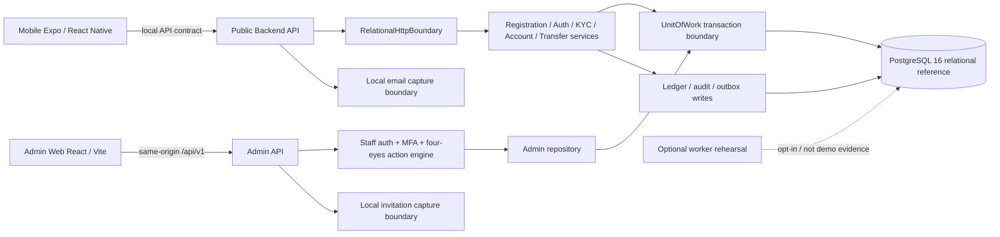

# Kiến trúc và phạm vi bàn giao — Đợt 3

## 1. Phạm vi diễn giải

Sơ đồ mô tả reference sandbox của đồ án, không mô tả hệ thống ngân hàng thật.
Luồng đã có evidence ở Đợt 2 gồm customer synthetic, KYC synthetic, Admin
maker–checker, sandbox funding, Mobile login/MFA, internal recipient lookup, quote,
TOTP step-up, transfer và receipt. PostgreSQL là nguồn dữ liệu relational của
reference runtime; số dư do server trả về, Mobile không tự optimistic-update.

## 2. Kiến trúc logic

Các boundary chính được đối chiếu với `backend/src/database/relationalHttpBoundary.ts`,
`backend/src/database/unitOfWork.ts`, `backend/src/database/registrationService.ts`,
`backend/src/database/kycService.ts`, `backend/src/database/transferService.ts`,
`backend/src/admin/http/adminHttp.ts` và `backend/src/admin/actions/actionEngine.ts`.
Compose local được mô tả trong [`compose.yaml`](../../compose.yaml); đây là cấu hình
preview local, không phải deployment production.

## 3. Ranh giới trách nhiệm

| Boundary | Trách nhiệm trong đồ án | Giới hạn |
| --- | --- | --- |
| Mobile | Nhập liệu, route guard, loading/error, MFA/step-up UI, hiển thị kết quả server | Không là nguồn sự thật số dư, không tạo device attestation production |
| Public API | Auth, registration, KYC customer, account read, recipient, quote/transfer | Reference API local; chưa chứng minh partner/core integration |
| Admin API/Web | Staff session/MFA, masked reads, KYC review, funding/approval, audit | Policy/service/Admin Web evidence; không tuyên bố negative UI E2E đầy đủ |
| UnitOfWork/repositories | Transaction, lock, persistence, ledger/audit/outbox invariants | Không thay thế core banking thật |
| PostgreSQL | Relational schema và constraints của sandbox | Local/demo/disposable only |
| Capture services | OTP/invitation synthetic local | Không gửi mail ra Internet |

## 4. Source anchors

- API contracts: [`documents/api/banking-mvp.openapi.yaml`](../api/banking-mvp.openapi.yaml)
  và [`documents/api/admin.openapi.yaml`](../api/admin.openapi.yaml).
- Relational boundary: `backend/src/database/relationalHttpBoundary.ts`.
- Transaction boundary: `backend/src/database/unitOfWork.ts`.
- Schema subset: migrations `001`, `006`, `008`, `011`, `019`, `020`, `038` dưới
  `backend/database/`.
- Runtime/setup: [`backend/README.md`](../../backend/README.md) và
  [`compose.yaml`](../../compose.yaml).
