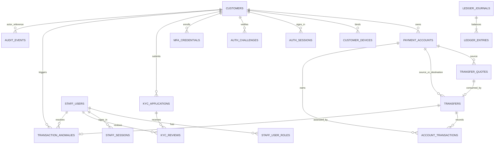

# ERD phần schema phục vụ demo cốt lõi

Đây là ERD rút gọn, không phải toàn bộ schema `001`–`051`. Quan hệ và tên bảng được
đối chiếu với các migration `001_banking_mvp.sql`, `006_relational_v2_foundation.sql`,
`008_transfer_relational_v2.sql`, `011_registration_recovery.sql`,
`014_mfa_credentials.sql`, `019_admin_control_plane.sql`,
`020_admin_case_operations.sql`, `033_control_policy_bootstrap.sql`,
`038_customer_kyc_runtime.sql` và các migration mở rộng `045`–`051`.

## Ghi chú đọc sơ đồ

- `customers`, `payment_accounts`, `transfers`, `account_transactions`,
  `ledger_journals` và `ledger_entries` là phần persistence dùng để giải thích
  funding/transfer (cả nội bộ `INTERNAL` và liên ngân hàng mô phỏng `NAPAS_IBFT` với `held_minor` ở migration `049`) và đối soát debit-credit. Migration `047` chuẩn hóa toàn bộ `ledger_entries.account_ref` của tài khoản thanh toán về định dạng chuẩn `payment-account:<uuid>` phục vụ đối soát Trial Balance.
- `customer_devices`, `mfa_credentials`, `auth_challenges`, `registration_completions`,
  `pending_registrations` hỗ trợ đăng ký 2 bước, TOTP/Biometric device-bound (`046`),
  đổi/đặt lại mật khẩu (`050`) và quản lý thiết bị (`device_name`, `last_seen_at`).
- `transaction_anomalies` (`045`) lưu kết quả đánh giá rủi ro bất thường (`MEDIUM`/`HIGH`/`CRITICAL`), điểm số, mã quy tắc, phản hồi khách hàng (`CONFIRMED_SAFE`/`REPORTED_SUSPICIOUS`) và trạng thái xử lý của nhân viên (`RESOLVED`).
- `control_policy` (`033`, `048`, `051`) là bản ghi singleton giữ Global Kill-Switch, hạn mức mỗi giao dịch, hạn mức lũy kế ngày (`daily_transfer_limit_minor`) và phí chuyển tiền động (`transfer_fee_minor`).
- `kyc_applications` có `customer_id`, trạng thái synthetic và payload metadata; không
  lưu bytes tài liệu hay KYC/PII thật.
- `staff_users`, `staff_user_roles`, `staff_sessions`, `kyc_reviews` và các bảng
  action/request là phần control plane Admin. Four-eyes là policy/service boundary.
- `ledger_journals.aggregate_id` và `outbox_events.aggregate_id` là liên kết nghiệp vụ
  dạng text, không trình bày như foreign key trong ERD rút gọn.
- Các bảng Savings/Credit/notification và bảng legacy không đưa vào sơ đồ này; xem đầy đủ danh mục 40 Use Cases tại [`use-cases-complete-specification.md`](use-cases-complete-specification.md).

## Nguồn đối chiếu

- PostgreSQL DDL: [`backend/database/001_banking_mvp.sql`](../../backend/database/001_banking_mvp.sql),
  [`backend/database/006_relational_v2_foundation.sql`](../../backend/database/006_relational_v2_foundation.sql),
  [`backend/database/008_transfer_relational_v2.sql`](../../backend/database/008_transfer_relational_v2.sql),
  [`backend/database/011_registration_recovery.sql`](../../backend/database/011_registration_recovery.sql),
  [`backend/database/014_mfa_credentials.sql`](../../backend/database/014_mfa_credentials.sql),
  [`backend/database/019_admin_control_plane.sql`](../../backend/database/019_admin_control_plane.sql),
  [`backend/database/020_admin_case_operations.sql`](../../backend/database/020_admin_case_operations.sql),
  [`backend/database/033_control_policy_bootstrap.sql`](../../backend/database/033_control_policy_bootstrap.sql),
  [`backend/database/038_customer_kyc_runtime.sql`](../../backend/database/038_customer_kyc_runtime.sql),
  [`backend/database/045_transaction_anomaly_detection.sql`](../../backend/database/045_transaction_anomaly_detection.sql),
  [`backend/database/046_biometric_authentication.sql`](../../backend/database/046_biometric_authentication.sql),
  [`backend/database/047_normalize_ledger_account_refs.sql`](../../backend/database/047_normalize_ledger_account_refs.sql),
  [`backend/database/048_daily_transfer_limit_policy.sql`](../../backend/database/048_daily_transfer_limit_policy.sql),
  [`backend/database/049_interbank_transfers_and_held_funds.sql`](../../backend/database/049_interbank_transfers_and_held_funds.sql),
  [`backend/database/050_password_reset_and_device_metadata.sql`](../../backend/database/050_password_reset_and_device_metadata.sql),
  [`backend/database/051_dynamic_transfer_fee_policy.sql`](../../backend/database/051_dynamic_transfer_fee_policy.sql).
- API: [`documents/api/banking-mvp.openapi.yaml`](../api/banking-mvp.openapi.yaml), [`documents/api/admin.openapi.yaml`](../api/admin.openapi.yaml).
