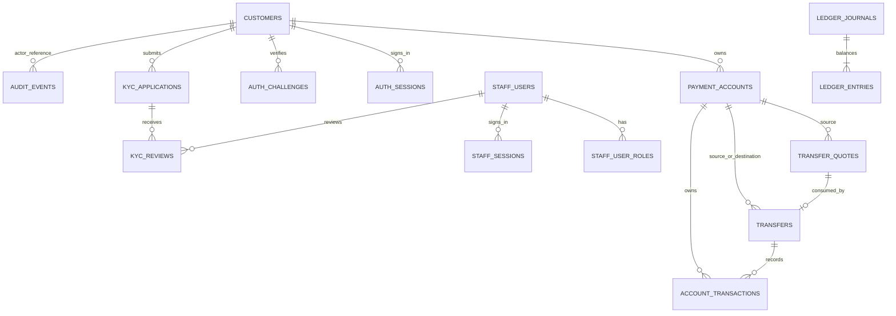

# ERD phần schema phục vụ demo cốt lõi

Đây là ERD rút gọn, không phải toàn bộ schema 001–040. Quan hệ và tên bảng được
đối chiếu với các migration `001_banking_mvp.sql`, `006_relational_v2_foundation.sql`,
`008_transfer_relational_v2.sql`, `011_registration_recovery.sql`,
`019_admin_control_plane.sql`, `020_admin_case_operations.sql` và
`038_customer_kyc_runtime.sql`.

## Ghi chú đọc sơ đồ

- `customers`, `payment_accounts`, `transfers`, `account_transactions`,
  `ledger_journals` và `ledger_entries` là phần persistence dùng để giải thích
  funding/transfer và đối soát debit-credit.
- `registration_completions`, `auth_challenges`, `pending_registrations` hỗ trợ
  registration hai bước và không lưu OTP plaintext trong outbox intent.
- `kyc_applications` có `customer_id`, trạng thái synthetic và payload metadata; không
  lưu bytes tài liệu hay KYC/PII thật.
- `staff_users`, `staff_user_roles`, `staff_sessions`, `kyc_reviews` và các bảng
  action/request là phần control plane Admin. Four-eyes là policy/service boundary.
- `ledger_journals.aggregate_id` và `outbox_events.aggregate_id` là liên kết nghiệp vụ
  dạng text, không trình bày như foreign key trong ERD rút gọn.
- Các bảng Savings/Credit/Fraud/notification không đưa vào sơ đồ này trừ khi cần cho
  một phụ lục khác; danh mục use case 22 mục không đồng nghĩa tất cả đã nghiệm thu.

## Nguồn đối chiếu

- PostgreSQL DDL: [`backend/database/001_banking_mvp.sql`](../../backend/database/001_banking_mvp.sql),
  [`backend/database/006_relational_v2_foundation.sql`](../../backend/database/006_relational_v2_foundation.sql),
  [`backend/database/008_transfer_relational_v2.sql`](../../backend/database/008_transfer_relational_v2.sql),
  [`backend/database/011_registration_recovery.sql`](../../backend/database/011_registration_recovery.sql),
  [`backend/database/019_admin_control_plane.sql`](../../backend/database/019_admin_control_plane.sql),
  [`backend/database/020_admin_case_operations.sql`](../../backend/database/020_admin_case_operations.sql),
  [`backend/database/038_customer_kyc_runtime.sql`](../../backend/database/038_customer_kyc_runtime.sql).
- API: [`documents/api/banking-mvp.openapi.yaml`](../api/banking-mvp.openapi.yaml).
