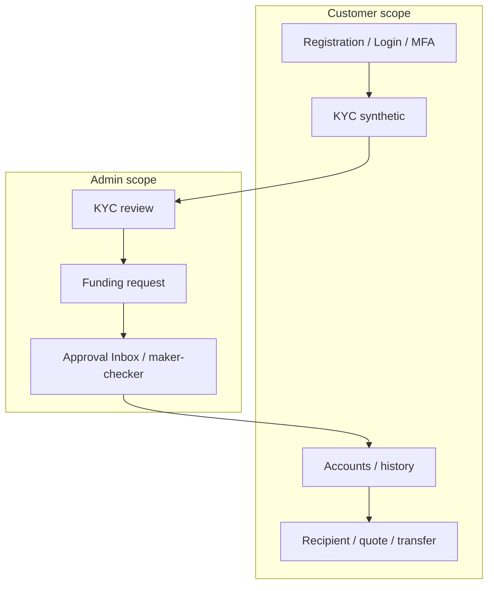

# Bản đồ chức năng bàn giao — Đợt 3

## 1. Trong phạm vi đã nghiệm thu

| Nhóm | Chức năng | Tầng bằng chứng |
| --- | --- | --- |
| Customer | Registration hai bước, login/MFA, session | Mobile/API/reference relational; chi tiết theo hồ sơ Đợt 1–2 |
| Customer | KYC synthetic submit và trạng thái | Mobile/Admin/API/PostgreSQL local theo evidence Đợt 2 |
| Admin | Maker request, checker độc lập, self-approval bị từ chối | Policy/service và Admin Web; self-reject không phải negative UI E2E riêng |
| Admin | Sandbox funding | Admin Web/API/PostgreSQL local, tiền ảo |
| Transfer | Recipient lookup, quote/phí, TOTP step-up, idempotent submit, receipt | Mobile/API/PostgreSQL local |
| Accounting | Account transactions và double-entry ledger đối soát | PostgreSQL read-only trong hồ sơ Đợt 2 |
| UX | Loading, empty, error/retry và route guard ở các màn liên quan | Mobile source/emulator evidence tùy flow |

## 2. Ngoài phạm vi nghiệm thu Đợt 3

- Core banking, payment rail, ngân hàng liên thông, tiền thật.
- KYC/AML thật, lưu ảnh giấy tờ thật hoặc provider identity thật.
- Staging/production deployment, HTTPS public, secret manager và monitoring vận hành.
- Chứng minh thiết bị thật, accessibility TalkBack đầy đủ, signed APK phát hành hoặc
  remote CI pass nếu chưa có evidence tương ứng.
- Tự động đóng toàn bộ 22 mục danh mục hoặc các UC-M04+ chỉ vì có implementation.
- Redesign toàn app, thêm module mới, hardening infrastructure ngoài rubric.

## 3. Bản đồ tổng quan

## 4. Cách đọc trạng thái

`COMPLETED — OWNER APPROVED` chỉ áp dụng cho Đợt 2 trong phạm vi ghi tại
[`tasks/DEMO/TASK_DOT_2_CORE_BANKING_DEMO.md`](../../tasks/DEMO/TASK_DOT_2_CORE_BANKING_DEMO.md).
Hồ sơ này là deliverable nháp của Đợt 3, không phải quyết định đóng các UC khác.
