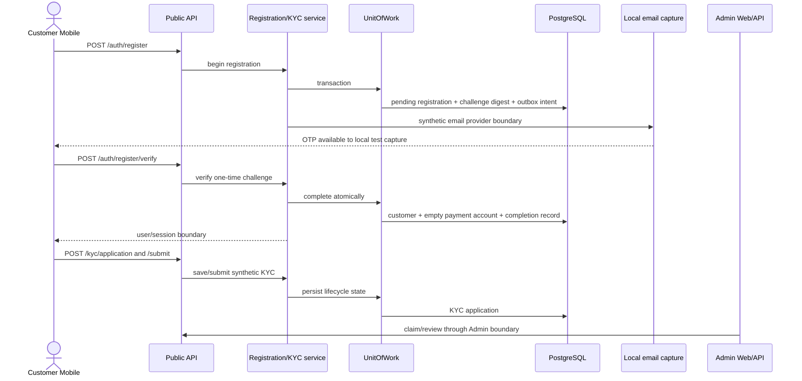
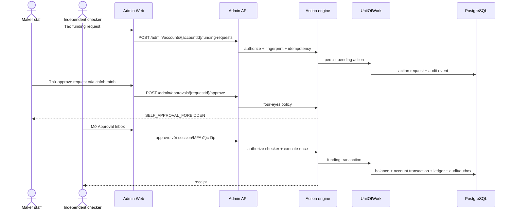
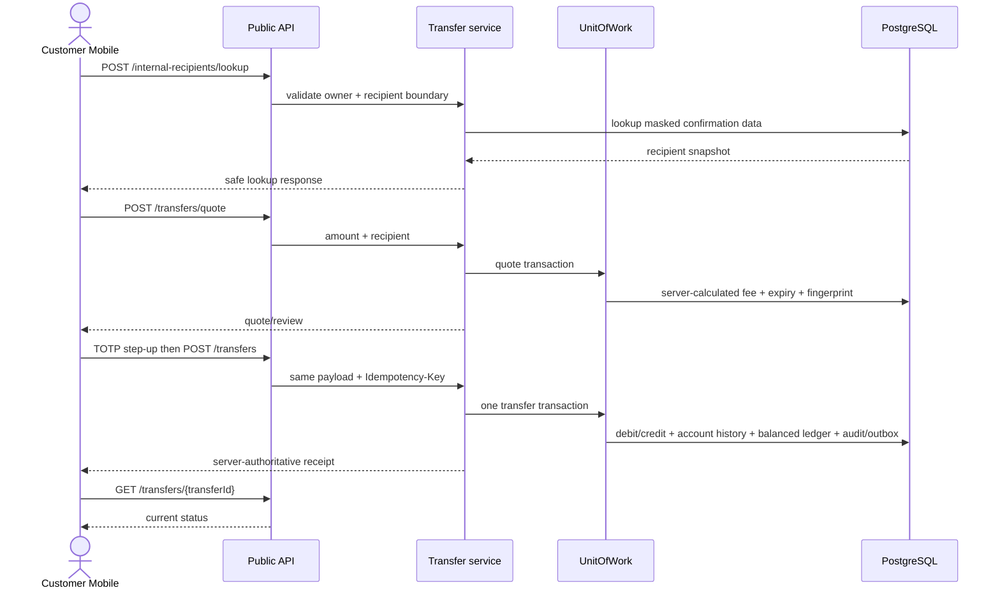

# Sequence các luồng chính — Đợt 2 và phạm vi bàn giao

Các sequence dưới đây là mô hình giải thích dựa trên source/API và evidence Đợt 2.
Chúng không tuyên bố tích hợp ngân hàng thật, provider thanh toán thật hoặc KYC thật.

## 1. Registration và KYC synthetic

## 2. Maker–checker và sandbox funding

## 3. Transfer nội bộ có quote và step-up

## 4. Evidence boundary

Đợt 2 chứng minh happy path Mobile/Admin Web và các negative controls ở các tầng khác
nhau: service/PostgreSQL disposable cho idempotency, HTTP/PostgreSQL invariant cho
cross-account, policy/service cho self-approval. Không gộp các tầng này thành một E2E
claim duy nhất.
