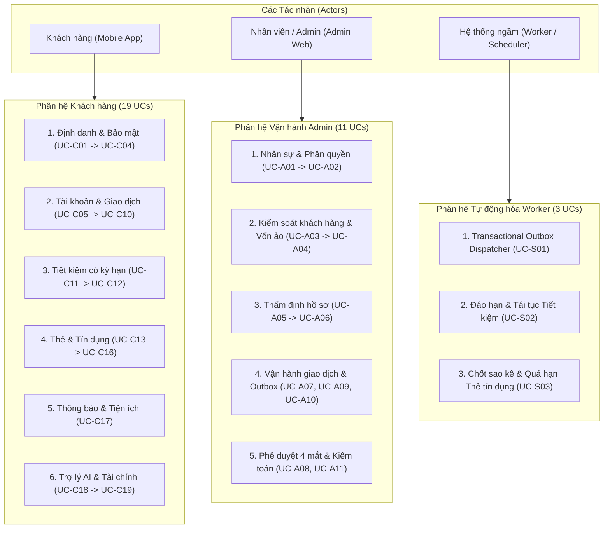

# Đặc tả chi tiết toàn bộ Use Case hệ thống — Banking System (NOVA)

> **Tài liệu đặc tả nghiệp vụ & ca sử dụng toàn diện**
> 
> Ngày lập: 14/10/2026.  
> Căn cứ đối chiếu: Mã nguồn thực tế tại `mobile-app/`, `backend/`, `admin-web/`, hợp đồng API OpenAPI (`documents/api/`) và 43 migrations PostgreSQL (`backend/database/`).  
> Tài liệu này phản ánh **100% các chức năng thực tế có implementation trong mã nguồn**, phân định rõ ràng giữa 3 tác nhân: **Khách hàng (Customer Mobile)**, **Nhân viên / Quản trị viên (Bank Staff / Admin)** và **Hệ thống ngầm (System / Background Worker)**.

---

## 1. TỔNG QUAN HỆ THỐNG USE CASE

Toàn bộ hệ thống gồm **33 Use Cases** hoàn chỉnh được chia thành 3 phân hệ theo tác nhân:



---

## 2. PHÂN HỆ KHÁCH HÀNG — CUSTOMER MOBILE (19 USE CASES)

### Nhóm 1: Định danh, Xác thực & Bảo mật (Onboarding & Security)

#### UC-C01: Đăng ký tài khoản khách hàng mới (Registration with Email OTP)
- **Tác nhân:** Khách hàng chưa có tài khoản.
- **Tiền điều kiện:** Chưa đăng nhập, có email và số điện thoại hợp lệ.
- **Luồng sự kiện chính:**
  1. Khách hàng nhập họ tên, email, số điện thoại, mật khẩu tại `RegisterScreen`.
  2. Client sinh `idempotencyKey` và lưu trạng thái `BEGIN_UNKNOWN` vào storage tạm.
  3. Gửi `POST /api/v1/auth/register` kèm header thiết bị `X-Device-ID`.
  4. Server validate định dạng, kiểm tra trùng lặp email/SĐT, kiểm tra rate limit theo fingerprint thiết bị.
  5. Server phát sinh `challengeId` loại `REGISTRATION_VERIFY`, gửi mã OTP 6 số qua email (SMTP Gmail hoặc mock).
  6. Khách hàng nhận OTP và nhập mã xác thực tại app; Client gửi `POST /api/v1/auth/register/verify`.
  7. Server kiểm tra OTP: nếu đúng, khởi tạo bản ghi `customers`, `customer_devices`, `accounts` (tài khoản thanh toán mặc định số dư 0 VND).
- **Luồng ngoại lệ / Huỷ bỏ:**
  - Khách hàng có thể chọn huỷ luồng đăng ký qua `POST /api/v1/auth/register/cancel`.
  - Khách hàng yêu cầu gửi lại OTP qua `POST /api/v1/auth/challenges/{challengeId}/resend` (áp dụng cooldown).
- **Mã nguồn liên quan:**
  - Mobile: `mobile-app/src/features/auth/screens/RegisterScreen.tsx`
  - Backend: `backend/src/database/registrationService.ts`, `backend/src/mfa/persistentMfaService.ts`
  - Schema / Tables: `pending_registrations`, `customers`, `accounts`, `auth_challenges`.

#### UC-C02: Đăng nhập mật khẩu & Quản lý phiên (Authentication & Session Lifecycle)
- **Tác nhân:** Khách hàng đã có tài khoản.
- **Tiền điều kiện:** Tài khoản ở trạng thái `ACTIVE`.
- **Luồng sự kiện chính:**
  1. Nhập email và mật khẩu tại `LoginScreen`.
  2. Gửi `POST /api/v1/auth/login` kèm header `X-Device-ID`.
  3. Server xác minh mật khẩu qua mã băm Scrypt/Argon2 + salt/pepper.
  4. Server phát hành cặp mã: `accessToken` (15 phút) và `refreshToken` (7 ngày), gắn với gia đình phiên `refresh_session_families`.
  5. Client lưu session vào SecureStore native có mã hóa; chuyển sang trạng thái `AUTHENTICATED`.
  6. **Cơ chế Refresh Token tự động:** Khi gọi API nhận lỗi `401 Unauthorized`, `httpClient` tự động kích hoạt tiến trình làm mới đơn tuyến (`single-flight queue`) gọi `POST /api/v1/auth/refresh`, đổi token mới và thực hiện lại request bị chặn.
  7. **Cơ chế bảo vệ khi vào Background:** App tự động khóa màn hình và yêu cầu xác thực lại (PIN/Biometric local) khi quay lại Foreground.
  8. **Đăng xuất:** Khách hàng có thể chọn Đăng xuất phiên hiện tại (`POST /api/v1/auth/logout`) hoặc Đăng xuất tất cả thiết bị (`POST /api/v1/auth/logout-all` - thu hồi toàn bộ session family).
- **Mã nguồn liên quan:**
  - Mobile: `mobile-app/src/features/auth/context/AuthContext.tsx`, `mobile-app/src/services/api/httpClient.ts`
  - Backend: `backend/src/database/relationalAuthService.ts`
  - Tables: `refresh_session_families`, `refresh_session_records`.

#### UC-C03: Quản lý xác thực 2 bước MFA TOTP & Khôi phục (MFA TOTP & Recovery)
- **Tác nhân:** Khách hàng đã đăng nhập.
- **Luồng sự kiện chính:**
  1. **Đăng ký TOTP:** Khách hàng gọi `POST /api/v1/auth/mfa/totp/enroll`. Server sinh secret TOTP, mã hoá lưu trữ và trả về `otpauth://` URI cùng khóa cài đặt thủ công.
  2. Khách hàng quét mã vào Google Authenticator/Authy và gửi mã xác nhận 6 số qua `POST /api/v1/auth/mfa/totp/confirm`.
  3. Server kích hoạt TOTP và phát hành 8 mã khôi phục dùng 1 lần (`recoveryCodes`).
  4. **Xoay vòng mã khôi phục:** Khách hàng có thể yêu cầu tạo bộ mã khôi phục mới qua `POST /api/v1/auth/mfa/recovery-codes/rotate` (bắt buộc nhập mã TOTP hiện tại).
  5. **Gỡ bỏ TOTP:** Khách hàng gọi `DELETE /api/v1/auth/mfa/methods/{id}` (yêu cầu mật khẩu tài khoản hiện tại).
  6. **Quy trình Khôi phục MFA (Mất thiết bị OTP):**
     - Tại màn hình đăng nhập, chọn khôi phục MFA -> nhập mã khôi phục dự phòng (`POST /api/v1/auth/mfa/recover`).
     - Server kiểm tra hash mã khôi phục, khởi tạo `recoveryRequestId` kèm thời gian chờ an toàn (`cooldownUntil`).
     - Xác thực hoàn tất qua `POST /api/v1/auth/mfa/recover/complete` và cho phép cấp phát TOTP mới trên thiết bị mới.
- **Mã nguồn liên quan:**
  - Mobile: `mobile-app/src/app/mfa.tsx`, `mobile-app/src/features/auth/screens/MfaRecoveryScreen.tsx`
  - Backend: `backend/src/mfa/persistentMfaService.ts`
  - Tables: `mfa_credentials`, `mfa_recovery_codes`, `mfa_recovery_requests`.

#### UC-C04: Khai báo & Theo dõi hồ sơ định danh (Customer KYC Profile)
- **Tác nhân:** Khách hàng đã đăng nhập.
- **Luồng sự kiện chính:**
  1. Khách hàng vào màn hình `KycScreen`.
  2. Ứng dụng tải trạng thái hồ sơ hiện tại qua `GET /api/v1/kyc/application`.
  3. Khách hàng nhập họ tên, số CCCD/CMND, địa chỉ cư trú.
  4. Khách hàng có thể:
     - Lưu bản nháp: `POST /api/v1/kyc/application` (trạng thái `DRAFT`).
     - Gửi phê duyệt: `POST /api/v1/kyc/application/submit` (trạng thái chuyển thành `PENDING_REVIEW`).
  5. Bảo mật dữ liệu: Số CCCD gốc chỉ được xử lý tạm thời; server lưu trữ và chỉ trả về 4 số cuối (`identityNumberLast4`) để hiển thị trên ứng dụng.
  6. Khách hàng theo dõi trạng thái phản hồi: `APPROVED` (Đã duyệt), `REJECTED` (Từ chối kèm lý do) hoặc `NEEDS_MORE_INFO` (Yêu cầu bổ sung tài liệu).
- **Mã nguồn liên quan:**
  - Mobile: `mobile-app/src/features/kyc/screens/KycScreen.tsx`
  - Backend: `backend/src/database/kycService.ts`
  - Tables: `kyc_applications`, `kyc_application_documents`, `kyc_reviews`.

---

### Nhóm 2: Quản lý Tài khoản & Giao dịch Thanh toán (Accounts & Transfers)

#### UC-C05: Xem thông tin tài khoản thanh toán & Số dư (Authoritative Balance)
- **Tác nhân:** Khách hàng đã đăng nhập.
- **Luồng sự kiện chính:**
  1. Khách hàng mở trang chủ `HomeScreen` hoặc chi tiết tài khoản `AccountDetailScreen`.
  2. Ứng dụng gọi `GET /api/v1/accounts`.
  3. Server truy vấn dữ liệu từ bảng `accounts` và trả về số dư có thẩm quyền (*server-authoritative*):
     - `availableBalance`: Số dư khả dụng có thể chi tiêu.
     - `currentBalance`: Số dư thực tế trong tài khoản.
     - `heldAmount`: Số tiền đang bị phong tỏa / giữ chỗ.
  4. Số tài khoản mặc định được hiển thị dạng che (`maskedNumber`).
  5. Khi khách hàng bấm "Xem/Sao chép số tài khoản", ứng dụng gọi `GET /api/v1/accounts/{id}/number` để mở che số tài khoản sau khi kiểm tra quyền sở hữu.
- **Nguyên tắc bất biến:** Client tuyệt đối không tự ý cộng/trừ số dư giả lập (không optimistic-update balance).
- **Mã nguồn liên quan:**
  - Mobile: `mobile-app/src/features/home/screens/HomeScreen.tsx`, `AccountDetailScreen.tsx`
  - Backend: `backend/src/database/relationalAccountReadService.ts`
  - Tables: `accounts`.

#### UC-C06: Tra cứu lịch sử & Chi tiết giao dịch (Transaction History)
- **Tác nhân:** Khách hàng đã đăng nhập.
- **Luồng sự kiện chính:**
  1. Mở màn hình `HistoryScreen` hoặc lịch sử tài khoản.
  2. Gọi `GET /api/v1/accounts/{id}/transactions?cursor=...&limit=...`.
  3. Phân trang bằng Keyset Cursor (`cursor-based pagination`) giúp đảm bảo danh sách không bị lặp hoặc sót bản ghi khi có giao dịch mới chèn vào giữa.
  4. Hiển thị danh sách giao dịch với ký hiệu chiều tiền rõ ràng:
     - Dấu `+` (Ghi có / Nhận tiền).
     - Dấu `-` (Ghi nợ / Chuyển tiền, thanh toán).
  5. Bấm vào từng giao dịch để xem chi tiết biên lai tại `TransactionDetailScreen`: mã tham chiếu `reference`, phân loại (`TRANSFER`, `SAVINGS_DEPOSIT`, `CREDIT_REPAYMENT`), thời gian ghi nhận và tài khoản đối ứng.
- **Mã nguồn liên quan:**
  - Mobile: `mobile-app/src/features/history/screens/HistoryScreen.tsx`, `TransactionDetailScreen.tsx`
  - Backend: `backend/src/database/relationalAccountReadService.ts`
  - Tables: `transactions`.

#### UC-C07: Quản lý danh bạ người thụ hưởng (Beneficiary Management)
- **Tác nhân:** Khách hàng đã đăng nhập.
- **Luồng sự kiện chính:**
  1. Khách hàng xem danh bạ người nhận đã lưu: `GET /api/v1/beneficiaries`.
  2. **Thêm mới:** Nhập số tài khoản, tên chủ tài khoản gợi nhớ, tên ngân hàng -> `POST /api/v1/beneficiaries`.
  3. **Đổi tên gợi nhớ:** Nhập tên mới -> `PATCH /api/v1/beneficiaries/{id}`.
  4. **Xóa:** Chọn người thụ hưởng cần xóa -> `DELETE /api/v1/beneficiaries/{id}`.
- **Mã nguồn liên quan:**
  - Mobile: `mobile-app/src/app/beneficiaries.tsx`, `mobile-app/src/features/transfers/screens/BeneficiariesScreen.tsx`
  - Backend: `backend/src/database/relationalBeneficiaryService.ts`
  - Tables: `beneficiaries`.

#### UC-C08: Tra cứu người nhận nội bộ trước khi chuyển tiền (Internal Recipient Lookup)
- **Tác nhân:** Khách hàng thực hiện chuyển tiền.
- **Luồng sự kiện chính:**
  1. Khách hàng nhập số tài khoản đích trên form chuyển tiền (được validate định dạng 6–34 chữ số).
  2. Ứng dụng gửi `POST /internal-recipients/lookup` kèm số tài khoản.
  3. Server áp dụng Rate Limiting (tối đa 15 lượt/phút/user) nhằm ngăn chặn tấn công vét cạn danh bạ khách hàng.
  4. Server tìm kiếm tài khoản nội bộ, kiểm tra trạng thái hoạt động (`ACTIVE`) và sinh mã định danh tra cứu `lookupId`.
  5. Bản ghi tra cứu được lưu vào bảng `recipient_lookups` dưới dạng mã băm SHA-256 (`token_hash`) với thời gian sống ngắn (TTL = 5 phút). Server tự động dọn dẹp các bản ghi quá hạn và thu hồi ngay khi lệnh chuyển tiền thành công.
  6. Khách hàng bắt buộc phải dùng `lookupId` hợp lệ còn hạn để tạo báo giá chuyển tiền (Quote), ngăn chặn kẻ xấu sửa đổi tài khoản đích giữa chừng.
- **Mã nguồn liên quan:**
  - Mobile: `mobile-app/src/features/transfers/services/transfersApi.ts`, `mobile-app/src/features/transfers/screens/TransferScreen.tsx`
  - Backend: `backend/src/database/remainingService.ts`, `backend/src/recipientLookupRateLimiter.ts`, `backend/src/http.ts`
  - Tables: `recipient_lookups`.

#### UC-C09: Chuyển tiền nội bộ trong hệ thống NOVA (Internal Funds Transfer)
- **Tác nhân:** Khách hàng gửi tiền (đã đăng nhập và kích hoạt MFA).
- **Tiền điều kiện:** 
  - Tài khoản thanh toán nguồn (`payment_accounts`) ở trạng thái `ACTIVE` và có đủ số dư khả dụng (`availableMinor >= totalDebit = amountMinor + feeMinor`).
  - Tài khoản người nhận ở trạng thái `ACTIVE` và khác tài khoản nguồn.
  - Tuân thủ chính sách kiểm soát rủi ro `control_policy` (chuyển tiền được bật, không kích hoạt kill switch, người dùng trong allowlist, số tiền không vượt `maxTransferAmountMinor` - mặc định 5,000,000 VND).
- **Kiến trúc thực thi (Dual-Engine Execution):**
  - **Relational PostgreSQL Engine ([`RelationalTransferService`](file:///c:/Projects/banking-system/backend/src/database/transferService.ts)):** Engine chuẩn vận hành qua cờ cutover `RelationalHttpBoundary`, thực thi giao dịch nguyên tử trong 1 Database Transaction duy nhất qua `UnitOfWork`.
  - **In-Memory Sandbox Engine ([`InMemoryCoreBanking`](file:///c:/Projects/banking-system/backend/src/services/coreBanking.ts)):** Engine mô phỏng sandbox local, hỗ trợ cơ chế 2-pha với trạng thái `PENDING` (tiền bị phong tỏa tạm thời vào `heldMinor` trước khi settle thành `SUCCEEDED`).
- **Luồng sự kiện chính (Theo Relational Core):**
  1. **Bước 1: Lấy báo giá chuyển tiền (Quote):**
     - Client gửi yêu cầu `POST /api/v1/transfers/quote` kèm `sourceAccountId`, `amount` (`{ currency: "VND", amountMinor: string }`), và đúng một trong hai: `beneficiaryId` (người nhận đã lưu trong danh bạ) hoặc `lookupId` (mã định danh tra cứu nhanh UC-C08).
     - Server kiểm tra chính sách lần 1 (`ControlPolicyRepository.assertTransferAllowed`), tính toán phí cố định (`feeMinor = 1_000n` / 1,000 VND), tạo `transfer_quotes` với thời hạn 5 phút (`expiresAt = now + 5 phút`).
     - Lưu trữ snapshot bất biến của người thụ hưởng (`destination_owner_name`, `destination_account_id`, `destination_owner_id`), tính toán chuỗi hash `requestFingerprint` và ghi nhật ký `audit_events` (`TRANSFER_QUOTED`).
     - Trả về `TransferQuote` gồm: `quoteId`, `fee`, `totalDebit = amount + fee`, `expiresAt`.
  2. **Bước 2: Chuẩn bị Intent & Xác thực tăng cường (Step-Up Challenge):**
     - Client sinh mã duy nhất `Idempotency-Key` (chuỗi ngẫu nhiên tối thiểu 16 ký tự).
     - Client lưu trạng thái ban đầu `DRAFT_QUOTE` vào `SecureStore` (phân vùng theo tài khoản: `banking.transfer.intent.v2:<userId>`).
     - Client gọi `POST /api/v1/auth/challenges` để tạo challenge xác thực giao dịch (`purpose: "TRANSFER"`, `resourceId: quoteId`).
     - Khách hàng thực hiện xác thực bước 2 (MFA TOTP). Backend kiểm tra ràng buộc nghiêm ngặt qua `mfaService.verifyChallenge`: đối chiếu `deviceId` (header `x-device-id`), `purpose`, `resourceId` và **bắt buộc `requestFingerprint` phải khớp chính xác với fingerprint của quote đã lưu trên DB** nhằm chống giả mạo hay tráo đổi nội dung giao dịch sau khi xin mã.
  3. **Bước 3: Thực thi lệnh chuyển tiền & Cơ chế chống Crash (Intent Safety Lifecycle):**
     - **Quy tắc an toàn Client:** Client chuyển trạng thái Intent sang `SUBMIT_UNKNOWN` và lưu bền vững vào `SecureStore` **trước khi** gửi request HTTP `POST /api/v1/transfers` (kèm `quoteId`, `stepUp` proof và header `Idempotency-Key`).
     - Nếu ứng dụng gặp sự cố mạng, sập nguồn hoặc crash giữa chừng: khi mở lại ứng dụng, hàm `restoreTransferIntent` phát hiện `SUBMIT_UNKNOWN`, lập tức kích hoạt cờ **`recoveryBlocked = true`** khóa màn hình giao diện không cho tạo lệnh mới (ngăn ngừa tuyệt đối rủi ro double-spend), đồng thời hiển thị hộp thoại cứu hộ để tự động truy vấn đối soát `GET /api/v1/transfers/{id}` hoặc chuyển sang quy trình Manual Review nếu có mã lỗi nghi vấn.
  4. **Bước 4: Xử lý giao dịch nguyên tử & Ghi sổ cái kép trên Server ([`RelationalTransferService.submit`](file:///c:/Projects/banking-system/backend/src/database/transferService.ts)):**
     - Toàn bộ bước này thực hiện trong 1 Database Transaction duy nhất (`UnitOfWork`):
       + **Bảo vệ Idempotency 2 lớp:**
         * Lớp 1 (`command_idempotency`): Thực hiện `reserveCommandIdempotency`. Nếu key đã tồn tại với fingerprint khác -> ném lỗi `IdempotencyConflictError` (HTTP 409); nếu đã thành công -> trả về ngay bản ghi biên lai cũ (*idempotent replay*).
         * Lớp 2 (`transfer_quotes`): Khóa dòng quote (`findQuoteForUpdate`). Nếu quote đã có `consumed_transfer_id` -> trả về canonical transfer cũ, ngăn chặn một quote bị tiêu thụ hai lần.
       + **Kiểm tra chính sách lần 2 (Anti-TOCTOU):** Tái kiểm tra `assertTransferAllowed` ngay sau khi khóa quote để ngăn chặn việc chính sách hệ thống (hạn mức/kill switch) bị thay đổi giữa lúc lấy quote và submit.
       + **Khóa tài khoản chống Deadlock:** Khóa đồng thời cả 2 tài khoản bằng `lockManyByIds([source.id, destination.id])` (`SELECT ... FOR UPDATE`), trong đó các ID tài khoản được **sắp xếp theo thứ tự UUID tăng dần** để loại trừ nguy cơ deadlock giữa 2 giao dịch song song đối ứng.
       + **Cập nhật số dư có kiểm soát phiên bản (OCC):**
         * Tài khoản nguồn: `availableMinor -= totalDebit`, `currentMinor -= totalDebit`.
         * Tài khoản đích: `availableMinor += amountMinor`, `currentMinor += amountMinor`.
         * Cả hai tài khoản được tăng trường `version` để bảo vệ tính nhất quán dữ liệu.
       + **Tạo giao dịch lịch sử tài khoản:** Thêm 2 bản ghi vào `account_transactions` (1 giao dịch `DEBIT` cho người gửi, 1 giao dịch `CREDIT` cho người nhận kèm tên đối tác đối ứng).
       + **Ghi sổ cái kép (Double-Entry General Ledger):**
         * Tạo 1 bút toán `ledger_journals` (loại `TRANSFER`, `aggregate_id = transfer.id`, `currency = 'VND'`).
         * Ghi các bút toán `ledger_entries`:
           - Dòng 1: Ghi Nợ (`DEBIT`) tài khoản nguồn với số tiền `totalDebit` (`amount + fee`).
           - Dòng 2: Ghi Có (`CREDIT`) tài khoản đích với số tiền `amount`.
           - Dòng 3 (nếu `fee > 0`): Ghi Có (`CREDIT`) tài khoản doanh thu phí `fee-income:VND` với số tiền `fee`.
           - Cân bằng tài chính: $\sum \text{DEBIT} = \sum \text{CREDIT}$.
         * Ràng buộc toàn vẹn Database: Hai constraint trigger `assert_ledger_journal_has_entries` và `assert_ledger_journal_balanced` được cấu hình **`DEFERRABLE INITIALLY DEFERRED`**, tự động kiểm tra trước khi commit; nếu sổ cái không cân, toàn bộ transaction bị PostgreSQL hủy bỏ.
       + **Ghi nhận kiểm toán, thông báo & Outbox:**
         * Ghi 1 bản ghi `audit_events` (`TRANSFER_SUBMITTED`, kèm `traceId`).
         * Tạo 2 thông báo in-app trong bảng `notifications` cho cả người gửi và người nhận.
         * Ghi sự kiện `outbox_events` (`TRANSFER_SUCCEEDED`, priority 10) để worker phát tán.
       + **Đánh dấu tiêu thụ quote & Hoàn tất Idempotency:** Cập nhật `consumed_transfer_id = transfer.id` trên quote và chuyển `command_idempotency` sang trạng thái hoàn tất.
     - Commit Transaction -> Trả về biên lai `TransferReceipt` mã HTTP `200`.
  5. **Bước 5: Hoàn tất & Dọn dẹp Intent:**
     - Client nhận biên lai thành công (`TransferReceipt`), hiển thị màn hình kết quả giao dịch và xóa intent khỏi `SecureStore`.
- **Mã nguồn liên quan:**
  - Mobile UI & Flow: [`mobile-app/src/features/transfers/screens/TransferScreen.tsx`](file:///c:/Projects/banking-system/mobile-app/src/features/transfers/screens/TransferScreen.tsx), [`mobile-app/src/features/transfers/storage/transferIntentStorage.ts`](file:///c:/Projects/banking-system/mobile-app/src/features/transfers/storage/transferIntentStorage.ts)
  - Backend Services & Router: [`backend/src/database/transferService.ts`](file:///c:/Projects/banking-system/backend/src/database/transferService.ts), [`backend/src/domain/ledger.ts`](file:///c:/Projects/banking-system/backend/src/domain/ledger.ts), [`backend/src/routes/transferRoutes.ts`](file:///c:/Projects/banking-system/backend/src/routes/transferRoutes.ts), [`backend/src/controllers/transferController.ts`](file:///c:/Projects/banking-system/backend/src/controllers/transferController.ts)
  - Database Schema & Migrations: [`backend/database/001_banking_mvp.sql`](file:///c:/Projects/banking-system/backend/database/001_banking_mvp.sql), [`backend/database/008_transfer_relational_v2.sql`](file:///c:/Projects/banking-system/backend/database/008_transfer_relational_v2.sql)
  - Tables: `payment_accounts`, `transfers`, `transfer_quotes`, `account_transactions`, `ledger_journals`, `ledger_entries`, `command_idempotency`, `audit_events`, `notifications`, `outbox_events`.
- **Các bài toán kỹ thuật cốt lõi & Cơ chế giải quyết trong kiến trúc:**
  1. *Bài toán Tính nguyên tử tài chính (Financial Atomicity):* Sử dụng mẫu `UnitOfWork` gom toàn bộ các tác vụ (trừ số dư nguồn, cộng số dư đích, tạo 2 giao dịch sao kê, ghi 3 bút toán sổ cái, tạo thông báo in-app và sự kiện outbox) vào đúng một Transaction CSDL duy nhất. Bất kỳ lỗi logic hay đứt gãy kết nối nào đều kích hoạt rollback 100%, bảo vệ tuyệt đối tính nhất quán dòng tiền.
  2. *Bài toán Kế toán sổ cái kép (Double-Entry General Ledger):* Mọi giao dịch biến động số dư đều sinh bút toán kép đối ứng (Nợ tài khoản nguồn `amount + fee`, Có tài khoản đích `amount`, Có tài khoản phí `fee`). Toàn vẹn kế toán $\sum \text{DEBIT} = \sum \text{CREDIT}$ được ràng buộc trực tiếp bằng Constraint Trigger PostgreSQL `assert_ledger_journal_balanced` (`DEFERRABLE INITIALLY DEFERRED`); CSDL tự động từ chối commit nếu xảy ra sai lệch số học dù chỉ 1 đồng.
  3. *Bài toán Chống chi tiêu trùng lặp & Replay Request (Two-Layer Idempotency):*
     - Lớp 1 (`command_idempotency`): Khóa theo `idempotencyKey` và `requestFingerprint`. Trùng payload thì replay biên lai cũ; khác payload thì trả lỗi `409 IdempotencyConflictError`.
     - Lớp 2 (`transfer_quotes`): Khóa báo giá qua `consumed_transfer_id`. Một báo giá chỉ được tiêu thụ duy nhất 1 lần, ngăn chặn việc tái sử dụng báo giá cũ.
  4. *Bài toán Chống Deadlock khi giao dịch đồng thời (Anti-Deadlock Lock Ordering):* Hàm `lockManyByIds` luôn sắp xếp danh sách UUID tài khoản theo thứ tự tăng dần trước khi thực hiện `SELECT ... FOR UPDATE`. Nhờ vậy, khi 2 khách hàng chuyển tiền đối ứng cho nhau trong cùng 1 tích tắc, cả 2 luồng đều xếp hàng khóa theo cùng một trật tự, loại trừ hoàn toàn nguy cơ Deadlock cycle.
  5. *Bài toán Mất kết nối & Crash ứng dụng trên Mobile (Resilient Client Intent Lifecycle):* Mobile app chuyển trạng thái Intent sang `SUBMIT_UNKNOWN` và lưu bền vững vào `SecureStore` trước khi phát request mạng. Khi khởi động lại sau sự cố, hàm `restoreTransferIntent` phát hiện `SUBMIT_UNKNOWN`, lập tức bật cờ `recoveryBlocked = true` đóng băng màn hình chuyển tiền (chống double-spend), đồng thời tự động gọi API đối soát với server để đồng bộ biên lai chính xác.
  6. *Bài toán Chống tráo đổi dữ liệu & Chống TOCTOU (Context-Bound Fingerprint & Two-Phase Policy Check):* Toàn bộ nội dung Quote được băm thành `requestFingerprint` và bắt buộc đối chiếu khi xác thực mã TOTP. Server áp dụng cơ chế kiểm tra chính sách rủi ro 2 lần: một lần lúc lấy Quote và một lần nữa ngay trong transaction khi Submit, chặn đứng nguy cơ thay đổi hạn mức hoặc kích hoạt Kill Switch giữa chừng.
- **Đánh giá chuẩn học thuật & Hướng dẫn bảo vệ đồ án:**
  - *Mức độ hoàn thiện đồ án:* Vượt xa yêu cầu đồ án sinh viên thông thường (thường chỉ làm CRUD số dư đơn giản). Chức năng này đạt chuẩn kiến trúc tham chiếu ngân hàng (Bank-grade Reference Architecture) với đầy đủ cơ chế bảo vệ tính toán, đồng thời, kế toán kép và phục hồi sự cố.
  - *Ranh giới phạm vi học thuật (Academic Scope Boundary):* Dự án là Academic Reference Sandbox chạy local/emulator, chưa kết nối với lõi Core Banking thực (Temenos T24, Oracle Flexcube), chưa tích hợp mạng lưới liên ngân hàng (NAPAS 247, VietQR) và chưa qua kiểm định phần cứng bảo mật HSM / PCI-DSS. Việc hiểu và trình bày rõ ràng ranh giới này thể hiện tư duy kỹ sư chín chắn trước Hội đồng bảo vệ.

#### UC-C10: Tạo & Quét mã QR thông tin nhận tiền (Receive Information QR)
- **Tác nhân:** Khách hàng chia sẻ thông tin nhận tiền hoặc quét đọc thông tin người nhận.
- **Tiền điều kiện:** Đã đăng nhập vào ứng dụng; có tài khoản thanh toán khả dụng.
- **Luồng sự kiện chính:**
  1. **Tạo mã QR nhận tiền ("QR của tôi"):**
     - Mở tab QR (`mode="my"`), ứng dụng tự động lấy danh sách tài khoản (`GET /api/v1/accounts`) và gọi API lấy số tài khoản đầy đủ (`GET /api/v1/accounts/{id}/number`).
     - Đóng gói dữ liệu bằng `createReceiveQrPayload` với cấu trúc JSON version 2 chuẩn hóa (`ReceiveQrPayload`):
       ```json
       {
         "version": 2,
         "kind": "RECEIVE_MONEY",
         "accountNumber": "<số_tài_khoản_đầy_đủ>",
         "displayName": "<tên_chủ_tài_khoản>",
         "maskedAccountNumber": "<số_tài_khoản_che>",
         "bankName": "<tên_ngân_hàng>",
         "currency": "VND"
       }
       ```
     - Validate an toàn trước khi vẽ: kiểm tra regex số tài khoản `^\d{6,34}$`, loại bỏ ký tự điều khiển Unicode ẩn (`\u0000-\u001f`) và chống Unicode Bidi override spoofing (`\u202e`).
     - Hiển thị QR vector bằng `react-native-qrcode-svg` trên nền surface kèm cảnh báo: *"Đây không phải QR thanh toán và không tự tạo giao dịch. Luôn đối chiếu tên và tài khoản người nhận trước khi chuyển tiền."*
  2. **Quét & Phân tích mã QR ("Quét QR"):**
     - Khách hàng cấp quyền camera (`useCameraPermissions`) và quét mã bằng `CameraView` (`expo-camera`); **hoặc** nhập/dán chuỗi text payload thủ công vào ô "Nội dung mã QR" và bấm "Đọc thông tin QR" (Manual Fallback cho máy ảo Emulator / CI / khi không có camera).
     - Phân tích payload qua `parseReceiveQrPayload`: kiểm tra giới hạn độ dài `<= 4096`, cú pháp JSON, kiểm tra tập key nghiêm ngặt (`hasOnlyReceiveQrKeys`), phiên bản `version === 2`, `kind === "RECEIVE_MONEY"`, `currency === "VND"`.
     - Gán nhãn an toàn: `trust: "UNVERIFIED"`.
     - Hiển thị thông tin người nhận đã giải mã (Tên, số tài khoản che, ngân hàng) kèm hộp cảnh báo an toàn bị khóa chuyển tiền trực tiếp (`testID="qr-transfer-blocked"`): *"Cần xác minh trước khi chuyển. Mã này mới được kiểm tra định dạng. Hãy chọn người nhận đã xác minh trong màn hình Chuyển tiền."*
- **Ranh giới an toàn (Trust Boundary - Quyết định D-20):**
  - Quét mã QR tuyệt đối **không tự động phát sinh lệnh chuyển tiền** và **không có shortcut điều hướng trực tiếp sang chuyển tiền**.
  - Mã QR không chứa `beneficiaryId` hay `amount` để ngăn chặn tấn công giả mạo người thụ hưởng từ nguồn dữ liệu không tin cậy bên ngoài. Khách hàng bắt buộc phải thực hiện luồng chuyển tiền độc lập (UC-C09) qua danh bạ hoặc tra cứu nội bộ trên server.
- **Mã nguồn liên quan:**
  - Mobile UI & Route: `mobile-app/src/app/(tabs)/qr.tsx`, `mobile-app/src/features/qr/screens/QrScreen.tsx`
  - Types & Validation: `mobile-app/src/features/qr/types/qr.ts`, `mobile-app/src/features/qr/validation/qrPayload.ts`
  - Unit Tests: `mobile-app/src/features/qr/validation/__tests__/qrPayload.test.ts`

---

### Nhóm 3: Tiết kiệm có kỳ hạn (Term Savings)

#### UC-C11: Mở sổ tiết kiệm có kỳ hạn (Open Term Savings)
- **Tác nhân:** Khách hàng đã đăng nhập, sở hữu tài khoản thanh toán VND đang hoạt động (`ACTIVE`).
- **Tiền điều kiện:** 
  - Tài khoản thanh toán nguồn (`payment_accounts`) ở trạng thái `ACTIVE` và có đủ số dư khả dụng (`availableMinor >= principalMinor`).
  - Tuân thủ chính sách kiểm soát rủi ro `control_policy` (`savingsEnabled = true`, không kích hoạt `globalKillSwitch`, người dùng nằm trong `savingsAllowlisted`).
  - Số tiền gửi nằm trong giới hạn cho phép: $\text{minAmountMinor} \le \text{principalMinor} \le \min(\text{maxAmountMinor}, \text{maxSavingsAmountMinor})$.
- **Các gói sản phẩm tiết kiệm VND (Sandbox Products):**
  - `savings-vnd-1m`: Kỳ hạn 1 tháng, lãi suất `3.00%/năm` (`annualRateBasisPoints = 300`).
  - `savings-vnd-3m`: Kỳ hạn 3 tháng, lãi suất `3.50%/năm` (`annualRateBasisPoints = 350`).
  - `savings-vnd-6m`: Kỳ hạn 6 tháng, lãi suất `4.50%/năm` (`annualRateBasisPoints = 450`).
  - `savings-vnd-12m`: Kỳ hạn 12 tháng, lãi suất `5.00%/năm` (`annualRateBasisPoints = 500`).
  - Giới hạn tiền gửi mỗi gói: Tối thiểu 1,000,000 VND, tối đa 500,000,000 VND.
- **Chỉ thị khi đáo hạn (Maturity Instructions chuẩn theo Code & Schema DB):**
  - `RETURN_PRINCIPAL_AND_INTEREST`: Trả toàn bộ gốc và lãi về tài khoản thanh toán khi đến hạn.
  - `RENEW_PRINCIPAL`: Tái tục tiền gốc sang sổ mới cùng kỳ hạn; chuyển tiền lãi về tài khoản thanh toán.
  - `RENEW_PRINCIPAL_AND_INTEREST`: Tái tục toàn bộ cả tiền gốc lẫn lãi vào sổ mới cùng kỳ hạn (lãi kép).
- **Luồng sự kiện chính (Theo Kiến trúc Relational Core):**
  1. **Bước 1: Chọn sản phẩm & Nhập số tiền gửi:**
     - Khách hàng vào màn hình `OpenSavingsScreen`, ứng dụng tự động gọi song song: `listAccounts` (`GET /api/v1/accounts`), `listSavingsProducts` (`GET /api/v1/savings/products`) và `getControlPolicy` (`GET /api/v1/control/policy`).
     - Khách hàng chọn tài khoản thanh toán nguồn, kỳ hạn tiết kiệm, nhập số tiền gửi và chọn 1 trong 3 chỉ thị khi đáo hạn.
  2. **Bước 2: Lấy báo giá mở sổ (Quote):**
     - Client gửi yêu cầu `POST /api/v1/savings/quotes` kèm `sourceAccountId`, `productId`, `principal`, `maturityInstruction`.
     - Server kiểm tra chính sách hạn mức lần 1 (`policy.assertSavingsOpeningAllowed`), tính toán ngày đáo hạn `maturityAt` qua `addMonthsClamped` (theo múi giờ `Asia/Ho_Chi_Minh` UTC+07:00, kẹp ngày cuối tháng nếu tháng sau ngắn hơn), tính số ngày gửi thực tế `interestDays = calculateActualDays(openedAt, maturityAt)`.
     - Tính tiền lãi ước tính bằng số nguyên lớn (`BigInt`):
       $$\text{expectedInterest} = \frac{\text{principalMinor} \times \text{annualRateBasisPoints} \times \text{interestDays}}{10\,000 \times 365}$$
     - Server tạo bản ghi `savings_quotes` với thời gian hiệu lực 5 phút (`expiresAt = openedAt + 5 phút`), tính chuỗi hash `requestFingerprint = fingerprint({ quoteId })` và ghi nhật ký `audit_events` (`SAVINGS_QUOTED`).
     - Client chuyển sang bước `review`, hiển thị thông tin lãi ước tính và đồng hồ đếm ngược báo giá thời gian thực.
  3. **Bước 3: Xem lại & Xác thực tăng cường (Step-Up TOTP):**
     - Client sinh mã duy nhất `Idempotency-Key` (chuỗi ngẫu nhiên tối thiểu 16 ký tự).
     - Client lưu trạng thái ban đầu `DRAFT_QUOTE` vào `SecureStore` (key: `banking.savings.intent.v1:<userId>`).
     - Client gọi `POST /api/v1/auth/challenges` để tạo challenge xác thực (`purpose: "SAVINGS_OPENING"`, `resourceId: quoteId`).
     - Server chỉ hỗ trợ và trả về phương thức `TOTP` (được gắn chặt với `requestFingerprint` của quote và `deviceId`). Khách hàng nhập mã TOTP 6 số từ Google Authenticator hoặc ứng dụng xác thực.
  4. **Bước 4: Lưu Intent an toàn trên Client (Crash Recovery Lifecycle):**
     - **Quy tắc an toàn Client:** Client chuyển trạng thái Intent sang `SUBMIT_UNKNOWN` và lưu bền vững vào `SecureStore` **trước khi** gửi request HTTP `POST /api/v1/savings/deposits` (kèm `quoteId`, `stepUp` proof và header `Idempotency-Key`).
     - Nếu ứng dụng gặp sự cố mạng hoặc crash: khi mở lại ứng dụng, hàm `restoreIntent` phát hiện `openingId` sẽ tự động tra cứu đối soát `GET /api/v1/savings/openings/{openingId}`. Nếu có mã lỗi nghi vấn, cờ **`recoveryBlocked = true`** khóa màn hình không cho tạo lệnh mới (ngăn ngừa tuyệt đối rủi ro double-spend).
  5. **Bước 5: Xử lý giao dịch nguyên tử & Sổ cái kép trên Server ([`RelationalSavingsService.submitOpening`](file:///c:/Projects/banking-system/backend/src/database/savingsService.ts)):**
     - Toàn bộ bước này thực hiện trong 1 Database Transaction duy nhất (`UnitOfWork`):
       + **Bảo vệ Idempotency 2 lớp:**
         * Lớp 1 (`savings_idempotency`): Thực hiện `reserveIdempotency`. Nếu key đã tồn tại với fingerprint khác -> ném lỗi `IdempotencyConflictError` (HTTP 409); nếu đã thành công -> trả về ngay bản ghi biên lai cũ (*idempotent replay*).
         * Lớp 2 (`savings_quotes`): Khóa dòng quote (`lockQuote`). Kiểm tra TTL (nếu quá hạn -> lỗi 409 `QUOTE_EXPIRED`). Tiêu thụ quote (`consumeQuote` gán `consumed_at = NOW()`); nếu quote đã bị tiêu thụ song song -> ném lỗi `QUOTE_ALREADY_CONSUMED` ngăn chặn một quote bị mở hai sổ.
       + **Kiểm tra chính sách lần 2 (Anti-TOCTOU):** Tái kiểm tra `assertSavingsOpeningAllowed` ngay sau khi khóa quote.
       + **Khóa tài khoản thanh toán:** Khóa dòng `payment_accounts` bằng `lockById` (`SELECT ... FOR UPDATE`), kiểm tra `availableMinor >= principalMinor`.
       + **Cập nhật số dư có kiểm soát phiên bản (OCC):**
         * `availableMinor = availableMinor - principalMinor`
         * `currentMinor = currentMinor - principalMinor`
         * Cập nhật số dư và tăng trường `version` để bảo vệ tính nhất quán dữ liệu.
       + **Tạo sổ tiết kiệm:** Thêm bản ghi `savings_deposits` (trạng thái `ACTIVE`, mã reference định dạng `SAV-XXXXXXXXXXXX`).
       + **Ghi giao dịch lịch sử tài khoản:** Thêm bản ghi vào `account_transactions` (loại `SAVINGS`, chiều `DEBIT`, số tiền `principalMinor`, `feeMinor = 0`).
       + **Ghi sổ cái kép (Double-Entry General Ledger):**
         * Tạo 1 bút toán `ledger_journals` (loại `SAVINGS_OPENING`, `aggregate_id = openingId`).
         * Ghi các bút toán `ledger_entries`:
           - Dòng 1: Ghi Nợ (`DEBIT`) tài khoản thanh toán nguồn `payment-account:<sourceAccountId>` với số tiền `principalMinor`.
           - Dòng 2: Ghi Có (`CREDIT`) tài khoản sổ tiết kiệm `savings-deposit:<depositId>` với số tiền `principalMinor`.
         * Ràng buộc toàn vẹn trigger `assert_ledger_journal_balanced` (`DEFERRABLE INITIALLY DEFERRED`) tự động kiểm tra trước khi commit; nếu sổ cái không cân, toàn bộ transaction bị hủy.
       + **Ghi nhận kiểm toán, thông báo & Outbox:**
         * Ghi 1 bản ghi `audit_events` (`SAVINGS_OPENING_SUCCEEDED`, kèm `traceId`).
         * Tạo 1 thông báo in-app trong bảng `notifications` (`Mở tiết kiệm thành công`).
         * Ghi sự kiện `outbox_events` (`savings.opening_succeeded`, aggregateId là `openingId`) để worker phát tán.
         * Cập nhật trạng thái `savings_openings` và `savings_idempotency` sang `SUCCEEDED`.
     - Commit Transaction -> Trả về biên lai `SavingsOpening` mã HTTP `200` (ở relational runtime) hoặc `202` (khi mô phỏng asynchronous sandbox `PENDING`).
  6. **Bước 6: Hoàn tất & Dọn dẹp Intent:**
     - Client nhận biên lai thành công (`SavingsOpening`), hiển thị màn hình kết quả giao dịch và chuyển intent sang `ACCEPTED_TERMINAL`.
- **Mã nguồn liên quan:**
  - Mobile UI & Flow: [`mobile-app/src/features/savings/screens/OpenSavingsScreen.tsx`](file:///c:/Projects/banking-system/mobile-app/src/features/savings/screens/OpenSavingsScreen.tsx), [`mobile-app/src/features/savings/domain/savingsOpeningStateMachine.ts`](file:///c:/Projects/banking-system/mobile-app/src/features/savings/domain/savingsOpeningStateMachine.ts), [`mobile-app/src/features/savings/storage/savingsIntentStorage.ts`](file:///c:/Projects/banking-system/mobile-app/src/features/savings/storage/savingsIntentStorage.ts), [`mobile-app/src/features/savings/services/savingsApi.ts`](file:///c:/Projects/banking-system/mobile-app/src/features/savings/services/savingsApi.ts)
  - Backend Services: [`backend/src/database/savingsService.ts`](file:///c:/Projects/banking-system/backend/src/database/savingsService.ts), [`backend/src/domain/savings/`](file:///c:/Projects/banking-system/backend/src/domain/savings/), [`backend/src/routes/savingsRoutes.ts`](file:///c:/Projects/banking-system/backend/src/routes/savingsRoutes.ts), [`backend/src/controllers/savingsController.ts`](file:///c:/Projects/banking-system/backend/src/controllers/savingsController.ts), [`backend/src/database/repositories/savingsRepository.ts`](file:///c:/Projects/banking-system/backend/src/database/repositories/savingsRepository.ts)
  - Database Schema & Migrations: [`backend/database/002_savings_sandbox.sql`](file:///c:/Projects/banking-system/backend/database/002_savings_sandbox.sql), [`backend/database/009_savings_relational_v2.sql`](file:///c:/Projects/banking-system/backend/database/009_savings_relational_v2.sql)
  - Tables: `savings_products`, `savings_quotes`, `savings_deposits`, `savings_openings`, `savings_idempotency`, `payment_accounts`, `account_transactions`, `ledger_journals`, `ledger_entries`, `audit_events`, `notifications`, `outbox_events`.

#### UC-C12: Quản lý danh mục, Đổi phương án đáo hạn & Tất toán trước hạn sổ tiết kiệm (Savings Portfolio, Maturity & Early Withdrawal)
- **Tác nhân:** Khách hàng sở hữu sổ tiết kiệm đã mở.
- **Tiền điều kiện:** 
  - Khách hàng đã đăng nhập vào tài khoản.
  - Sổ tiết kiệm tồn tại và thuộc quyền sở hữu của khách hàng.
- **Luồng sự kiện chính:**
  1. **Tra cứu danh sách & Chi tiết sổ tiết kiệm:**
     - Khách hàng xem danh sách các sổ tiết kiệm: `GET /api/v1/savings/deposits`.
     - Xem chi tiết từng sổ tại `SavingsDetailScreen.tsx` (`GET /api/v1/savings/deposits/{depositId}`):
       + Số tiền gửi gốc ban đầu (`principal`).
       + Lãi suất có kỳ hạn áp dụng (%/năm tính theo basis points).
       + Tiền lãi dự kiến nhận được khi đáo hạn (`expectedInterest`) và tổng tiền khi đáo hạn (`totalAtMaturity`).
       + Ngày mở (`openedAt`), ngày đáo hạn (`maturityAt`) và phương án đáo hạn hiện tại.
       + Tài khoản thanh toán nhận tiền gốc/lãi (`sourceAccountMaskedNumber`).
  2. **Thay đổi phương án khi đáo hạn (Change Maturity Instruction):**
     - Áp dụng khi sổ đang ở trạng thái `ACTIVE`.
     - Khách hàng chọn "Đổi phương án đáo hạn", lựa chọn 1 trong 3 chỉ thị:
       + `RETURN_PRINCIPAL_AND_INTEREST`: Trả toàn bộ gốc và lãi về tài khoản thanh toán.
       + `RENEW_PRINCIPAL`: Tái tục tiền gốc sang kỳ hạn mới; chuyển tiền lãi về tài khoản thanh toán.
       + `RENEW_PRINCIPAL_AND_INTEREST`: Tái tục toàn bộ cả tiền gốc và lãi vào kỳ hạn mới.
     - Ứng dụng gửi `PATCH /api/v1/savings/deposits/{depositId}` kèm `maturityInstruction`.
     - Server xác thực quyền sở hữu, kiểm tra trạng thái sổ `ACTIVE`, cập nhật CSDL `savings_deposits.maturity_instruction` và trả về thông tin sổ đã cập nhật (HTTP 200).
  3. **Tất toán trước hạn (Early Withdrawal with Demand Deposit Rate):**
     - Áp dụng khi sổ đang ở trạng thái `ACTIVE`.
     - Khách hàng bấm "Tất toán trước hạn", ứng dụng hiển thị hộp thoại cảnh báo quy định NHNN:
       * Khi rút trước hạn, toàn bộ khoản tiền gửi sẽ **chỉ được áp dụng lãi suất không kỳ hạn (`0.20%/năm`, `demandRateBasisPoints = 20`)** tính theo số ngày thực gửi (`interestDays = calculateActualDays(openedAt, now)`), thay vì lãi suất có kỳ hạn ban đầu.
       * Công thức tính lãi không kỳ hạn:
         $$\text{earlyInterest} = \frac{\text{principalMinor} \times 20 \times \text{interestDays}}{10\,000 \times 365}$$
       * Tổng tiền chi trả về tài khoản nguồn: $\text{totalPayout} = \text{principal} + \text{earlyInterest}$.
     - **Bảo mật Step-Up TOTP:** Client gọi `POST /api/v1/auth/otp/challenges` (`purpose: "SAVINGS_WITHDRAWAL"`, `resourceId: depositId`). Server sinh challenge ràng buộc chặt chẽ với vân tay ngữ cảnh:
       $$\text{requestFingerprint} = \text{fingerprint}(\{\text{depositId}, \text{action: "EARLY_WITHDRAWAL"}\})$$
     - Khách hàng nhập mã TOTP 6 số từ Google Authenticator; Client sinh `Idempotency-Key` (tối thiểu 16 ký tự) và gửi `POST /api/v1/savings/deposits/{depositId}/withdraw` kèm proof TOTP và challengeId.
     - **Xử lý tài chính & Bút toán Sổ cái kép trong Transaction duy nhất (`UnitOfWork`):**
       + Khóa sổ tiết kiệm (`lockDeposit`), kiểm tra trạng thái `ACTIVE` và khách hàng sở hữu.
       + Khóa tài khoản thanh toán nguồn (`lockById`).
       + Tính toán số tiền lãi không kỳ hạn và tổng tiền hoàn trả.
       + Cộng tiền gốc và lãi không kỳ hạn vào số dư khả dụng và số dư thực tế của tài khoản nguồn:
         * `availableMinor = availableMinor + totalPayoutMinor`
         * `currentMinor = currentMinor + totalPayoutMinor`
         * Tăng trường `version` bảo vệ OCC.
       + Chuyển trạng thái sổ sang `CLOSED`, lưu `early_withdrawn_at` và `early_interest_minor`.
       + Thêm giao dịch sao kê vào `account_transactions` (chiều `CREDIT`, số tiền `totalPayoutMinor`, loại `SAVINGS`).
       + **Bút toán Sổ cái kép (Double-Entry General Ledger):**
         * Tạo 1 bút toán `ledger_journals` (loại `SAVINGS_EARLY_SETTLEMENT`).
         * Dòng 1: Ghi Nợ (`DEBIT`) tài khoản sổ tiết kiệm `savings-deposit:<depositId>` số tiền `principalMinor`.
         * Dòng 2: Ghi Nợ (`DEBIT`) tài khoản chi phí lãi `interest-expense:VND` số tiền `earlyInterestMinor` (nếu lãi > 0).
         * Dòng 3: Ghi Có (`CREDIT`) tài khoản thanh toán nguồn `payment-account:<sourceAccountId>` số tiền `totalPayoutMinor`.
         * Ràng buộc $\sum \text{DEBIT} = \sum \text{CREDIT}$ thỏa mãn trigger CSDL `assert_ledger_journal_balanced`.
       + Ghi sự kiện kiểm toán `audit_events` (`SAVINGS_EARLY_WITHDRAWN`), tạo thông báo in-app `notifications` và phát tán sự kiện `outbox_events` (`savings.early_withdrawn`).
       + Trả về biên lai `SavingsWithdrawalReceipt` HTTP 200; Client hiển thị biên lai chi tiết và cập nhật giao diện.
- **Mã nguồn liên quan:**
  - Mobile UI & Flow: [`mobile-app/src/features/savings/screens/SavingsDetailScreen.tsx`](file:///c:/Projects/banking-system/mobile-app/src/features/savings/screens/SavingsDetailScreen.tsx), [`mobile-app/src/features/savings/services/savingsApi.ts`](file:///c:/Projects/banking-system/mobile-app/src/features/savings/services/savingsApi.ts)
  - Backend Services & Domain: [`backend/src/database/savingsService.ts`](file:///c:/Projects/banking-system/backend/src/database/savingsService.ts), [`backend/src/domain/savings/`](file:///c:/Projects/banking-system/backend/src/domain/savings/), [`backend/src/routes/savingsRoutes.ts`](file:///c:/Projects/banking-system/backend/src/routes/savingsRoutes.ts), [`backend/src/controllers/savingsController.ts`](file:///c:/Projects/banking-system/backend/src/controllers/savingsController.ts)
  - Database Schema & Migrations: [`backend/database/044_savings_early_withdrawal.sql`](file:///c:/Projects/banking-system/backend/database/044_savings_early_withdrawal.sql)
  - Tables: `savings_deposits`, `payment_accounts`, `account_transactions`, `ledger_journals`, `ledger_entries`, `command_idempotency`, `auth_challenges`, `audit_events`, `notifications`, `outbox_events`.

---

### Nhóm 4: Thẻ & Tín dụng cá nhân (Credit Cards & Repayment)

#### UC-C13: Đăng ký & Kích hoạt thẻ tín dụng (Credit Card Onboarding)
- **Tác nhân:** Khách hàng chưa có thẻ tín dụng.
- **Tiền điều kiện:** Khách hàng đã hoàn tất đăng ký tài khoản và eKYC thành công.
- **Luồng sự kiện chính:**
  1. Khách hàng vào mục Thẻ, chọn "Mở thẻ tín dụng NOVA".
  2. Điền hạn mức tín dụng mong muốn (`requestedLimit` trong giới hạn sandbox tối đa), tạo thử thách và xác thực qua TOTP step-up (`CREDIT_APPLICATION`), gửi hồ sơ kèm header `Idempotency-Key`: `POST /api/v1/credit/applications`.
  3. Hồ sơ được lưu ở trạng thái `SUBMITTED`, chờ bộ phận thẩm định tín dụng của ngân hàng xem xét (UC-A06).
  4. Sau khi nhân viên Admin thẩm định và ra quyết định phê duyệt hạn mức (`approvedLimitMinor`), hồ sơ chuyển sang trạng thái `PENDING_ACTIVATION` (lúc này chưa mở tài khoản tín dụng hay thẻ).
  5. Khách hàng nhận thông báo, mở app bấm "Kích hoạt thẻ": tạo thử thách và xác thực bằng TOTP step-up (`CARD_ACTIVATION`), gửi `POST /api/v1/credit/applications/{id}/activate` kèm `Idempotency-Key`.
  6. Hệ thống thực thi transaction nguyên tử: khởi tạo tài khoản tín dụng `credit_accounts`, sinh thẻ ảo `credit_cards` ở trạng thái `ACTIVE` (với 4 số cuối chuẩn sandbox), và cập nhật trạng thái hồ sơ đơn sang `ACTIVE`.
- **Mã nguồn liên quan:**
  - Mobile: [`cards/apply.tsx`](file:///c:/Projects/banking-system/mobile-app/src/app/cards/apply.tsx), [`CreditApplicationScreen.tsx`](file:///c:/Projects/banking-system/mobile-app/src/features/credit/screens/CreditApplicationScreen.tsx)
  - Backend: [`creditService.ts`](file:///c:/Projects/banking-system/backend/src/database/creditService.ts), [`domain/credit/`](file:///c:/Projects/banking-system/backend/src/domain/credit/), [`cardRoutes.ts`](file:///c:/Projects/banking-system/backend/src/routes/cardRoutes.ts), [`cardController.ts`](file:///c:/Projects/banking-system/backend/src/controllers/cardController.ts)
  - Tables: `credit_applications`, `credit_accounts`, `credit_cards`, `credit_idempotency`.

#### UC-C14: Quản lý an toàn thẻ tín dụng (Card Controls & Security)
- **Tác nhân:** Khách hàng sở hữu thẻ tín dụng.
- **Luồng sự kiện chính:**
  1. Khách hàng xem danh sách thẻ và chi tiết thẻ: `GET /api/v1/cards`, `GET /api/v1/cards/{id}` (trả về đồng thời `{ card, creditAccount, latestStatement }`).
  2. **Khóa thẻ khẩn cấp (Emergency Lock):**
     - Khi nghi ngờ lộ thông tin thẻ, khách hàng bấm "Khóa thẻ khẩn cấp".
     - Gửi `POST /api/v1/cards/{id}/lock`. Thao tác này **cố ý không yêu cầu OTP/TOTP** để đảm bảo khách hàng có thể phong tỏa thẻ ngay lập tức khi khẩn cấp.
     - Lệnh có tính chất **Idempotent no-op**: nếu thẻ đã ở trạng thái `LOCKED`, server trả về thành công mà không phát sinh thêm bản ghi audit/outbox trùng lặp. Trạng thái thẻ chuyển sang `LOCKED`.
  3. **Mở khóa thẻ (Unlock Card):**
     - Khách hàng bấm "Mở khóa thẻ" -> tạo challenge `CARD_UNLOCK` -> gửi `POST /api/v1/cards/{id}/unlock` kèm mã TOTP step-up. Thẻ chuyển về `ACTIVE`. Chỉ thẻ đang `LOCKED` mới được mở khóa.
  4. **Báo mất thẻ (Report Lost):**
     - Khi mất thẻ, khách hàng tạo challenge `CARD_REPORT_LOST` -> gửi `POST /api/v1/cards/{id}/report-lost` kèm mã TOTP step-up.
     - Thẻ bị chặn vĩnh viễn với trạng thái **`BLOCKED`** (không thể tự mở khóa lại). Hệ thống tự động mở một hồ sơ điều tra an toàn trong bảng `card_security_cases` (loại `REPORTED_LOST`, trạng thái `OPEN`), đồng thời phát sự kiện Outbox để thông báo và chuyển giao bộ phận vận hành xử lý cấp lại thẻ.
- **Mã nguồn liên quan:**
  - Mobile: [`CardsScreen.tsx`](file:///c:/Projects/banking-system/mobile-app/src/features/cards/screens/CardsScreen.tsx), [`CardDetailScreen.tsx`](file:///c:/Projects/banking-system/mobile-app/src/features/cards/screens/CardDetailScreen.tsx)
  - Backend: [`creditService.ts`](file:///c:/Projects/banking-system/backend/src/database/creditService.ts)
  - Tables: `credit_cards`, `card_security_cases`, `audit_events`, `outbox_events`.

#### UC-C15: Tra cứu tài khoản tín dụng, giao dịch thẻ & Sao kê (Statements)
- **Tác nhân:** Khách hàng sở hữu thẻ tín dụng.
- **Luồng sự kiện chính:**
  1. Xem tổng quan tài khoản tín dụng: `GET /api/v1/cards/{cardId}` (composite) hoặc `GET /api/v1/credit/accounts/{id}`:
     - Hạn mức được cấp (`creditLimit`).
     - Dư nợ đã ghi sổ (`postedOutstanding`).
     - Giao dịch đang chờ duyệt (`pendingAuthorizations`).
     - Hạn mức khả dụng còn lại (`availableCredit = creditLimit - postedOutstanding - pendingAuthorizations`).
  2. Xem lịch sử chi tiêu qua thẻ: `GET /api/v1/credit/accounts/{id}/transactions` (hỗ trợ phân trang keyset cursor base64 qua `cursor` và `limit` 1..100).
  3. Tra cứu danh sách sao kê định kỳ: `GET /api/v1/credit/accounts/{id}/statements` (phân trang keyset cursor).
  4. Xem chi tiết sao kê (`GET /api/v1/credit/accounts/{id}/statements/{statementId}`): xem chu kỳ sao kê (`cycleStartAt` đến `cycleEndAt`), ngày đến hạn trả nợ (`dueAt`), số tiền thanh toán tối thiểu (`minimumPaymentDue`), số tiền tối thiểu còn lại (`minimumPaymentRemaining`), tổng dư nợ kỳ (`closingBalance`), số tiền còn lại phải thanh toán (`remainingAmountDue`), và trạng thái sao kê (`ISSUED`, `PARTIALLY_PAID`, `PAID`, hoặc **`OVERDUE`**).
- **Mã nguồn liên quan:**
  - Mobile: [`statements.tsx`](file:///c:/Projects/banking-system/mobile-app/src/app/cards/[cardId]/statements.tsx), [`statements/[statementId].tsx`](file:///c:/Projects/banking-system/mobile-app/src/app/cards/[cardId]/statements/[statementId].tsx), [`transactions.tsx`](file:///c:/Projects/banking-system/mobile-app/src/app/cards/[cardId]/transactions.tsx)
  - Backend: [`creditService.ts`](file:///c:/Projects/banking-system/backend/src/database/creditService.ts)
  - Tables: `credit_accounts`, `credit_statements`, `credit_transactions`, `credit_statement_items`.

#### UC-C16: Thanh toán dư nợ thẻ tín dụng (Credit Card Repayment)
- **Tác nhân:** Khách hàng cần trả nợ thẻ tín dụng.
- **Tiền điều kiện:**
  - Tài khoản thanh toán (nguồn trích nợ) có đủ số dư khả dụng và ở trạng thái `ACTIVE`.
  - Tài khoản thẻ ở trạng thái `ACTIVE` hoặc `FROZEN`.
  - Sao kê cần thanh toán phải là **sao kê mới nhất** (`latestStatement`), có dư nợ còn lại (`remainingAmountDue > 0`), ở trạng thái `ISSUED`, `PARTIALLY_PAID` hoặc `OVERDUE`.
  - Không có khoản thanh toán nào khác đang ở trạng thái `PENDING` trên cùng tài khoản thẻ (`credit_payments_one_pending_account_idx`).
- **Luồng sự kiện chính:**
  1. **Bước 1: Lấy báo giá thanh toán thẻ:**
     - Gọi `POST /api/v1/credit/payment-quotes` với các tùy chọn:
       + `MINIMUM`: Thanh toán đủ số tối thiểu (`minimumPaymentRemaining`, tính theo 5% dư nợ, sàn 100.000 VND).
       + `FULL_STATEMENT`: Thanh toán toàn bộ dư nợ còn lại trong kỳ (`remainingAmountDue`).
       + `CUSTOM`: Nhập số tiền tự chọn (phải > 0 và không vượt quá tổng dư nợ hiện tại).
     - Server kiểm tra phiên bản sao kê `statementVersion`, tính toán dư nợ trước và sau khi trả, trả về `CreditPaymentQuote` có hiệu lực trong **5 phút (300.000 ms)**.
     - Mobile lưu trữ intent thanh toán vào disk (`cardPaymentIntentStorage`) với trạng thái `DRAFT_QUOTE`.
  2. **Bước 2: Xác nhận và trích nợ thanh toán:**
     - Tạo thử thách `CREDIT_PAYMENT` gắn với `quoteId` -> Nhập mã TOTP step-up -> gửi `POST /api/v1/credit/payments` kèm `quoteId`, `stepUp`, và `Idempotency-Key`.
     - Server mở Database Transaction với cơ chế khóa hàng (`FOR UPDATE`):
       + Khấu trừ số dư tài khoản thanh toán nguồn (`availableMinor`, `currentMinor`).
       + Giảm dư nợ ghi sổ của tài khoản tín dụng (`posted_outstanding_minor`) và khôi phục hạn mức khả dụng tương ứng.
       + Cập nhật sao kê: tăng `paid_amount_minor`, giảm `remaining_amount_due_minor`, chuyển trạng thái sang `PAID` nếu đã thanh toán hết.
       + Tạo bản ghi thanh toán `credit_payments` và ghi bút toán sổ cái kép (Double-entry Ledger: nợ `payment-account:{id}` và có `credit-receivable:{id}`).
       + Bắn sự kiện kiểm toán `CREDIT_PAYMENT_SUCCEEDED` và sự kiện Outbox `credit.payment_succeeded`.
  3. **Phục hồi sau sự cố mạng/crash:**
     - Nếu xảy ra timeout mạng hoặc ứng dụng bị dừng đột ngột, Mobile giữ `SUBMIT_UNKNOWN` trong intent storage. Khi vào lại màn hình thanh toán thẻ, ứng dụng khôi phục intent để tra cứu trạng thái thanh toán từ server mà không trừ tiền trùng lặp, hoặc hiển thị cảnh báo đối soát nếu rơi vào diện `requiresManualReview`.
- **Mã nguồn liên quan:**
  - Mobile: [`pay.tsx`](file:///c:/Projects/banking-system/mobile-app/src/app/cards/[cardId]/pay.tsx), [`CreditPaymentScreen.tsx`](file:///c:/Projects/banking-system/mobile-app/src/features/credit/screens/CreditPaymentScreen.tsx), [`cardPaymentIntentStorage.ts`](file:///c:/Projects/banking-system/mobile-app/src/features/credit/storage/cardPaymentIntentStorage.ts)
  - Backend: [`creditService.ts`](file:///c:/Projects/banking-system/backend/src/database/creditService.ts)
  - Tables: `credit_statements`, `credit_payments`, `credit_payment_quotes`, `payment_accounts`, `ledger_entries`, `credit_idempotency`.

---

### Nhóm 5: Thông báo & Tiện ích người dùng (Notifications & Policy)

#### UC-C17: Xem & Quản lý thông báo người dùng (Notifications Inbox)
- **Tác nhân:** Khách hàng đã đăng nhập.
- **Luồng sự kiện chính:**
  1. Khách hàng mở hộp thư thông báo: `GET /api/v1/notifications`.
  2. Xem danh sách thông báo: biến động số dư tiền vào/ra, cảnh báo sao kê thẻ tín dụng sắp đến hạn, thông báo mở sổ tiết kiệm thành công.
  3. Bấm vào từng thông báo:
     - Gọi `POST /api/v1/notifications/{id}/read` để đánh dấu đã đọc.
     - Ứng dụng tự động kích hoạt tính năng Deep-link, chuyển hướng người dùng trực tiếp tới màn hình chi tiết giao dịch hoặc sao kê tương ứng.
- **Mã nguồn liên quan:**
  - Mobile: `mobile-app/src/app/notifications.tsx`, `notifications/[notificationId].tsx`
  - Backend: `backend/src/database/remainingService.ts`
  - Tables: `notifications`.

---

### Nhóm 6: Trí tuệ nhân tạo & Kế hoạch tài chính (AI & Financial Advisory)

#### UC-C18: Trợ lý giải đáp & Hướng dẫn sử dụng NOVA (NOVA Help Assistant)
- **Tác nhân:** Khách hàng cần hỗ trợ.
- **Luồng sự kiện chính:**
  1. Khách hàng vào màn hình Trợ lý tại `mobile-app/src/app/assistant.tsx`.
  2. Nhập câu hỏi thắc mắc (ví dụ: "Làm thế nào để đổi mã PIN thẻ?", "Hạn mức chuyển tiền tối đa là bao nhiêu?").
  3. **Bộ lọc bảo vệ dữ liệu nhạy cảm (Sensitive Data Filter):** Client và server tự động quét regex để loại bỏ các thông tin nhạy cảm (mật khẩu, CVV, số thẻ, mã PIN, OTP). Nếu phát hiện, hệ thống từ chối xử lý và nhắc nhở người dùng không nhập thông tin bí mật.
  4. Gửi `POST /api/v1/assistant/help` kèm câu hỏi đã được làm sạch.
  5. Server sử dụng tập tri thức đã biên dịch (`knowledgeBundle`) và gọi mô hình AI Radox (hoặc selector nội bộ) để phân tích ý định và chọn ra câu trả lời chuẩn xác nhất trong danh mục FAQ đã được ngân hàng phê duyệt (`responseCatalog`).
  6. Trả về hướng dẫn chính xác kèm gợi ý điều hướng đến màn hình chức năng. Trợ lý hoàn toàn ở chế độ Read-only, không được phép đọc số dư hay tự động thực thi giao dịch.
- **Mã nguồn liên quan:**
  - Mobile: `mobile-app/src/features/assistant/screens/AssistantScreen.tsx`
  - Backend: `backend/src/assistant/helpService.ts`, `radoxHelpProvider.ts`, `knowledgeBundle.ts`, `responseCatalog.ts`.

#### UC-C19: Tư vấn lập kế hoạch tài chính cá nhân (NOVA Financial Planner)
- **Tác nhân:** Khách hàng muốn quản lý tài chính thông minh.
- **Luồng sự kiện chính:**
  1. Khách hàng mở màn hình `FinancialAdviceScreen` và chọn 1 trong 2 mục tiêu:
     - **Mục tiêu 1: Kế hoạch tiết kiệm mục tiêu (`SAVINGS_PLAN`):** Nhập số tiền muốn đạt được (ví dụ: 100,000,000 VND) và thời gian mong muốn (ví dụ: 12 tháng).
     - **Mục tiêu 2: Cân đối ngân sách thu chi (`BUDGET_BALANCE`):** Nhập số tiền muốn tiết kiệm đều đặn mỗi tháng.
  2. Khách hàng chủ động tự nhập các con số tài chính hiện tại (*USER_ENTERED*):
     - Thu nhập hàng tháng (`monthlyIncome`).
     - Chi phí thiết yếu: tiền nhà, ăn uống, điện nước (`essentialExpenses`).
     - Chi phí linh hoạt: giải trí, mua sắm (`flexibleExpenses`).
     - Các khoản trả nợ vay hàng tháng (`monthlyDebtPayments`).
     - Quỹ dự phòng phát sinh (`monthlyBuffer`).
  3. Gửi `POST /api/v1/assistant/financial-advice`.
  4. **Tính toán số học tất định (Deterministic BigInt Calculator):**
     - Server tính toán thặng dư khả dụng: `surplus = income - essential - flexible - debt - buffer`.
     - Tính tỷ lệ gánh nặng nợ DTI (`debtToIncomeRatio`).
     - Tính số tháng thực tế cần để đạt mục tiêu tiết kiệm.
  5. **Mô hình AI gợi ý kịch bản (Bounded AI Selector):**
     - Nếu kế hoạch bị thâm hụt hoặc không khả thi, mô hình AI Radox được cấp quota nghiêm ngặt chỉ được phép chọn 1 trong các phương án điều chỉnh tối ưu đã định nghĩa sẵn:
       + Kéo dài thời gian tích lũy (`EXTEND_DEADLINE`).
       + Cắt giảm chi tiêu linh hoạt (`REDUCE_FLEXIBLE_EXPENSES`).
       + Hạ thấp mục tiêu ban đầu (`LOWER_SAVINGS_GOAL`).
  6. Server xác thực đầu ra của AI bằng bộ lọc ngữ nghĩa nghiêm ngặt, gắn văn bản giải thích chuẩn từ `explanationCatalog` và trả về giao diện trực quan cho người dùng.
- **Mã nguồn liên quan:**
  - Mobile: `mobile-app/src/features/financial-advice/screens/FinancialAdviceScreen.tsx`
  - Backend: `backend/src/financialAdvice/adviceService.ts`, `calculations.ts`, `selectionPolicy.ts`, `explanationCatalog.ts`.

---

## 3. PHÂN HỆ VẬN HÀNH & QUẢN TRỊ — ADMIN WEB (11 USE CASES)

#### UC-A01: Xác thực nhân viên & Quản lý phiên làm việc (Staff Authentication)
- **Tác nhân:** Nhân viên ngân hàng (Vai trò: `OPERATIONS` hoặc `ADMIN`).
- **Luồng sự kiện chính:**
  1. Truy cập cổng Admin Web (`http://127.0.0.1:5173` hoặc Nginx proxy).
  2. Nhân viên Operations: Nhập username và mật khẩu.
  3. Nhân viên Admin: Nhập mật khẩu -> Bắt buộc xác thực thêm bước 2 bằng mã TOTP.
  4. Backend cấp HttpOnly Session Cookie và mã CSRF Token.
  5. Hệ thống gọi `/api/v1/admin/me` để nạp danh sách quyền hạn runtime (`permissions`) theo vai trò.
  6. Tự động thu hồi phiên và yêu cầu đăng nhập lại khi hết hạn thời gian nhàn rỗi (Idle Timeout).
- **Mã nguồn liên quan:**
  - Admin Web: `admin-web/src/features/auth/Login.tsx`, `StaffContext.tsx`
  - Backend: `backend/src/admin/auth/staffAuthService.ts`
  - Tables: `staff_users`, `staff_sessions`, `staff_roles`, `staff_permissions`.

#### UC-A02: Quản lý nhân sự & Phân quyền RBAC (Staff & Roles Management)
- **Tác nhân:** Quản trị viên cấp cao (`ADMIN`).
- **Luồng sự kiện chính:**
  1. Xem danh sách nhân viên, vai trò và ma trận quyền hạn: `GET /admin/staff`, `GET /admin/roles`, `GET /admin/permissions`.
  2. Khởi tạo tài khoản nhân viên vận hành mới: `POST /admin/staff/operations-accounts` kèm quy trình kích hoạt MFA TOTP một lần.
  3. Yêu cầu thay đổi vai trò nhân sự (`POST /admin/staff/{id}/role-change-requests`) hoặc Vô hiệu hóa tài khoản (`POST /admin/staff/{id}/disable-requests`).
  4. Các yêu cầu thay đổi phân quyền bắt buộc phải chuyển vào hòm thư phê duyệt Maker-Checker (UC-A08) để người khác kiểm duyệt.
- **Mã nguồn liên quan:**
  - Admin Web: `admin-web/src/features/staff/StaffView.tsx`
  - Backend: `backend/src/admin/auth/adminBootstrapService.ts`
  - Tables: `staff_users`, `staff_roles`, `staff_user_roles`.

#### UC-A03: Tra cứu & Kiểm soát tài khoản khách hàng (Customer & Account Control)
- **Tác nhân:** Nhân viên vận hành (`staff.read`).
- **Luồng sự kiện chính:**
  1. Tra cứu danh sách khách hàng: `GET /admin/customers`, thông tin nhạy cảm tự động được che mờ (`customer.read.masked`).
  2. Xem chi tiết tài khoản thanh toán và lịch sử giao dịch: `GET /admin/accounts/{id}/transactions`.
  3. **Khóa / Mở khóa truy cập khách hàng:** Nhân viên gửi yêu cầu khóa tài khoản đăng nhập của khách hàng (`POST /admin/customers/{id}/access-lock-requests`).
  4. **Phong tỏa / Giải tỏa tài khoản thanh toán:** Nhân viên gửi yêu cầu phong tỏa số dư tài khoản thanh toán (`POST /admin/accounts/{id}/block-requests`).
  5. Mọi thao tác khóa/phong tỏa đều tạo bản ghi Maker Action chờ cấp quản lý phê duyệt trước khi có hiệu lực.
  6. **Chỉ báo trạng thái chờ duyệt (Pending Approval Badge):** Giao diện quét danh sách Maker Action đang ở trạng thái `PENDING` và hiển thị cảnh báo trực quan màu vàng `⏳ Đang chờ duyệt: ...` trực tiếp trên thẻ khách hàng hoặc thẻ tài khoản kèm Action ID và số tiền, giúp nhân viên nhận diện ngay các yêu cầu đang chờ xử lý.
- **Mã nguồn liên quan:**
  - Admin Web: `admin-web/src/features/customers/Customers.tsx`
  - Backend: `backend/src/admin/http/adminHttp.ts`
  - Tables: `customer_access_status_history`, `account_status_history`.

#### UC-A04: Cấp vốn thử nghiệm & Đảo ngược cấp vốn (Simulation Funding & Reversal)
- **Tác nhân:** Nhân viên vận hành được phân quyền `simulation-funding.request`.
- **Luồng sự kiện chính:**
  1. Để phục vụ kiểm thử và kịch bản demo đồ án, nhân viên tạo lệnh nạp tiền ảo vào tài khoản khách hàng: `POST /admin/accounts/{id}/funding-requests` (ví dụ: cấp 10,000,000 VND).
  2. Yêu cầu được chuyển sang trạng thái chờ duyệt (Maker Request); thẻ tài khoản lập tức hiển thị badge cảnh báo màu vàng `⏳ Đang chờ duyệt: Nạp tiền ảo +... VND (Mã: ...)`.
  3. Sau khi Checker phê duyệt (UC-A08), tiền ảo được ghi có vào tài khoản khách hàng và ghi nhận đối ứng vào sổ cái.
  4. Khi cần thu hồi tiền ảo, nhân viên tạo lệnh đảo ngược: `POST /admin/accounts/{id}/funding-reversal-requests`.
- **Mã nguồn liên quan:**
  - Admin Web: `admin-web/src/features/customers/Customers.tsx`
  - Backend: `backend/src/admin/actions/actionEngine.ts`
  - Tables: `simulation_funding_requests`, `simulation_funding_reversals`.

#### UC-A05: Thẩm định & Phê duyệt hồ sơ định danh (Customer Identity Review & Decision)
- **Tác nhân:** Nhân viên vận hành / Thẩm định định danh (`kyc.read`, `kyc.review`).
- **Giao diện & Đường dẫn:** Menu **"Hồ sơ định danh"** (`#kyc`) tại Cổng quản trị Admin Web (`admin-web/src/features/applications/Applications.tsx`).
- **Luồng sự kiện chính:**
  1. Nhân viên truy cập tab **"Hồ sơ định danh"**, xem danh sách các hồ sơ định danh đang chờ xử lý (`GET /admin/applications?type=KYC`).
  2. Bấm **"Tiếp nhận hồ sơ"** (Claim) để nhận quyền xử lý độc quyền (`POST /admin/kyc-applications/{id}/claim`), tránh xung đột giữa nhiều nhân viên cùng duyệt một hồ sơ.
  3. Bấm **"Xem hồ sơ"** mở modal **Hồ sơ định danh khách hàng (Identity Profile)**:
     - Đối chiếu thông tin cá nhân: Họ tên, 4 số cuối CCCD/CMND (`identityNumberLast4`), địa chỉ thường trú, ngày gửi.
     - Kiểm tra kết quả kiểm tra tự động: Định dạng số giấy tờ tùy thân (Format Validation) và ảnh tài liệu định danh mẫu.
  4. Bấm **"Xử lý & Phê duyệt hồ sơ định danh"**: Lựa chọn quyết định và nhập mã phiếu xử lý nghiệp vụ (`ticketReference`):
     - `APPROVED`: Phê duyệt định danh thành công.
     - `REJECTED`: Từ chối hồ sơ kèm mã lý do.
     - `NEEDS_MORE_INFO`: Yêu cầu khách hàng bổ sung lại giấy tờ/thông tin rõ ràng hơn.
  5. **Cơ chế Phê duyệt trực tiếp (1 cấp):** Gửi `POST /admin/kyc-applications/{id}/review-recommendations` với cờ `directExecution: true`. Quyết định có hiệu lực ngay lập tức trên hệ thống; tài khoản khách hàng được cập nhật trạng thái định danh và hiển thị tức thì trên ứng dụng di động Mobile.
- **Mã nguồn liên quan:**
  - Admin Web: `admin-web/src/features/applications/Applications.tsx`
  - Backend: `backend/src/admin/repositories/adminRepository.ts`, `backend/src/admin/actions/actionEngine.ts`
  - Tables: `kyc_applications`, `kyc_reviews`.

#### UC-A06: Thẩm định & Phê duyệt hồ sơ tín dụng (Credit Application Processing & Decision)
- **Tác nhân:** Nhân viên vận hành / Thẩm định tín dụng (`credit-application.read`, `credit-application.review`).
- **Giao diện & Đường dẫn:** Menu **"Hồ sơ tín dụng"** (`#credit`) tại Cổng quản trị Admin Web (`admin-web/src/features/applications/Applications.tsx`).
- **Luồng sự kiện chính:**
  1. Nhân viên truy cập tab **"Hồ sơ tín dụng"**, xem danh sách các đơn đăng ký mở thẻ tín dụng (`GET /admin/applications?type=CREDIT`).
  2. Bấm **"Tiếp nhận hồ sơ"** (Claim) để khóa quyền thẩm định hồ sơ (`POST /admin/credit-applications/{id}/claim`).
  3. Bấm **"Xem hồ sơ"** mở modal **Thẩm định hồ sơ tín dụng**:
     - Xem mockup thẻ tín dụng EMV ảo giả lập.
     - Thẩm định hạn mức khách hàng yêu cầu (`requestedLimitMinor`), thu nhập khai báo và điểm tín dụng trung tâm CIC giả lập (**735 - Hạng A**).
  4. Bấm **"Xử lý & Phê duyệt hồ sơ tín dụng"**:
     - Chọn `PENDING_ACTIVATION` để phê duyệt cấp thẻ, đồng thời có thể điều chỉnh hạn mức được duyệt (`approvedLimitMinor`).
     - Chọn `REJECTED` để từ chối hồ sơ nếu không đủ điều kiện tín dụng.
  5. Gửi lệnh phê duyệt trực tiếp (`directExecution: true`): Hệ thống phê duyệt hồ sơ và chuyển trạng thái sang `PENDING_ACTIVATION`. Khách hàng nhận được thông báo trên điện thoại và có thể mở Mobile App bấm "Kích hoạt thẻ" (UC-C13).
- **Mã nguồn liên quan:**
  - Admin Web: `admin-web/src/features/applications/Applications.tsx`
  - Backend: `backend/src/admin/actions/actionEngine.ts`
  - Tables: `credit_applications`.

#### UC-A07: Giám sát dòng thời gian & Xử lý giao dịch chuyển tiền (Transfer Operations)
- **Tác nhân:** Nhân viên vận hành giao dịch (`transfer.pending.read`).
- **Luồng sự kiện chính:**
  1. Xem danh sách các giao dịch chuyển tiền trong hệ thống, lọc các giao dịch đang bị treo (`GET /admin/transfers`).
  2. Xem dòng thời gian chi tiết của một giao dịch: `GET /admin/transfers/{id}/timeline` (xem chi tiết từng bước: quote -> reserve -> ledger -> outbox).
  3. Với các giao dịch gặp sự cố mạng hoặc trạng thái không rõ ràng:
     - Gửi yêu cầu thử lại: `POST /admin/transfers/{id}/retry-requests`.
     - Gửi yêu cầu hủy giao dịch: `POST /admin/transfers/{id}/cancel-requests`.
     - Gửi yêu cầu hoàn tiền (Reversal): `POST /admin/transfers/{id}/reversal-requests`.
- **Mã nguồn liên quan:**
  - Admin Web: `admin-web/src/features/transfers/Transfers.tsx`
  - Backend: `backend/src/admin/http/adminHttp.ts`
  - Tables: `transfers`, `transfer_operation_requests`.

#### UC-A08: Hòm thư phê duyệt Maker–Checker (Approval Inbox & Step-up MFA)
- **Tác nhân:** Nhân viên có quyền Checker (`audit.read`, quyền phê duyệt theo loại action).
- **Nguyên tắc cốt lõi:**
  - **Quy trình Maker–Checker / Luồng phê duyệt 2 bước:** Tách bạch giữa khâu tạo yêu cầu (Maker) và khâu phê duyệt (Checker). Trong cấu hình một Admin của đồ án tham chiếu, tài khoản ADMIN có thể tự duyệt yêu cầu do mình tạo sau khi xác thực TOTP Step-up; nhân viên OPERATIONS chỉ có quyền Maker và không thể tự duyệt.
  - **Xác thực tăng cường (Step-up MFA):** Checker bắt buộc phải xác thực lại bằng mã TOTP tươi (fresh TOTP step-up, hiệu lực 5 phút) ngay tại thời điểm bấm phê duyệt hoặc từ chối.
  - **Tự động làm mới (Auto-Refresh):** Hỗ trợ polling 15s tự động cập nhật danh sách yêu cầu chờ duyệt theo thời gian thực, có nút bật/tắt và đèn tín hiệu nhịp đập (`pulse-dot`).
- **Luồng sự kiện chính:**
  1. Checker mở hòm thư phê duyệt: `GET /admin/approvals`.
  2. Bật/tắt chế độ **Tự động làm mới (15s)** để giám sát các yêu cầu mới phát sinh từ Maker.
  3. Xem danh sách các yêu cầu đang chờ: Cấp vốn, Khóa tài khoản, Phê duyệt hồ sơ định danh, Cấp thẻ tín dụng, Thay đổi vai trò nhân sự.
  4. Kiểm tra payload đóng băng (`frozen payload`) và vân tay yêu cầu (`fingerprint`).
  5. Quyết định:
     - Phê duyệt: `POST /admin/approvals/{id}/approve` kèm mã TOTP.
     - Từ chối: `POST /admin/approvals/{id}/reject` kèm lý do (bảo toàn quyết định từ chối qua bước TOTP).
  6. Khi được duyệt, Action Engine tự động thực thi logic nghiệp vụ trong một Transaction duy nhất và ghi log kiểm toán.
- **Mã nguồn liên quan:**
  - Admin Web: `admin-web/src/features/approvals/Approvals.tsx`, `approvalsLogic.ts`
  - Backend: `backend/src/admin/actions/actionEngine.ts`
  - Tables: `admin_action_requests`, `admin_action_decisions`, `admin_action_execution_attempts`.

#### UC-A09: Giám sát Outbox & Xử lý sự cố gửi tin thất bại (Outbox & Dead-Letter Operations)
- **Tác nhân:** Nhân viên vận hành hệ thống (`outbox.read`).
- **Luồng sự kiện chính:**
  1. Xem tổng quan tình trạng phân phối tin nhắn: `GET /admin/operations/outbox/summary`.
  2. Tra cứu danh sách các sự kiện gửi tin bị lỗi vĩnh viễn: `GET /admin/operations/outbox/dead-letters`.
  3. Giám sát liên tục với cơ chế **Tự động làm mới (Auto-Refresh 15s)**.
  4. Xem chi tiết lỗi: số lần thử, mã lỗi nhà cung cấp, nội dung thông báo.
  5. Tạo yêu cầu đưa sự kiện trở lại hàng đợi để hệ thống gửi lại: `POST /admin/operations/outbox/events/{id}/requeue-requests`.
- **Mã nguồn liên quan:**
  - Admin Web: `admin-web/src/features/operations/Operations.tsx`
  - Backend: `backend/src/admin/http/adminHttp.ts`
  - Tables: `outbox_events`, `dead_letter_events`, `outbox_requeue_requests`.

#### UC-A10: Giám sát & Thử lại Tác vụ chạy ngầm (Background Job Monitoring & Retry)
- **Tác nhân:** Nhân viên vận hành hệ thống (`job.read`).
- **Luồng sự kiện chính:**
  1. Tra cứu danh sách các tác vụ chạy ngầm của hệ thống: `GET /admin/operations/jobs`.
  2. Giám sát trạng thái hàng đợi và worker qua cơ chế **Tự động làm mới (Auto-Refresh 15s)**.
  3. Xem chi tiết lịch sử thực thi và lỗi của job: `GET /admin/operations/jobs/{id}`.
  4. Gửi yêu cầu tái kích hoạt thực hiện lại job: `POST /admin/operations/jobs/{id}/retry-requests`.
- **Mã nguồn liên quan:**
  - Admin Web: `admin-web/src/features/operations/Operations.tsx`
  - Backend: `backend/src/admin/http/adminHttp.ts`
  - Tables: `background_jobs`, `background_job_attempts`, `job_retry_requests`.

#### UC-A11: Tra cứu nhật ký kiểm toán & Xuất báo cáo (Audit Trail & Compliance Export)
- **Tác nhân:** Cán bộ kiểm toán & Tuân thủ (`audit.read`, `audit.export`).
- **Nguyên tắc bảo vệ:** Bảng `audit_events` được bảo vệ ở mức cơ sở dữ liệu bằng PostgreSQL Triggers chống lại các thao tác sửa đổi (`UPDATE`) hoặc xóa (`DELETE`), đảm bảo tính toàn vẹn tuyệt đối của dữ liệu kiểm toán.
- **Luồng sự kiện chính:**
  1. Tra cứu sự kiện kiểm toán: `GET /admin/audit-events`. Xem thông tin chi tiết: người thực hiện, hành động, tài nguyên bị tác động, IP, User-Agent, thời gian chính xác.
  2. Bật/tắt chế độ **Tự động làm mới (Auto-Refresh 15s)** để giám sát luồng kiểm toán trực tiếp.
  3. Bấm **"Xuất báo cáo"** mở modal: Nhập lý do kiểm toán (Audit Reason) và lựa chọn định dạng (**CSV** hoặc **JSON**).
  4. Hệ thống ghi nhận yêu cầu xuất kiểm toán qua `POST /admin/audit-export-requests` với Idempotency Key, đồng thời tự động kích hoạt tải file `.csv` hoặc `.json` về máy trạm của cán bộ kiểm toán.
- **Mã nguồn liên quan:**
  - Admin Web: `admin-web/src/features/audit/AuditView.tsx`
  - Backend: `backend/src/admin/http/adminHttp.ts`
  - Tables: `audit_events`.

---

## 4. PHÂN HỆ HỆ THỐNG NGẦM TỰ ĐỘNG — SYSTEM WORKER (3 USE CASES)

#### UC-S01: Xử lý hàng đợi sự kiện giao dịch (Transactional Outbox Dispatcher)
- **Tác nhân:** `worker.ts` process chạy ngầm độc lập.
- **Luồng sự kiện chính:**
  1. Worker định kỳ quét bảng `outbox_events` (chu kỳ polling = 1000ms).
  2. Thực hiện kỹ thuật chiếm quyền xử lý độc quyền (`Lease Claim`): cập nhật `worker_instances` và khóa dòng bản ghi để tránh 2 worker cùng xử lý một sự kiện.
  3. Lấy thông tin người nhận và mẫu thông báo từ `templateRegistry.ts`.
  4. Gọi adapter gửi thông báo tương ứng (Email qua SMTP hoặc Push Notification).
  5. **Xử lý lỗi:** Nếu gửi thất bại, tự động tính toán thời gian thử lại kế tiếp theo thuật toán Exponential Backoff kèm Full Jitter (`nextAttemptAt`).
  6. Nếu vượt quá số lần thử tối đa (`maxAttempts = 5`), hệ thống chuyển sự kiện sang bảng `dead_letter_events` và đánh dấu thất bại vĩnh viễn.
- **Mã nguồn liên quan:**
  - Backend: `backend/src/worker.ts`, `backend/src/workers/workerRuntime.ts`, `backend/src/outbox/postgresOutboxRepository.ts`
  - Tables: `outbox_events`, `notification_deliveries`, `dead_letter_events`, `worker_instances`.

#### UC-S02: Xử lý tự động vòng đời sổ tiết kiệm đáo hạn (Savings Maturity Lifecycle Scheduler)
- **Tác nhân:** `RelationalLifecycleScheduler` chạy ngầm.
- **Luồng sự kiện chính:**
  1. Scheduler định kỳ quét các sổ tiết kiệm có `status = 'ACTIVE'` và ngày đáo hạn `maturityAt <= NOW()`.
  2. Mở Transaction cơ sở dữ liệu:
     - Tính toán tiền lãi chính xác dựa trên số ngày gửi thực tế trong kỳ.
     - **Trường hợp Tất toán (`RETURN_PRINCIPAL_AND_INTEREST`):** Hạch toán chuyển toàn bộ Gốc + Lãi vào tài khoản thanh toán của khách hàng.
     - **Trường hợp Tái tục cả Gốc và Lãi (`RENEW_PRINCIPAL_AND_INTEREST`):** Tự động mở sổ mới với số tiền gốc mới = Gốc cũ + Lãi cũ, liên kết mã sổ cũ qua `renewedDepositId`.
     - **Trường hợp Tái tục gốc, nhận lãi (`RENEW_PRINCIPAL`):** Chuyển tiền lãi vào tài khoản thanh toán, mở sổ mới giữ nguyên số tiền gốc ban đầu.
     - **Cơ chế tài khoản treo (Suspense Handling):** Nếu tài khoản thanh toán của khách hàng đang bị phong tỏa hoặc đóng, hệ thống không làm mất tiền mà chuyển toàn bộ vào bảng `savings_maturity_suspense` và tự động kích hoạt cơ chế retry định kỳ.
- **Mã nguồn liên quan:**
  - Backend: `backend/src/database/lifecycleService.ts`, `backend/src/workers/lifecycleScheduler.ts`
  - Tables: `savings_deposits`, `savings_maturity_operations`, `savings_maturity_suspense`.

#### UC-S03: Chốt chu kỳ sao kê & Đánh giá quá hạn thẻ tín dụng (Credit Billing & Delinquency Scheduler)
- **Tác nhân:** `RelationalLifecycleScheduler` chạy ngầm.
- **Luồng sự kiện chính:**
  1. **Chốt kỳ sao kê (`Statement Close`):**
     - Đến ngày chốt sao kê hàng tháng của thẻ tín dụng, hệ thống tự động tổng hợp toàn bộ các giao dịch quẹt thẻ trong kỳ.
     - Tính toán số dư đầu kỳ, tổng chi tiêu, tiền lãi phát sinh, số dư cuối kỳ.
     - Tính số tiền thanh toán tối thiểu (`minimumPaymentDue = 5%` tổng dư nợ) và ngày đến hạn nộp tiền (`dueAt` = ngày chốt + 15 ngày).
     - Phát hành bản ghi sao kê mới `credit_statements` ở trạng thái `ISSUED` và phát sinh sự kiện thông báo cho khách hàng.
  2. **Đánh giá nợ quá hạn (`Evaluate Overdue`):**
     - Hàng ngày kiểm tra các sao kê đã quá hạn `dueAt` mà khách hàng chưa thanh toán đủ số tiền tối thiểu.
     - Chuyển trạng thái sao kê sang **`OVERDUE`**.
     - Khóa một phần hạn mức tín dụng của thẻ và gửi cảnh báo nhắc nợ tự động qua Outbox.
- **Mã nguồn liên quan:**
  - Backend: [`lifecycleService.ts`](file:///c:/Projects/banking-system/backend/src/database/lifecycleService.ts)
  - Tables: `credit_accounts`, `credit_cards`, `credit_statements`, `credit_lifecycle_operations`.

---

## 5. BẢNG ĐỐI CHIẾU MÃ NGUỒN VÀ OPENAPI CONTRACT

| Mã Use Case | Tên Use Case | Tác nhân | Entrypoint / UI Code | API Endpoint / Route | Database Table chính |
| :--- | :--- | :--- | :--- | :--- | :--- |
| **UC-C01** | Đăng ký tài khoản mới | Khách hàng | `mobile-app/src/app/(auth)/register.tsx` | `POST /auth/register`, `POST /auth/register/verify` | `customers`, `pending_registrations` |
| **UC-C02** | Đăng nhập & Quản lý phiên | Khách hàng | `mobile-app/src/app/(auth)/login.tsx` | `POST /auth/login`, `POST /auth/refresh`, `POST /auth/logout` | `refresh_session_records` |
| **UC-C03** | Xác thực MFA TOTP & Khôi phục | Khách hàng | `mobile-app/src/app/mfa.tsx` | `POST /auth/mfa/totp/enroll`, `POST /auth/mfa/recover` | `mfa_credentials`, `mfa_recovery_codes` |
| **UC-C04** | Khai báo & Theo dõi hồ sơ định danh | Khách hàng | `mobile-app/src/app/kyc.tsx` | `GET /kyc/application`, `POST /kyc/application/submit` | `kyc_applications`, `kyc_reviews` |
| **UC-C05** | Xem tài khoản & Số dư | Khách hàng | `mobile-app/src/app/(tabs)/index.tsx` | `GET /accounts`, `GET /accounts/{id}/number` | `accounts` |
| **UC-C06** | Lịch sử & Chi tiết giao dịch | Khách hàng | `mobile-app/src/app/history.tsx` | `GET /accounts/{id}/transactions`, `GET .../transactions/{id}` | `transactions` |
| **UC-C07** | Quản lý người thụ hưởng | Khách hàng | `mobile-app/src/app/beneficiaries.tsx` | `GET /beneficiaries`, `POST /beneficiaries`, `DELETE ...` | `beneficiaries` |
| **UC-C08** | Tra cứu người nhận nội bộ | Khách hàng | `mobile-app/src/app/transfer.tsx` | `POST /internal-recipients/lookup` | `recipient_lookups` |
| **UC-C09** | Chuyển tiền nội bộ NOVA | Khách hàng | `mobile-app/src/app/transfer.tsx` | `POST /transfers/quote`, `POST /transfers` | `transfers`, `payment_accounts`, `account_transactions`, `ledger_entries` |
| **UC-C10** | Tạo & Quét mã QR thanh toán | Khách hàng | `mobile-app/src/app/(tabs)/qr.tsx` | Client-side QR Parser & Payload Validator | `accounts` |
| **UC-C11** | Mở sổ tiết kiệm có kỳ hạn | Khách hàng | `mobile-app/src/app/savings/open.tsx` | `GET /savings/products`, `POST /savings/quotes`, `POST /savings/deposits` | `savings_deposits`, `savings_quotes`, `savings_idempotency` |
| **UC-C12** | Quản lý danh mục, Đổi đáo hạn & Tất toán trước hạn | Khách hàng | `mobile-app/src/app/savings/index.tsx` | `GET /savings/deposits`, `GET /savings/deposits/{id}`, `PATCH .../deposits/{id}`, `POST .../deposits/{id}/withdraw` | `savings_deposits`, `account_transactions`, `ledger_entries`, `auth_challenges` |
| **UC-C13** | Đăng ký & Kích hoạt thẻ tín dụng | Khách hàng | `mobile-app/src/app/cards/apply.tsx` | `POST /credit/applications`, `POST .../activate` | `credit_applications`, `credit_cards` |
| **UC-C14** | Quản lý an toàn thẻ tín dụng | Khách hàng | `mobile-app/src/app/cards.tsx` | `POST /cards/{id}/lock`, `POST /cards/{id}/unlock` | `credit_cards`, `card_security_cases` |
| **UC-C15** | Tra cứu thẻ & Sao kê tín dụng | Khách hàng | `mobile-app/src/app/cards/[cardId]/statements.tsx` | `GET /credit/accounts/{id}/statements` | `credit_statements`, `credit_transactions` |
| **UC-C16** | Thanh toán dư nợ thẻ tín dụng | Khách hàng | `mobile-app/src/app/cards/[cardId]/pay.tsx` | `POST /credit/payment-quotes`, `POST /credit/payments` | `credit_payments`, `credit_statements` |
| **UC-C17** | Quản lý thông báo người dùng | Khách hàng | `mobile-app/src/app/notifications.tsx` | `GET /notifications`, `POST /notifications/{id}/read` | `notifications` |
| **UC-C18** | Trợ lý giải đáp NOVA Help | Khách hàng | `mobile-app/src/app/assistant.tsx` | `POST /assistant/help` | Read-only / Knowledge catalog |
| **UC-C19** | Tư vấn lập kế hoạch tài chính | Khách hàng | `mobile-app/src/app/financial-advice.tsx` | `POST /assistant/financial-advice` | Computation-only / User-entered |
| **UC-A01** | Xác thực nhân viên & Quản lý phiên | Nhân viên | `admin-web/src/features/auth/Login.tsx` | `POST /admin/login`, `GET /admin/me`, `POST /admin/logout` | `staff_users`, `staff_sessions` |
| **UC-A02** | Quản lý nhân sự & Phân quyền | Admin | `admin-web/src/features/staff/StaffView.tsx` | `GET /admin/staff`, `POST .../role-change-requests` | `staff_users`, `staff_roles` |
| **UC-A03** | Kiểm soát tài khoản khách hàng | Nhân viên | `admin-web/src/features/customers/Customers.tsx` | `POST .../access-lock-requests`, `POST .../block-requests` | `customers`, `accounts`, `status_history` |
| **UC-A04** | Cấp vốn thử nghiệm & Đảo ngược | Nhân viên | `admin-web/src/features/customers/Customers.tsx` | `POST .../funding-requests`, `POST .../funding-reversal` | `simulation_funding_requests` |
| **UC-A05** | Thẩm định & Phê duyệt hồ sơ định danh | Nhân viên | `admin-web/src/features/applications/Applications.tsx` | `POST /admin/kyc-applications/{id}/claim`, `.../decisions` | `kyc_applications`, `kyc_reviews` |
| **UC-A06** | Thẩm định & Phê duyệt hồ sơ tín dụng | Nhân viên | `admin-web/src/features/applications/Applications.tsx` | `POST /admin/credit-applications/{id}/claim`, `.../decisions` | `credit_applications` |
| **UC-A07** | Giám sát & Xử lý sự cố chuyển tiền | Nhân viên | `admin-web/src/features/transfers/Transfers.tsx` | `GET /admin/transfers/{id}/timeline`, `POST .../reversal` | `transfers`, `transfer_operation_requests` |
| **UC-A08** | Hòm thư phê duyệt Maker-Checker | Checker | `admin-web/src/features/approvals/Approvals.tsx` | `GET /admin/approvals`, `POST .../{id}/approve` | `admin_action_requests`, `admin_action_decisions` |
| **UC-A09** | Giám sát Outbox & Dead-Letter | Nhân viên | `admin-web/src/features/operations/Operations.tsx` | `GET .../outbox/dead-letters`, `POST .../requeue-requests` | `outbox_events`, `dead_letter_events` |
| **UC-A10** | Giám sát & Thử lại Background Jobs | Nhân viên | `admin-web/src/features/operations/Operations.tsx` | `GET /admin/operations/jobs`, `POST .../retry-requests` | `background_jobs`, `background_job_attempts` |
| **UC-A11** | Kiểm tra nhật ký & Xuất kiểm toán | Cán bộ kiểm toán | `admin-web/src/features/audit/AuditView.tsx` | `GET /admin/audit-events`, `POST /admin/audit-export-requests` | `audit_events` (Triggers immutable) |
| **UC-S01** | Transactional Outbox Dispatcher | Hệ thống | `backend/src/workers/workerRuntime.ts` | Daemon Polling & Exponential Backoff Dispatcher | `outbox_events`, `notification_deliveries` |
| **UC-S02** | Đáo hạn & Tái tục Tiết kiệm | Hệ thống | `backend/src/database/lifecycleService.ts` | Scheduled Lifecycle Daemon: Maturity & Suspense | `savings_deposits`, `savings_maturity_suspense` |
| **UC-S03** | Chốt sao kê & Quá hạn Thẻ tín dụng | Hệ thống | `backend/src/database/lifecycleService.ts` | Scheduled Lifecycle Daemon: Statement & Delinquency | `credit_statements`, `credit_accounts` |

---

## 6. KẾT LUẬN & ĐÁNH GIÁ ĐỒ ÁN

1. **Tính đầy đủ:** Hệ thống không chỉ dừng lại ở các tính năng bề nổi trên giao diện khách hàng mà xây dựng hoàn chỉnh toàn bộ chuỗi mắt xích ngân hàng số: từ đăng ký định danh, thanh toán sổ cái kép đến vận hành quản trị phê duyệt 4 mắt và tự động hóa xử lý ngầm.
2. **Tính an toàn & chuẩn mực:** Mọi giao dịch tiền tệ đều được đảm bảo nguyên tắc Idempotency (chống chuyển trùng), Step-up authentication (TOTP bắt buộc), bảo vệ chống tràn số (BigInt minor VND) và cơ chế đối soát sổ cái hai bên độc lập.
3. **Phân quyền chặt chẽ:** Đảm bảo triệt để ranh giới nghiệp vụ giữa khách hàng và nhân viên; tách biệt rõ ràng giữa người tạo yêu cầu (Maker) và người phê duyệt (Checker).
