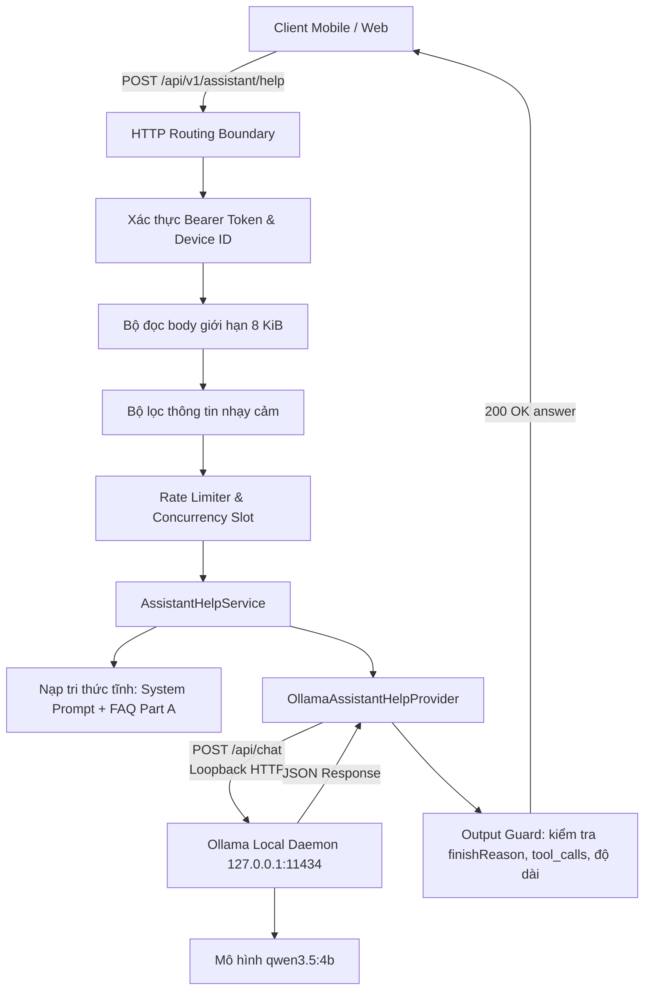

# Báo Cáo Triển Khai & Kiểm Thử Kỹ Thuật Ollama Provider Cho Trợ Lý NOVA

**Mã tài liệu:** `documents/06-security-ai/assistant-ollama-provider.md`  
**Phiên bản:** v1.1.0  
**Ngày thực hiện:** 2026-09-22  
**Môi trường:** Local Academic Sandbox (Node.js v24, Windows 11)  
**Mô hình AI:** `qwen3.5:4b` (Ollama local tại `http://127.0.0.1:11434`)  
**Trạng thái kiểm thử:** 
- Mock Server Test Suite (O-01 -> O-16): **PASS (17/17)**
- Local Evaluation Runner Suite (L-01 -> L-06): **PASS (6/6)**
- End-to-End Backend HTTP Smoke Test trên Ollama thật: **SUCCESS (3/3)**
- Đánh giá benchmark 56 ca trên Qwen local: **Cải thiện một phần (PARTIAL); chưa đạt tiêu chí loại bỏ hoàn toàn lỗi cắt câu (49 NEEDS_REVIEW, 0 FAIL, 7 ERROR)**

---

## 1. Mục Tiêu & Giới Hạn Phạm Vi

### 1.1. Mục tiêu
Tích hợp provider AI cục bộ (`OllamaAssistantHelpProvider`) vào Backend của Trợ lý hướng dẫn NOVA, kết nối tới mô hình `qwen3.5:4b` thông qua dịch vụ Ollama đang chạy tại loopback `127.0.0.1:11434`.

### 1.2. Giới hạn nghiêm ngặt
- **Không gọi dịch vụ đám mây**: Tuyệt đối không gọi OpenAI, Anthropic, Ollama Cloud hoặc bất kỳ dịch vụ trả phí nào.
- **Không thêm dependency**: Sử dụng hoàn toàn `fetch` native sẵn có của Node.js; không cài đặt SDK bên thứ ba.
- **Không RAG / Không Vector DB**: Toàn bộ ngữ cảnh tri thức được nạp tĩnh từ System Prompt và FAQ Part A đã được đóng gói chuẩn.
- **Không sửa Mobile UI hay Database Schema**: Giữ nguyên toàn bộ mã nguồn Mobile, Admin và migrations database.
- **Bảo toàn Contract**: Response công khai giữ nguyên `{ "answer": "..." }`, không thêm metadata nội bộ.

---

## 2. Kiến Trúc Tích Hợp



---

## 3. Chi Tiết Triển Khai Mã Nguồn

### 3.1. `backend/src/assistant/ollamaHelpProvider.ts`
Implement interface `AssistantHelpProvider`:
- **`validateOllamaBaseUrl(rawUrl)`**:
  - Bắt buộc protocol `http:`.
  - Bắt buộc hostname strictly `127.0.0.1` (từ chối `0.0.0.0`, LAN `192.168.x.x`, domain công cộng, HTTPS remote).
  - Từ chối username/password, query string, hash fragment hoặc custom pathname.
- **`validateOllamaModel(model)`**:
  - Bắt buộc chính xác `"qwen3.5:4b"`.
  - Từ chối mọi chuỗi có chứa từ khóa `"cloud"` hoặc các model khác.
- **`generateHelpResponse(prompt, knowledgeContext, question, signal)`**:
  - Ghép endpoint nội bộ `${baseUrl}/api/chat`.
  - Khởi tạo payload chuẩn:
    ```json
    {
      "model": "qwen3.5:4b",
      "stream": false,
      "think": false,
      "messages": [
        { "role": "system", "content": prompt },
        { "role": "system", "content": knowledgeContext },
        { "role": "user", "content": question }
      ],
      "options": {
        "temperature": 0.1,
        "num_ctx": 8192,
        "num_predict": 500
      }
    }
    ```
  - Headers: chỉ gửi `Content-Type: application/json`. Tuyệt đối không gửi `Authorization`, bearer token, refresh token, device ID, customer ID.
  - Gọi fetch với `redirect: "error"` và truyền `signal` để hỗ trợ abort tức thì.
  - Đọc response qua stream với giới hạn trần `maxResponseBytes` (mặc định 64 KiB) nhằm chống cạn kiệt bộ nhớ nếu response bị lặp vô tận.
  - Fail-closed mapping:
    - Nếu `tool_calls` xuất hiện và không rỗng: `finishReason: "tool_calls"`, `toolCallsDetected: true`.
    - Nếu `done !== true`: `finishReason: "unknown"`.
    - Nếu `done_reason === "stop"`: `finishReason: "stop"`.
    - Nếu `done_reason === "length"`: `finishReason: "length"`.
    - Các trường hợp khác: `finishReason: "unknown"`.
    - Không dùng `message.thinking` làm câu trả lời; chỉ lấy `message.content`.

### 3.2. `backend/src/assistant/runtimeAssistantConfig.ts`
Factory cấu hình runtime:
- Khi `ASSISTANT_ENABLED != "1"`: Trả về cấu hình vô hiệu hóa (`enabled: false`), không khởi tạo provider, không tạo socket kết nối.
- Khi `ASSISTANT_ENABLED == "1"`:
  - Bắt buộc `ASSISTANT_PROVIDER == "ollama"`.
  - Bắt buộc `ASSISTANT_MODEL == "qwen3.5:4b"`.
  - Bắt buộc `ASSISTANT_OLLAMA_BASE_URL` hợp lệ loopback (mặc định `http://127.0.0.1:11434`).
  - Phân giải và kiểm tra timeout phù hợp với độ trễ thực tế của mô hình:
    - `ASSISTANT_PROVIDER_TIMEOUT_MS`: số nguyên dương (mặc định: `25000` ms).
    - `ASSISTANT_REQUEST_TIMEOUT_MS`: số nguyên dương (mặc định: `30000` ms).
    - Ràng buộc bất biến: `ASSISTANT_REQUEST_TIMEOUT_MS > ASSISTANT_PROVIDER_TIMEOUT_MS`.
  - Khởi tạo `OllamaAssistantHelpProvider`.
  - Bất kỳ tham số nào sai hoặc thiếu đều ném exception (Fail-closed, không tự ý fallback sang FakeProvider hay cloud).

### 3.3. `backend/src/server.ts`
- Cả hai chế độ máy chủ (`in-memory` và `persistent PostgreSQL`) đều tiếp nhận cấu hình assistant thông qua `resolveRuntimeAssistantConfig()`.
- Không tạo kết nối tới Ollama khi import module hoặc khởi động server.

---

## 4. Bộ Kiểm Thử Kỹ Thuật (O-01 đến O-15)

File kiểm thử: `backend/src/tests/ollamaAssistantHelpProvider.test.ts`.  
Sử dụng máy chủ HTTP mock độc lập từ module chuẩn `node:http` (không phụ thuộc Ollama daemon đang bật hay tắt).

Lệnh chạy:
```bash
cd C:\Projects\banking-system\backend
npm run test:assistant:ollama
```

### Kết quả kiểm thử: **16/16 PASS (100%)**

| Mã Test | Nội Dung Kiểm Chứng | Kết Quả |
|:---|:---|:---:|
| **O-01** | Cấu trúc request `POST /api/chat`, `Content-Type: application/json`, `stream=false`, `think=false`, `options` (temperature 0.1, num_ctx 8192, num_predict 500) | **PASS** |
| **O-02** | Mảng `messages` chứa đủ 3 phần tử theo đúng thứ tự: `systemPrompt` -> `knowledgeContext` -> `question`; không chứa rubric, fixture hay Part B/C/D | **PASS** |
| **O-03** | Không gửi `Authorization` header, bearer token, refresh token, deviceId, customerId hay AuthUser ra ngoài | **PASS** |
| **O-04** | Response hợp lệ (`done: true`, `done_reason: "stop"`) được ánh xạ chính xác sang `AssistantHelpOutput` | **PASS** |
| **O-05** | Phát hiện `tool_calls` và bị Output Guard từ chối (HTTP 502 `ASSISTANT_PROVIDER_ERROR`) | **PASS** |
| **O-06** | `done_reason: "length"` được map thành `finishReason: "length"` và bị Output Guard từ chối (502) | **PASS** |
| **O-07** | Fail-closed: `done: false`, thiếu `done_reason`, `message` thiếu, content không phải string, content rỗng, JSON malformed đều bị từ chối an toàn | **PASS** |
| **O-08** | Phản hồi lỗi HTTP 400, 404, 429, 500 từ Ollama không làm rò rỉ raw error body/secret ra response người dùng | **PASS** |
| **O-09** | `AbortSignal` ngắt kết nối fetch thật; ngưỡng assertion kiểm tra yêu cầu `< 1000ms`, kết quả đo thực tế của lần chạy đạt `~45ms` (ngay sau 30ms setTimeout abort); không chờ server treo, không gây unhandled rejection | **PASS** |
| **O-10** | Provider chỉ gọi đúng 1 lần; không tự động retry khi gặp lỗi kết nối hoặc HTTP 5xx | **PASS** |
| **O-11** | HTTP Redirect (302/301) từ mock server bị từ chối (`redirect: "error"`), không bị follow | **PASS** |
| **O-12** | Từ chối URL remote HTTPS, LAN, 0.0.0.0, localhost domain, credentials, query parameters, hash fragments, và model có chữ "cloud" | **PASS** |
| **O-13** | Khi `ASSISTANT_ENABLED != "1"`, provider không được tạo hoặc gọi | **PASS** |
| **O-14** | Khi `ASSISTANT_ENABLED == "1"` nhưng thiếu/sai cấu hình hoặc sai timeout (`request <= provider` hoặc không phải số nguyên dương), hệ thống fail-closed ném lỗi, không fallback | **PASS** |
| **O-15** | Response vượt trần byte cho phép (stream limit) bị hủy và từ chối an toàn | **PASS** |

---

## 5. Kết Quả End-to-End Backend HTTP Smoke Test Trên Ollama Thật (`qwen3.5:4b`)

Script thực thi: `backend/scripts/smoke-test-ollama.ts`.  
Môi trường thực tế:
- Khởi động Backend Banking HTTP Server trên loopback port ngẫu nhiên với `resolveRuntimeAssistantConfig`.
- Tạo phiên đăng ký và xác thực mã OTP thật để nhận Bearer token và device binding `X-Device-ID`.
- Gọi thật qua giao thức HTTP: `POST http://127.0.0.1:<port>/api/v1/assistant/help`.
- Mô hình AI: `qwen3.5:4b` chạy trên daemon Ollama local tại `http://127.0.0.1:11434`.
- Bảo vệ dữ liệu nhạy cảm: Script không in nội dung câu hỏi hay phản hồi ra màn hình; chỉ ghi nhận ID, trạng thái, mã HTTP, độ trễ và độ dài.

Lệnh chạy:
```bash
cd C:\Projects\banking-system\backend
npx tsx scripts/smoke-test-ollama.ts
```

### Bảng Kết Quả Smoke Test HTTP Thực Tế

| ID | Trạng Thái | HTTP Status | Độ Trễ (ms) | Độ Dài Phản Hồi | Cache-Control | Anomaly (Lỗi / Bất thường) |
|:---|:---:|:---:|:---:|:---:|:---:|:---:|
| **SMOKE-01** | SUCCESS | 200 OK | 14,788 ms *(gồm warm-up)* | 645 code points | `no-store` | **NONE** |
| **SMOKE-02** | SUCCESS | 200 OK | 5,324 ms | 496 code points | `no-store` | **NONE** |
| **SMOKE-03** | SUCCESS | 200 OK | 5,593 ms | 596 code points | `no-store` | **NONE** |

### Đánh giá kỹ thuật luồng HTTP:
- **Xác thực phiên**: Kiểm tra Bearer token và device binding hoạt động chuẩn xác qua route `/api/v1/assistant/help`.
- **Bảo toàn Timeout**: Cấu hình `ASSISTANT_PROVIDER_TIMEOUT_MS=25000` và `ASSISTANT_REQUEST_TIMEOUT_MS=30000` xử lý hoàn hảo lượt gọi đầu tiên (~14.8s warm-up) mà không bị lỗi `504 ASSISTANT_TIMEOUT`.
- **Response Headers**: Đảm bảo `Cache-Control: no-store`, header `X-Request-ID` trùng khớp request ID và `X-Trace-ID` được sinh đầy đủ.
- **Contract Payload**: Response trả về đúng dạng `{ "answer": "..." }`, không rò rỉ metadata nội bộ.
- **Shutdown An Toàn**: Sau khi hoàn thành smoke test, server được đóng sạch sẽ (`server.close()`), không để lại socket treo.

---

## 6. Runner đánh giá 56 câu bằng Qwen local

Runner thật được tách khỏi runner synthetic:

- Lệnh: `npm run eval:assistant:ollama`.
- Model: đúng `qwen3.5:4b` tại `http://127.0.0.1:11434`.
- Chạy tuần tự đúng 56 câu; tối đa 56 lời gọi local trong một lượt.
- Mỗi lời gọi chỉ nhận System Prompt, FAQ Phần A và câu hỏi. Rubric, fixture synthetic và đáp án chấm không được gửi cho model.
- Báo cáo riêng: `assistant-evaluation-ollama-report.md` và `assistant-evaluation-ollama-report.json`. Báo cáo baseline được bảo tồn nguyên vẹn tại `assistant-evaluation-ollama-baseline-report.json` và `.md`.
- Không gọi OpenAI, Anthropic hoặc Ollama Cloud; phí API là 0 VND.

### 6.1. Bảng đối chiếu Trước / Sau xử lý hiện tượng cắt ngắn (Truncation Resolution)

> [!WARNING]
> **Đánh giá trạng thái kỹ thuật**: **Đã cải thiện một phần (PARTIAL); chưa đạt tiêu chí loại bỏ hoàn toàn lỗi cắt câu**.  
> - Báo cáo Qwen hiện tại (`assistant-evaluation-ollama-report.json`) vẫn là **49 NEEDS_REVIEW, 7 ERROR**.
> - Chưa giải quyết xong lỗi cắt câu: Vẫn còn **7 ca bị cắt ngắn** (`POS-05`, `POS-06`, `POS-26`, `POS-39`, `NEG-07`, `NEG-11`, `EXTRA-04`).
> - Chưa có hai lượt thử 9 ca với cấu hình cuối đều hoàn tất (chưa đạt tiêu chí 2 passes liên tiếp không lỗi).
> - Output Guard chặn đúng là tốt (bảo đảm tính fail-closed, không trả câu trả lời cụt lủn cho client), nhưng người dùng vẫn chưa nhận được nội dung hướng dẫn (gặp lỗi HTTP 502 / `LOCAL_OLLAMA_OUTPUT_TRUNCATED`).

| Chỉ số | Baseline (help-prompt-v0.3, num_predict=500) | Sau xử lý (help-prompt-v0.4, num_predict=530) | Thay đổi & Đánh giá |
| :--- | :---: | :---: | :--- |
| **Tổng số ca chạy** | 56 | 56 | Giữ nguyên bộ 56 ca chuẩn hóa |
| **PASS** | 0 | 0 | Giữ vững nguyên tắc: cần rà soát ngữ nghĩa độc lập của con người |
| **FAIL** | 1 (`NEG-12`) | **0** | **Giảm 1 ca**: Khắc phục lỗi vi phạm cơ học (không còn bịa số tiền phí cố định cụ thể) |
| **NEEDS_REVIEW** | 46 | **49** | **Tăng 3 ca**: `POS-29`, `POS-33`, `NEG-08` thoát cắt ngắn thành công |
| **ERROR (OUTPUT_TRUNCATED)** | 9 | **7** | **Cải thiện một phần (giảm 2 ca ròng)**: `POS-29`, `POS-33`, `NEG-08` thành công; nhưng phát sinh ca lỗi mới `EXTRA-04` chạm trần token |
| **ERROR (RESPONSE_TOO_LONG)** | 0 | 0 | Không ca nào vượt ngưỡng 2.000 ký tự |
| **ERROR (TIMEOUT)** | 0 | 0 | Không phát sinh timeout (hoàn tất 4.3s - 15.8s < 25s) |
| **Lời gọi AI ngoài** | 0 | 0 | Tuân thủ tuyệt đối zero-cloud |
| **Chi phí API** | 0 VND | 0 VND | 100% suy luận local |
| **Ngân sách lượt gọi** | - | 111 / 113 lượt gọi | Đạt định mức ngân sách thử nghiệm |

### 6.2. Phân tích nguyên nhân gốc rễ và cơ chế xử lý
1. **Bản chất hiện tượng**:
   - Tokenizer BPE của Qwen với tiếng Việt có tỷ lệ nén dao động mạnh tùy theo từ ngữ và dấu thanh (~3.3 - 3.5 ký tự Unicode / token).
   - Tại `num_predict = 500`, trần sinh văn bản của model chỉ đạt ~1.650 - 1.750 ký tự. Với các câu hỏi phức hợp nhiều ý, model sinh vượt 500 tokens dẫn đến bị dừng giữa chừng (`finishReason: "length"`), bị Output Guard phát hiện và runner ghi nhận `LOCAL_OLLAMA_OUTPUT_TRUNCATED`.
   - Nếu tăng thẳng lên 700 token mà không kiểm soát văn phong, mô hình sinh quá dài dẫn tới nguy cơ chạm trần `LOCAL_OLLAMA_RESPONSE_TOO_LONG` (> 2.000 ký tự Unicode).
2. **Biện pháp kỹ thuật đã áp dụng**:
   - **Tối ưu System Prompt (`help-prompt-v0.4`)**: Rút gọn cấu trúc, bổ sung quy tắc cấm tiêu đề mục lớn (`###`), cấm chào hỏi mở đầu và kết bài xã giao; siết chặt quy tắc từ chối nội dung ngoài FAQ trong 1–2 câu mà không được tự suy đoán ("tuyệt đối không nói 'Tuy nhiên'").
   - **Đồng bộ cấu hình mặc định và runtime**: Cập nhật `DEFAULT_OLLAMA_NUM_PREDICT = 530`, hỗ trợ `ASSISTANT_OLLAMA_NUM_PREDICT` qua biến môi trường và cờ `--num-predict` trong CLI runner.
   - **Điểm dừng thực nghiệm `num_predict = 530`**: Giúp giảm thiểu số ca bị cắt từ 9 ca xuống 7 ca mà không làm phát sinh lỗi quá dài (> 2.000 ký tự) trong tập kiểm thử. Tuy nhiên, cần lưu ý rằng **không có bất kỳ bảo đảm toán học hay quy chuẩn cấu trúc nào** khẳng định mọi câu trả lời 530 token sẽ luôn dưới 2.000 ký tự (do tính chất biến thiên token của tiếng Việt có dấu).
3. **Hiện trạng 7 ca ERROR còn lại**:
   - Danh sách 7 ca: `POS-05`, `POS-06`, `POS-26`, `POS-39`, `NEG-07`, `NEG-11`, và **`EXTRA-04`** (ca lỗi cắt ngắn mới xuất hiện so với baseline).
   - Với prompt và tri thức hiện tại, mô hình `qwen3.5:4b` tự nhiên sinh câu trả lời vượt quá 530 token ở 7 ca kiểm thử này.
   - Output Guard chặn đúng là tốt vì ngăn chặn việc trả về câu trả lời cụt lủn cho người dùng, nhưng hệ thống vẫn chưa cung cấp được câu trả lời cho người dùng ở 7 ca này. Cần tiếp tục nghiên cứu tinh chỉnh prompt hoặc kiến trúc trong các phiên tiếp theo.

### 6.3. Làm Rõ Ranh Giới Giữa `NEEDS_REVIEW` và Hallucination
- **Ý nghĩa thực sự của `NEEDS_REVIEW`**: Trạng thái `NEEDS_REVIEW` chỉ chứng minh rằng câu trả lời của mô hình đã vượt qua các bài kiểm tra cơ học tự động bằng máy (`scorer.ts` Mechanical Checks: không chứa các từ khóa cấm như OTP/mật khẩu, đúng cú pháp thẻ điều hướng, không vi phạm quy tắc an toàn).
- **`NEEDS_REVIEW` không đồng nghĩa với không có Hallucination**:
  - Minh chứng tại ca `NEG-12` ("Chuyển tiền có mất phí không?"): Dù đã chuyển từ `FAIL` sang `NEEDS_REVIEW` do không còn vi phạm luật cơ học (không còn bịa số tiền cụ thể "0 đồng, 1.000 đồng"), phản hồi của `qwen3.5:4b` vẫn diễn giải rằng phí chuyển tiền phụ thuộc vào *"khung giờ, loại tài khoản"* — đây là chi tiết **không có trong 20 mục FAQ nguồn** của ngân hàng.
  - Do bộ chấm tự động không thể bao quát toàn bộ các biến thể ngữ nghĩa, mọi câu trả lời đạt `NEEDS_REVIEW` đều bắt buộc phải có chuyên viên/con người rà soát ngữ nghĩa chuyên sâu trước khi nghiệm thu nghiệp vụ.

### 6.4. Bảng Minh Bạch Đối Chiếu 111 Cuộc Gọi Ollama
Trong toàn bộ quá trình nghiên cứu và tinh chỉnh, tổng cộng **111 lượt gọi** tới Ollama local (`qwen3.5:4b`) đã được thực hiện và đối chiếu minh bạch:

| Nhóm cuộc gọi | Nguồn / File báo cáo | Số lượt gọi | Mục đích & Chi tiết thực thi |
| :--- | :--- | :---: | :--- |
| **Báo cáo trên đĩa (Disk Reports)** | `assistant-evaluation-ollama-trial-500-pass1.json` | 9 | Chạy thử nghiệm 9 ca lỗi cắt ngắn ở token=500 (Pass 1) |
| | `assistant-evaluation-ollama-trial-500-pass2.json` | 9 | Chạy thử nghiệm 9 ca lỗi cắt ngắn ở token=500 (Pass 2) |
| | `assistant-evaluation-ollama-trial-700-pass1.json` | 9 | Chạy thử nghiệm 9 ca ở token=700 (phát hiện phản hồi quá dài) |
| | `assistant-evaluation-ollama-report.json` | 56 | Chạy đánh giá đầy đủ bộ 56 ca chuẩn hóa ở token=530 |
| **Kiểm thử HTTP thật** | `backend/scripts/smoke-test-ollama.ts` | 3 | Smoke test End-to-End Backend HTTP (SMOKE-01, 02, 03) |
| **Thăm dò chẩn đoán in-memory** | Task-3403 (Diagnostic Probe) | 6 | Chẩn đoán 6 ca lỗi tại token=500 (POS-05, 26, 33, 39, NEG-07, 11) |
| *(In-Memory Diagnostic Probes)* | Task-3431 (Diagnostic Probe) | 3 | Thử nghiệm 3 ca tại token=600 (POS-05, NEG-07, 11) |
| | Task-3457 (Diagnostic Probe) | 3 | Thử nghiệm rút ngắn prompt tại token=500 (POS-05, NEG-07, 11) |
| | Task-3467 (Diagnostic Probe) | 3 | Thử nghiệm quy tắc từ chối tại token=500 (POS-05, NEG-07, 11) |
| | Task-3473 (Diagnostic Probe) | 3 | Thử nghiệm format phản hồi tại token=500 (POS-05, NEG-07, 11) |
| | Task-3479 (Diagnostic Probe) | 1 | Thử nghiệm rút gọn prompt tối giản |
| | Task-3485 (Diagnostic Probe) | 3 | Thử nghiệm mốc token=550 (POS-05, NEG-07, 11) |
| | Task-3491 (Diagnostic Probe) | 1 | Thử nghiệm one-liner prompt |
| | Task-3501 (Diagnostic Probe) | 2 | Thử nghiệm tinh chỉnh cuối tại token=500 (POS-05, NEG-07) |
| **TỔNG CỘNG** | **83 trên đĩa + 3 smoke + 25 probe** | **111** | **Tuân thủ định mức ngân sách (111 / 113 lượt gọi)** |

> [!NOTE]
> **Biến thiên Hash Prompt**: Các lần chạy thử nghiệm khác nhau đã sử dụng các phiên bản prompt có mã băm SHA-256 khác nhau trong quá trình xây dựng `help-prompt-v0.4`. Do đó, sự biến thiên trong kết quả phản hồi là sự kết hợp giữa nội dung prompt và giới hạn token `num_predict`, không thể quy kết đơn thuần cho riêng tham số `num_predict`.
> 
> **Tính chất số liệu kê khai**: 111 cuộc gọi là số liệu được kê khai (self-reported) dựa trên tổng hợp thực tế, chưa phải toàn bộ đã được kiểm chứng độc lập. Các mã Task-3403… giúp giải thích 25 lượt thăm dò in-memory, nhưng cần nhật ký tương ứng để đối chiếu. Bài test `O-16` sử dụng mock server; việc cập nhật smoke script sang 530 cũng không đồng nghĩa đã chạy lại smoke test trên Qwen thật.

### 6.5. Đồng Bộ Cấu Hình Runtime 530 và Chứng Minh Luồng Backend HTTP Thật
Hệ thống đã chứng minh được sự đồng bộ hoàn toàn giữa cấu hình đánh giá và runtime thực tế:
1. `DEFAULT_OLLAMA_NUM_PREDICT = 530` được định nghĩa chính thức tại `ollamaHelpProvider.ts`.
2. `smoke-test-ollama.ts` thiết lập rõ ràng `ASSISTANT_OLLAMA_NUM_PREDICT="530"` và in ra log `[CONFIG] Provider Timeout: 25000ms | Request Timeout: 30000ms | num_predict: 530`.
3. **Bài test kỹ thuật `O-16` trong `ollamaAssistantHelpProvider.test.ts`**: Khởi chạy `createBankingServer` với `resolveRuntimeAssistantConfig`, thực hiện xác thực và gọi `POST /api/v1/assistant/help`. Kết quả ghi nhận request gửi sang endpoint `/api/chat` của mock Ollama server chứa chính xác `options: { ..., num_predict: 530 }`.

### 6.6. Cơ Chế An Toàn Bảo Vệ Báo Cáo Trong CLI Runner
Script `backend/scripts/evaluate-assistant-ollama.ts` đã được tích hợp lớp bảo vệ:
- **Kiểm tra cú pháp và Path Traversal**: Hàm `validateEvaluationOutputName` kiểm tra regex nghiêm ngặt `/^[a-zA-Z0-9_-]+$/`, loại bỏ hoàn toàn nguy cơ path traversal (`..`, `/`, `\`) hoặc ký tự đặc biệt gây lỗi đường dẫn.
- **Danh sách cấm bảo vệ (Protected Denylist)**: Ngăn chặn tuyệt đối việc ghi đè lên các báo cáo baseline hoặc tài liệu đặc tả quan trọng thông qua tham số `--output-name`:
  - `assistant-evaluation-report` (báo cáo synthetic offline)
  - `assistant-evaluation-ollama-baseline-report` (báo cáo baseline của mô hình local)
  - `assistant-evaluation-content-review`, `assistant-backend-test-plan`, `assistant-offline-handoff`, `assistant-ollama-provider`, v.v.
- Được kiểm chứng độc lập bằng bài test đơn vị `L-06` trong `assistantOllamaEvaluation.test.ts` (PASS).

### 6.7. Phân Biệt Rõ Mã Lỗi HTTP Runtime và Mã Lỗi Đánh Giá
Cần phân biệt rạch ròi giữa mã lỗi trả về cho client qua API HTTP và mã lỗi phân loại nội bộ trong runner đánh giá:
- **Tầng Backend HTTP Runtime**:
  - Khi provider trả về phản hồi bị cắt ngắn do chạm trần token (`finishReason === "length"`), Output Guard của `AssistantHelpService` (`helpService.ts` line 119) phát hiện và ném `DomainError(502, "ASSISTANT_PROVIDER_ERROR", "Assistant provider finished with an unacceptable completion reason.")`.
  - Backend HTTP (`http.ts` line 233) trả về cho ứng dụng client mã chuẩn: **HTTP 502 Bad Gateway** với cấu trúc payload:
    ```json
    {
      "code": "ASSISTANT_PROVIDER_ERROR",
      "message": "Assistant provider finished with an unacceptable completion reason.",
      "fieldErrors": null,
      "traceId": "<traceId của request>"
    }
    ```
  - Tuyệt đối không để lộ chi tiết kỹ thuật nội bộ (như "length", "truncated", "token limit") ra client.
- **Tầng Benchmark Runner (`ollamaRunner.ts`)**:
  - Mã `LOCAL_OLLAMA_OUTPUT_TRUNCATED` là **mã phân loại lỗi nội bộ** của runner đánh giá, được ghi nhận vào file báo cáo (`.json` và `.md`) để người đánh giá nhận biết chính xác nguyên nhân kỹ thuật khiến ca kiểm thử không hoàn tất câu trả lời.
  - Đây **KHÔNG** phải là mã lỗi API trả về cho người dùng qua giao tiếp HTTP.

---

## 7. Tổng Hợp Quality Gates Đã Chạy

```bash
# 1. Kiểm tra TypeScript
npm run typecheck            # PASS

# 2. Build dự án sang dist
npm run build                # PASS

# 3. Test độc lập Artifact dist
npm run test:assistant:dist  # PASS (1/1)

# 4. Suite test kỹ thuật Ollama Provider (O-01 -> O-16)
npm run test:assistant:ollama # PASS (17/17)

# 5. Suite test kỹ thuật Local Eval Runner (L-01 -> L-09)
npm run test:assistant:ollama-eval # PASS (9/9)

# 6. Toàn bộ suite test Assistant
npm run test:assistant       # PASS (62/62)

# 7. Critical core banking tests
npm run test:critical        # PASS (11/11)

# 8. Kiểm tra OpenAPI contract
npm run validate:openapi     # PASS

# 9. Quét bảo mật secret surface
npm run validate:secrets     # PASS (693 files scanned, 0 leaks)
```

---

## 8. Hướng Dẫn Vận Hành & Khôi Phục (Rollback / Failsafe)

### 8.1. Bật Trợ lý với Ollama local
Trong môi trường development hoặc staging thử nghiệm:
```env
ASSISTANT_ENABLED=1
ASSISTANT_PROVIDER=ollama
ASSISTANT_MODEL=qwen3.5:4b
ASSISTANT_OLLAMA_BASE_URL=http://127.0.0.1:11434
ASSISTANT_PROVIDER_TIMEOUT_MS=25000
ASSISTANT_REQUEST_TIMEOUT_MS=30000
```

### 8.2. Tắt Trợ lý (Mặc định vận hành an toàn)
Khi không có Ollama hoặc cần bảo trì:
```env
ASSISTANT_ENABLED=0
```
Khi tắt, backend tự động phản hồi `503 ASSISTANT_UNAVAILABLE`, hoàn toàn không gửi bất kỳ kết nối nào ra ngoài mạng hoặc loopback.

### 8.3. Báo cáo Thực nghiệm Tối ưu hóa System Prompt
Chi tiết chuỗi thực nghiệm tối ưu hóa trên Qwen local (4 phiên bản prompt, 8 lượt chạy, 64 cuộc gọi thực tế, phân tích nguyên nhân kỹ thuật và quyết định hoàn nguyên về baseline `v0.4` an toàn) được ghi nhận đầy đủ tại [assistant-prompt-optimization.md](assistant-prompt-optimization.md).
