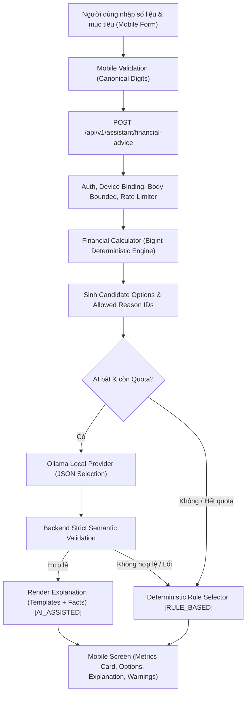

# Kế hoạch và Kiến trúc Module AI Tư vấn Tài chính Cá nhân (Financial Advice)

> **Trạng thái 2026-10-03:** phần local/offline đã được kiểm tra lại: evaluator 16/16 PASS với 0 provider calls; Backend `test:assistant` 74/74; Mobile Financial Advice/API/validator và shared auth-route regression 36/36; các gate typecheck/build/lint/OpenAPI/public-env/Maestro-structure được ghi trong chỉ mục bằng chứng. Đây chưa phải nghiệm thu live: Qwen, HTTP Mobile→Backend thực tế, emulator/device và Web demo đều `NOT RUN`; chưa có test kết hợp riêng cho Financial Advice 401 → AuthProvider → protected login route. Ngưỡng live `>=15/16` so với `>=95%` vẫn cần Owner chốt. API tiếp tục Draft/academic.

## 1. Mục tiêu và phạm vi

Module tư vấn tài chính cá nhân được thiết kế nhằm hỗ trợ người dùng lập kế hoạch tài chính cá nhân trên ứng dụng Mobile Banking (tham khảo học thuật / đồ án tốt nghiệp), bao gồm hai nghiệp vụ cốt lõi:
1. **UC-FA01 — Tư vấn kế hoạch tiết kiệm (Savings Plan Advisory)**: Phân tích mục tiêu tiết kiệm, tính toán số tiền cần dành mỗi tháng, đánh giá tính khả thi dựa trên thu nhập, chi phí và khoản giữ lại (buffer), đưa ra các phương án điều chỉnh (kéo dài thời gian, giảm chi tiêu linh hoạt, điều chỉnh mục tiêu).
2. **UC-FA02 — Tư vấn cân đối ngân sách (Budget Balance Advisory)**: Đánh giá cơ cấu thu nhập - chi tiêu - trả nợ - khoản giữ lại, kiểm tra thâm hụt/thặng dư và khả năng đáp ứng mức tiết kiệm mong muốn, đưa ra các phương án cân đối.

### Nguyên tắc nghiệp vụ
- **Dữ liệu do người dùng nhập (USER_ENTERED)** cho một tháng đại diện. Hệ thống không tự ý quét số dư hay toàn bộ lịch sử giao dịch để suy diễn tài chính.
- **Tính toán tài chính xác định (Deterministic Financial Engine)**: Toàn bộ công thức tính toán, số liệu và tập hợp phương án khả thi (Candidate Options) được thực thi bằng backend code với kiểu số nguyên lớn `BigInt` (đơn vị VND). Tuyệt đối không để AI tính toán số tiền hoặc bịa đặt con số.
- **AI có kiểm soát (Controlled AI Selection)**: Mô hình ngôn ngữ (Ollama local / LLM) chỉ đóng vai trò hỗ trợ lựa chọn phương án ưu tiên (`preferredOptionId`) và lý do giải thích (`reasonIds`) từ danh mục hợp lệ đã được Backend xác thực trước. Văn bản giải thích hiển thị cho người dùng được Backend ghép từ template và sự kiện thực tế.
- **Dung sai lỗi và Fallback an toàn (Rule-based Fallback)**: Khi AI không khả dụng, timeout, vượt quota hoặc trả về kết quả không hợp lệ, hệ thống chuyển sang chế độ giải thích theo quy tắc (`RULE_BASED`) với nhãn minh bạch. Các số liệu do calculator xác định; độ đúng được chứng minh trong phạm vi golden/cross-contract tests đã chạy, không phải bảo đảm tuyệt đối ngoài các ca đó.
- **Không thực hiện giao dịch tài chính**: Module chỉ mang tính chất tham khảo, không tự động chuyển tiền, không mở sổ tiết kiệm, không sửa đổi cơ sở dữ liệu giao dịch ngân hàng.

---

## 2. Kiến trúc giải pháp (Architecture Design)

---

## 3. Các quyết định thiết kế đã chốt (Decisions D-01 đến D-15)

- **D-01**: Giữ đúng 2 use case UC-FA01 và UC-FA02.
- **D-02**: Nguồn dữ liệu hoàn toàn do người dùng cung cấp (`USER_ENTERED`).
- **D-03**: Đơn vị tiền tệ duy nhất là `VND`, số nguyên không âm ở input; các chỉ số chênh lệch/thâm hụt có thể âm được quản lý bằng kiểu `SignedMinor` riêng biệt.
- **D-04**: Giao diện Form có cấu trúc chặt chẽ, không dùng khung chat tự do.
- **D-05**: Backend tính toán bằng `BigInt` tránh sai số; Mobile chỉ kiểm tra định dạng và hiển thị.
- **D-06**: AI chỉ chọn option/reason ID trong whitelist; Backend render template câu văn chứa số liệu.
- **D-07**: Endpoint riêng biệt `POST /api/v1/assistant/financial-advice`; không ảnh hưởng `/assistant/help`.
- **D-08**: Không migration database, không lưu dữ liệu tư vấn xuống disk/database; xử lý in-memory request-scoped.
- **D-09**: Tái sử dụng Ollama provider hiện có, chia sẻ chung quota (10 calls/run) và rate limiter.
- **D-10**: Tự động fallback về `RULE_BASED` khi provider lỗi/hết quota/trả sai định dạng.
- **D-11**: Cờ tính năng `FINANCIAL_ADVICE_ENABLED` độc lập (mặc định 0).
- **D-12**: Quản lý vòng đời chặt chẽ trên Mobile bằng `sessionEpoch` và `requestGeneration` tránh race condition khi logout/relogin.
- **D-13**: Không tự động tạo debit, transfer hay mở tài khoản tiết kiệm.
- **D-14**: Phân định rõ ràng bằng chứng kiểm thử (Unit, Seam HTTP, Mock, Live Ollama local).
- **D-15**: Giới hạn tối đa số tiền nhập 1.000.000.000.000 VND và thời gian tối đa 120 tháng.
