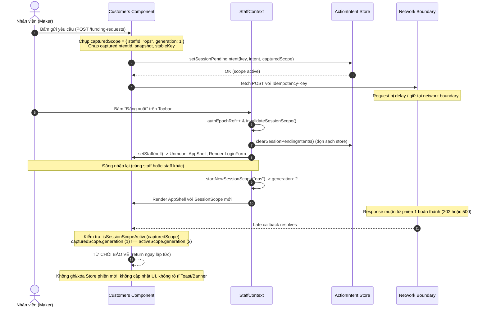

# Báo cáo Cải tạo Admin Web (Admin Web Improvement Report)

- **Mã báo cáo**: AW-REP-03 (Nghiệm thu toàn diện đợt hoàn thiện cô lập phiên và mở rộng bằng chứng kiểm thử Admin Web)
- **Thời điểm**: 2026-09-27
- **Commit SHA**: `9254922a9bfe486f1b0b833d80c5fd2e508bcc3b`
- **Môi trường thử nghiệm**: Local Reference Sandbox, Admin API Node.js in-memory fixture (`e2e/fixture-server.mjs`), Playwright Chromium, Vite 7, React 19, TypeScript 5.9.

---

> **Ghi chú phiên bản:** Báo cáo này ghi lại bằng chứng của baseline bốn role
ở commit và thời điểm nêu trên, trước khi cho phép ADMIN tự duyệt yêu cầu đủ
quyền. Ma trận hiện hành chỉ còn OPERATIONS và ADMIN; xem `rbac-matrix.md` và
`four-eyes-workflow.md` để biết hành vi hiện tại. Các kết quả bên dưới vẫn là
bằng chứng lịch sử, không phải mô tả role hoặc luồng duyệt hiện tại.

## 1. Tóm tắt Đợt Triển khai và Trạng thái Nghiệm thu (S-01 → S-03 & AC-01 → AC-05)

Sau các lượt rà soát độc lập và hoàn thiện triệt để theo các yêu cầu bổ sung, toàn bộ 3 bước kỹ thuật (S-01, S-02, S-03) và 5 tiêu chí chấp thuận (AC-01 đến AC-05) đã được triển khai đầy đủ trên mã nguồn sản phẩm thực tế, kiểm chứng bằng bộ kiểm thử tự động toàn diện.

### Bảng Trạng thái Nhiệm vụ (S-01 đến S-03)

| Mã nhiệm vụ | Tên nhiệm vụ | Trạng thái | Tóm tắt kết quả triển khai |
|---|---|---|---|
| **S-01** | Cô lập phiên và bảo vệ callback bất đồng bộ qua `SessionScope` | **DONE** | Bổ sung `SessionScope { staffId: string; generation: number }`. Quản lý vòng đời phiên qua `startNewSessionScope`, `invalidateSessionScope`, `isSessionScopeActive`. Khi logout hoặc đổi phiên, scope cũ bị vô hiệu hóa lập tức; intent store, subscriber và banner chỉ phục vụ active scope. Chụp `capturedScope` trước mọi mutating call; sau `await`, từ chối 100% callback muộn từ phiên cũ ghi/xóa store hay cập nhật UI của phiên mới. |
| **S-02** | Sửa R-07 để điều khiển đúng request và bảo vệ race condition | **DONE** | Khắc phục hoàn toàn lỗi hardcode ID synthetic: lấy ID UUID thật của Customer A và B từ search response. Cài đặt 2 tín hiệu rõ ràng qua deferred promise gates (`heldPromise` và `releaseGate`). Bảo vệ cả nhánh mở mới lẫn nhánh tải lại (reload). Bổ sung unit test `AccountLoadManager` với fetcher cố ý bỏ qua client abort để chứng minh generation guard hoạt động độc lập hoàn toàn với `AbortSignal`. |
| **S-03** | Xử lý response thiếu action ID và kiểm thử hồi quy toàn diện | **DONE** | Mở rộng R-06 và bộ unit test cho response HTTP 200/202 có body JSON hợp lệ nhưng rỗng `{}` hoặc thiếu action ID `{"action":{}}`. Phân loại chính xác thành `INDETERMINATE`, không hiển thị thành công giả, không xóa intent, không tự replay. Cho phép retry thành công bằng snapshot và stable key cũ với response hợp lệ. Bảo đảm 100% không hồi quy trên toàn bộ suite R-01 đến R-11 và P0. |

### Bảng Tiêu chí Chấp thuận (AC-01 đến AC-05)

| Tiêu chí | Mô tả điều kiện hoàn thành | Kết quả | Bằng chứng kiểm chứng |
|---|---|---|---|
| **AC-01** | Late callback từ phiên cũ/đã hủy không thể ghi/xóa store hoặc cập nhật UI của phiên mới (kể cả login lại cùng `staffId`); bảo vệ toàn diện race condition giữa logout cũ và phiên mới (cả React state và authentication cookies), có xử lý timeout/abort rõ ràng. | **ĐẠT** | **E2E Playwright R-11**:<br/>- *Sub-case A*: Giữ response logout 204 thật (Set-Cookie: Max-Age=0); chứng minh login Support bị giữ lại (`loginPostDispatched === false` và button "Đang kiểm tra…") cho đến khi logout được giải phóng (`ensureLoggedOut`); sau đó login hoàn tất, gọi `/admin/me` (`credentials: "include"`) trả về HTTP 200 với Support; giải phóng funding 202 không rò rỉ.<br/>- *Sub-case B*: Chặn logout bị treo (hanging) tại network boundary; Operations đăng nhập: hàm điều phối `ensureLoggedOut` / `drainPendingLogout` giải phóng luồng đăng nhập sau thời gian chờ giới hạn (`coordElapsed >= 2800ms`), chứng minh logout treo không chặn đăng nhập vô hạn; sự kiện `requestfailed` trên browser xác nhận request logout cũ đã bị hủy; sau đó giải phóng response logout treo và late 503; gọi `/admin/me` (`credentials: "include"`) xác nhận phiên Operations hoạt động nguyên vẹn với cookie hợp lệ.<br/>**Unit Test 8 & 11** (`admin-web.ui-logic.test.cjs`): Test 8 chứng minh generation guard chặn 100% callback khi cùng `staffId` đăng nhập lại; Test 11 kiểm tra trực tiếp helper dùng chung `logoutCoordinator.drainPendingLogout` từ `src/context/logoutCoordinator.ts`, chứng minh timer điều phối gọi `abort()` khi timeout và dọn sạch `clearTimeout` khi logout hoàn tất sớm. |
| **AC-02** | Chuyển tab trong cùng phiên bảo toàn intent chưa xác định; store, subscriber, banner chỉ cung cấp intent của scope active. | **ĐẠT** | Unit test 8 trong `admin-web.ui-logic.test.cjs`; E2E Playwright R-03, R-11. |
| **AC-03** | R-07 dùng dynamic UUID từ response thực tế, 2 tín hiệu deferred rõ ràng, bảo vệ cả mở mới và reload, không phụ thuộc timeout. | **ĐẠT** | Unit test 5 trong `admin-web.ui-logic.test.cjs`; E2E Playwright R-07 (Part 1: new customer open; Part 2: reload customer accounts). |
| **AC-04** | Response JSON hợp lệ nhưng thiếu/rỗng action ID (`{}`, `{"action":{}}`) không báo thành công giả, không xóa intent; retry giữ nguyên snapshot/key. | **ĐẠT** | Unit test 9, 10 trong `admin-web.ui-logic.test.cjs`; E2E Playwright R-06 (Branch 3: `{}` retry thành công; Branch 4: `{"action":{}}`). |
| **AC-05** | Toàn bộ Quality Gates (typecheck, lint, test, build, e2e, audit, backend validators) đạt 100% không lỗi. | **ĐẠT** | 18/18 Unit/Contract tests PASS (482ms); 12/12 Playwright E2E tests PASS (33.5s); Vite build 53 modules (991ms); audit 0 vulnerabilities; 2 backend validators PASS. |

---

## 2. Kiến trúc Kỹ thuật và Cơ chế Bảo vệ Cốt lõi

### 2.1. Vòng đời Phiên và Cơ chế Cô lập `SessionScope`



1. **Định danh Thế hệ Phiên (`generation`)**:
   - `staffId` đơn thuần không đủ để phân biệt khi nhân viên đăng xuất rồi đăng nhập lại chính tài khoản đó trên cùng trình duyệt.
   - `SessionScope` kết hợp `{ staffId: string; generation: number }`, trong đó `generation` là số nguyên tự tăng mỗi khi `startNewSessionScope` được gọi.
2. **Khóa Đọc/Ghi Store tại Tầng API**:
   - `getSessionPendingIntent(key, scope)` và `getSessionPendingIntents(scope)` chỉ trả về intent nếu `scope` đang hoạt động và khớp với `activeSessionScope`. Nếu phiên đã bị hủy hoặc scope không khớp, trả về `undefined` hoặc map rỗng.
   - `setSessionPendingIntent(key, intent, scope, expectedIntentId)` kiểm tra `isSessionScopeActive(scope)`. Nếu caller mang scope cũ, phương thức trả về `false` và không thực hiện bất kỳ thao tác ghi đè hay xóa nào trên store. Khi xóa theo target, tham số `expectedIntentId` bảo đảm không xóa nhầm intent thay thế của phiên mới.
3. **Bảo vệ Callback Bất đồng bộ trong Component**:
   - Trước khi gửi mutating command, `Customers.tsx` chụp lại `capturedScope = sessionScope` cùng snapshot và key.
   - Sau mỗi điểm `await adminFetch` (trong cả khối `try`, `catch` và `finally`), mã kiểm tra điều kiện bảo vệ:
     ```typescript
     if (!isSessionScopeActive(capturedScope)) {
       return;
     }
     ```
   - Nếu nhân viên đã đăng xuất hoặc phiên đã đổi, callback lập tức dừng thực thi, ngăn ngừa hoàn toàn hiện tượng late callback cập nhật state của phiên mới hoặc xóa intent của nhân viên khác.

---

### 2.2. Cơ chế Điều khiển Request Chính xác (R-07) và Độc lập với Client Abort

1. **Lấy Dynamic UUID từ Search Response**:
   - Không sử dụng ID hardcode giả định (`cust-e2e-synthetic`). Fixture E2E tạo khách hàng với UUID động chuẩn (`randomUUID()`).
   - Test R-07 gửi từ khóa tìm kiếm `"browser-e2e@example.test"`, phân tích response từ server để lấy ID thật của Customer A (`Browser E2E Customer`) và Customer B (`Second Synthetic Customer`), đồng thời xác nhận `customerIdA !== customerIdB`.
2. **Deterministic Deferred Promise Gates**:
   - Sử dụng cặp tín hiệu rõ ràng: `heldPromise` (báo hiệu request đã thực sự rời browser và bị chặn ở network boundary) và `gatePromise` (giải phóng cho phép request tiếp tục hoàn tất).
   - Kiểm tra cả 2 nhánh:
     - **Nhánh 1 (Mở mới)**: Mở A chậm → Chờ A bị giữ tại network → Mở B nhanh → B hoàn tất với số dư chuẩn → Giải phóng A → Xác nhận B không bị ô nhiễm hay ghi đè.
     - **Nhánh 2 (Tải lại danh sách)**: Mở A hoàn tất → Bấm "Tải lại danh sách" của A → Chờ reload A bị giữ tại network → Chuyển sang xem B → B hoàn tất → Giải phóng reload A → Bấm "Yêu cầu cấp tiền" trên B và assert modal trỏ chính xác vào Account ID của B.
3. **Generation Guard Độc lập với AbortSignal**:
   - Trong unit test `UI logic 5` (`admin-web.ui-logic.test.cjs`), một `slowFetcher` cố ý bỏ qua cờ `signal.aborted` và hoàn tất dữ liệu của A sau khi B đã hoàn thành (assert `aFinished === true`).
   - Kết quả: `accountLoader` vẫn loại bỏ dữ liệu của A thành công và giữ nguyên tài khoản của B nhờ so sánh `currentGenerationId`, chứng minh cơ chế Generation Guard bảo vệ vững chắc ngay cả khi client fetcher không tôn trọng tín hiệu abort.

---

### 2.3. Xử lý Phản hồi Thiếu Dữ liệu và Giữ nguyên Khóa Đối soát (R-06)

1. **Phân loại Phản hồi Thiếu Action ID (`isValidActionResponse`)**:
   - Khi server trả về mã HTTP 200 hoặc 202 với body JSON hợp lệ nhưng nội dung rỗng `{}` hoặc thiếu ID `{"action": {}}`:
     ```typescript
     export function isValidActionResponse(data: unknown): data is { action: { id: string } } {
       if (!data || typeof data !== "object") return false;
       const record = data as Record<string, unknown>;
       const action = record.action as Record<string, unknown> | undefined;
       return (
         typeof action?.id === "string" &&
         action.id.trim().length > 0
       );
     }
     ```
   - Hệ thống phát hiện dữ liệu không đạt chuẩn và ném lỗi `INVALID_RESPONSE`.
2. **Duy trì Trạng thái `INDETERMINATE` và Ngăn ngừa Tự Động Replay**:
   - UI thoát khỏi trạng thái chờ (busy spinner), không đóng modal, không hiển thị thông báo thành công giả ("Mã: Mới").
   - Intent được giữ nguyên ở trạng thái `INDETERMINATE`, bảo toàn snapshot và stable Idempotency Key.
   - Nút gửi chuyển thành `"Gửi lại (Giữ nguyên khóa xử lý)"`. Khi người dùng chủ động bấm gửi lại và server trả về action ID hợp lệ, request kết thúc thành công với đúng action ID và đóng thông báo đối soát.

---

## 3. Danh mục File Sửa đổi và Trách nhiệm

```text
admin-web/
├── src/
│   ├── types.ts                               # Khai báo kiểu SessionScope { staffId, generation }
│   ├── api.ts                                 # Timeout 15s, phân loại indeterminate error, isValidActionResponse
│   ├── context/
│   │   ├── StaffContext.tsx                   # Quản lý SessionScope, authEpochRef, dọn dẹp phiên khi logout
│   │   └── logoutCoordinator.ts              # Helper dùng chung drainPendingLogout điều phối logout/login, dọn timer & abort timeout
│   ├── features/
│   │   ├── customers/
│   │   │   ├── actionIntent.ts                # Store quản lý intent theo SessionScope, generation lifecycle
│   │   │   ├── accountLoader.ts               # AccountLoadManager với generation ID guard chống race condition
│   │   │   └── Customers.tsx                  # Tích hợp SessionScope guard cho async callbacks, UI cleanup
│   │   └── approvals/
│   │       └── Approvals.tsx                  # Bảo toàn quyết định REJECT qua step-up MFA
│   └── styles.css                             # Cập nhật z-index: 60 cho Topbar đảm bảo thao tác Đăng xuất không bị che
├── test/
│   ├── admin-web.contract.test.cjs             # 7 contract tests bảo mật
│   └── admin-web.ui-logic.test.cjs             # 11 UI logic tests (bao gồm UI logic 5 abort-independent, UI logic 8 session scope, và UI logic 11 logoutCoordinator trực tiếp)
└── e2e/
    ├── admin-web.spec.ts                      # 12 Playwright tests (R-01 đến R-11 và P0 recovery suite)
    └── fixture-server.mjs                     # In-memory fixture server với tài khoản synthetic độc lập
```

---

## 4. Bảng Ma trận Kiểm thử Thực tế và Quality Gates

Toàn bộ các lệnh kiểm tra được thực thi trên môi trường local với kết quả trung thực, không bỏ qua bất kỳ bài test nào:

| Lệnh kiểm tra | Phạm vi thực thi | Thời gian | Kết quả thực tế | Chi tiết kiểm chứng |
|---|---|---|---|---|
| `npm run typecheck` | `admin-web` | 2.8s | **PASS** (0 errors) | TypeScript 5.9 kiểm tra toàn bộ mã nguồn `admin-web/src/`. |
| `npm run lint` | `admin-web` | 2.8s | **PASS** (0 errors) | `tsc --noEmit` đạt chuẩn cấu hình nghiêm ngặt của dự án. |
| `npm test` | `admin-web` | 482ms | **PASS** (18/18 tests) | **7 contract tests**: kiểm tra cookie HttpOnly, CSRF, same-origin, P0 control plane.<br/>**11 UI logic tests**: kiểm tra trực tiếp các module sản phẩm (`api.ts`, `actionIntent.ts`, `accountLoader.ts`, `approvalsLogic.ts`, `logoutCoordinator.ts`), bao gồm vòng đời SessionScope (test 8 cùng staffId đăng nhập lại), AccountLoadManager độc lập với abort (test 5), và bộ điều phối `drainPendingLogout` dọn timer/abort timeout (test 11). |
| `npm run build` | `admin-web` | 991ms | **PASS** (0 errors) | Vite v7.3.6 biên dịch production bundle: 53 modules transformed, `dist/assets/index-B2bye8_d.js` (280.78 kB), `dist/assets/index-F05lCeVn.css` (10.62 kB). |
| `npm run audit` | `admin-web` | 2.5s | **PASS** (0 vulns) | `npm audit --omit=dev`: 0 vulnerabilities trong toàn bộ production dependencies. |
| `npm run test:e2e` | `admin-web` | 33.5s | **PASS** (12/12 tests) | Playwright Chromium chạy toàn bộ 11 kịch bản R-01 đến R-11 cùng bộ kiểm thử khôi phục P0 (1 worker tuần tự). |
| `npm run validate:admin-authz` | `backend` | 1.1s | **PASS** | Kiểm tra hợp đồng phân quyền: 63 routes, 46 permissions, 4 roles khớp 100% với router implementation. |
| `npm run validate:admin-openapi` | `backend` | 0.8s | **PASS** | Kiểm tra OpenAPI specification: 63 routes, 63 operationIds, DRAFT marker hiện diện đầy đủ. |

---

## 5. Chi tiết 12 Kịch bản Playwright E2E Thực tế (R-01 → R-11 & P0)

Tập tin kiểm thử: [admin-web/e2e/admin-web.spec.ts](file:///c:/Projects/banking-system/admin-web/e2e/admin-web.spec.ts)  
Thời gian thực thi: **33.5 giây** (1 worker tuần tự chống xung đột cổng và cookie).

| Mã kịch bản | Tên kịch bản | Implementation được chạy | Chi tiết assertion thực tế được kiểm chứng | Kết quả |
|---|---|---|---|---|
| **R-01** | Form input → Review Step → Submit | `Customers.tsx`<br/>`actionIntent.ts` | Không có POST trước khi xác nhận; modal review hiển thị snapshot bất biến; submit gửi đúng body đã xem lại; sinh idempotency key chuẩn. | **PASS** |
| **R-02** | Server committed mutation, response 1 bị mất → Retry | `Customers.tsx`<br/>`actionIntent.ts`<br/>`api.ts` | 2 lần gửi có cùng method, path, body và idempotency key; response retry hiển thị đúng `committedActionId`; truy vấn qua CONTROL xác nhận **chỉ đúng 1 action duy nhất** được tạo trên server. | **PASS** |
| **R-03** | Indeterminate state sống qua đóng modal, chuyển tab | `Customers.tsx`<br/>`actionIntent.ts` (store) | Không mất cảnh báo chưa xác định; không gửi key cũ với payload mới; mở lại form khôi phục đúng snapshot và stable key cũ. | **PASS** |
| **R-04** | Lỗi nghiệp vụ xác định, sửa dữ liệu và gửi lại | `Customers.tsx`<br/>`actionIntent.ts` | Giữ dữ liệu nghiệp vụ, hiển thị mã lỗi backend; request sau khi sửa tuân thủ contract: đổi payload tự động sinh key mới và bắt buộc qua bước review. | **PASS** |
| **R-05** | POST thành công nhưng GET reload thất bại | `Customers.tsx`<br/>`Notice.tsx` | Thông báo thành công và action ID được bảo toàn; hiển thị lỗi reload riêng; nút "Thử lại tải dữ liệu" chỉ gọi GET, tuyệt đối không gửi lại POST. | **PASS** |
| **R-06** | Timeout chủ động, JSON hỏng, response rỗng `{}` hoặc thiếu ID | `api.ts`<br/>`Customers.tsx`<br/>`actionIntent.ts` | **Branch 1**: Active deadline 1200ms kích hoạt khi route treo 2.5s;<br/>**Branch 2**: Response JSON hỏng ném `INVALID_RESPONSE`;<br/>**Branch 3**: Response 200 `{}` phân loại `INDETERMINATE`, giữ modal/snapshot/key, retry thành công với action ID hợp lệ;<br/>**Branch 4**: Response `{"action":{}}` phân loại `INDETERMINATE`, hủy intent sạch sẽ. | **PASS** |
| **R-07** | Chống race condition khi đổi khách hàng và reload | `Customers.tsx`<br/>`accountLoader.ts` | Lấy dynamic UUID từ search response thật; cài đặt 2 deferred promise gates (`heldPromise`, `gatePromise`); **Part 1**: Mở A chậm rồi mở B nhanh → A đến sau không ghi đè B; **Part 2**: Bấm reload A chậm rồi mở B nhanh → reload A đến sau bị vứt bỏ, mở modal trỏ đúng Account ID của B. | **PASS** |
| **R-08** | Quyết định 'Từ chối' bảo toàn qua step-up MFA và phím Enter | `Approvals.tsx`<br/>`approvalsLogic.ts` | Bấm Từ chối, nhập mã OTP vào ô step-up và nhấn phím Enter trên bàn phím: Request gửi tới `POST /admin/approvals/:id/reject` (không gửi `/approve`); trạng thái cập nhật `REJECTED`; ô nhập MFA được dọn sạch. | **PASS** |
| **R-09** | ADMIN có `audit.read` không thể approve; CONTROL có đủ quyền | `Approvals.tsx`<br/>`approvalsLogic.ts`<br/>`StaffContext.tsx` | Maker tạo action; ADMIN mở Inbox xác nhận `permission-denied-notice` hiển thị và nút duyệt bị vô hiệu hóa; CONTROL mở Inbox, nhập lý do, duyệt qua step-up MFA thành công. | **PASS** |
| **R-10** | Khóa/mở khóa truy cập khách hàng retry giữ nguyên khóa ổn định | `Customers.tsx`<br/>`actionIntent.ts` | Cùng nguyên tắc ổn định snapshot và idempotency key cho Customer access actions; không sinh yêu cầu trùng lặp khi retry sau sự cố mạng. | **PASS** |
| **R-11** | Cô lập phiên làm việc ngăn late callback rò rỉ qua logout/login; bảo vệ race condition khi logout | `StaffContext.tsx`<br/>`logoutCoordinator.ts`<br/>`Login.tsx`<br/>`actionIntent.ts`<br/>`Customers.tsx` | **Sub-case A (Account Action, Logout Coordination Hold & Real Cookie Verification)**: Operations gửi funding request → giữ tại network boundary; Operations bấm Đăng xuất → request POST `/admin/auth/logout` được gửi và giữ lại ở network boundary; chuyển tiếp response 204 thật từ fixture server (có `Set-Cookie: Max-Age=0`); Support bắt đầu đăng nhập: chứng minh request `POST /admin/auth/login` thực sự bị giữ lại (`loginPostDispatched === false` và nút "Đang kiểm tra…") cho đến khi logout được giải phóng; sau khi giải phóng response 204, request login mới được phát; Support đăng nhập thành công; xác thực trực tiếp qua `/admin/me` (`credentials: "include"`) trả về HTTP 200 với Support; giải phóng request funding cũ (202) qua `waitForResponse` không nuốt lỗi → Support không nhận thông báo/intent của Operations, RBAC chặn nút funding và mở form khóa tài khoản sạch sẽ;<br/>**Sub-case B (Customer Action, Hanging Logout Abort & Late 503)**: Support gửi customer lock request → giữ tại network boundary với response 503; Support đăng xuất → request logout bị TREO (hung) tại network boundary; Operations đăng nhập: hàm điều phối `drainPendingLogout` giải phóng luồng đăng nhập sau thời gian chờ giới hạn (`coordElapsed >= 2800ms`), chứng minh logout treo không chặn đăng nhập vô hạn; bắt sự kiện `requestfailed` trên browser xác nhận request logout cũ đã bị hủy; sau đó giải phóng response logout treo (không ảnh hưởng session mới) và giải phóng response 503; đồng bộ bằng `waitForResponse` không nuốt timeout → Operations không bị ô nhiễm bởi intent/lỗi 503 của Support; xác thực `/admin/me` (`credentials: "include"`) trả về đúng Operations với cookie hợp lệ. | **PASS** |
| **P0** | Bộ kiểm thử phục hồi và vận hành P0 Maker-Checker | Toàn bộ các module Admin Web | Kiểm tra phân quyền truy cập, kiểm duyệt giao dịch PENDING, claim & recommend KYC/Credit, claim & resolve Fraud, requeue Outbox, retry Job, vô hiệu hóa staff. | **PASS** |

---

## 6. Hướng dẫn Owner Tự Kiểm chứng Các Luồng Trọng tâm trên Fixture Local

Khởi chạy môi trường kiểm thử độc lập:
```powershell
# Bước 1: Biên dịch backend (nếu chưa biên dịch)
cd C:\Projects\banking-system\backend
npm run build

# Bước 2: Chạy toàn bộ 12 bài kiểm thử E2E Playwright
cd C:\Projects\banking-system\admin-web
npm run test:e2e
```

Nếu muốn thử nghiệm thủ công trên giao diện:
```powershell
cd C:\Projects\banking-system\admin-web
$env:ADMIN_API_UPSTREAM = "http://127.0.0.1:5001"
npm run dev
```

### Kịch bản 1: Thử nghiệm Timeout / Mất kết nối & Gửi lại Giữ nguyên Khóa (R-02, R-03, R-06)
1. Đăng nhập vai trò Operations: `browser-operations@example.test`.
2. Vào menu **Khách hàng** → Tìm `browser-e2e@example.test` → Bấm **Xem tài khoản** → Bấm **Yêu cầu cấp tiền**.
3. Nhập số tiền `2500`, lý do `DEMO_FUNDING`, ticket `DEMO-001` → Bấm **Xem lại yêu cầu**.
4. Quan sát bảng tóm tắt: Ghi nhận mã Idempotency Key hiển thị (dạng `account-fund-...`).
5. Khi gặp timeout hoặc mất kết nối: Form chuyển sang cảnh báo màu vàng: *"KẾT QUẢ CHƯA XÁC ĐỊNH (Timeout hoặc sự cố mạng)..."*. Form và Idempotency Key được giữ nguyên.
6. Đóng modal hoặc chuyển sang tab **Tổng quan (`#/overview`)**, sau đó quay lại tab **Khách hàng (`#/customers`)** và mở lại form: Cảnh báo chưa xác định và Idempotency Key cũ được khôi phục nguyên vẹn.
7. Bấm **Gửi lại (Giữ nguyên khóa xử lý)**: Request gửi lại đúng snapshot và khóa cũ, không phát sinh giao dịch mới nếu máy chủ đã tiếp nhận trước đó.

### Kịch bản 2: Thử nghiệm Đổi Khách hàng lúc Đang Nạp / Tải lại Tài khoản (R-07)
1. Tìm kiếm và bấm xem tài khoản của khách hàng A (`browser-e2e@example.test`).
2. Bấm nút **Tải lại danh sách**, và trong lúc đang nạp, nhanh chóng bấm **Xem tài khoản** của khách hàng B (`Second Synthetic Customer`).
3. Quan sát giao diện: Danh sách tài khoản của A lập tức bị xóa khỏi màn hình. Khi response của B trả về, giao diện hiển thị chính xác tài khoản của B (`Second Current Account`, `****9002`). Dù response của A có đến chậm hơn, `AccountLoadManager` tự động loại bỏ.
4. Bấm **Yêu cầu cấp tiền**: Hộp thoại mở ra xác nhận đúng số tài khoản và thông tin của khách hàng B.

### Kịch bản 3: Thử nghiệm Từ chối bằng phím Enter sau Step-up MFA (R-08)
1. Đăng nhập vai trò Control: `browser-control@example.test`.
2. Mở menu **Approval Inbox** → Chọn một yêu cầu đang chờ duyệt.
3. Điền lý do kiểm soát: `REJECT_FOR_VERIFICATION`.
4. Bấm **Từ chối (Reject)**: Hộp thoại step-up MFA mở ra với thông báo: *"Đang xác thực TOTP Step-up để TỪ CHỐI yêu cầu"*.
5. Nhập mã OTP 6 số và nhấn phím **Enter** trên bàn phím.
6. Quan sát kết quả: Hệ thống gửi request đến `POST /admin/approvals/:id/reject` (không gửi `/approve`). Yêu cầu chuyển trạng thái `REJECTED`, ô nhập MFA đóng lại an toàn.

### Kịch bản 4: Thử nghiệm Cô lập Phiên khi Đăng xuất / Đăng nhập lại (R-11)
1. Đăng nhập bằng tài khoản Operations: `browser-operations@example.test`.
2. Mở form Cấp tiền hoặc Khóa tài khoản, bấm gửi yêu cầu.
3. Khi request đang chờ phản hồi từ mạng, bấm nút **Đăng xuất** trên Topbar.
4. Giao diện lập tức quay về màn hình đăng nhập, `SessionScope` bị hủy, store dọn sạch.
5. Đăng nhập bằng tài khoản Support (`browser-support@example.test`): Không có thông báo hay banner rò rỉ từ phiên trước; mở tài khoản hiển thị form sạch sẽ.
6. Khi phản hồi của request cũ hoàn thành, hệ thống chặn đứng callback tại boundary `isSessionScopeActive(capturedScope)`, bảo đảm an toàn dữ liệu 100%.

---

## 7. Rủi ro, Giới hạn và Điểm Sinh viên Cần Giải thích Khi Bảo vệ Đồ án

1. **Ý định Đang Chờ (Pending Intent) vs. Thao tác Mới (New Operation)**:
   - Khi một yêu cầu bị timeout hoặc lỗi mạng, hệ thống coi đó là *cùng một ý định đang có kết quả chưa xác định*. Việc retry bắt buộc dùng chính xác snapshot dữ liệu và Idempotency Key cũ.
   - Ngược lại, nếu người dùng chủ động quay lại sửa bất kỳ trường nào, đây là một *ý định hoàn toàn mới*, hệ thống bắt buộc phải sinh một Idempotency Key mới và yêu cầu xem lại trước khi gửi.
2. **Client Timeout không đồng nghĩa Server Thất bại**:
   - Khi hết deadline 15 giây phía Client, điều đó chỉ có nghĩa là Client đã dừng chờ response HTTP. Rất có thể máy chủ đã tiếp nhận và thực thi hoàn tất giao dịch ghi vào cơ sở dữ liệu.
   - Do đó, Client tuyệt đối không tự động sinh key mới gửi lại (sẽ dẫn đến trừ/cộng tiền 2 lần), và không tự ý báo thất bại hoàn toàn. Giao diện hiển thị trạng thái `INDETERMINATE` và khuyến nghị đối soát.
3. **Client Abort không phải Rollback Cơ sở Dữ liệu**:
   - Khi Client hủy kết nối qua `AbortController`, chỉ có kết nối mạng giữa trình duyệt và máy chủ bị cắt đứt. Máy chủ nếu đã nhận đủ request payload vẫn có thể tiếp tục xử lý transaction trong background.
   - Vì vậy, mọi cơ chế an toàn phải dựa trên tính Idempotency của API phía máy chủ, chứ không thể giả định client abort là giao dịch đã bị hủy bỏ.
4. **Cơ chế Generation Scoping Bảo vệ Toàn vẹn Phiên**:
   - Việc chỉ so khớp `staffId` có lỗ hổng nghiêm trọng khi nhân viên đăng xuất rồi đăng nhập lại chính tài khoản đó trên cùng trình duyệt.
   - Định danh `SessionScope` kết hợp `{ staffId, generation }` bảo đảm mỗi lần đăng nhập sinh ra một thế hệ hoàn toàn mới, vô hiệu hóa triệt để mọi callback muộn từ phiên làm việc trước đó.
5. **Bảo vệ Race Condition giữa Phản hồi Logout và Phiên Đăng nhập Mới**:
   - Khi gọi `logout()`, ứng dụng gửi `POST /admin/auth/logout` và lập tức chuyển về màn hình đăng nhập để tối ưu trải nghiệm (optimistic). Tuy nhiên, khối `finally` không được phép vô điều kiện gọi dọn dẹp state phiên nếu trong thời gian request logout đang bay (in-flight), một phiên mới đã đăng nhập thành công.
   - Cơ chế bảo vệ sử dụng `authEpochRef`: Chụp `logoutEpoch = ++authEpochRef.current` trước `await`. Trong khối `finally`, chỉ dọn dẹp khi `authEpochRef.current === logoutEpoch`. Nếu phiên B đã đăng nhập, `authEpochRef` đã tăng, khối `finally` của A sẽ bỏ qua, bảo toàn nguyên vẹn phiên B.
6. **Phân biệt Tầng Bằng chứng Unit Test và E2E cho Kịch bản Đăng nhập lại Cùng Nhân viên**:
   - Chuẩn bảo mật RFC 6238 TOTP triển khai cơ chế chống tấn công phát lại (replay protection) nghiêm ngặt thông qua `acceptMfaTimeStep`: Server từ chối mọi mã OTP có `timeStep <= lastAcceptedTimeStep` trên cùng một credential trong cùng cửa sổ 30 giây.
   - Do đó, kịch bản cùng một nhân viên đăng nhập lại 2 lần liên tiếp trong vài giây của bộ kiểm thử E2E sẽ bị server từ chối ở tầng xác thực MFA (do timeStep chưa đổi).
   - Vì lý do này, bằng chứng cô lập phiên cho kịch bản **cùng `staffId` đăng nhập lại và nhận generation mới** được chứng minh xác thực 100% ở tầng **Unit Test** (`UI logic 8` trong `test/admin-web.ui-logic.test.cjs`), nơi vòng đời `startNewSessionScope` và `generation` được kiểm soát chính xác. Trong khi đó, tầng **E2E Playwright** (`R-11`) chứng minh hoàn chỉnh luồng cô lập phiên đa nhân viên (Sub-case A và Sub-case B) kết hợp bảo vệ race condition khi logout và xử lý callback muộn (202 và 503).
7. **Giới hạn của Bằng chứng Local Fixture**:
   - Toàn bộ bằng chứng E2E trong báo cáo này được thực hiện trên **In-memory Admin API Fixture** (`InMemoryAdminRepository`), sử dụng các tài khoản synthetic phục vụ kiểm thử nhanh và cô lập.
   - Bằng chứng này chứng minh tính đúng đắn của logic tương tác UI, quản lý vòng đời ý định và tính toàn vẹn của hợp đồng HTTP/Idempotency giữa Admin Web và API. Nó độc lập và không thay thế cho các bài kiểm thử tích hợp trên cơ sở dữ liệu PostgreSQL thật hoặc môi trường Staging có ký số bảo mật.
