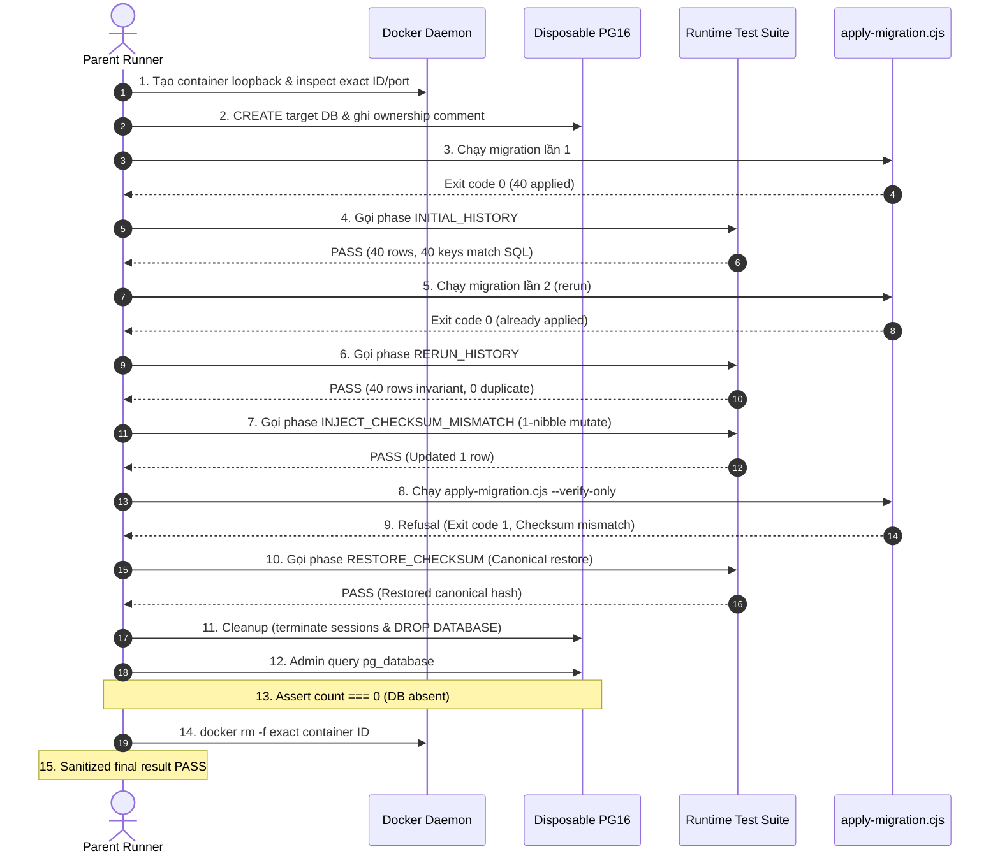

# TASK M01-07 — Xác minh PostgreSQL disposable cho Registration và KYC (Kế hoạch v4)

- Trạng thái: IN_PROGRESS — M07-A2 PG-POOL CONTRACT REMEDIATION VERIFIED — AWAITING CHECKPOINT COMMIT
- Chế độ hiện tại: DOCUMENTATION UPDATE AND CHECKPOINT STAGING ONLY
- An toàn thực thi database: BLOCKED — M07-A2 RUNTIME RETRY NOT AUTHORIZED
- M01-07: INCOMPLETE
- UC-M01: INCOMPLETE
- Chế độ dự kiến sau owner approval riêng: IMPLEMENT_AND_VERIFY (theo từng gate)

## OWNER APPROVAL RECORD — M07-A2 PG-POOL REMEDIATION (2026-09-05)

- Root cause được Owner chấp nhận: `POOL_QUERY_OVERLOAD_MISMATCH`.
- Remediation local/unit được Owner chấp nhận để staging; không phải runtime
  approval.
- `npm run typecheck`: PASS.
- `npm run build`: PASS.
- Targeted suite: `115/115 PASS`, delta `+4` từ baseline `111`.
- CodeGraph/source reconciliation: PASS; unsupported query shape đã biến mất
  trong disposable scope.
- Runtime retry chưa được cấp quyền.
- Không có bằng chứng socket-level cancellation; không được suy diễn từ
  orchestration cancellation.
- M07-A2 runtime, M01-07 và UC-M01 vẫn chưa hoàn thành.

Baseline được xác nhận khi soạn task:

- Repository root: C:\Projects\banking-system
- Current working directory: C:\Projects\banking-system
- Branch: codex/staging-academic-completion
- HEAD: 1343f7120441ac359a598b59153a8f3634602f35
- Working tree trước documentation correction: đúng ba file modified trong checkpoint allowlist, 0 untracked file
- Cached area: sạch
- M01-06: COMPLETED
- M01-07: đang IN_PROGRESS ở checkpoint M07-A2 remediation; chưa hoàn thành
- M01-08, M01-09: chưa bắt đầu

Task này là kế hoạch xác minh cho dữ liệu tổng hợp và tiền ảo trong phạm vi khóa luận. Nó không biến hệ thống thành production, không kết nối hệ thống ngân hàng thật và không sử dụng dữ liệu khách hàng thật.

## OWNER APPROVAL — M01-07 FINAL IMPLEMENTATION PLAN

- Ngày phê duyệt kế hoạch: 2026-09-04
- Baseline commit được phê duyệt: `1bded79c8575c7958f3920cc021878e050225aed`
- Quyết định: Phê duyệt kế hoạch thực thi M01-07 (Plan v4). Kế hoạch xác lập 11 quy tắc an toàn fail-closed, mô hình chia checkpoint tuần tự (M07-A1, M07-A2, M07-B, M07-C, M07-D, M07-E), ma trận kiểm thử Registration & KYC, cùng phân định trách nhiệm rõ ràng.
- Ghi nhận 4 khoảng trống harness M07-A2: Nhận diện rõ 4 harness gap tại Checkpoint M07-A2 (`BLOCKED — M07-A2 EVIDENCE HARNESS GAP`), giữ nguyên modification allowlist cho A2 là chỉ duy nhất 1 file task. Bất kỳ mở rộng harness nào phải chờ quyết định và cấp quyền riêng từ Owner.
- Cảnh báo an toàn: Phê duyệt kế hoạch KHÔNG đồng nghĩa với việc cho phép khởi chạy database hoặc chuyển sang checkpoint thực thi code. Checkpoint M07-A1 CHƯA bắt đầu. Toàn bộ lệnh thực thi database tiếp tục bị chặn (`BLOCKED — DISPOSABLE DATABASE SAFETY NOT ESTABLISHED`) cho đến khi hoàn thành cổng an toàn M07-A1 và có phê duyệt riêng của Owner.

## OWNER APPROVAL — M07-A1 UNIT SAFETY GATE ACCEPTED

- Ngày phê duyệt: 2026-09-04
- Baseline commit: `0a351b1fa835430d8ce6cab464b16a00fe9e24f5`
- Quyết định Owner: Chấp thuận Checkpoint M07-A1 Guard & Runner Hardening ở mức unit/test-double. Checkpoint M07-A2 KHÔNG ĐƯỢC CẤP QUYỀN trong lượt này.
- Danh mục 4 file checkpoint M07-A1:
  1. `backend/scripts/run-disposable-postgres-test.ts`
  2. `backend/src/database/disposableDatabaseGuard.ts`
  3. `backend/src/tests/disposableDatabaseGuard.test.ts`
  4. `tasks/UC-M01/TASK_M01_07_VERIFY_DISPOSABLE_POSTGRESQL_REGISTRATION_KYC.md`
- Kết quả kiểm thử được chấp thuận:
  - Typecheck: PASS (`npm run typecheck`, 0 lỗi TypeScript, 0 prohibited TypeScript bypasses).
  - Build: PASS (`npm run build`).
  - Targeted tests: `32/32 PASS`, `0 fail`, `0 cancelled`, `0 skipped` (`node --import=tsx --test src/tests/disposableDatabaseGuard.test.ts`, ~379ms).
  - Quy chuẩn an toàn `SAFE-R01` đến `SAFE-R11`: Đạt đầy đủ unit/test-double evidence.
- Bounded Cooperative Cancellation:
  - Cơ chế timeout chuyển đổi hoàn toàn từ `Promise.race` sang mô hình hủy phối hợp có giới hạn, sử dụng typed lifecycle state (`"IDLE" | "RUNNING" | "STOPPING" | "TIMED_OUT" | "COMPLETED" | "FAILED"`), `AbortController`, và kiểm tra hủy trước từng phase (`checkCancellation`).
  - Late child completion: Fake child hoàn thành muộn sau timeout không làm thay đổi kết quả fail-closed và không chạy command kế tiếp.
  - Late cleanup completion: Phase dọn dẹp hoàn tất muộn sau deadline không chạy phase hủy diệt tiếp theo (`pg_terminate_backend`, `DROP DATABASE`, post-drop catalog check, container removal đều có đúng 0 lượt gọi).
  - Non-cooperative adapter: Adapter không tự hủy chỉ chứng minh orchestration trả về `fail-closed` theo đúng deadline; không chứng minh underlying runtime I/O đã bị dừng.
- Ngữ nghĩa sự kiện tiến trình (Fatal Events & Exit Code Seam):
  - Cả 4 fatal process events (`SIGINT`, `SIGTERM`, `uncaughtException`, `unhandledRejection`) đều được kiểm tra qua fake process seam; `processFacade.exitCode` được thiết lập thành 1 (khác 0), không gọi `process.exit()` trực tiếp, không có unawaited background promise.
- Ranh giới an toàn:
  - Hoàn toàn KHÔNG có PostgreSQL, Docker, container, DNS/network hoặc child process thật nào được chạy trong M07-A1.
  - Không có bất kỳ tuyên bố an toàn ở cấp độ runtime (no runtime safety claim).
  - Task M01-07 và Use Case UC-M01 CHƯA HOÀN THÀNH.

Giới hạn và điểm chưa chứng minh ở runtime:
- Chưa chứng minh PostgreSQL 16 container thật (chưa chứng minh ephemeral container descriptor và loopback port binding).
- Chưa chứng minh connection/query cancellation thật trên socket PostgreSQL.
- Chưa chứng minh ownership marker comment thật trong `pg_shdescription`.
- Chưa chứng minh `pg_terminate_backend`, `DROP DATABASE`, hay catalog verification sau drop thật trên PostgreSQL.
- Chưa chứng minh container removal thật bằng Docker client / daemon.
- Sơ đồ lifecycle chỉ là tài liệu minh họa, không thay thế test/runtime evidence.

Bốn blocker M07-A2 được giữ nguyên vẹn:
1. Exact 40 migration history rows (`001_initial_schema.sql` đến `040_add_admin_and_staff_audit_events.sql`).
2. Rerun migration tuần tự trên DB đã migrate phải giữ nguyên 40 rows.
3. Runtime checksum mismatch refusal: Sửa đổi 1 byte checksum phải bị từ chối rõ ràng.
4. Post-drop catalog verification: Truy vấn `pg_database` xác minh DB target đã biến mất hoàn toàn.

## OWNER APPROVAL — M07-A2R NO-DB HARNESS ACCEPTED

- Ngày phê duyệt: 2026-09-04
- Baseline HEAD: `925bf3129ee7f0f3e562078f554c1f12cdfcaf4f`
- Quyết định Owner: Chấp nhận Checkpoint M07-A2R No-DB Harness sau khi hoàn thành phase-key remediation.
- Bằng chứng và cơ chế fail-closed được chấp nhận:
  - Immutable Docker image binding: `validateDockerImageInspectOutput` ràng buộc exact `postgres:16` tag và 64-hex image ID (`^sha256:[0-9a-f]{64}$`).
  - Container-ID binding: `parseAndValidateLaunchedContainerId` ràng buộc exact 64-hex container ID từ `docker run`; `validateDockerInspectOutput` đối chiếu `inspect.Id === launchedContainerId`; cleanup chỉ xóa `launchedContainerId`.
  - Runtime ownership gate: `assertRuntimeDatabaseOwnership` xác thực `current_database()` và marker comment (`disposable_run_id=<run_id>;owner=m01_runner`) trên catalog trước mọi phase action.
  - Case-insensitive child environment filtering: `PROTECTED_CHILD_ENV_KEYS_UPPERCASE` loại bỏ mọi biến thể hoa thường của các khóa nhạy cảm.
  - Phase-key reconciliation: Canonical key duy nhất là `DISPOSABLE_TEST_PHASE`. Runner chỉ ghi `DISPOSABLE_TEST_PHASE`, runtime test chỉ đọc `DISPOSABLE_TEST_PHASE`. Legacy key `DATABASE_TEST_PHASE` chỉ được giữ trong protected set để strip triệt để input legacy/hostile, runtime worker hoàn toàn không chấp nhận hay đọc legacy key này.
- Kết quả kiểm thử và Quality Gates:
  - Typecheck: PASS (`npm run typecheck`, 0 lỗi, 0 prohibited bypasses: 0 `any`, 0 `as any`, 0 `as unknown as`, 0 `as never`, 0 `@ts-ignore`, 0 `@ts-expect-error`).
  - Build: PASS (`npm run build`, biên dịch `dist/` thành công).
  - Targeted tests: `76/76 PASS`, `0 fail`, `0 cancelled`, `0 skip` (`node --import=tsx --test src/tests/disposableDatabaseGuard.test.ts`).
  - Phân bổ 76 tests:
    - 32 M07-A1 baseline tests.
    - 23 M07-A2R baseline harness tests (`M07-A2R-01` đến `M07-A2R-23`).
    - 20 safety-binding follow-up tests (`M07-A2R-FU-01` đến `M07-A2R-FU-20`).
    - 1 phase-key regression test (`M07-A2R-FU-21`).
- Ranh giới an toàn:
  - Không chạy Docker CLI, Docker daemon, PostgreSQL, database socket, migration hoặc runtime migration test.
  - Bằng chứng chỉ chứng minh ở mức unit/test-double nhằm giảm thiểu rủi ro theo thiết kế fail-closed ở mức unit/test-double.
  - Checkpoint M07-A2 runtime vẫn ở trạng thái: **CHƯA ĐƯỢC CẤP QUYỀN (NOT AUTHORIZED)**.
  - Task M01-07 và Use Case UC-M01 tiếp tục: **CHƯA HOÀN THÀNH (INCOMPLETE)**.

## M07-A2R CHECKPOINT IMPLEMENTATION COMMIT

### Commit identity
- **Full Commit SHA**: `0b9f5e143f823acbe6fa08ec92dabb1bc86658f4`
- **Parent Commit SHA**: `925bf3129ee7f0f3e562078f554c1f12cdfcaf4f`
- **Commit Message**: `test(database): prepare disposable PostgreSQL runtime harness`
- **AuthorDate**: `2026-09-04T17:50:24+07:00`
- **CommitDate**: `2026-09-04T17:50:24+07:00`
- **Committed Files (Exact Five)**:
  - `M backend/scripts/run-disposable-postgres-test.ts`
  - `M backend/src/database/disposableDatabaseGuard.ts`
  - `M backend/src/tests/disposableDatabaseGuard.test.ts`
  - `A backend/src/tests/disposableMigrationRuntime.test.ts`
  - `M tasks/UC-M01/TASK_M01_07_VERIFY_DISPOSABLE_POSTGRESQL_REGISTRATION_KYC.md`
- **Exact Stat**: `5 files changed, 2694 insertions(+), 4 deletions(-)`
- **Commit-Tree Blob Hashes**:
  - `backend/scripts/run-disposable-postgres-test.ts`: `11c8a40019d6b1166b11898eda74b86fc908b67c`
  - `backend/src/database/disposableDatabaseGuard.ts`: `ac7668b47c5c1a60468aa9d37e4f192ecd00fc45`
  - `backend/src/tests/disposableDatabaseGuard.test.ts`: `60d4ffe82ce1d478c5184b9dd171f87d0d04de6e`
  - `backend/src/tests/disposableMigrationRuntime.test.ts`: `d397b7ae88fee3f771cd8b0ae3030f43db83d07f`
  - `tasks/UC-M01/TASK_M01_07_VERIFY_DISPOSABLE_POSTGRESQL_REGISTRATION_KYC.md`: `c9b06615d568079424ed66185b0af1adfc0293ad`

### Accepted implementation evidence
- **Typecheck**: PASS (`npm run typecheck`, 0 lỗi, 0 prohibited bypasses).
- **Build**: PASS (`npm run build`, biên dịch `dist/` thành công).
- **Targeted Unit Suite**: `76/76 PASS` (`0 fail`, `0 cancelled`, `0 skipped`):
  - 32 tests M07-A1 baseline.
  - 23 tests M07-A2R baseline harness (`M07-A2R-01` đến `M07-A2R-23`).
  - 20 tests safety-binding follow-up (`M07-A2R-FU-01` đến `M07-A2R-FU-20`).
  - 1 test phase-key regression (`M07-A2R-FU-21`).

### Accepted harness capabilities
- Exact `postgres:16` tag and immutable image-ID binding (`validateDockerImageInspectOutput`).
- Exact launch/inspect/cleanup container-ID binding (`parseAndValidateLaunchedContainerId`, cleanup uses `launchedContainerId`).
- Loopback-only ephemeral container contract (`127.0.0.1`, numeric port).
- No host volume contract (chặn `-v` và `--volume`).
- `--pull=never` flag enforcement.
- Clean child environment construction (`buildCleanChildEnvironment`).
- Canonical phase key duy nhất: `DISPOSABLE_TEST_PHASE`.
- Legacy `DATABASE_TEST_PHASE` bị strip triệt để và không được runtime chấp nhận.
- Runtime ownership-marker gate trên catalog trước mọi phase action (`assertRuntimeDatabaseOwnership`).
- Exact 40-row migration-history validator (`validateInitialMigrationHistory`).
- Rerun invariant validator (`validateRerunMigrationHistory`).
- One-nibble checksum mutation (`mutateMigrationChecksumOneNibble`).
- Expected checksum-mismatch classifier (`isExpectedChecksumMismatchRefusal`).
- Restoration verify-only phase và post-restore validation.
- Parent-side post-drop catalog assertion (`assertPostDropCatalogEmpty`).
- Bounded timeout/cancellation orchestration với typed lifecycle states.

### Evidence boundary
- Toàn bộ harness chỉ được xác minh bằng unit tests và in-memory test doubles nhằm giảm thiểu rủi ro theo thiết kế fail-closed ở mức unit/test-double.
- Chưa chạy Docker CLI hoặc Docker daemon.
- Chưa chạy PostgreSQL.
- Chưa mở database/network socket.
- Chưa chạy migrations.
- Chưa chạy `disposableMigrationRuntime.test.ts`.
- Chưa chứng minh runtime cleanup, row lock hoặc database concurrency trên hạ tầng thật.
- Checkpoint M07-A2 vẫn cần Owner directive riêng trước khi được phép kích hoạt.

### Remaining M07-A2 runtime evidence
Giữ nguyên chưa hoàn thành và tiếp tục là ranh giới bắt buộc:
1. Exact 40 migration rows trên PostgreSQL disposable thật.
2. Rerun giữ nguyên exact 40 rows trên PostgreSQL disposable thật.
3. Runtime checksum mismatch refusal trên PostgreSQL disposable thật.
4. Post-drop `pg_database` catalog verification trên PostgreSQL disposable thật.
5. Ephemeral container identity, loopback binding, và không-volume mount verification từ Docker daemon thật.
6. Ownership marker comment trong `pg_shdescription` và cleanup xác nhận trên PostgreSQL thật.

## OWNER APPROVAL — M07-A2 CLI WIRING REMEDIATION ACCEPTED

- Ngày phê duyệt: 2026-09-04
- Baseline HEAD: `5b985badb4d187955eeaf49664b78b12ace7677a`
- Quyết định Owner: Chấp thuận kết quả hiệu chỉnh M07-A2 CLI wiring remediation trong phạm vi unit/static evidence.
- Danh mục 4 file checkpoint M07-A2 CLI wiring:
  1. `backend/scripts/run-disposable-postgres-test.ts`
  2. `backend/src/database/disposableDatabaseGuard.ts`
  3. `backend/src/tests/disposableDatabaseGuard.test.ts`
  4. `tasks/UC-M01/TASK_M01_07_VERIFY_DISPOSABLE_POSTGRESQL_REGISTRATION_KYC.md`
- Quy tắc điều phối 4 nhánh (Production Dispatch Trace):
  - Exact single canonical argument (`src/tests/disposableMigrationRuntime.test.ts`) → chạy canonical sequence (`runCanonicalEvidenceSequence`).
  - Exact canonical kết hợp với bất kỳ argument nào khác → bị từ chối fail-closed trước cả hai runner (`handled: "REJECTED"`, `exitCode = 1`).
  - Reserved canonical alias hoặc non-exact candidate (`isReservedCanonicalRuntimeCandidate`) → bị từ chối fail-closed trước cả hai runner (`handled: "REJECTED"`, `exitCode = 1`, `canonicalCalls = 0`, `legacyCalls = 0`).
  - Chỉ các test target legacy hợp lệ còn lại mới chuyển sang legacy runner (`runDisposablePostgresTest`).
- Ma trận 5 unit tests hiệu chỉnh (`M07-A2-CLI-01` .. `M07-A2-CLI-05`):
  - `M07-A2-CLI-01`: Exact single canonical target điều phối canonical runner đúng 1 lần, 0 legacy runner calls.
  - `M07-A2-CLI-02`: Đóng documented alias-bypass trong dispatch contract đã kiểm thử trên 11 biến thể (whitespace, relative `./` và `.\`, Windows backslash `\`, absolute path, `..`, case variants, prefix, suffix); xác minh `isCanonicalRuntimePath = false`, `isReservedCanonicalRuntimeCandidate = true`, `canonicalCalls = 0`, `legacyCalls = 0`, `facade.exitCode = 1`, `handled = "REJECTED"`, thông điệp lỗi được sanitize.
  - `M07-A2-CLI-03`: Exact canonical kết hợp đối số bổ sung fail-closed an toàn (`handled = "REJECTED"`, `exitCode = 1`, 0 runner calls).
  - `M07-A2-CLI-04`: Genuine legacy test target điều phối legacy runner đúng 1 lần (`legacyCalls = 1`, 0 canonical calls).
  - `M07-A2-CLI-05`: Production main seam (`runCliMain`), runner import an toàn side-effect-free, xuất khẩu `isReservedCanonicalRuntimeCandidate`, redaction của error output và không retry/fallback khi canonical failure.
- Kết quả kiểm thử và Quality Gates được chấp thuận:
  - Typecheck: PASS (`npm run typecheck`, 0 lỗi, 0 prohibited bypasses: 0 `any`, 0 `as any`, 0 `as unknown as`, 0 `as never`, 0 `@ts-ignore`, 0 `@ts-expect-error`).
  - Build: PASS (`npm run build`, biên dịch `dist/` thành công).
  - Targeted unit suite: `81/81 PASS`, `0 fail`, `0 cancelled`, `0 skipped` (`node --import=tsx --test src/tests/disposableDatabaseGuard.test.ts`, ~372ms).
- Kiểm tra tính toàn vẹn file đóng băng (Frozen runtime test):
  - File: `backend/src/tests/disposableMigrationRuntime.test.ts`
  - SHA-256: `890511a6d95a75b59cda04ebac737379f6c3c55c2e8003d3b7844e6b6834eb04` (khớp 100% baseline).
- Ranh giới an toàn và ghi nhận độ lệch (Evidence Boundary & Ledger):
  - Tuân thủ ranh giới NO-DATABASE trong phiên: không có bất kỳ bằng chứng runtime hay database thật nào được tạo ra.
  - Độ lệch read-only Docker trong phiên trước (`docker ps -a` kiểm tra rò rỉ container sau failure) đã được ghi nhận; tuân thủ ranh giới NO-DATABASE trong phiên: không chạy lệnh Docker nào trong toàn bộ phiên correction hiện tại.
  - Việc chạy lại M07-A2 runtime (runtime retry) bắt buộc phải có chỉ thị riêng từ Owner (`M07-A2 RUNTIME RETRY NOT AUTHORIZED`).
  - Task M01-07 và Use Case UC-M01 tiếp tục ở trạng thái **CHƯA HOÀN THÀNH (INCOMPLETE)**.

## M07-A2 CLI WIRING IMPLEMENTATION COMMIT

### Commit identity
- **Full Implementation SHA**: `2776681dd5eda81e319d193cfa560e69a6d0de70`
- **Parent SHA**: `5b985badb4d187955eeaf49664b78b12ace7677a`
- **Exact Commit Message**: `fix(database): route disposable runtime through canonical harness`
- **AuthorDate**: `2026-09-04T20:19:03+07:00`
- **CommitDate**: `2026-09-04T20:19:03+07:00`
- **Committed Files (Exact Four)**:
  - `M backend/scripts/run-disposable-postgres-test.ts`
  - `M backend/src/database/disposableDatabaseGuard.ts`
  - `M backend/src/tests/disposableDatabaseGuard.test.ts`
  - `M tasks/UC-M01/TASK_M01_07_VERIFY_DISPOSABLE_POSTGRESQL_REGISTRATION_KYC.md`
- **Exact Commit Stat**: `4 files changed, 640 insertions(+), 16 deletions(-)`
- **Commit-Tree Blob Hashes**:
  - `backend/scripts/run-disposable-postgres-test.ts`: `25c0dae7c64fcbe3ad5db43b7682b2acde786974`
  - `backend/src/database/disposableDatabaseGuard.ts`: `1366b27c5c9b4319ff1fcf95d97ea593ef3fbded`
  - `backend/src/tests/disposableDatabaseGuard.test.ts`: `40d03d432bb0bce329efe6c3f4ddd3d4bd8985a0`
  - `tasks/UC-M01/TASK_M01_07_VERIFY_DISPOSABLE_POSTGRESQL_REGISTRATION_KYC.md`: `7e888d12f62ee0d317cefc46bf6fa002f26101b2`

### Accepted implementation evidence
- **Typecheck**: PASS (`npm run typecheck`, 0 lỗi TypeScript, 0 prohibited bypasses: 0 `any`, 0 `as any`, 0 `as unknown as`, 0 `as never`, 0 `@ts-ignore`, 0 `@ts-expect-error`).
- **Build**: PASS (`npm run build`, biên dịch `dist/` thành công).
- **Targeted Unit Suite**: `81/81 PASS` (`0 fail`, `0 cancelled`, `0 skipped`, ~372ms).
- **Exact Four-Branch Dispatch Contract**:
  - Branch 1: Exact single canonical argument (`src/tests/disposableMigrationRuntime.test.ts`) → `runCanonicalEvidenceSequence` (`handled: "CANONICAL"`).
  - Branch 2: Exact canonical target kết hợp đối số bổ sung → fail-closed trước cả hai runner (`handled: "REJECTED"`, `exitCode = 1`, 0 runner calls).
  - Branch 3: Reserved canonical aliases/candidates (`isReservedCanonicalRuntimeCandidate`) → fail-closed trước cả hai runner (`handled: "REJECTED"`, `exitCode = 1`, `canonicalCalls = 0`, `legacyCalls = 0`).
  - Branch 4: Genuine legacy targets hợp lệ → `runDisposablePostgresTest` (`handled: "LEGACY"`).
- **Reserved Aliases Chặn Trước Cả Hai Runners**:
  - Toàn bộ 11 biến thể non-canonical (whitespace, relative `./` và `.\`, Windows backslash `\`, absolute path, `..`, case variants, prefix, suffix) được xác minh chặn hoàn toàn, không rơi sang legacy runner hay canonical runner (`canonicalCalls === 0`, `legacyCalls === 0`).
- **Frozen Runtime Test Hash**:
  - `backend/src/tests/disposableMigrationRuntime.test.ts` (SHA-256: `890511a6d95a75b59cda04ebac737379f6c3c55c2e8003d3b7844e6b6834eb04`).
- **Ranh giới Thực thi**:
  - Tuân thủ ranh giới NO-DATABASE trong phiên: không có lệnh Docker, PostgreSQL, database socket, migration hay runtime test nào được thực thi trong phiên commit.
  - Commit hiện tại được lưu trữ hoàn toàn ở local, chưa push lên remote.

## 1. Repository verification và quyền phiên này

Preflight đã chạy trong repository thật:

```powershell
git branch --show-current
# codex/staging-academic-completion

git rev-parse HEAD
# 1bded79c8575c7958f3920cc021878e050225aed

git status --short --untracked-files=all
# ?? tasks/UC-M01/TASK_M01_07_VERIFY_DISPOSABLE_POSTGRESQL_REGISTRATION_KYC.md

git diff --cached --name-status
# <không có dòng thay đổi>

git diff --name-status
# <không có dòng thay đổi>

git log -5 --oneline
# 1bded79 docs(uc-m01): complete registration KYC coverage gaps
# 7599a5a test(mobile): close registration KYC coverage gaps
# a7d3068 docs(uc-m01): complete KYC lifecycle and UI errors
# 6bdb004 feat(kyc): complete mobile lifecycle states
# 736e55e docs(uc-m01): record KYC lifecycle checkpoint
```

M01-07 phải chạy lại toàn bộ preflight ở đầu mỗi checkpoint. Không được mặc định rằng snapshot M01-06 hoặc số liệu trong tài liệu cũ vẫn là hiện trạng. Source tree, migration history/checksum, runtime và test output của đúng HEAD là bằng chứng chính.

Chỉ file sau được tạo hoặc cập nhật trong phiên documentation-only này:

`tasks/UC-M01/TASK_M01_07_VERIFY_DISPOSABLE_POSTGRESQL_REGISTRATION_KYC.md`

Không đọc hoặc in .env, DATABASE_URL, password, token, key hoặc credential. Chỉ được đọc tên biến, file .env.example và cấu hình đã redact khi cần.

## 2. Chế độ làm việc và quyền Git

Chế độ hiện tại là DIAGNOSE_AND_PLAN — DOCUMENTATION ONLY.

Quyền trong phiên này:

- Được kiểm tra source, migration, test harness, package script và cấu hình Compose ở chế độ chỉ đọc.
- Được cập nhật đúng task file M01-07 này.
- Không được sửa Backend source, repository, service, database schema, migration, OpenAPI, Mobile, Admin Web, CI, infrastructure, worker hoặc scheduler.
- Không được chạy PostgreSQL integration/release suite.
- Không được tạo, reset, migrate, seed, truncate, drop hoặc xóa database.
- Không được kết nối banking_preview, database remote, staging hoặc production-like.
- Không được chạy docker compose up, docker compose down, createdb, dropdb, CREATE DATABASE hoặc DROP DATABASE.
- Không được chạy worker/scheduler, Mobile runtime, emulator hoặc Maestro.
- Không được thêm dependency, script package hoặc biến secret/config.
- Không được git add, stage, commit, push, merge, rebase hoặc tag.

Quyền thực hiện các checkpoint có database ở phần sau chỉ có hiệu lực sau khi owner phê duyệt riêng chế độ implementation và xác nhận protocol disposable đã đạt gate an toàn. Không được xem kế hoạch này là quyền chạy destructive test.

## 3. Mục tiêu và kết quả quan sát được

Mục tiêu duy nhất của M01-07 là chứng minh trên một PostgreSQL disposable được guard chặt rằng Registration và KYC relational-v2:

1. Có thể migrate từ database rỗng theo đúng thứ tự 001–040.
2. Ghi và kiểm tra migration history, checksum và migration-set fingerprint.
3. Chạy lại migration an toàn, không tạo bản ghi lịch sử trùng và không che giấu checksum mismatch.
4. Giữ đúng các invariant database của Registration, challenge, completion, KYC, audit và outbox.
5. Xử lý concurrency bằng row lock, unique constraint, transaction và idempotency đúng với canonical contract.
6. Rollback không để lại customer, account, pending registration, KYC, audit, outbox hoặc balance dở dang.
7. Đóng và mở lại pool/repository vẫn đọc được dữ liệu đã commit.
8. Chỉ sử dụng fixture synthetic; không đưa password, OTP, proof, token, full identity number hoặc credential vào log/evidence.

Kết quả cần bàn giao sau implementation là evidence đã redact, gắn với đúng HEAD, migration fingerprint, môi trường disposable và lệnh thật đã chạy. Không được dùng số lượng test skip như bằng chứng PostgreSQL đã pass.

## 4. Phạm vi và phần không thuộc M01-07

### 4.1 Thuộc M01-07

- Disposable database safety protocol hardening và validation.
- Migration từ database rỗng và kiểm tra lịch sử/checksum.
- Upgrade/re-run theo migration runner hiện có.
- Registration duplicate race, pending cleanup, completion precedence, challenge binding, cancel idempotency và verify race.
- KYC open-application constraint, DRAFT, SUBMITTED, UNDER_REVIEW, NEEDS_MORE_INFO, APPROVED, REJECTED, submit idempotency và interleaving.
- Transaction rollback, lock ordering, isolation, restart safety.
- Audit/outbox/business side-effect consistency trong cùng transaction.
- Disposable database guard, cleanup ownership, timeout và redacted evidence.

### 4.2 Không thuộc M01-07

- Sửa canonical decisions D-01 đến D-15.
- Sửa API/OpenAPI hoặc Mobile contract; M01-03 đã sở hữu phần đồng bộ đó.
- Sửa Registration recovery code ngoài bằng chứng cần kiểm tra; nếu service sai thì mở task implementation riêng, không âm thầm sửa trong test task.
- Emulator, thiết bị thật, restart app, UI, keyboard, Maestro; chuyển M01-08.
- Worker production-like, push/email provider thật, scheduler deployment; chỉ kiểm tra bản ghi outbox nguyên tử nếu cần, không tuyên bố worker đã xác minh.
- Admin Web, CI/infrastructure, cloud, HTTPS, backup/restore staging.
- Tiền thật, core/partner thật, dữ liệu định danh thật.

## 5. Quan hệ với M01-03, M01-04, M01-05, M01-06, M01-08 và M01-09

| Task | Kết quả đã có hoặc dependency | M01-07 nhận và xác minh | Không được nhận thay |
| ---- | ----------------------------- | ----------------------- | --------------------- |
| M01-03 | API privacy/contract đã đồng bộ; database thật bị deferred | Kiểm tra persisted payload/mapper không làm lộ full identity và schema vẫn đọc được | Không sửa OpenAPI, Backend public mapper hoặc Mobile |
| M01-04 | Registration contract/recovery và D-06–D-09 đã chốt; PostgreSQL race bị deferred | Chứng minh transaction, row lock, duplicate/cancel/verify/restart trên DB disposable | Không đổi recovery policy hoặc global enum |
| M01-05 | KYC lifecycle D-10/D-11/D-14/D-15 đã chốt; DB concurrency bị deferred | Chứng minh unique-open, status terminal, version, lock, side-effect idempotency | Không đổi KYC status contract hoặc UI |
| M01-06 | Coverage gaps test-only đã đóng; PostgreSQL/device vẫn deferred | Chạy phần relational runtime được chỉ định trong task này | Không coi test unit là bằng chứng DB |
| M01-08 | Chưa bắt đầu | Nhận kết luận persisted state/restart cần kiểm tra trên app/emulator | Không tuyên bố emulator/Maestro pass |
| M01-09 | Chưa bắt đầu | Nhận evidence và risk còn lại để audit/đóng UC-M01 | Không đánh dấu toàn bộ UC-M01 hoàn thành |

## 6. Decisions D-01 đến D-15 và ownership của M01-07

M01-07 không tạo decision mới. Nó chỉ kiểm chứng invariant database của các decision đã được owner chốt trong M01-02 và implementation đã được giao cho M01-03/M01-04/M01-05.

| Decision | Invariant cần kiểm chứng trên PostgreSQL | Task sở hữu contract | Bằng chứng M01-07 cần |
| -------- | ---------------------------------------- | --------------------- | --------------------- |
| D-01 | Identity synthetic lưu đúng boundary 6–24 chữ số; không lộ giá trị đầy đủ trong public result/log | M01-03 | Row/payload hợp lệ và response/query assertion đã redact |
| D-02 | documentUri chỉ nhận mock:// hoặc synthetic:// ở boundary đã chốt | M01-03 | Valid/invalid fixture và persisted value |
| D-03 | Public KYC chỉ trả identityNumberLast4 đúng bốn chữ số | M01-03 | Mapper/HTTP assertion; không đọc full identity vào evidence |
| D-04 | Full identity không xuất hiện trong public response hoặc telemetry | M01-03 | Capture/log/storage scan đã redact |
| D-05 | Registration dùng EMAIL_OTP và REGISTRATION_EMAIL_VERIFY; KYC dùng enum canonical | M01-04/M01-05 | Challenge/status row và rejection cho alias không hợp lệ |
| D-06 | Verify malformed/missing body trả 422 ở HTTP contract | M01-04 | DB không tạo side effect khi HTTP fake test được phép; HTTP fake chính thuộc M01-04 |
| D-07 | Duplicate registration race có một winner (202) và error 409 cho loser | M01-04 | Hai transaction/process và count customer/pending/completion |
| D-08 | Cancel dùng POST /auth/register/cancel theo base path thực tế | M01-04 | Challenge/pending state sau command; path/HTTP chính thuộc M01-04 |
| D-09 | Cancel ràng buộc challengeId, X-Device-ID, purpose; idempotent và completed precedence | M01-04 | 204/404/409 theo state, không hủy nhầm device/purpose |
| D-10 | KYC DRAFT là payload đầy đủ hợp lệ đã lưu nhưng chưa submit | M01-05 | Status, payload, submitted_at, version và side-effect count |
| D-11 | REJECTED terminal/immutable; resubmit tạo application mới, tối đa một open | M01-05 | Cũ không đổi, record mới DRAFT/SUBMITTED hợp lệ |
| D-12 | Không persist password, OTP hoặc proof plaintext | M01-04/M01-05 | Column/payload/audit/outbox scan chỉ có digest/intent đã redact |
| D-13 | Identifier rate-limit chỉ dùng keyed HMAC-SHA-256 hex 64 chars; không lưu raw identifier | M01-04 | rate_limit_buckets.bucket_key có prefix + keyed HMAC lowercase hex 64 chars |
| D-14 | NEEDS_MORE_INFO là canonical; version/field semantics nhất quán | M01-05 | Status transition/version/constraint trên DB |
| D-15 | Update unchanged có thể bỏ identity; đổi identity phải là full 6–24 digits | M01-03/M01-05 | Persisted value mới đúng, response chỉ last4 |

## 7. Quy chuẩn an toàn cơ sở dữ liệu disposable (Disposable Database Safety Protocol)

Để giảm thiểu rủi ro theo cơ chế fail-closed đã phê duyệt đối với preview database (`banking_preview`), staging hoặc môi trường dùng chung, M01-07 thiết lập 11 quy tắc an toàn bắt buộc (`SAFE-R01` đến `SAFE-R11`). Mọi runner và test harness phải tuân thủ nghiêm ngặt:

### 7.1 Mười một quy tắc an toàn bắt buộc (SAFE-R01 đến SAFE-R11)

- `SAFE-R01` — Bí mật chuỗi kết nối và thông tin xác thực (Connection secrecy): Không bao giờ echo, log, serialize hoặc in chuỗi kết nối đầy đủ, password, token, key hoặc connection string ra console, test report, transcript hay artifact. Mọi thông báo lỗi và log audit phải được redact; trong báo cáo chỉ ghi nhận connection value: `value redacted`.
- `SAFE-R02` — Lớp môi trường runtime cô lập (Isolated runtime class): Chỉ chạy trên ephemeral container PostgreSQL 16 local, bind duy nhất vào numeric loopback interface (`127.0.0.1` hoặc `::1`). Nếu kiểm tra `localhost`, phải phân giải DNS và chứng minh mọi địa chỉ trả về đều là loopback numeric, đồng thời đối chiếu exact container ID/label. Docker port tuyệt đối không được bind `0.0.0.0`. Gán label và tên duy nhất cho container theo pattern `^banking_test_container_[a-f0-9]{32}$`. Tuyệt đối cấm mount volume host, cấm volume persistence (`banking_preview_pgdata`), cấm dùng chung database instance với bất kỳ service nào khác.
- `SAFE-R03` — Danh sách endpoint và tên database được bảo vệ (Protected endpoints & DB names): Fail-closed ngay lập tức nếu endpoint không thuộc loopback numeric, hoặc tên database là các database hệ thống (`postgres`, `template0`, `template1`), database preview (`banking_preview`), hoặc bất kỳ biến thể chữ hoa/chữ thường sau khi chuẩn hóa chuỗi (case-insensitive normalized).
- `SAFE-R04` — Định danh database đích do runner sinh độc quyền (Runner-generated target identity): Tên database kiểm thử phải được sinh tự động bởi runner theo pattern regex nghiêm ngặt `^banking_test_[a-f0-9]{32}$`, trong đó `run_id` là đúng 32 ký tự thập lục phân thường (`run_id = randomUUID().replaceAll("-", "").toLowerCase()`). Runner từ chối mọi tên database do caller hoặc biến môi trường bên ngoài tự ý truyền vào. Phân loại database đích: `ephemeral-loopback`, target class: `banking_test_<redacted>`. Không in full run ID trong báo cáo.
- `SAFE-R05` — Phân loại và kiểm tra trước khi tạo (Pre-create classification): Trước khi thực hiện lệnh `CREATE DATABASE`, runner phải kết nối tới admin database trên loopback để phân loại: kiểm tra container ID, host, port, xác nhận database đích chưa tồn tại trong `pg_database`, và xác nhận target name thỏa mãn pattern `^banking_test_[a-f0-9]{32}$`. Bước pre-create này không yêu cầu ownership marker vì database đích chưa được tạo.
- `SAFE-R06` — Dấu ấn quyền sở hữu sau khi tạo (Post-create ownership marker): Ngay sau khi tạo database đích, runner ghi dấu ấn quyền sở hữu thông qua `COMMENT ON DATABASE "banking_test_<run_id>" IS 'disposable_run_id=<run_id>;owner=m01_runner;created_at=<timestamp>'`. Không can thiệp sửa schema application. Trước khi chạy bất kỳ test nào, runner phải đọc lại comment này qua `shobj_description(d.oid, 'pg_database')` để xác minh quyền sở hữu.
- `SAFE-R07` — Tái xác thực trước khi dọn dẹp (Pre-cleanup revalidation): Trước khi thực hiện bất kỳ thao tác hủy (`DROP DATABASE`), runner phải kết nối admin database và kiểm tra lại toàn bộ: container instance, host/port, tên database khớp exact pattern `^banking_test_[a-f0-9]{32}$`, và comment database phải khớp chính xác `<run_id>` đã tạo. Nếu không khớp hoặc thiếu comment, fail-closed và dừng, không drop.
- `SAFE-R08` — Phạm vi lệnh và tiến trình chính xác (Exact command and process scope): Chỉ ngắt kết nối (`pg_terminate_backend`) thuộc đúng database đích `banking_test_<run_id>`. Lệnh `DROP DATABASE` chỉ nhắm đúng tên đã xác thực, không dùng phép nội suy chuỗi shell không kiểm soát. Trước khi remove container phải revalidate exact container ID và run label theo pattern `^banking_test_container_[a-f0-9]{32}$`; không xóa container theo tên hoặc prefix mơ hồ. Không dùng `docker compose down -v`, không dùng `docker system prune`, không xóa container/volume ngoài phiên chạy. Giới hạn test execution trong allowlist cố định.
- `SAFE-R09` — Giới hạn thời gian chờ hữu hạn (Finite candidate timeouts): Mọi thao tác phải có timeout hữu hạn được thực thi nghiêm ngặt, không cho phép treo vô hạn:
  - Khởi tạo container: tối đa 60 giây.
  - Kết nối pool/client: tối đa 5 giây (`connectionTimeoutMillis: 5000`).
  - Khóa dòng / bảng (lock): tối đa 5 giây (`SET lock_timeout = '5s'`).
  - Thực thi câu lệnh: tối đa 30 giây (`SET statement_timeout = '30s'`).
  - Session giao dịch nhàn rỗi: tối đa 30 giây (`SET idle_in_transaction_session_timeout = '30s'`).
  - Mỗi migration command hoặc mỗi targeted child test command: tối đa 180 giây (không chạy broad suite).
  - Dọn dẹp / cleanup: tối đa 30 giây.
- `SAFE-R10` — Dọn dẹp có bảo đảm và xử lý ngắt tiến trình (Awaited cleanup & interruption handling): Thao tác dọn dẹp bắt buộc nằm trong khối `finally` bất đồng bộ được `await` hoàn tất. Đóng toàn bộ client/pool trước khi drop. Đối với các tín hiệu ngắt (`SIGINT`, `SIGTERM`) và sự kiện lỗi nghiêm trọng (`uncaughtException`, `unhandledRejection`): handler chỉ được thực hiện bounded one-shot cleanup, giữ exit code khác 0, không swallow lỗi, không tiếp tục normal execution và tuyệt đối không gọi `process.exit()` trước khi awaited cleanup kết thúc hoặc timeout cleanup (30s) xảy ra.
- `SAFE-R11` — Hậu điều kiện, ẩn danh hóa và kết quả fail-closed (Postcondition, redaction & fail-closed result): Xác minh database đích đã bị xóa hoàn toàn khỏi PostgreSQL catalog (`pg_database`). Xóa container tạm sau khi revalidate container ID/label. Redact toàn bộ log/evidence trước khi ghi nhận. Nếu có bất kỳ bước kiểm tra hậu điều kiện nào thất bại, kết quả phải được đánh dấu là `FAILED / FAIL-CLOSED`, không được báo thành công.

### 7.2 Phân tầng bằng chứng an toàn: M07-A1 (Unit) đối chiếu M07-A2 (Runtime)

M07-A1 chỉ chứng minh pure guard logic và orchestration bằng unit/test-double; không chứng minh container identity, database comment thật, terminate session thật, drop thật hoặc catalog postcondition thật. Các đặc tính runtime này chỉ được chứng minh tại M07-A2. Sau M07-A1, việc thực thi database vẫn bị block cho đến khi Owner review và phê duyệt riêng.

| Quy tắc | M07-A1 Unit Evidence (Logic & Test-Double) | M07-A2 Runtime Evidence (Thực thi Ephemeral Container Thật) |
| ------- | ------------------------------------------ | ------------------------------------------------------------ |
| `SAFE-R01` | Test-double kiểm tra bộ lọc redaction chuỗi kết nối và credential | Quét output thực tế của lệnh migration/connection; bảo đảm không in connection string |
| `SAFE-R02` | Logic kiểm tra loopback IP numeric `127.0.0.1`/`::1` và DNS resolution | Container inspect thật: xác minh loopback numeric, không volume |
| `SAFE-R03` | Unit tests chặn các tên cấm `postgres`, `template0`, `template1`, `banking_preview` | Chạy trên target database thật; guard từ chối nếu tên vi phạm |
| `SAFE-R04` | Regex validation unit test cho pattern `^banking_test_[a-f0-9]{32}$` | Runner sinh `banking_test_<run_id>` thật với 32 hex lowercase |
| `SAFE-R05` | Mock test-double cho pre-create classification logic | Truy vấn catalog `pg_database` thật trên admin DB xác nhận target chưa tồn tại |
| `SAFE-R06` | Test-double cho việc tạo lệnh SQL `COMMENT ON DATABASE` | Thực thi `COMMENT ON DATABASE` thật; query `shobj_description` đọc lại đúng `run_id` |
| `SAFE-R07` | Unit test kiểm tra logic so sánh marker trước drop | Query `shobj_description` thật trước khi drop; xác thực marker khớp `run_id` |
| `SAFE-R08` | Mock test-double cho parameterized terminate backend và drop database | Thực thi `pg_terminate_backend(pid)` cho đúng target DB và DROP DATABASE đích danh |
| `SAFE-R09` | Assertion kiểm tra cấu hình timeout trong code harness | Bounded execution thật; đo runtime câu lệnh, abort signal khi vượt trần thời gian |
| `SAFE-R10` | Mô phỏng child failure/timeout và xác minh cleanup orchestration được gọi | Bắt signal/failure thật; xác minh exact database và container đã được cleanup sạch sẽ |
| `SAFE-R11` | Mock test-double cho catalog verification sau drop | Query `pg_database` thật xác nhận target DB đã biến mất hoàn toàn khỏi catalog |

## 8. Đối chiếu năng lực bằng chứng của M07-A2 (A2 Evidence-Capability Reconciliation)

Trước khi kích hoạt M07-A2, năng lực của các script/test hiện có trong codebase được đối chiếu cụ thể như sau:

| Yêu cầu của M07-A2 | Script / Test hiện có | Exact Symbol / Lệnh | Có đủ evidence? | Đánh giá hiện trạng |
| ------------------ | --------------------- | ------------------- | --------------- | ------------------- |
| Apply 001–040 from empty | `backend/scripts/apply-migration.cjs` qua `run-disposable-postgres-test.ts` | `main()` lines 76–77 | Yes | Runner áp dụng tuần tự toàn bộ 40 migration vào target DB |
| Exactly 40 history rows | Không có test nào trong snapshot | Không có assertion | No | **BLOCKED — M07-A2 EVIDENCE HARNESS GAP**; thiếu test query `SELECT COUNT(*) FROM reference_schema_migrations` và assert 40 |
| Rerun keeps 40 rows | `backend/scripts/apply-migration.cjs` | Mode `apply` / `verify-only` | No | **BLOCKED — M07-A2 EVIDENCE HARNESS GAP**; chưa có kịch bản chạy lặp 2 lần trên cùng disposable DB trong test harness |
| Checksum mismatch refused | `backend/scripts/apply-migration.cjs` | Checksum comparison throw | No | **BLOCKED — M07-A2 EVIDENCE HARNESS GAP**; chưa có test harness tự động inject synthetic checksum mismatch trên DB thật |
| Migration-set fingerprint | `backend/scripts/migration-fingerprint.cjs` & `migrationFingerprint.test.ts` | `fingerprint(directory)` | Yes | Offline digest qua các kiểu newline được chứng minh độc lập bởi test |
| Cleanup / postcondition | `backend/scripts/run-disposable-postgres-test.ts` | `finally` block lines 121–126 | No | **BLOCKED — M07-A2 EVIDENCE HARNESS GAP**; có lệnh drop nhưng thiếu post-drop assertion truy vấn catalog `pg_database` |

*Kết luận năng lực A2*: Snapshot hiện tại có runner `apply-migration.cjs` và `migration-fingerprint.cjs`, nhưng thiếu suite test kiểm chứng tự động cho 4 khía cạnh runtime (40 history rows, rerun count invariant, mismatch refusal, post-drop catalog verification). Không tự ý mở allowlist để sửa runner trong A2; việc bổ sung test harness sẽ cần Owner quyết định phê duyệt bổ sung nếu không dùng runner script độc lập.

## 9. Source-of-truth inventory và khảo sát hiện trạng

Không dùng một thứ tự ưu tiên chung cho mọi loại dữ liệu. M01-07 đối chiếu theo loại source sau:

| Loại dữ liệu | Source of truth | Cách xác minh | Hiện trạng đã khảo sát |
| ------------ | --------------- | ------------- | ---------------------- |
| Database schema | backend/database/*.sql và reference_schema_migrations | Đếm, sort numeric, migration từ rỗng, history/checksum và verify-only | Có migration 001–040; chưa chạy DB trong lượt này |
| Migration runner | backend/scripts/apply-migration.cjs | Kiểm tra transaction từng migration, checksum mismatch và pending set | Có advisory lock theo migration key; runtime proof còn thiếu |
| Migration set | backend/scripts/migration-fingerprint.cjs | Đối chiếu first/last/schema version/digest với evidence | Có script read-only; chưa ghi evidence mới |
| Database safety | backend/src/database/disposableDatabaseGuard.ts và runner | Guard marker, host, DB-name, reference URL, cleanup ownership | Guard có fail-closed cơ bản; safety protocol đầy đủ chưa được chứng minh |
| Transaction | backend/src/database/unitOfWork.ts | BEGIN/COMMIT/ROLLBACK, isolation, retry 40001/40P01 và row lock | Có READ COMMITTED, REPEATABLE READ, SERIALIZABLE, retry hữu hạn |
| Pool | backend/src/database/pool.ts | Pool limits, timeout, SSL và health/slow query metadata | Có pool config; chưa đo runtime trên disposable |
| Registration | backend/src/database/registrationService.ts, customerRepository.ts, mfaRepository.ts | DB process race và invariant queries | Có FOR UPDATE, unique constraints, compensation; chưa có run thật |
| KYC | backend/src/database/kycService.ts | DB lock/concurrency/status/side-effect assertions | Có lockOpen, partial unique index, version và canonical status; chưa có KYC relational file riêng |
| Audit | backend/src/database/repositories/auditRepository.ts | Count, append-only, transaction rollback | Unit/contract có; DB evidence chưa có |
| Outbox | backend/src/database/repositories/outboxRepository.ts, backend/src/outbox/postgresOutboxRepository.ts | Count, dedup key, committed vs rolled back row | Claim/lease worker có source; worker runtime không phải kết luận cốt lõi của M01-07 |
| Test runner | backend/scripts/run-disposable-postgres-test.ts | Guard trước create, exact target, finally cleanup, timeout/redaction | Có unique banking_test_* và cleanup; cần hardening theo 11 quy tắc an toàn |
| Test entrypoint | backend/package.json và test files | Đọc script thật trước khi chạy | Có test:database, test:relational, test:registration:persistence; không tự thêm script |
| Compose | compose.yaml | Chỉ đọc image/profile/volume/env names | Postgres 16 digest và volume banking_preview_pgdata; preview tuyệt đối không được động vào |
| API contract | documents/api/banking-mvp.openapi.yaml, runtime validators/routes | Chỉ regression check khi test được owner cho phép | M01-07 không sửa API; OpenAPI/runtime proof chính thuộc M01-03/M01-04/M01-05 |

### 9.1 Migration/schema invariants cần đối chiếu

| Nhóm migration | Invariant chính | Kiểm tra bắt buộc |
| -------------- | --------------- | ----------------- |
| 001_banking_mvp.sql | Customer/account/transfer/ledger/audit/outbox nền tảng và foreign key | Tạo từ rỗng, tồn tại đúng bảng/constraint, rollback không để orphan |
| 006_relational_v2_foundation.sql | Account sequence/unique account, quote fingerprint, transfer quote uniqueness, idempotency và outbox dedup/index | Constraint/index tồn tại đúng tên và chịu được race |
| 007_identity_runtime_normalization.sql | auth_challenges, pending_registrations, unique lower email/phone, expiry/attempts/device/purpose | Registration fixture và concurrent duplicate |
| 011_registration_recovery.sql | registration_completions one-time mapping customer/account | Verify race chỉ có một completion |
| 012_outbox_worker.sql, 013_outbox_worker_operations.sql | PENDING/PROCESSING/DISPATCHED/DEAD/SKIPPED, lease/dead-letter/updated-at/index | Business event commit/rollback và dedup; worker riêng chỉ khi checkpoint được mở |
| 015–018 | Challenge hardening, MFA recovery/security metadata và canonical method/purpose constraints | Purpose/method alias bị từ chối, metadata không raw |
| 020_admin_case_operations.sql | KYC application nền tảng, status/version/review data | Schema và public KYC row mapping không lẫn Admin contract |
| 033–034 | Control policy bootstrap/rate-limit policy | Chỉ kiểm tra khi dependency cần; không mở rộng M01-07 sang Admin policy |
| 038_customer_kyc_runtime.sql | Canonical NEEDS_MORE_INFO, synthetic payload, submitted timestamp, one-open partial unique index, customer history index | Concurrent save/submit, rejected immutable và version/side-effect assertions |
| 039–040 | Migration sau KYC runtime trong bộ hiện hành | History/checksum/order; không sửa migration đã áp dụng |

Không migration nào được sửa trong M01-07 để làm test pass. Nếu migration history/checksum không khớp, dừng và mở issue/task sửa migration riêng.

## 10. Test architecture hiện tại và reconcile chính xác 48 skipped tests

backend/package.json là nguồn duy nhất để chọn command:

- `npm test` chạy `node scripts/run-core-tests.cjs`.
- `npm run test:database`, `npm run test:relational`, `npm run test:registration:persistence` và các script persistence khác dùng `scripts/run-disposable-postgres-test.ts`.
- Không có script `test:m01-07`; không thêm script trong task documentation-only.
- `run-core-tests.cjs` loại toàn bộ `workerOutbox.test.ts` khỏi aggregate.
- 48 test dưới đây skip khi thiếu database URL. Chúng không phải là 48 test PostgreSQL đã pass.
- `workerOutbox.test.ts` có 9 test database riêng và không nằm trong 48 skip của core aggregate; worker evidence phải được phân biệt riêng.

| # | Test/file | Skip condition | Dependency | M01-07 ownership | Lý do hiện chưa là evidence |
| - | --------- | -------------- | ---------- | ---------------- | ---------------------------- |
| 1 | admin.database.test.ts — PostgreSQL Admin funding action is typed, atomic and single-execution | !databaseUrl | Admin database | Ngoài core M01-07, chỉ dùng làm regression nếu dependency | Chưa chạy database |
| 2 | admin.database.test.ts — customer and Admin KYC workflow reads and mutates the same persistent application | !databaseUrl | Admin/KYC database | M01-07 chỉ kiểm tra không phá KYC row; Admin workflow thuộc scope khác | Chưa chạy database |
| 3 | admin.database.test.ts — PostgreSQL Admin funding rolls back when ledger or outbox execution faults | !databaseUrl | Admin/ledger/outbox | Ngoài Registration/KYC customer slice | Chưa chạy database |
| 4 | admin.database.test.ts — PostgreSQL fraud notes are parameterized and sanitized before persistence | !databaseUrl | Admin/fraud database | Ngoài M01-07 | Chưa chạy database |
| 5 | admin.database.test.ts — PostgreSQL account and customer access locks survive repository restart | !databaseUrl | Admin/account repository | Ngoài M01-07 | Chưa chạy database |
| 6 | admin.database.test.ts — PostgreSQL Admin funding and transfer reversals are balanced and idempotent | !databaseUrl | Admin/ledger/transfer | Ngoài M01-07 | Chưa chạy database |
| 7 | admin.database.test.ts — legacy public replay preserves append-only Admin audit and Outbox rows | !databaseUrl | Admin/audit/outbox | Chỉ dùng làm non-regression khi owner mở rộng | Chưa chạy database |
| 8 | admin.database.test.ts — PostgreSQL Admin outbox requeue accepts only canonical DEAD/SKIPPED events | !databaseUrl | Admin/outbox | Ngoài M01-07 | Chưa chạy database |
| 9 | admin.database.test.ts — Admin outbox requeue hands a canonical event to the worker exactly once | !databaseUrl | Admin/worker/outbox | Worker scope riêng | Chưa chạy database |
| 10 | creditRelational.test.ts — relational credit payment is atomic, prevents concurrent overpay and is restart-readable | !databaseUrl | Credit relational | Ngoài M01-07 | Chưa chạy database |
| 11 | creditRelational.test.ts — relational credit payment rollback leaves quote, balances, ledger and outbox untouched | !databaseUrl | Credit/ledger/outbox | Ngoài M01-07 | Chưa chạy database |
| 12 | creditRelational.test.ts — credit repayment remains available while new credit is frozen and fails closed only on its command switch | !databaseUrl | Credit/control policy | Ngoài M01-07 | Chưa chạy database |
| 13 | creditRelational.test.ts — relational credit application activation creates account and card without a zero placeholder statement | !databaseUrl | Credit/card | Ngoài M01-07 | Chưa chạy database |
| 14 | creditRelational.test.ts — persistent card lock is emergency-safe and idempotent while unlock remains policy-gated | !databaseUrl | Credit/card | Ngoài M01-07 | Chưa chạy database |
| 15 | creditRelational.test.ts — reported-lost card is blocked and creates one durable operations case under concurrency | !databaseUrl | Credit/Admin cases | Ngoài M01-07 | Chưa chạy database |
| 16 | databaseFoundation.test.ts — migration 035 backfills only trustworthy credit cycle evidence and marks ambiguity | !databaseUrl | Migration/credit | Chỉ migration regression ngoài KYC/Registration | Chưa chạy database |
| 17 | databaseFoundation.test.ts — control policy is bootstrapped once and missing policy fails persistent readiness closed | !databaseUrl | Control policy | Ngoài M01-07 | Chưa chạy database |
| 18 | databaseFoundation.test.ts — relational-v2 UnitOfWork rolls back and retries only retryable errors | !databaseUrl | UnitOfWork | Dùng làm prerequisite transaction evidence | Chưa chạy database |
| 19 | databaseFoundation.test.ts — direct transfer use case is idempotent, lock-ordered and atomically persisted | !databaseUrl | Transfer/ledger | Ngoài M01-07 | Chưa chạy database |
| 20 | databaseFoundation.test.ts — fault after ledger write leaves no partial relational transfer | !databaseUrl | Transfer/ledger/outbox | Ngoài Registration/KYC | Chưa chạy database |
| 21 | databaseFoundation.test.ts — direct transfer quotes and submits enforce the current control policy without financial side effects | !databaseUrl | Transfer/control policy | Ngoài M01-07 | Chưa chạy database |
| 22 | databaseFoundation.test.ts — login rate-limit buckets lock before password verification, expire safely and reset on success | !databaseUrl | Auth/rate limit | Registration rate-limit proof có thể tham chiếu; login thuộc scope khác | Chưa chạy database |
| 23 | databaseFoundation.test.ts — persistent KYC draft/submit is idempotent, synthetic-only and emits one committed security intent | !databaseUrl | KYC/audit/outbox | M01-07 KYC baseline | Chưa chạy database |
| 24 | databaseFoundation.test.ts — beneficiary delete/block semantics preserve transfer counterparty snapshots | !databaseUrl | Beneficiary/transfer | Ngoài M01-07 | Chưa chạy database |
| 25 | databaseFoundation.test.ts — database keyset pagination returns more than 1000 account transactions without duplicates or cursor scope leaks | !databaseUrl | Account transactions | Ngoài M01-07 | Chưa chạy database |
| 26 | databaseFoundation.test.ts — normalized registration allocates a database sequence account atomically | !databaseUrl | Registration/account sequence | Registration prerequisite | Chưa chạy database |
| 27 | integratedDisposable.test.ts — integrated relational-v2 rehearsal uses HTTP OTP capture, two workers and two lifecycle schedulers | !databaseUrl | API/worker/scheduler | Worker/lifecycle evidence deferred; không thay M01-07 core proof | Chưa chạy database |
| 28 | lifecycleRelational.test.ts — Savings maturity/renewal is durable, balanced and one-shot across concurrent catch-up | !databaseUrl | Savings/lifecycle | Ngoài M01-07 | Chưa chạy database |
| 29 | lifecycleRelational.test.ts — savings kill switch is command-only and maturity falls back when a product is retired | !databaseUrl | Savings/control policy | Ngoài M01-07 | Chưa chạy database |
| 30 | lifecycleRelational.test.ts — savings maturity moves an unavailable destination to durable suspense instead of leaving it ACTIVE | !databaseUrl | Savings/suspense | Ngoài M01-07 | Chưa chạy database |
| 31 | lifecycleRelational.test.ts — savings suspense retries with backoff then dead-letters exactly once | !databaseUrl | Savings/outbox/worker | Ngoài M01-07 | Chưa chạy database |
| 32 | lifecycleRelational.test.ts — credit statement cycles use a half-open boundary without losing the cycle-end transaction | !databaseUrl | Credit/lifecycle | Ngoài M01-07 | Chưa chạy database |
| 33 | lifecycleRelational.test.ts — Credit close, overdue, pending payment and reversal are idempotent and never overpay | !databaseUrl | Credit/lifecycle | Ngoài M01-07 | Chưa chạy database |
| 34 | lifecycleRelational.test.ts — scheduled lifecycle and worker can run together, then restart without replay | !databaseUrl | Lifecycle/worker | Ngoài M01-07 | Chưa chạy database |
| 35 | lifecycleScheduler.test.ts — two lifecycle schedulers claim a due savings maturity once and expose successful readiness | !databaseUrl | Scheduler | Worker/scheduler scope riêng | Chưa chạy database |
| 36 | mfaPersistence.test.ts — persistent MFA lifecycle is transactional, one-time and restart-safe | !databaseUrl | MFA persistence | Chỉ registration challenge dependency khi cần | Chưa chạy database |
| 37 | persistence.test.ts — persistent HTTP validates the request body before opening the snapshot transaction | !databaseUrl | Persistent HTTP | HTTP fake/contract chính thuộc M01-04 | Chưa chạy database |
| 38 | persistence.test.ts — PostgreSQL snapshot persists users and serializes concurrent transfer submit | !databaseUrl | Legacy snapshot/transfer | Ngoài M01-07 | Chưa chạy database |
| 39 | persistence.test.ts — PostgreSQL snapshot keeps fraud reports idempotent, restartable and user-scoped | !databaseUrl | Fraud snapshot | Ngoài M01-07 | Chưa chạy database |
| 40 | persistence.test.ts — PostgreSQL persistent HTTP server restores state across restart | !databaseUrl | Persistent HTTP | Có thể tham chiếu restart protocol; không thay M01-08 device proof | Chưa chạy database |
| 41 | persistence.test.ts — PostgreSQL snapshot persists a savings opening across restart | !databaseUrl | Savings snapshot | Ngoài M01-07 | Chưa chạy database |
| 42 | persistence.test.ts — PostgreSQL snapshot persists M7 credit state and serializes concurrent payment | !databaseUrl | Credit snapshot | Ngoài M01-07 | Chưa chạy database |
| 43 | registrationRelational.test.ts — relational registration persists only OTP digest, uses outbox intent and completes once | !databaseUrl | Registration/MFA/audit/outbox | M01-07 registration baseline | Chưa chạy database |
| 44 | relationalPersistence.test.ts — relational adapter persists restart state, serializes one quote submission and rehearses logical restore | !databaseUrl | Relational adapter/transfer | Ngoài Registration/KYC; chỉ regression nếu cần | Chưa chạy database |
| 45 | remainingRelational.test.ts — recipient lookup is persistent, hashed and usable by relational transfer quote | !databaseUrl | Beneficiary/transfer | Ngoài M01-07 | Chưa chạy database |
| 46 | remainingRelational.test.ts — notifications and fraud reports use relational ownership and idempotency | !databaseUrl | Notification/fraud | Outbox row check có thể tham chiếu; nghiệp vụ ngoài scope | Chưa chạy database |
| 47 | savingsRelational.test.ts — relational savings opening is atomic, idempotent and restart-readable | !databaseUrl | Savings | Ngoài M01-07 | Chưa chạy database |
| 48 | savingsRelational.test.ts — relational savings rollback leaves no opening, deposit or debit | !databaseUrl | Savings/ledger | Ngoài M01-07 | Chưa chạy database |

Tổng reconcile: 48 test database-skipped trong core aggregate, 0 được coi là pass trong lượt documentation-only. workerOutbox.test.ts có 9 test riêng và không được cộng vào con số này.

## 11. Bảng đối chiếu Event thực tế từ Source Code (Source-Backed Event Inventory)

Các event name trong kế hoạch được đối chiếu trực tiếp từ mã nguồn triển khai; không sử dụng event name giả định:

| Nghiệp vụ / Flow | Audit Event | Outbox Event | Notification | Expected Counts | Source File & Implementation Symbol |
| ---------------- | ----------- | ------------ | ------------ | --------------- | ----------------------------------- |
| Registration Begin (mới) | `REGISTRATION_STARTED` | *(Không tạo)* | *(Không tạo)* | Audit: 1, Outbox: 0, Notif: 0 | `backend/src/database/registrationService.ts::RelationalRegistrationService.begin` (line 121) |
| Registration Begin (dọn dẹp expired) | `REGISTRATION_PENDING_CLEANUP` | *(Không tạo)* | *(Không tạo)* | Audit: 1, Outbox: 0, Notif: 0 | `backend/src/database/registrationService.ts::RelationalRegistrationService.begin` (line 91) |
| Registration Verify (thành công) | `CUSTOMER_REGISTERED` | `CUSTOMER_REGISTERED` | *(Không tạo trực tiếp tại DB)* | Audit: 1, Outbox: 1, Notif: 0 | `backend/src/database/registrationService.ts::RelationalRegistrationService.verify` (lines 263, 271) & `backend/src/outbox/eventRegistry.ts` (line 36) |
| Registration Cancel | *(Không tạo)* | *(Không tạo)* | *(Không tạo)* | Audit: 0, Outbox: 0, Notif: 0 | `backend/src/database/registrationService.ts::RelationalRegistrationService.cancel` |
| KYC Save Draft (mới / cập nhật) | `KYC_DRAFT_SAVED` | *(Không tạo)* | *(Không tạo)* | Audit: 1, Outbox: 0, Notif: 0 | `backend/src/database/kycService.ts::RelationalKycService.saveDraft` (line 253) |
| KYC Submit (nộp hồ sơ lần đầu/tăng version) | `KYC_SUBMITTED` | `SECURITY_KYC_SUBMITTED` | `notifications` row (type: `SECURITY`) | Audit: 1, Outbox: 1, Notif: 1 | `backend/src/database/kycService.ts::RelationalKycService.submit` (lines 337, 346, 354) & `backend/src/outbox/eventRegistry.ts` (line 67) |
| KYC Submit (Replay idempotent cùng fingerprint) | *(Không tạo thêm)* | *(Không tạo thêm)* | *(Không tạo thêm)* | Audit: 0 (mới), Outbox: 0 (mới), Notif: 0 (mới) | `backend/src/database/kycService.ts::RelationalKycService.submit` (line 300) |

*Ghi chú*: Kế hoạch v4 chỉ sử dụng các event name đã được kiểm chứng trực tiếp từ mã nguồn triển khai thực tế. Mọi event name giả định không tồn tại trong codebase đều đã bị loại bỏ hoàn toàn.

## 12. Kế hoạch xác minh Registration (Registration Verification Plan)

### M07-B-REG — Duplicate, pending, challenge, completion và cryptography

Mục tiêu: chứng minh `registrationService` và các repository hoạt động chính xác trên PostgreSQL disposable thật, xử lý race-condition bằng row lock và transaction isolation, không sửa service để làm test pass.

Đặc tả kỹ thuật cryptography và rate-limiting:
- Registration tính fingerprint mạng thông qua hàm `computeRegistrationNetworkFingerprint(request.socket.remoteAddress, registrationFingerprintKey)`.
- Công thức: `HMAC-SHA-256(key, normalized socket.remoteAddress)` với prefix phân tách miền `DOMAIN_SEPARATION_PREFIX = "registration-rate-limit:"`.
- Chuẩn hóa remoteAddress: chuyển đổi địa chỉ `::ffff:x.x.x.x` IPv4-mapped IPv6 thành IPv4 thuần `x.x.x.x`, loại bỏ khoảng trắng và chuyển sang chữ thường.
- Registration derive bucket duy nhất từ socket connection address; tuyệt đối không dùng header `X-Forwarded-For` (header này dễ bị client giả mạo).
- Bucket key lưu trữ trong bảng `rate_limit_buckets`: `relational-registration:<64 lowercase hexadecimal characters>`.
- Tuyệt đối không dùng unkeyed SHA-256 hay phép nối chuỗi key và identifier.
- Test runner được phép so sánh fingerprint trong memory; tuyệt đối không in full fingerprint, secret key hoặc raw IP ra test report hoặc evidence artifact.

Các kịch bản và kết quả nghiệp vụ chuẩn xác:

1. **Hai begin cùng email, phone khác**:
   - HTTP route: Winner trả `202 Accepted` (`documents/api/banking-mvp.openapi.yaml:42`, `backend/src/http.ts:806`), loser trả `409 Conflict`.
   - Domain outcome: Winner tạo pending registration với `expires_at` và `device_id`, khởi tạo email challenge; loser nhận `ConflictError`.
   - Database state: Đúng 1 row được tạo trong bảng `pending_registrations` (schema không có cột `status`; HTTP response body trả `status: PENDING_VERIFICATION`). Bảng có index duy nhất `pending_registrations_email_idx` trên `lower(email)` và `pending_registrations_phone_idx` trên `phone_number` (migration `007_identity_runtime_normalization.sql`).
   - Audit/Outbox: 1 audit event `REGISTRATION_STARTED` (payload `{}`), 0 outbox event.
2. **Hai begin cùng phone, email khác**: Tương tự, winner trả `202 Accepted`, loser trả `409 Conflict`.
3. **Hai begin đồng thời cùng cặp contact**: Invariant unique index `pending_registrations_email_idx` và `pending_registrations_phone_idx` giữ vững; winner `202 Accepted`, loser `409 Conflict`.
4. **Pending hết hạn tồn tại**: Begin mới kích hoạt dọn dẹp; giải phóng challenge liên kết và xóa pending cũ an toàn; ghi 1 audit `REGISTRATION_PENDING_CLEANUP` (payload `{}`); request mới được cấp phép và tạo pending mới.
5. **Pending active bị lặp begin**: Trả `409 Conflict`, không làm mới challenge token hoặc kéo dài thời hạn trái policy.
6. **Pending và challenge khác device/purpose**: Cách ly hoàn toàn; không thể hủy nhầm challenge của phiên khác.
7. **Hai verify đồng thời cùng một challengeId/code**:
   - HTTP route: Winner trả `201 Created` (`documents/api/banking-mvp.openapi.yaml:68`, `backend/src/http.ts:847`); loser trả `409 Conflict`.
   - Domain outcome: Winner tạo đúng 1 customer, 1 tài khoản thanh toán, entitlements `TRANSFERS`, `SAVINGS`, `CREDIT`, và 1 bản ghi `registration_completions`. Loser nhận `RelationalConflictError("REGISTRATION_ALREADY_CONSUMED", ...)`.
   - Audit/Outbox: Đúng 1 audit event `CUSTOMER_REGISTERED` và đúng 1 outbox event `CUSTOMER_REGISTERED`.
8. **Verify replay sau completion**: Bị từ chối dứt khoát với HTTP `409 Conflict`, không tạo thêm dữ liệu.
9. **Cancel challenge đang ACTIVE và chưa hết hạn**:
   - HTTP route: Trả `204 No Content` (`documents/api/banking-mvp.openapi.yaml:96`, `backend/src/http.ts:891`).
   - Domain outcome: Challenge chuyển trạng thái `CANCELLED`, pending registration được detach và xóa sạch (`consumePendingRegistration`).
10. **Cancel challenge đã CANCELLED**: Trả `204 No Content` (idempotent, không đổi trạng thái).
11. **Cancel challenge đã EXPIRED**: Trả `204 No Content` (idempotent, dọn dẹp pending nếu còn).
12. **Cancel sai device hoặc sai purpose**: Trả HTTP `404 Not Found` (domain `RelationalNotFoundError` với thông điệp đã redact), không thay đổi DB.
13. **Cancel khi registration đã COMPLETED**: Trả HTTP `409 Conflict` (`RelationalConflictError("REGISTRATION_ALREADY_COMPLETED", "Registration is already completed.")`).
14. **Bồi hoàn khi lỗi provider sau begin commit**: Khi email challenge provider thất bại sau khi pending registration đã được insert, cơ chế compensation kích hoạt dọn dẹp sạch sẽ, không để lại pending orphan hay challenge reference mồ côi.
15. **Giới hạn tốc độ đăng ký (REG-15)**: Bucket lưu `relational-registration:<fingerprint>` cập nhật nguyên tử; audit event được kiểm tra là `REGISTRATION_STARTED` với payload `{}` (không có audit event riêng cho rate limit bucket).
16. **Restart read**: Đóng connection pool, mở connection pool mới tới cùng database disposable -> Dữ liệu đã commit đọc đầy đủ, chính xác.
17. **Rollback toàn phần**: Lỗi trước khi COMMIT kích hoạt ROLLBACK; không để lại bản ghi rác nào.

## 13. Kế hoạch xác minh KYC (KYC Verification Plan)

### M07-C-KYC — Dedicated Relational KYC Suite

Mục tiêu: kiểm chứng database invariant của D-10, D-11, D-14 và D-15 bằng PostgreSQL thật qua file test chuyên biệt `backend/src/tests/kycRelational.test.ts`.

Quy định bảo mật danh tính tổng hợp (Synthetic Identity Boundary):
- Synthetic identity đầy đủ (6–24 chữ số) được phép serialize và lưu trữ duy nhất trong cột `kyc_applications.synthetic_payload` (migration `038_customer_kyc_runtime.sql`).
- Được phép so sánh full synthetic identity trong bộ nhớ (memory) phục vụ test assertion.
- Tuyệt đối không để lộ full synthetic identity trong HTTP response, error message, console log, assertion failure message, báo cáo test hoặc artifact tài liệu.
- Public response chỉ trả về `identityNumberLast4` gồm đúng 4 chữ số.

Quy định chuẩn xác về timestamp `submitted_at` trong `RelationalKycService.saveDraft`:
- Trường hợp tạo hồ sơ `DRAFT` mới: `submitted_at` mang giá trị `NULL`.
- Trường hợp cập nhật hồ sơ `DRAFT` đã có: `submitted_at` được gán rõ ràng bằng `NULL`.
- Trường hợp cập nhật hồ sơ ở trạng thái `NEEDS_MORE_INFO`: Câu truy vấn UPDATE không chạm vào cột `submitted_at`, do đó timestamp `submitted_at` ban đầu được bảo toàn nguyên vẹn (`preserved`), tuyệt đối không bị ghi đè thành `NULL`.

Các kịch bản và kết quả nghiệp vụ chuẩn xác:

1. **Lưu DRAFT hợp lệ lần đầu (`saveDraft`)**:
   - HTTP route: Trả `200 OK` (`documents/api/banking-mvp.openapi.yaml:1272`).
   - Domain outcome: Tạo bản ghi `kyc_applications` với trạng thái `DRAFT`, `submitted_at = NULL`, `version = 1`.
   - Audit/Outbox: 1 audit event `KYC_DRAFT_SAVED`, 0 outbox event.
2. **Lưu DRAFT với dữ liệu không hợp lệ / URI sai**: Bị reject tại validation với HTTP `422 Unprocessable Entity`, không tạo row.
3. **Hai thao tác save DRAFT đồng thời cho cùng một customer**: Partial unique index `kyc_applications_customer_open_idx` (`WHERE status IN ('DRAFT', 'SUBMITTED', 'UNDER_REVIEW', 'NEEDS_MORE_INFO')`) đảm bảo tối đa một hồ sơ mở; winner trả `200 OK`, loser nhận HTTP `409 Conflict`.
4. **Lưu DRAFT khi không đổi identity (D-15)**: Request bỏ qua trường `identityNumber` -> Hệ thống giữ nguyên full synthetic identity trong DB; response trả `200 OK` với `identityNumberLast4` đúng 4 chữ số.
5. **Lưu DRAFT khi đổi identity**: Gửi full synthetic identity mới hợp lệ -> Cập nhật payload mới; response trả `200 OK` với `identityNumberLast4` mới.
6. **Lưu DRAFT với identity masked hoặc chỉ 4 số**: Bị reject tại validation với HTTP `422 Unprocessable Entity`.
7. **Identity có số 0 ở đầu (Leading zero)**: Lưu trữ nguyên vẹn dưới dạng text, trích xuất `identityNumberLast4` có số 0 ở đầu đủ 4 ký tự, không bị ép kiểu số nguyên:
   - saveDraft outcome: 200 OK
   - submit outcome: 201 Created
8. **Nộp hồ sơ lần đầu (`submit`)**:
   - HTTP route: Trả `201 Created` (`documents/api/banking-mvp.openapi.yaml:1295`).
   - Domain outcome: Trạng thái chuyển sang `SUBMITTED`, `submitted_at = NOW()`, version tăng.
   - Audit/Outbox: Đúng 1 audit event `KYC_SUBMITTED`, đúng 1 outbox event `SECURITY_KYC_SUBMITTED`, đúng 1 thông báo trong bảng `notifications` (`notification_type: 'SECURITY'`).
9. **Hai submit đồng thời cùng request fingerprint (Idempotent replay)**:
   - Cả hai tiến trình đều nhận HTTP `201 Created` với cùng dữ liệu hồ sơ.
   - Không nhân đôi side effect: tổng cộng đúng 1 audit `KYC_SUBMITTED`, đúng 1 outbox `SECURITY_KYC_SUBMITTED`, đúng 1 notification.
10. **Hai submit đồng thời khác request fingerprint khi application đang xử lý**: Tiến trình thứ hai bị từ chối với HTTP `409 Conflict` (`conflict("KYC hồ sơ đang được xử lý; không thể thay đổi dữ liệu.")`).
11. **Vòng đời NEEDS_MORE_INFO (D-14)**: Hồ sơ ở trạng thái `NEEDS_MORE_INFO` cho phép `saveDraft` cập nhật dữ liệu (giữ trạng thái `NEEDS_MORE_INFO`, version +1, timestamp `submitted_at` được bảo toàn) và `submit` chuyển sang `SUBMITTED`; các alias như `MORE_INFO_REQUIRED` bị chặn ở validation.
12. **Tính bất biến của APPROVED (D-10 Precedence)**: Hồ sơ đã `APPROVED` chặn mọi thao tác `saveDraft` hoặc `submit`, trả HTTP `409 Conflict`.
13. **Tính bất biến của REJECTED (D-11)**: Hồ sơ bị `REJECTED` là immutable. Khách hàng nộp lại sẽ tạo một bản ghi application hoàn toàn mới với ID mới, giữ nguyên lịch sử cũ, thỏa mãn tối đa 1 open application.
14. **PostgreSQL APPROVED Interleaving (KYC-14)**:
   - Khách hàng đang có open application ở trạng thái `SUBMITTED` hoặc `UNDER_REVIEW`.
   - Transaction của Admin nắm row lock và chuyển trạng thái application sang `APPROVED`.
   - Transaction của khách hàng gọi `saveDraft` hoặc `submit`, bị block chờ tại `lockOpen`.
   - Sau khi Admin transaction COMMIT, `lockOpen` của khách hàng được giải phóng và trả về `null` (vì không còn open application).
   - Transaction của khách hàng tiếp tục thực hiện recheck `APPROVED` trong cùng transaction và phát hiện hồ sơ đã được duyệt.
   - Kết quả: Khách hàng nhận generic `409 Conflict`.
   - Đảm bảo: Không normalize hoặc kế thừa identity; không tạo application mới; không phát sinh audit/outbox/notification; có finite `lock_timeout`.
   - Evidence class: Bằng chứng interleaving thực tế trên PostgreSQL disposable, không dùng test-double.
15. **Database Error Mapping (KYC-15)**:
   - Lỗi PostgreSQL code `23505` trên constraint `kyc_applications_customer_open_idx` được ánh xạ thành generic `409 Conflict`.
   - Lỗi `23505` trên primary key `kyc_applications_pkey` được rethrow trực tiếp, không nuốt thành conflict.
   - Lỗi unknown unique, foreign-key hoặc lỗi DB khác đều được rethrow; không tạo audit/outbox/notification dở dang.
16. **Restart read (KYC-16)**: Đóng pool, mở connection pool mới -> Dữ liệu KYC đã commit đọc chính xác, đầy đủ.

## 14. Tính nguyên tử, Audit, Outbox và Restart Safety

### M07-D-ATOMIC — Ranh giới Transaction và Side Effect Consistency

Mọi nghiệp vụ Registration và KYC trên PostgreSQL disposable tuân thủ thứ tự:

`validate/lock` → `mutate business tables` → `ledger/balance (nếu có)` → `audit append` → `outbox intent append` → `COMMIT`

Khi xảy ra lỗi ở bất kỳ bước nào:
- Transaction thực hiện ROLLBACK toàn bộ.
- Số lượng bản ghi business, audit, và outbox không tăng.
- Không tồn tại trạng thái dở dang (orphan rows).
- Retry an toàn dựa trên idempotency key / request fingerprint.

### M07-D-RESTART — Độ an toàn qua chu kỳ khởi động lại (Restart Safety)

1. Thực hiện flow hoàn chỉnh và COMMIT.
2. Đóng kết nối database pool, hủy đối tượng repository.
3. Mở kết nối pool mới tới cùng disposable database.
4. Đọc lại trạng thái: Dữ liệu đã commit phải đọc được nguyên vẹn và nhất quán.
5. Thử lại command đã hoàn tất: Không sinh thêm side effect lặp.
6. Kết thúc test, runner dọn dẹp đúng database đích bằng revalidation marker.

## 15. Ma trận rủi ro và các checkpoint đề xuất

| Kịch bản | Bảng / Index / Schema | Service / Component | Test hiện tại | Khoảng trống bằng chứng | Rủi ro | Checkpoint xử lý |
| -------- | --------------------- | ------------------- | ------------- | ----------------------- | ------ | ---------------- |
| An toàn database runner | Marker, host, target name | `disposableDatabaseGuard.ts` | `disposableDatabaseGuard.test.ts` | Thiếu unit test cho 11 quy tắc SAFE-R | Xóa nhầm preview DB | **M07-A1** (NO DB) |
| Migrate từ rỗng | 001–040, `reference_schema_migrations` | `apply-migration.cjs` | `disposableMigrationRuntime.test.ts` | Chưa chạy 001-040 trên DB rỗng | Schema không tái hiện được | **M07-A2** |
| Rerun / Checksum | Checksum, history | `apply-migration.cjs` | Checksum unit tests | Chưa có evidence rerun an toàn | Drift hoặc ghi đè schema | **M07-A2** |
| Concurrent begin email | Unique `pending_registrations_email_idx` | `registrationService.ts` | `registrationRelational.test.ts` | Race 2 tiến trình chưa có DB proof | Nhân đôi pending | **M07-B** |
| Concurrent begin phone | Unique `pending_registrations_phone_idx` | `registrationService.ts` | `registrationRelational.test.ts` | Race 2 tiến trình chưa có DB proof | Nhân đôi pending | **M07-B** |
| Concurrent verify OTP | `registration_completions` | `registrationService.ts` | Relational test có skip | Race hoàn tất tạo 2 customer | 2 tài khoản cho 1 OTP | **M07-B** |
| Cancel binding / idempotency | `auth_challenges` | `registrationService.ts` | Contract unit mock | Chưa verify DB row lock & replay | Hủy nhầm hoặc leak challenge | **M07-B** |
| Rate limit bucket privacy | `rate_limit_buckets` | `mfaRepository.ts` | Unit tests | HMAC 64-hex chưa verify trên DB | Lộ PII trong bucket key | **M07-B** |
| KYC one-open constraint | `kyc_applications_customer_open_idx` | `kycService.ts` | Foundation test skipped | Chưa có suite KYC relational riêng | 2 hồ sơ mở cùng lúc | **M07-C** (NEW) |
| KYC REJECTED immutable | Status check, history index | `kycService.ts` | Contract tests | Chưa verify tính bất biến trên DB | Ghi đè hồ sơ bị từ chối | **M07-C** (NEW) |
| KYC identity privacy | `synthetic_payload`, last4 | `kycService.ts` | Contract tests | Chưa scan log/evidence trên DB | Lộ full identity ra output | **M07-C** (NEW) |
| KYC APPROVED interleaving | `kyc_applications` row lock | `kycService.ts` | `kycContract.test.ts` (test-double) | Chưa có PostgreSQL runtime interleaving | Bỏ sót race condition DB thật | **M07-C** (NEW) |
| Transaction rollback | Mọi bảng liên quan | `unitOfWork.ts` | Skipped test | Chưa verify rollback toàn phần | Dữ liệu dở dang (orphan) | **M07-D** |
| Pool restart | State persistence | Pool, Repositories | Skipped test | Chưa verify reopen pool | Mất dữ liệu sau restart | **M07-D** |

## 16. Cấu trúc Checkpoint và Fixed Allowlists

Mọi checkpoint khi triển khai phải tuân thủ nghiêm ngặt danh sách file được phép sửa (Fixed Allowlist). Tuyệt đối cấm sửa migration SQL đã áp dụng, cấm sửa core business service, và cấm sửa mobile/admin.

### 16.1 Checkpoint M07-A1 — Guard & Runner Hardening (TUYỆT ĐỐI KHÔNG CHẠY DATABASE)

Mục tiêu: Triển khai và kiểm thử logic 11 quy tắc an toàn `SAFE-R01` đến `SAFE-R11` trong code guard và runner hoàn toàn bằng unit tests và test-double. Tuyệt đối không kết nối cơ sở dữ liệu.

Fixed Allowlist:
- `backend/src/database/disposableDatabaseGuard.ts`
- `backend/scripts/run-disposable-postgres-test.ts`
- `backend/src/tests/disposableDatabaseGuard.test.ts`
- `tasks/UC-M01/TASK_M01_07_VERIFY_DISPOSABLE_POSTGRESQL_REGISTRATION_KYC.md`

Gate hoàn thành: Toàn bộ unit test guard pass 100%; chứng minh được các cơ chế chặn host, chặn protected name, bắt buộc loopback numeric, ownership comment pattern và fail-closed logic. Không chạy broad test suite, test:database, test:relational, test:release trong checkpoint này.

### 16.2 Checkpoint M07-A2 — Ephemeral Container & Migration Proof

Mục tiêu: Sau khi M07-A1 đạt và được Owner phê duyệt riêng, khởi tạo ephemeral container PostgreSQL 16 local, thực thi migrate từ rỗng 001–040, xác minh checksum và chạy lại an toàn. Checkpoint này là runtime evidence checkpoint, không có kế hoạch sửa đổi source hay test code.

Fixed Allowlist:
- `tasks/UC-M01/TASK_M01_07_VERIFY_DISPOSABLE_POSTGRESQL_REGISTRATION_KYC.md`

*(Ghi chú: `backend/scripts/apply-migration.cjs` và `backend/src/tests/disposableMigrationRuntime.test.ts` chỉ được đọc và chạy theo snapshot đã commit, không được sửa. Nếu M07-A2 phát hiện cần sửa runner hoặc test, phải dừng với thông báo `BLOCKED — M07-A2 REQUIRES SEPARATE REMEDIATION ALLOWLIST` và chờ Owner quyết định).*

Gate hoàn thành: Toàn bộ 40 migration áp dụng thành công; history table có đúng 40 bản ghi; rerun migration không thay đổi history; target database được drop và xác nhận dọn dẹp sạch sẽ khỏi catalog.

### 16.3 Checkpoint M07-B — Registration Relational Verification

Mục tiêu: Chạy toàn bộ kịch bản relational của Registration trên disposable database.

Fixed Allowlist:
- `backend/src/tests/registrationRelational.test.ts`
- `tasks/UC-M01/TASK_M01_07_VERIFY_DISPOSABLE_POSTGRESQL_REGISTRATION_KYC.md`

Gate hoàn thành: Toàn bộ kịch bản `REG-01` đến `REG-17` pass; không có duplicate completion, không có orphan pending, log evidence sạch thông tin nhạy cảm.

### 16.4 Checkpoint M07-C — Dedicated KYC Relational Verification

Mục tiêu: Thiết lập file test chuyên biệt `kycRelational.test.ts` để kiểm chứng toàn bộ invariant của KYC relational trên disposable database mà không làm ô nhiễm databaseFoundation.

Fixed Allowlist:
- `backend/src/tests/kycRelational.test.ts` (FILE MỚI)
- `tasks/UC-M01/TASK_M01_07_VERIFY_DISPOSABLE_POSTGRESQL_REGISTRATION_KYC.md`

Gate hoàn thành: Toàn bộ kịch bản `KYC-01` đến `KYC-16` pass; xác nhận one-open index, immutability, version increment, interleaving và identity privacy boundary.

### 16.5 Checkpoint M07-D — Atomicity, Rollback, Audit/Outbox và Restart Safety

Mục tiêu: Kiểm chứng rollback toàn phần khi có lỗi, tính nhất quán của audit/outbox events, và khả năng đọc lại sau khi restart pool.

Fixed Allowlist:
- `backend/src/tests/registrationRelational.test.ts`
- `backend/src/tests/kycRelational.test.ts`
- `tasks/UC-M01/TASK_M01_07_VERIFY_DISPOSABLE_POSTGRESQL_REGISTRATION_KYC.md`

*(Ghi chú: Không đưa `backend/src/tests/outboxUnit.test.ts` vào allowlist vì đây là unit test của worker outbox, không thuộc phạm vi relational integration test của Registration/KYC).*

Gate hoàn thành: Rollback không để lại rác; outbox và audit được commit nguyên tử cùng nghiệp vụ; pool restart đọc đúng dữ liệu đã commit; quét PII/secret đạt 100% sạch.

### 16.6 Checkpoint M07-E — Tổng hợp bằng chứng và đóng Task M01-07

Mục tiêu: Redact và tổng hợp toàn bộ bằng chứng thực thi, đối chiếu migration digest, cập nhật trạng thái task.

Fixed Allowlist:
- `tasks/UC-M01/TASK_M01_07_VERIFY_DISPOSABLE_POSTGRESQL_REGISTRATION_KYC.md`

Gate hoàn thành: Toàn bộ bằng chứng đã được sanitize; không có secret hay credential; không mở rộng phạm vi ra ngoài task.

### 16.7 Các file TUYỆT ĐỐI CẤM SỬA ở mọi checkpoint

- `backend/database/*.sql` (toàn bộ file migration đã áp dụng)
- `backend/src/database/registrationService.ts`
- `backend/src/database/kycService.ts`
- `backend/src/database/repositories/*`
- `mobile-app/**`
- `admin-web/**`
- `documents/api/**`
- `compose.yaml`, `.env`, các file cấu hình CI và hạ tầng.

## 17. Ma trận kiểm thử chi tiết (Detailed Test Matrix)

### 17.1 Bảng giới hạn thời gian chờ ứng viên (Candidate Timeouts Table)

| Thao tác / Phạm vi | Giới hạn tối đa (Timeout) | Cơ chế thực thi |
| ------------------ | ------------------------- | --------------- |
| Khởi tạo container tạm | 60 giây | AbortSignal / Docker timeout |
| Kết nối Database pool | 5 giây | `connectionTimeoutMillis: 5000` |
| Khóa dòng / bảng (lock) | 5 giây | `SET lock_timeout = '5s'` |
| Thực thi câu lệnh SQL | 30 giây | `SET statement_timeout = '30s'` |
| Session giao dịch nhàn rỗi | 30 giây | `SET idle_in_transaction_session_timeout = '30s'` |
| Mỗi migration command hoặc mỗi targeted child test command | 180 giây | Test runner child process timeout |
| Dọn dẹp & DROP DATABASE | 30 giây | Async finally block timeout |

### 17.2 Ma trận ca kiểm thử (Detailed Test Cases)

| ID | Precondition | Kịch bản / Luồng thực thi | DB Assertions | Domain / HTTP Outcome | Audit & Outbox Assertions | Cleanup / Timeout | Phân loại bằng chứng |
| -- | ------------ | ------------------------- | ------------- | --------------------- | ------------------------- | ----------------- | -------------------- |
| MIG-01 | DB rỗng, target đã guard | Runner áp dụng 001–040 tuần tự | 40 migration rows, đủ bảng/index | Exit code 0 | Không có business event | Exact DB drop, timeout 180s | Disposable Migration |
| MIG-02 | Schema đã migrate | Áp dụng lại (rerun) | History count giữ nguyên 40 | Exit code 0 | Không có duplicate row | Revalidation cleanup | Disposable Migration |
| MIG-03 | Giả lập checksum mismatch | Migration runner verify | Báo lỗi mismatch, từ chối chạy | Exit code != 0 (redacted) | Không mutate schema | Revalidation cleanup | Disposable Negative |
| SAFE-01 | Chưa tạo DB | Pre-create classification kiểm tra target DB | Xác nhận target chưa tồn tại; không đòi hỏi marker | Sẵn sàng CREATE | Không lộ connection string | Không tạo DB nếu trùng | Guard Unit |
| SAFE-02 | Host ngoài loopback numeric / DB preview | Guard kiểm tra endpoint & tên | Chặn truy cập fail-closed | Lỗi sanitized | Không có connection string | Không drop nhầm | Guard Unit |
| SAFE-03 | M07-A1: Child failure/timeout mô phỏng | Runner test-double giả lập gián đoạn | Xác minh cleanup orchestration được gọi | Process exit != 0 | Báo cáo lỗi sanitized | finally block, timeout 30s | Harness Safety Unit |
| SAFE-04 | M07-A2: Runtime failure thật | Runner chạy test thật bị gián đoạn | Xác minh exact DB và container đã được dọn dẹp | Process exit != 0 | Báo cáo lỗi sanitized | finally block, timeout 30s | Harness Safety Runtime |
| REG-01 | Chưa có customer | 2 tiến trình begin cùng email khác phone | 1 pending row trong `pending_registrations` | Winner: 202 Accepted, Loser: 409 Conflict | 1 audit `REGISTRATION_STARTED` (payload `{}`), 0 outbox | Cleanup target DB | Disposable DB Race |
| REG-02 | Chưa có customer | 2 tiến trình begin cùng phone khác email | 1 pending row trong `pending_registrations` | Winner: 202 Accepted, Loser: 409 Conflict | 1 audit `REGISTRATION_STARTED` (payload `{}`), 0 outbox | Timeout lock 5s | Disposable DB Race |
| REG-03 | Cạnh tranh cùng cặp email+phone | 2 tiến trình begin đồng thời | `pending_registrations_email_idx` và `pending_registrations_phone_idx` giữ vững | Winner: 202 Accepted, Loser: 409 Conflict | Không ghi audit cho loser | Cleanup target DB | Disposable DB Race |
| REG-04 | Pending hết hạn tồn tại | Begin mới kích hoạt dọn dẹp | Dọn dẹp pending hết hạn an toàn | Begin mới: 202 Accepted | 1 audit `REGISTRATION_PENDING_CLEANUP`, 1 `REGISTRATION_STARTED` | Rollback on error | Disposable DB State |
| REG-05 | Đã hoàn tất đăng ký | Cố tình begin lại contact cũ | Bản ghi completion/customer không đổi | 409 Conflict / completed precedence | Không phát sinh event mới | Cleanup target DB | Disposable DB State |
| REG-06 | Đang có pending active | Cố tình begin lại contact cũ | Bản ghi pending active không đổi | 409 Conflict | Không phát sinh event mới | Cleanup target DB | Disposable DB State |
| REG-07 | 1 challenge active | 2 tiến trình verify cùng challenge/code | Đúng 1 completion, 1 customer, 1 account | Winner: 201 Created, Loser: 409 Conflict | Đúng 1 audit `CUSTOMER_REGISTERED`, 1 outbox `CUSTOMER_REGISTERED` | Lock timeout 5s | Disposable DB Race |
| REG-08 | Đã hoàn tất đăng ký | Verify lại (replay verify) | Số lượng customer/account không đổi | Bị từ chối: 409 Conflict | Không sinh thêm outbox event | Cleanup target DB | Disposable DB Replay |
| REG-09 | Challenge active với device A | Gửi cancel với đúng device A & purpose | Challenge chuyển trạng thái cancelled, pending consumed | 204 No Content | 0 audit, 0 outbox | Cleanup target DB | Disposable DB Domain |
| REG-10 | Challenge active với device A | Gửi cancel với device B hoặc sai purpose | Trạng thái challenge không đổi | 404 Not Found (redacted) | 0 audit, 0 outbox | Cleanup target DB | Disposable DB Negative |
| REG-11 | Challenge đã CANCELLED | Gửi cancel lặp lại (replay cancel) | Trạng thái không đổi | 204 No Content (idempotent) | 0 audit, 0 outbox | Cleanup target DB | Disposable DB Idempotency |
| REG-12 | Challenge đã EXPIRED | Gửi cancel cho challenge hết hạn | Trạng thái không đổi, dọn dẹp pending nếu còn | 204 No Content (idempotent) | 0 audit, 0 outbox | Cleanup target DB | Disposable DB Idempotency |
| REG-13 | Registration đã completed | Gửi cancel cho challenge cũ | Completion/customer không đổi | 409 Conflict precedence | Không cho phép cancel | Cleanup target DB | Disposable DB Precedence |
| REG-14 | Email challenge provider lỗi | Begin transaction bồi hoàn | Không để lại pending orphan | Lỗi sanitized trả về caller | Không ghi nhận đăng ký thành công | Cleanup target DB | Disposable Rollback |
| REG-15 | Rate limit bucket cập nhật | Nhiều request begin đồng thời | Bucket update nguyên tử; bucket lưu `relational-registration:<fingerprint>` | Rate limit hoạt động chính xác | Audit `REGISTRATION_STARTED` payload `{}`; không có audit riêng cho bucket | Cleanup target DB | Disposable Privacy |
| REG-16 | Dữ liệu registration đã commit | Đóng pool, mở connection pool mới | Dữ liệu đã commit đọc đầy đủ | Đọc thành công | Dữ liệu toàn vẹn | Cleanup target DB | Disposable Restart |
| REG-17 | Lỗi trước commit | Rollback toàn phần | Không tạo customer, account, pending dở dang | Lỗi sanitized | Không sinh audit/outbox rác | Cleanup target DB | Disposable Rollback |
| KYC-01 | Customer đã tồn tại | Lưu DRAFT hợp lệ lần đầu (`saveDraft`) | 1 row DRAFT, submitted_at null, ver=1 | Trả về 200 OK | Audit `KYC_DRAFT_SAVED`, 0 outbox | Cleanup target DB | Disposable KYC |
| KYC-02 | Customer đã tồn tại | Lưu payload không hợp lệ (sai URI/số) | Không tạo row trong DB | 422 Unprocessable Entity | Không phát sinh audit | Cleanup target DB | Disposable Negative |
| KYC-03 | Chưa có hồ sơ mở | 2 tiến trình lưu DRAFT đồng thời | Partial unique index: tối đa 1 open | Winner: 200 OK, Loser: 409 Conflict | Đúng 1 audit `KYC_DRAFT_SAVED` | Timeout lock 5s | Disposable KYC Race |
| KYC-04 | Đang có DRAFT với identity | Lưu DRAFT không truyền identity | Identity server-side giữ nguyên | 200 OK; response chỉ có last4 | Không lộ full identity ra ngoài | Cleanup target DB | Disposable Privacy |
| KYC-05 | Đang có DRAFT với identity | Lưu DRAFT với full identity mới | Cập nhật payload mới, last4 khớp | 200 OK; response chỉ có last4 | Không lộ full identity ra ngoài | Cleanup target DB | Disposable Privacy |
| KYC-06 | Đang có hồ sơ | Truyền identity masked hoặc rỗng | Không cập nhật dữ liệu sai | 422 Unprocessable Entity | Không mutate row | Cleanup target DB | Disposable Negative |
| KYC-07 | Identity có số 0 ở đầu | Lưu và submit hồ sơ | Giữ nguyên text, last4 có số 0 | saveDraft outcome: 200 OK; submit outcome: 201 Created | last4 đủ 4 ký tự; không ép kiểu số | Cleanup target DB | Disposable Privacy |
| KYC-08 | Có DRAFT hợp lệ | Thực hiện Submit hồ sơ (`submit`) | Trạng thái SUBMITTED, submitted_at set | 201 Created | 1 audit `KYC_SUBMITTED`, 1 outbox `SECURITY_KYC_SUBMITTED`, 1 notif | Cleanup target DB | Disposable KYC |
| KYC-09 | Có DRAFT hợp lệ | 2 tiến trình submit cùng request fingerprint | Trạng thái SUBMITTED | Cùng trả về 201 Created (idempotent) | Đúng 1 bộ audit, outbox, notif; không duplicate | Lock timeout 5s | Disposable KYC Race |
| KYC-10 | Đang submit hồ sơ | Submit tiến trình khác khác fingerprint | Invariant được bảo toàn | Bị từ chối: 409 Conflict | Không sinh duplicate outbox | Lock timeout 5s | Disposable KYC Race |
| KYC-11 | Hồ sơ ở NEEDS_MORE_INFO | Cập nhật thông tin và submit | Chuyển trạng thái, tăng version; submitted_at preserved khi draft | 200 OK (draft) / 201 Created (submit) | Side effects phát sinh đúng policy | Cleanup target DB | Disposable Lifecycle |
| KYC-12 | Hồ sơ đã APPROVED | Cố tình sửa đổi hoặc nộp lại | Trạng thái APPROVED không đổi | Bị từ chối: 409 Conflict | Không cho phép thay đổi | Cleanup target DB | Disposable Precedence |
| KYC-13 | Hồ sơ đã REJECTED | Nộp hồ sơ mới (resubmit) | Hồ sơ cũ bất biến, tạo hồ sơ mới | 200 OK (draft) / 201 Created (submit) | Giữ nguyên audit cũ, thêm audit mới | Cleanup target DB | Disposable Lifecycle |
| KYC-14 | Open app + Admin APPROVED interleaving | Admin commit APPROVED trong khi customer chờ lockOpen | Không còn open row; recheck APPROVED phát hiện trạng thái đã duyệt | Generic 409 Conflict | Không audit/outbox success; không insert app mới | Lock timeout 5s | Disposable Interleaving |
| KYC-15 | Database constraint fault | Lỗi vi phạm partial unique index vs pkey | Constraint open_idx map 409; pkey rethrow; unknown rethrow | 409 Conflict (mã 23505 open_idx) hoặc rethrow | Không ghi nhận event dở dang | Cleanup target DB | Disposable Error |
| KYC-16 | Hồ sơ KYC đã commit | Đóng pool, mở connection pool mới | Dữ liệu KYC đọc chính xác | Đọc thành công | Dữ liệu toàn vẹn | Cleanup target DB | Disposable Restart |
| PRIV-01 | Mọi flow Registration / KYC | Quét toàn bộ log output & evidence | Không có secret, password, full identity | Không thay đổi hành vi | Mọi dữ liệu nhạy cảm đã redact | Không lưu raw dumps | Leakage Scan |
| ATX-01 | Flow hợp lệ + inject fault | Giả lập lỗi trước khi COMMIT | Toàn bộ các bảng rollback sạch sẽ | Báo lỗi | Không để lại dangling row | Cleanup target DB | Disposable Rollback |
| ATX-02 | Flow hợp lệ | Thử lại sau lỗi tạm thời (retryable) | Không nhân đôi dữ liệu | Thành công idempotent | Dữ liệu nhất quán | Retry có giới hạn | Disposable Retry |
| ATX-03 | Flow đã commit | Khởi động lại và replay lệnh terminal | Dữ liệu không đổi | Giữ nguyên trạng thái terminal | Không sinh thêm event | Cleanup target DB | Disposable Restart |

## 18. Kế hoạch lệnh thực thi tương lai (Future Command Plan — NOT EXECUTED)

Các lệnh dưới đây chỉ là kế hoạch tương lai được cấu trúc chặt chẽ theo từng checkpoint; **tuyệt đối không chạy bất kỳ lệnh nào trong phiên làm việc hiện tại**:

### 18.1 Checkpoint M07-A1 — Guard & Runner Hardening
- **Owner**: Thành viên phụ trách Database / Security Guard.
- **Working Directory**: `C:\Projects\banking-system\backend`
- **Database Use**: `NO DB` (Tuyệt đối không kết nối cơ sở dữ liệu).
- **Commands**:
  ```powershell
  npm run typecheck
  npm run build
  node --import=tsx --test src/tests/disposableDatabaseGuard.test.ts
  ```
- **Timeout**: Tối đa 60 giây cho `npm run typecheck`, 60 giây cho `npm run build`, 30 giây cho `node --import=tsx --test src/tests/disposableDatabaseGuard.test.ts`.
- **Cleanup Expectation**: Không tạo cơ sở dữ liệu; không có tài nguyên nào cần dọn dẹp.
- **Expected Semantics**: Toàn bộ unit test và typecheck pass 100% (0 failed, 0 skip). Guard test phải dùng mock/test-double; không import module theo cách tự động khởi tạo database; không gọi runner main khi import file; không đọc/in raw environment values. Tuyệt đối không chạy broad test suite, test:database, test:relational, test:release trong checkpoint này.

### 18.2 Checkpoint M07-A2 — Ephemeral Container & Migration Proof
- **Owner**: Thành viên phụ trách Database Migration.
- **Working Directory**: `C:\Projects\banking-system\backend`
- **Database Use**: `EPHEMERAL DB` (Chạy trên ephemeral container PostgreSQL 16 loopback).
- **Candidate Command**:
  ```powershell
  node --import=tsx scripts/run-disposable-postgres-test.ts src/tests/disposableMigrationRuntime.test.ts
  ```
- **Timeout**: Tối đa 180 giây.
- **Cleanup Expectation**: Runner tạo database đích theo pattern `^banking_test_[a-f0-9]{32}$`, ghi comment ownership, áp dụng migration 001–040, và trong khối `finally` thực hiện ngắt kết nối đích danh rồi `DROP DATABASE`, tái xác thực catalog.
- **Expected Semantics**: 40 migration được áp dụng thành công; exit code 0. *(Lưu ý: Nếu phát hiện thiếu harness assertion cho 40 history rows hoặc rerun, runner phải dừng với blocker `BLOCKED — M07-A2 EVIDENCE HARNESS GAP`).*

### 18.3 Checkpoint M07-B — Registration Relational Verification
- **Owner**: Thành viên phụ trách Registration Service.
- **Working Directory**: `C:\Projects\banking-system\backend`
- **Database Use**: `EPHEMERAL DB`.
- **Command**:
  ```powershell
  node --import=tsx scripts/run-disposable-postgres-test.ts src/tests/registrationRelational.test.ts
  ```
- **Timeout**: Tối đa 180 giây.
- **Cleanup Expectation**: Tự động dọn dẹp sạch sẽ database đích sau khi kết thúc suite.
- **Expected Semantics**: Toàn bộ các ca kiểm thử `REG-01` đến `REG-17` pass 100%.

### 18.4 Checkpoint M07-C — Dedicated KYC Relational Verification
- **Owner**: Thành viên phụ trách KYC Service.
- **Working Directory**: `C:\Projects\banking-system\backend`
- **Database Use**: `EPHEMERAL DB`.
- **Command**:
  ```powershell
  node --import=tsx scripts/run-disposable-postgres-test.ts src/tests/kycRelational.test.ts
  ```
- **Timeout**: Tối đa 180 giây.
- **Cleanup Expectation**: Tự động dọn dẹp sạch sẽ database đích sau khi kết thúc suite.
- **Expected Semantics**: Toàn bộ các ca kiểm thử `KYC-01` đến `KYC-16` (bao gồm kịch bản PostgreSQL interleaving và constraint error mapping) pass 100%.

### 18.5 Checkpoint M07-D — Atomicity, Rollback & Restart
- **Owner**: Thành viên phụ trách Transaction & Relational Safety.
- **Working Directory**: `C:\Projects\banking-system\backend`
- **Database Use**: `EPHEMERAL DB`.
- **Commands**:
  ```powershell
  node --import=tsx scripts/run-disposable-postgres-test.ts src/tests/registrationRelational.test.ts
  node --import=tsx scripts/run-disposable-postgres-test.ts src/tests/kycRelational.test.ts
  ```
- **Timeout**: Tối đa 180 giây mỗi suite.
- **Cleanup Expectation**: Tự động dọn dẹp sạch sẽ database đích.
- **Expected Semantics**: Toàn bộ ca kiểm thử atomicity, rollback và reopen pool pass 100%.

### 18.6 Checkpoint M07-E — Non-Database Static Gates & Handoff
- **Owner**: Thành viên phụ trách Quality Gate & Documentation.
- **Working Directory**: `C:\Projects\banking-system\backend`
- **Database Use**: `NO DB`.
- **Commands**:
  ```powershell
  npm run typecheck
  npm run build
  npm run validate:openapi
  ```
- **Timeout**: Tối đa 60 giây mỗi lệnh.
- **Cleanup Expectation**: Không có tài nguyên DB.
- **Expected Semantics**: Không có lỗi static, schema OpenAPI hợp lệ. Nếu có đề xuất chạy `npm test`, lệnh đó phải được chạy với môi trường không truyền cấu hình database integration vào child process, không in raw environment values, và 48 skipped tests phải được báo cáo đúng là skipped, không tính là passed. Broad disposable database suite vẫn cần Owner phê duyệt riêng.

## 19. Tiêu chuẩn nghiệm thu (M01-07 Acceptance Criteria)

M01-07 chỉ được đổi thành `COMPLETED` sau khi toàn bộ tiêu chí sau được tích chọn hoàn tất:

- [x] M07-A1 pure guard/orchestration tests PASS, tuyệt đối không kết nối database.
- [x] Owner review M07-A1 hoàn tất trước khi kích hoạt M07-A2.
- [ ] A2 xác minh exact ephemeral container identity, loopback-only binding và không có persistent volume.
- [ ] Database rỗng migrate tuần tự 001–040; có đúng 40 history rows trong catalog.
- [ ] Rerun migration giữ nguyên history; checksum mismatch bị từ chối rõ ràng.
- [ ] SAFE-R01 đến SAFE-R11 có đầy đủ runtime evidence tương ứng.
- [ ] Registration `REG-01` đến `REG-17` PASS trên PostgreSQL disposable.
- [ ] KYC `KYC-01` đến `KYC-16` PASS trên PostgreSQL disposable.
- [ ] APPROVED interleaving (`KYC-14`) được chứng minh bằng 2 connection/transaction thật trên PostgreSQL.
- [ ] Audit, outbox và notification commit hoặc rollback cùng nghiệp vụ trong cùng transaction.
- [ ] Restart pool đọc đúng committed state và không đọc uncommitted state.
- [ ] Không có secret, full synthetic identity, raw IP, hay full fingerprint trong output/evidence.
- [ ] Mọi command có finite timeout và exact cleanup postcondition.
- [ ] Mỗi checkpoint chỉ sửa đúng file trong fixed allowlist đã định nghĩa.
- [ ] Không sửa migration SQL cũ hoặc business service source để ép test pass.
- [ ] Test counts, pass, fail, skip được ghi chính xác; 48 skipped tests không được tính là pass.
- [ ] M01-08 (device/emulator) và M01-09 (audit/closure) vẫn chưa được nhận ownership.
- [ ] M01-07 chỉ chuyển `COMPLETED` sau Checkpoint M07-E và Owner closure review.
- [ ] Toàn bộ use case UC-M01 chưa chuyển `COMPLETED` trước khi M01-09 hoàn tất.
- [ ] Không thực hiện lệnh git push lên remote.

## 20. Quy tắc ẩn danh hóa bằng chứng (Sanitized Evidence Rules)

Mọi bằng chứng thực thi trong các checkpoint tiếp theo phải tuân thủ nghiêm ngặt các quy tắc ẩn danh hóa:

1. **Tuyệt đối không lưu raw database dump**: Không xuất hoặc lưu trữ các file SQL dump đầy đủ của database vào repository hay artifacts.
2. **Ẩn danh hóa chuỗi kết nối**: Tuyệt đối không đưa chuỗi kết nối dạng URL vào báo cáo. Báo cáo chỉ ghi nhận connection value: `value redacted`, database classification: `ephemeral-loopback`, target class: `banking_test_<redacted>`. Migration digest có thể ghi nếu không chứa secret.
3. **Ẩn danh hóa PII và danh tính tổng hợp**: Không ghi số điện thoại thật, email thật, hay full synthetic identity number vào báo cáo. Chỉ cho phép hiển thị `identityNumberLast4`; đối với keyed fingerprint chỉ báo format/length/match result hoặc giá trị đã redact, tuyệt đối không in full fingerprint.
4. **Không in plaintext token / OTP / credential**: Giá trị OTP, password hash, session token, private key phải được thay thế bằng chuỗi `[REDACTED]` trong mọi trích đoạn console log.
5. **Gắn kết quả với metadata phiên chạy**: Mọi báo cáo bằng chứng phải đi kèm commit hash (`git rev-parse HEAD`), migration digest, và timestamp thực thi.

## 21. Blockers và quyết định cần Owner phê duyệt

Trước khi bắt đầu thực thi code hoặc database, Owner cần phê duyệt các nội dung sau:

1. **Phê duyệt Kế hoạch An toàn v4**: Xác nhận 11 quy tắc an toàn `SAFE-R01` đến `SAFE-R11`, phương án phân tầng bằng chứng M07-A1 (Unit) và M07-A2 (Runtime), cùng bảng ma trận test case đã chuẩn hóa HTTP/Domain contract.
2. **Phê duyệt Phân tách File Test KYC**: Xác nhận tạo mới file `backend/src/tests/kycRelational.test.ts` (Checkpoint M07-C) để cô lập hoàn toàn kiểm thử KYC relational, không can thiệp vào `databaseFoundation.test.ts`.
3. **Cấp quyền Chuyển Chế độ M07-A1**: Cho phép chuyển chế độ làm việc sang `IMPLEMENT_AND_VERIFY` cho riêng cổng `M07-A1` với Fixed Allowlist tương ứng, giữ nguyên cấm chạy database.

### 21.1 Điều kiện dừng ngay lập tức (Fail-Closed Stop Conditions)

- Branch khác `codex/staging-academic-completion` hoặc HEAD khác `1bded79c8575c7958f3920cc021878e050225aed`.
- Phát hiện bất kỳ thay đổi nào ngoài file task này khi chưa có lệnh chuyển chế độ.
- Database đích có dấu hiệu là `banking_preview` hoặc endpoint không thuộc loopback numeric (`127.0.0.1` / `::1`).
- Phát hiện rò rỉ secret hoặc full synthetic identity trong output mà không thể redact.
- Quá trình chạy test vượt quá finite timeout quy định tại mục 17.1.

## 22. Quyết định phiên làm việc (Decision Result)

- Thời gian ghi nhận: 2026-09-04
- CWD: `C:\Projects\banking-system`
- Branch: `codex/staging-academic-completion`
- HEAD: `1bded79c8575c7958f3920cc021878e050225aed`
- Git Working Tree: có đúng một authorized untracked file; không có modified/staged file khác
- Trạng thái kế hoạch: `APPROVED`
- Trạng thái task: `IN_PROGRESS — M07-A1 NOT STARTED`
- An toàn thực thi database: `BLOCKED — DISPOSABLE DATABASE SAFETY NOT ESTABLISHED`
- Tiến độ task: `M01-07 CHƯA HOÀN THÀNH (INCOMPLETE)`
- Tiến độ use case: `UC-M01 CHƯA HOÀN THÀNH (INCOMPLETE)`

Kết luận: Phiên làm việc này hoàn toàn tuân thủ chế độ `DIAGNOSE_AND_PLAN — DOCUMENTATION COMMIT ONLY`. Kế hoạch xác minh PostgreSQL disposable v4 đã được Owner phê duyệt và ghi nhận chính thức. Chưa có bất kỳ dòng code nguồn, test script, cấu hình CI, hay database nào bị khởi tạo hoặc thay đổi. Checkpoint M07-A1 chưa bắt đầu.

## 23. Bàn giao — M01-07 FINAL PLAN REVIEW PACKET v4

Gói bàn giao kế hoạch v4 gửi Owner:

1. **Xác nhận Preflight**: CWD, branch, HEAD; cached area sạch; working tree có đúng một authorized untracked task file.
2. **Phạm vi Một File Duy nhất**: Chỉ cập nhật `tasks/UC-M01/TASK_M01_07_VERIFY_DISPOSABLE_POSTGRESQL_REGISTRATION_KYC.md`.
3. **Chuẩn hóa Run ID & Regex**: Định dạng duy nhất 32 ký tự hex thường (`run_id = randomUUID().replaceAll("-", "").toLowerCase()`), database regex `^banking_test_[a-f0-9]{32}$`, container regex `^banking_test_container_[a-f0-9]{32}$`.
4. **Targeted Safe Command Plan cho M07-A1**: Loại bỏ `npm test`, chỉ dùng `npm run typecheck`, `npm run build`, và `node --import=tsx --test src/tests/disposableDatabaseGuard.test.ts` (Database use: `NO DB`).
5. **Bảng Đối chiếu Năng lực Bằng chứng A2**: Nhận diện rõ 4 khoảng trống harness (`BLOCKED — M07-A2 EVIDENCE HARNESS GAP`), giữ modification allowlist A2 chỉ duy nhất 1 file task.
6. **Chuẩn hóa Ma trận Registration**: Assert đồng thời cả 2 index `pending_registrations_email_idx` và `pending_registrations_phone_idx` trong `REG-03`; chuẩn hóa `REG-14` là email challenge provider failure; làm rõ bucket key và audit `REGISTRATION_STARTED` trong `REG-15`.
7. **Ma trận KYC Hoàn chỉnh (KYC-01 đến KYC-16)**: Khôi phục ca kiểm thử PostgreSQL interleaving thực tế (`KYC-14`), kiểm tra chi tiết constraint error mapping (`KYC-15`), và phân tách rõ ràng outcome của `KYC-07`.
8. **Thu hẹp Đặc tả Timestamp submitted_at**: Làm rõ `submitted_at` mang giá trị `NULL` cho DRAFT mới hoặc DRAFT update, nhưng được bảo toàn nguyên vẹn (`preserved`) khi cập nhật ở trạng thái `NEEDS_MORE_INFO`.
9. **Khôi phục Future Command Plan**: Định rõ ownership, directory, file, database use, timeout, cleanup expectation cho từng checkpoint A1, A2, B, C, D, E.
10. **Khôi phục Acceptance Criteria**: Đầy đủ 20 checkbox `[ ]` chưa hoàn thành theo dõi toàn bộ tiến trình.
11. **Bảo toàn 48 Skipped Tests Inventory**: 48 skipped tests và 9 worker tests được duy trì nguyên vẹn.
12. **Tuân thủ Phạm vi Documentation-only**: Giảm thiểu rủi ro theo thiết kế fail-closed; không chạy Docker, PostgreSQL, migration runner hoặc test suite; chỉ commit duy nhất file tài liệu kế hoạch.

PLAN APPROVED — M07-A1 NOT STARTED — DATABASE EXECUTION REMAINS BLOCKED UNTIL M07-A1 SAFETY GATE PASSES

## 24. M07-A1 GUARD & RUNNER HARDENING EVIDENCE

### 24.1 Baseline & Quyền thực thi
- Baseline commit: `0a351b1fa835430d8ce6cab464b16a00fe9e24f5` (`docs(uc-m01): approve disposable PostgreSQL verification plan`)
- Parent commit: `1bded79c8575c7958f3920cc021878e050225aed`
- Chế độ thực thi: `IMPLEMENT_AND_VERIFY — M07-A1 ONLY — NO DATABASE`
- Không có bất kỳ kết nối PostgreSQL, Docker, hay container runtime nào được khởi tạo.
- Không stage, commit, push, amend, merge, rebase hoặc tag.

### 24.2 Exact Four-file Modification Inventory
1. `backend/src/database/disposableDatabaseGuard.ts`: Bổ sung toàn bộ guard helpers, type definitions, container descriptor validator, marker builder/parser/validator, timeout policy, safe quoting, log sanitizer, catalog checks, và testable runner orchestration (`runDisposablePostgresTest`).
2. `backend/scripts/run-disposable-postgres-test.ts`: Hardened CLI wrapper với `isMain` guard, bảo đảm không chạy code hoặc đăng ký handler khi import; re-export orchestration types.
3. `backend/src/tests/disposableDatabaseGuard.test.ts`: Bảo toàn nguyên vẹn 5 unit test cũ, bổ sung 12 test mới bao phủ toàn bộ `SAFE-R01..SAFE-R11` cùng import safety test với 100% test-doubles/fakes, 0 database/docker connections.
4. `tasks/UC-M01/TASK_M01_07_VERIFY_DISPOSABLE_POSTGRESQL_REGISTRATION_KYC.md`: Cập nhật trạng thái M07-A1, tick duy nhất criterion M07-A1, và bổ sung bằng chứng hoàn thành.

### 24.3 Mapping Implementation & Test Matrix (SAFE-R01..SAFE-R11)
| Rule | Implementation trong Guard / Runner | Unit Test trong disposableDatabaseGuard.test.ts | Kết quả |
| :--- | :--- | :--- | :--- |
| `SAFE-R01` | `sanitizeLogOutput`: che connection URL và 32-hex run ID | `SAFE-R01: redaction sanitizes synthetic credentials, connection URLs and run IDs` | PASS |
| `SAFE-R02` | `isNumericLoopback`, loopback host check cho 127.0.0.1 và ::1 | `SAFE-R02: accepts numeric loopback addresses and allows injected localhost resolution` | PASS |
| `SAFE-R03` | `assertProtectedDatabaseNameNotTargeted`, case-insensitive rejection | `SAFE-R03: rejects protected database names case-insensitively and fails closed on non-loopback hosts` | PASS |
| `SAFE-R04` | `generateDisposableRunId`, `RUN_ID_PATTERN`, `STRICT_DATABASE_NAME_PATTERN` | `SAFE-R04: enforces exact 32-hex run ID, strict database name, and container patterns` | PASS |
| `SAFE-R05` | `preCreateClassificationCheck`, `validateContainerDescriptor` | `SAFE-R05: pre-create classification rejects existing targets and invalid container descriptors` | PASS |
| `SAFE-R06` | `buildOwnershipMarker`, `parseOwnershipMarker`, `assertOwnershipMarkerMatches` | `SAFE-R06: marker builder and parser enforce exact key-value structure and fail-closed` | PASS |
| `SAFE-R07` | `preCleanupRevalidationCheck`, comment verification trước cleanup | `SAFE-R07: pre-cleanup revalidation blocks destructive operations on marker mismatch or missing comment` | PASS |
| `SAFE-R08` | `quoteDatabaseIdentifier`, `assertApprovedTestPath`, no arbitrary commands | `SAFE-R08: destructive commands scope strictly to verified target and enforce approved test paths` | PASS |
| `SAFE-R09` | `DISPOSABLE_TIMEOUTS` tập trung (60s, 5s, 5s, 30s, 30s, 180s, 30s) | `SAFE-R09: enforces exact finite timeout policy with no infinite defaults` | PASS |
| `SAFE-R10` | Awaited one-shot cleanup trong `finally`, `ProcessInterruptionEmitter` seam | `SAFE-R10: awaited one-shot cleanup executes on success, child failure, and simulated interruption` | PASS |
| `SAFE-R11` | `postDropCatalogCheck`, verify catalog sau DROP | `SAFE-R11: post-drop catalog check fails closed if database remains in catalog` | PASS |
| `IMPORT` | `isMain` guard trong runner module, không spawn/connect/listen on import | `import safety: importing runner does not spawn processes, connect to DB, or register global handlers` | PASS |

### 24.4 Kết quả ba Quality Gates
1. **Gate 1 — Typecheck**:
   ```powershell
   npm run typecheck
   # Output: tsc --noEmit (Exit code: 0)
   ```
2. **Gate 2 — Build**:
   ```powershell
   npm run build
   # Output: tsc -p tsconfig.build.json (Exit code: 0)
   ```
3. **Gate 3 — Targeted Guard Test**:
   ```powershell
   node --import=tsx --test src/tests/disposableDatabaseGuard.test.ts
   # ℹ tests 17 | pass 17 | fail 0 | cancelled 0 | skipped 0 | duration_ms ~532ms
   ```

### 24.5 Giới hạn & Điểm chưa chứng minh ở Runtime
- Bằng chứng tại M07-A1 là **pure guard logic & orchestration test-double evidence**.
- Chưa chứng minh container identity thật, database marker trên PostgreSQL thật, SQL session termination thật, drop database thật hay catalog postcondition thật.
- Bốn khoảng trống harness (`BLOCKED — M07-A2 EVIDENCE HARNESS GAP`) được giữ nguyên vẹn, chờ quyết định riêng của Owner trước M07-A2.
- Tuyệt đối không chạy database, Docker, migration script, hay broad test suites.
- Trạng thái an toàn thực thi database vẫn giữ: `BLOCKED — DISPOSABLE DATABASE SAFETY NOT ESTABLISHED`.
- Task M01-07 và Use Case UC-M01 vẫn ở trạng thái **CHƯA HOÀN THÀNH (INCOMPLETE)**.

## 25. M07-A1 SAFETY EVIDENCE FOLLOW-UP

### 25.1 Baseline & File Hashes (Before vs After Follow-up)
- Baseline commit: `0a351b1fa835430d8ce6cab464b16a00fe9e24f5`
- Chế độ thực thi: `IMPLEMENT_AND_VERIFY — M07-A1 FOLLOW-UP ONLY — NO DATABASE`

| File | SHA256 Trước Follow-up | SHA256 Sau Follow-up |
| :--- | :--- | :--- |
| `backend/scripts/run-disposable-postgres-test.ts` | `68F6CF6DB32EAD4F93E28B35131C63908CB7F77F65BE1C60845DC863C634BD3C` | `FE1846E3F0AD0005BE7266C7ED01AC8A62ACD4D56B4DEF3B71C00FAD852A0F2D` |
| `backend/src/database/disposableDatabaseGuard.ts` | `DCD0FEBEB7AA19446D0FCDFCBE9A165EAE6944C7866B2BD552B70488E400C719` | `0072E8940B1585536D9A9CE8955987179C52712727B3CF826B6F8466DC220D3B` |
| `backend/src/tests/disposableDatabaseGuard.test.ts` | `31638BC11578F58EE46A16779DE33C4847CB9BFA4416238E84BC9F91B12B97E1` | `81F01254924235707BAB846BFD317184FFBF2E67389207333E86EC2447C269C4` |

### 25.2 Xử lý Bốn Khoảng trống Bằng chứng An toàn (Items 3.1..3.4)
1. **Child-command Timeout Enforcement (3.1)**:
   - Đã bổ sung cơ chế truyền và áp đặt timeout `commandTimeoutMs` vào `runCmd` (mặc định 180s, hỗ trợ test injection).
   - Test deterministic `SAFE-R09-E1`: Giả lập child command timeout mà không chờ thời gian thật, xác minh chuyển sang failure, awaited cleanup chạy một lần, không tiếp tục execution.
2. **Cleanup Timeout Enforcement & Fail-closed (3.2)**:
   - Đã đóng gói toàn bộ thao tác cleanup trong `performCleanup` với `Promise.race` áp đặt giới hạn `cleanupTimeoutMs` (30s).
   - Test deterministic `SAFE-R09-E2`:
     - Khi cleanup treo vô hạn: Runner kết thúc ở trạng thái `FAILED / FAIL-CLOSED` với lỗi cleanup timeout, không bao giờ báo success.
     - Khi child command đã fail trước đó: Lỗi gốc được bảo toàn nguyên vẹn làm primary error, lỗi cleanup timeout được đính kèm vào `.cause` và `cleanupError`, không swallow lỗi gốc.
3. **Fatal Process Events Coverage (3.3)**:
   - Đã triển khai đầy đủ bộ handler cho cả 4 fatal events: `SIGINT`, `SIGTERM`, `uncaughtException`, `unhandledRejection` thông qua `ProcessInterruptionEmitter` test seam.
   - Tests `SAFE-R10`, `SAFE-R10-E1`, `SAFE-R10-E2`: Xác minh cleanup được kích hoạt một lần duy nhất, kết quả trả về failure (`success === false`), listener tự động được gỡ bỏ trong `finally`, và không can thiệp vào global `process` thật.
4. **Destructive-action & Target-identity Boundaries (3.4)**:
   - Test `SAFE-R04-E1`: Xác minh environment hay CLI không thể override target database name; runner luôn sinh tên từ 32-hex run ID.
   - Test `SAFE-R08-E1`: Xác minh child invocation chỉ sử dụng mảng tham số (`argv array`), không dùng shell interpolation và `shell` không được bật.
   - Test `SAFE-R08-E2`: Xác minh marker mismatch hoặc container descriptor mismatch làm cho số lượt gọi terminate, drop và container-remove bằng đúng 0.
   - Test `SAFE-R10-E3`: Xác minh primary failure luôn được giữ nguyên khi cleanup cũng gặp lỗi.
   - Test `SAFE-R01-E1`: Mở rộng redaction sanitizes synthetic credentials, bearer tokens, standalone passwords, child errors và cleanup errors.

### 25.3 Exact Test Counts và Kết quả Quality Gates
- **Tổng số test**: **26 tests** (17 test cũ bảo toàn verbatim + 9 test mới).
- **Trạng thái**: **26 pass, 0 fail, 0 cancelled, 0 skipped**.
- **Ba Quality Gates**:
  1. `npm run typecheck`: **PASS** (Exit code 0).
  2. `npm run build`: **PASS** (Exit code 0).
  3. `node --import=tsx --test src/tests/disposableDatabaseGuard.test.ts`: **PASS** (26/26 tests passed in ~365ms).

### 25.4 Bảo toàn Ranh giới Thực thi
- Toàn bộ 26 tests vận hành 100% in-memory qua test-doubles/fakes.
- Không có bất kỳ kết nối socket, PostgreSQL port, Docker daemon, migration runner thật, hay child process thật nào được khởi tạo trong quá trình kiểm thử.
- Bốn khoảng trống harness (`BLOCKED — M07-A2 EVIDENCE HARNESS GAP`) được giữ nguyên vẹn.
- An toàn thực thi database tiếp tục bị chặn: `BLOCKED — DISPOSABLE DATABASE SAFETY NOT ESTABLISHED`.
- Task M01-07 và Use Case UC-M01 vẫn ở trạng thái **CHƯA HOÀN THÀNH (INCOMPLETE)**.
## 26. M07-A1 BOUNDED CANCELLATION FOLLOW-UP

### 26.1 Baseline & File Hashes (Before vs After Bounded Cancellation Follow-up)
- Baseline commit: `0a351b1fa835430d8ce6cab464b16a00fe9e24f5`
- Chế độ thực thi: `IMPLEMENT_AND_VERIFY — M07-A1 BOUNDED CORRECTION ONLY — NO DATABASE`

| File | SHA256 Trước Bounded Correction | SHA256 Sau Bounded Correction |
| :--- | :--- | :--- |
| `backend/scripts/run-disposable-postgres-test.ts` | `FE1846E3F0AD0005BE7266C7ED01AC8A62ACD4D56B4DEF3B71C00FAD852A0F2D` | `3542BBD70B6B094A4E5938A5F432456E246CD69CF2980592EDE4671818FDDBCB` |
| `backend/src/database/disposableDatabaseGuard.ts` | `0072E8940B1585536D9A9CE8955987179C52712727B3CF826B6F8466DC220D3B` | `6EB7E501394CE34BAB1293151D2A570985B10147573B03F27FA6477877AE8241` |
| `backend/src/tests/disposableDatabaseGuard.test.ts` | `81F01254924235707BAB846BFD317184FFBF2E67389207333E86EC2447C269C4` | `A54B141D95748311FE8548416F1AA25BF49139798BE2DB353E8D380A5D8116D0` |

### 26.2 Phân tích: Vì sao bare `Promise.race` không tương đương Cancellation
1. **Bản chất của `Promise.race`**:
   - `Promise.race` chỉ giải quyết (resolve hoặc reject) promise bọc ngoài khi một promise con cán đích trước.
   - Khi timeout timer kết thúc trước tác vụ I/O hay child process, `Promise.race` giải phóng caller nhưng **hoàn toàn không dừng** promise hay tiến trình bất đồng bộ đang chạy ngầm bên dưới.
2. **Rủi ro đối với Disposable Database Runner**:
   - Nếu child command timeout nhưng tiếp tục chạy ngầm, nó có thể ghi đè dữ liệu hoặc xung đột với thao tác cleanup đang diễn ra.
   - Nguy hiểm hơn, nếu phase cleanup (như truy vấn marker hoặc terminate backend) bị timeout nhưng runner vẫn tiếp tục bước sau, hoặc nếu promise phase trước hoàn thành muộn sau khi runner đã timeout, nó có thể thực hiện `pg_terminate_backend`, `DROP DATABASE` hoặc xóa container ngoài tầm kiểm soát (late destructive side effects).
3. **Yêu cầu Bounded Cooperative Cancellation**:
   - Phải có trạng thái vòng đời tường minh (`RunnerLifecycleState`: `"IDLE" | "RUNNING" | "STOPPING" | "TIMED_OUT" | "COMPLETED" | "FAILED"`).
   - Phải kích hoạt `AbortController` và truyền `AbortSignal` xuống từng phase và child adapter.
   - Trước mỗi thao tác hủy diệt (destructive phase), phải kiểm tra tín hiệu hủy (`checkCancellation`). Nếu đã timeout/aborted, phải từ chối thực hiện ngay lập tức với 0 lượt gọi.
   - Toàn bộ timer phải được thu hồi trong khối `finally`.

### 26.3 Kiến trúc Bounded Cancellation & Fatal Exit Semantics
1. **Child Command Timeout & Abort Propagation**:
   - Runner sử dụng hàm điều phối `executeChildCommandWithTimeout` bọc `runCmd`.
   - Khi timeout xảy ra, `lifecycleState` chuyển thành `TIMED_OUT`, `commandAbortController.abort()` và `childAbortController.abort()` được kích hoạt đồng thời.
   - Tín hiệu abort được lắng nghe bởi adapter để hủy tác vụ cấp dưới và từ chối mọi lệnh tiếp theo.
2. **Phase-by-Phase Cleanup Cancellation**:
   - Mọi phase trong `performCleanup` (`pre-cleanup-revalidation`, `terminate-sessions`, `drop-database`, `post-drop-catalog-check`, `container-removal`) đều được bảo vệ bởi hàm `checkCancellation()`.
   - Nếu `cleanupTimeoutMs` phát hỏa:
     - `cleanupAbortController.abort()` được kích hoạt ngay lập tức.
     - `lifecycleState` chuyển sang `TIMED_OUT`.
     - Bất kỳ phase nào đang pending nếu hoàn thành muộn sẽ gặp kiểm tra hủy ở phase kế tiếp và bị chặn đứng.
     - Các phase hủy diệt tiếp theo được đảm bảo có đúng **0 lượt gọi**.
3. **Fatal Events & Process Facade Exit Semantics**:
   - Hỗ trợ cả 4 sự kiện tiến trình: `SIGINT`, `SIGTERM`, `uncaughtException`, `unhandledRejection`.
   - Các listener trên `ProcessInterruptionEmitter` đồng bộ kích hoạt `interruptionPromise` (đang race trực tiếp với `mainExecution`), gán `processFacade.exitCode = 1`, chuyển `lifecycleState = "STOPPING"`, abort child controller và kích hoạt cleanup.
   - Tuyệt đối không gọi `process.exit()` trực tiếp; không tạo unhandled/unawaited async promise trong EventEmitter callback.
   - Toàn bộ listener được tháo bỏ trong khối `finally`.

### 26.4 Kết quả Kiểm thử Late Completion, Non-Cooperative Adapter & Fatal Exit
Đã bổ sung 6 test deterministic chuyên biệt bảo vệ các ranh giới:
1. **Late Child Completion (`SAFE-R10-E4`)**:
   - Giả lập child command bị timeout, kích hoạt abort signal.
   - Sau khi runner đã trả kết quả thất bại, chủ động kích hoạt resolve lệnh child muộn.
   - Kết quả: Runner vẫn giữ nguyên trạng thái thất bại (`success === false`), không phát sinh lệnh con tiếp theo (`secondCommandInvoked === false`), cleanup chỉ chạy đúng 1 lần duy nhất.
2. **Late Cleanup Continuation (`SAFE-R10-E5`)**:
   - Giả lập Phase 1 (truy vấn comment kiểm tra marker) bị treo vượt quá deadline cleanup.
   - Runner kết thúc ở trạng thái fail-closed do timeout.
   - Sau đó giải phóng Phase 1 muộn.
   - Kết quả xác minh: Số lượt gọi đến `pg_terminate_backend` = 0, `DROP DATABASE` = 0, `post-drop catalog check` = 0, `container-removal` = 0. Hoàn toàn ngăn chặn late destructive continuation.
3. **Non-Cooperative Cleanup Adapter (`SAFE-R10-E6`)**:
   - Adapter cố tình bỏ qua `signal.aborted` và không bao giờ tự settle.
   - Kết quả: Runner kết thúc fail-closed đúng theo deadline `cleanupTimeoutMs`, các phase hủy diệt kế tiếp bị chặn đứng (0 calls), runner không bao giờ báo success.
4. **Primary Failure Ordering (`SAFE-R10-E7`)**:
   - Child error trước, cleanup error sau -> Child error là primary error, cleanup error đính kèm vào `.cause`.
   - Fatal event trước, child error sau -> Fatal event là primary error.
   - Cleanup-only error -> Cleanup error là primary error.
5. **Fatal Events Exit Code Seam (`SAFE-R10-E8`)**:
   - Kiểm tra độc lập cả 4 fatal events (`SIGINT`, `SIGTERM`, `uncaughtException`, `unhandledRejection`).
   - Kết quả: `processFacade.exitCode` luôn được thiết lập thành 1, `result.success === false`, lỗi tương ứng được ghi nhận rõ ràng.
6. **Timer & Listener Disposal (`SAFE-R10-E9`)**:
   - Toàn bộ event listeners trên emitter được gỡ bỏ hoàn toàn sau mọi luồng thực thi (thành công, thất bại, timeout, gián đoạn).

### 26.5 Exact Test Counts & Ba Quality Gates
- **Tổng số test**: **32 tests** (toàn bộ 26 tests cũ bảo toàn verbatim + 6 tests bounded cancellation mới).
- **Trạng thái**: **32 pass, 0 fail, 0 cancelled, 0 skipped, duration ~367ms**.
- **Ba Quality Gates bắt buộc**:
  1. `npm run typecheck`: **PASS** (Exit code 0, 0 lỗi TypeScript, 0 prohibited casts/suppressions).
  2. `npm run build`: **PASS** (Exit code 0, build thành công `dist/`).
  3. `node --import=tsx --test src/tests/disposableDatabaseGuard.test.ts`: **PASS** (32/32 tests pass).

### 26.6 Ranh giới An toàn & Giới hạn Thực thi
- **Unit/Test-double Boundary**: Toàn bộ 32 tests chạy 100% in-memory thông qua test doubles, fake emitters, và fake schedulers.
- **Giới hạn Adapter**: Đối với adapter không hợp tác (non-cooperative), runner chỉ có thể đảm bảo tiến trình điều phối của runner không thực hiện các phase tiếp theo; nó không thể đảm bảo một socket hay process bên ngoài của bên thứ ba tự dừng nếu thư viện đó không hỗ trợ AbortSignal.
- **Bốn Khoảng trống Harness M07-A2**: 4 harness gaps (`BLOCKED — M07-A2 EVIDENCE HARNESS GAP`) được giữ nguyên vẹn.
- **An toàn thực thi database**: Tiếp tục bị chặn nghiêm ngặt: `BLOCKED — DISPOSABLE DATABASE SAFETY NOT ESTABLISHED`.
- **Trạng thái bàn giao**:
  - Trạng thái: `IN_PROGRESS — M07-A1 AWAITING OWNER REVIEW`
  - Chế độ hiện tại: `IMPLEMENT_AND_VERIFY — M07-A1 NO DB`
  - Tiêu chí nghiệm thu: Giữ nguyên `[x]` cho M07-A1 pure guard tests, giữ nguyên `[ ]` cho Owner review M07-A1, không đánh dấu M01-07 hoặc UC-M01 hoàn thành.
## 27. M07-A1 CHECKPOINT COMMIT

### 27.1 Commit Metadata và Exact Inventory
- **Full Commit SHA**: `bf384d4cec756e123340353703c1d60cc3206620`
- **Parent SHA**: `0a351b1fa835430d8ce6cab464b16a00fe9e24f5`
- **Commit Message**: `test(database): harden disposable PostgreSQL safety guard`
- **Author Timestamp**: `2026-09-04T16:07:56+07:00`
- **Committer Timestamp**: `2026-09-04T16:07:56+07:00`
- **Trạng thái Commit**: Commit local trên branch `codex/staging-academic-completion`, chưa push lên remote.
- **Danh mục 4 file committed**:
  1. `backend/scripts/run-disposable-postgres-test.ts` (blob `7378b1da32530d13fc3f500d47f54467a1b81670`)
  2. `backend/src/database/disposableDatabaseGuard.ts` (blob `297cc81d58f10270fc7034c3b2bc227dc96258b4`)
  3. `backend/src/tests/disposableDatabaseGuard.test.ts` (blob `fe20b94ebbcd1da7adb2065f106d5ff3e1569414`)
  4. `tasks/UC-M01/TASK_M01_07_VERIFY_DISPOSABLE_POSTGRESQL_REGISTRATION_KYC.md` (blob `c066c9664b4bdde8f82e73a1a2784755395441e1`)

### 27.2 Bằng chứng Chất lượng Gắn Liền với Committed Snapshot
- **Typecheck**: `npm run typecheck` — PASS (0 lỗi TypeScript, 0 prohibited bypasses).
- **Build**: `npm run build` — PASS.
- **Targeted Guard & Runner Tests**: `node --import=tsx --test src/tests/disposableDatabaseGuard.test.ts` — PASS (32/32 tests, 0 fail, 0 skip, ~379ms).
- **Quy chuẩn an toàn SAFE-R01..SAFE-R11**: Được chấp thuận ở mức pure guard và orchestration unit evidence.
- **Bounded Cooperative Cancellation**: Đã unit-test mô hình hủy phối hợp có giới hạn với lifecycle state, AbortSignal, và phase-by-phase cancellation checks.
- **Late-completion Protection**: Late child completion không chạy command kế tiếp; late cleanup completion không chạy phase hủy diệt tiếp theo.
- **Fail-closed Result**: Non-cooperative adapter và timeout luôn trả về kết quả fail-closed.
- **Fatal Process Events**: `SIGINT`, `SIGTERM`, `uncaughtException`, `unhandledRejection` đặt exit code khác 0 qua process facade seam.
- **Ranh giới thực thi**: Không chạy PostgreSQL, Docker, network, migration hoặc real child process nào trong Checkpoint M07-A1.

### 27.3 Giới hạn và Nguyên tắc Bằng chứng
- Không tuyên bố PostgreSQL runtime verified.
- Không tuyên bố connection hay query thực tế đã được cancellation trên socket database engine.
- Không tuyên bố database hoặc container cleanup runtime đã được chứng minh.
- Non-cooperative adapter chỉ được chứng minh rằng orchestration dừng phase kế tiếp và trả fail-closed; không chứng minh underlying runtime I/O của bên thứ ba đã bị hủy nếu không hỗ trợ AbortSignal.

### 27.4 Bốn Blocker M07-A2 Giữ Nguyên Trạng
1. Chưa có assertion exact 40 migration history rows.
2. Chưa có rerun invariant giữ nguyên 40 rows.
3. Chưa có runtime checksum mismatch refusal test.
4. Chưa có post-drop catalog verification runtime.

Checkpoint M07-A2 cần một Owner directive riêng về remediation allowlist trước khi có thể chạy database. Checkpoint M07-A2 chưa sẵn sàng và chưa được cấp quyền (NOT AUTHORIZED). Task M01-07 và Use Case UC-M01 tiếp tục ở trạng thái chưa hoàn thành.
## 28. M07-A2 EVIDENCE HARNESS RECONCILIATION & ARCHITECTURE CORRECTION

### 28.1 Baseline và Danh mục Source Khảo sát
- **Baseline HEAD**: `925bf3129ee7f0f3e562078f554c1f12cdfcaf4f`
- **Parent Commit**: `bf384d4cec756e123340353703c1d60cc3206620` (`test(database): harden disposable PostgreSQL safety guard`)
- **Chế độ**: `DIAGNOSE_AND_PLAN — DOCUMENTATION ONLY — NO DATABASE` (Tuyệt đối không chạy Docker, PostgreSQL, migration, runner hoặc test).
- **Danh mục file đã khảo sát (Read-Only)**:
  - `AGENTS.md`, `PROJECT_CONTEXT.md`, `backend/README.md`, Task M01-07
  - `backend/package.json` (scripts và dependencies)
  - `backend/scripts/run-disposable-postgres-test.ts`
  - `backend/src/database/disposableDatabaseGuard.ts`
  - `backend/src/tests/disposableDatabaseGuard.test.ts`
  - `backend/scripts/apply-migration.cjs`
  - `backend/scripts/migration-fingerprint.cjs`
  - `backend/src/tests/disposableMigrationRuntime.test.ts`
  - `backend/scripts/migration-content.cjs`, `backend/scripts/postgres-ssl.cjs`
  - `backend/src/database/pool.ts`, `backend/src/database/unitOfWork.ts`
  - Thư mục migration: `backend/database/` (chứa đúng 40 file SQL `001_banking_mvp.sql` .. `040_card_security_and_suspense_retry.sql`)
  - `compose.yaml` (preview stack, read-only)

### 28.2 Ma trận Năng lực Thực tế của Runner (Capability Matrix)

| Năng lực (Capability) | File / Biểu tượng Cụ thể (Exact File & Symbol) | Hiện có? | Unit-tested? | Runtime Evidence? | Khoảng trống Kỹ thuật (Gap) |
| :--- | :--- | :---: | :---: | :---: | :--- |
| **PostgreSQL 16 container creation** | `run-disposable-postgres-test.ts` / `disposableDatabaseGuard.ts` | Chưa có real adapter | Có (`SAFE-R05` validator) | Chưa có | Runner hiện không tự khởi chạy container; thiếu real Docker spawn adapter |
| **Unique container/run identity** | `disposableDatabaseGuard.ts` (`generateDisposableRunId`, `RUN_ID_PATTERN`) | Có (32-hex ID) | Có (`SAFE-R04`) | Chưa có | Chưa đối chiếu label/name thực tế trên Docker engine |
| **Loopback-only port binding** | `disposableDatabaseGuard.ts` (`isNumericLoopback`, `assertLoopbackHost`) | Có (Validator) | Có (`SAFE-R02`, `SAFE-R03`) | Chưa có | Chưa xác nhận socket binding trên loopback host thật |
| **No persistent volume** | `disposableDatabaseGuard.ts` (`validateContainerDescriptor`) | Có (Validator) | Có (`SAFE-R05`) | Chưa có | Chưa kiểm tra cấu hình mounts rỗng từ Docker inspect thật |
| **Exact container inspect/label verification** | `disposableDatabaseGuard.ts` (`validateContainerDescriptor`) | Có (Validator interface) | Có (`SAFE-R05`, `SAFE-R08-E2`) | Chưa có | Thiếu real Docker inspect adapter trong runner |
| **Admin connection construction** | `disposableDatabaseGuard.ts` (`new Pool(adminUrl)`) | Có (`pg.Pool`) | Có (mock pool) | Chưa có | Chưa kết nối maintenance DB thật trên PostgreSQL 16 |
| **Target database creation** | `disposableDatabaseGuard.ts` (`CREATE DATABASE ...`) | Có (SQL in runner) | Có (mock query) | Chưa có | Chưa tạo database thật trên PostgreSQL instance |
| **Ownership comment write/readback** | `disposableDatabaseGuard.ts` (`COMMENT ON DATABASE`, `SELECT shobj_description`) | Có (SQL & Parser) | Có (`SAFE-R06`, `SAFE-R07`) | Chưa có | Chưa kiểm chứng ghi và đọc comment trong catalog `pg_shdescription` thật |
| **Migration 001–040 invocation** | `apply-migration.cjs` & `disposableDatabaseGuard.ts` | Có (40 files SQL) | Có (orchestration) | Chưa có | Chưa chạy migration thật trên disposable database |
| **Child test invocation** | `disposableDatabaseGuard.ts` (`executeChildCommandWithTimeout`) | Có (`tsx --test`) | Có (mock child) | Chưa có | Chưa chạy targeted test file thật trên disposable database |
| **Migration history count** | `apply-migration.cjs` (`reference_schema_migrations`) | Có bảng DB | Chưa | Chưa có | **Gap A2-01**: Runner chưa truy vấn assert `COUNT(*) === 40` và so khớp key inventory |
| **Migration rerun invariant** | `apply-migration.cjs` (idempotent apply & `--verify-only`) | Có trong script | Chưa | Chưa có | **Gap A2-02**: Runner chỉ gọi migration 1 lần; chưa assert rerun lần 2 giữ nguyên 40 rows |
| **Checksum mismatch refusal** | `apply-migration.cjs` (`throw Migration checksum mismatch`) | Có trong script | Chưa | Chưa có | **Gap A2-03**: Chưa có cơ chế điều phối và kiểm thử refusal fail-closed khi checksum bị lệch |
| **Target-session termination** | `disposableDatabaseGuard.ts` (`SELECT pg_terminate_backend(pid)...`) | Có (SQL in Phase 2) | Có (`SAFE-R10`, `SAFE-R10-E5`) | Chưa có | Chưa terminate sessions thật trên PostgreSQL runtime |
| **Exact database drop** | `disposableDatabaseGuard.ts` (`DROP DATABASE ... WITH (FORCE)`) | Có (SQL in Phase 3) | Có (mock query) | Chưa có | Chưa drop database thật trên PostgreSQL instance |
| **Post-drop catalog query** | `disposableDatabaseGuard.ts` (`SELECT 1 FROM pg_database WHERE datname = $1`) | Có (SQL in Phase 4) | Có (`SAFE-R11`) | Chưa có | **Gap A2-04**: Chưa có bằng chứng runtime độc lập do parent runner xác nhận DB đã biến mất |
| **Exact container removal** | `disposableDatabaseGuard.ts` (`deps.containerRemovalFn`) | Có (Hook seam) | Có (`SAFE-R08-E2`, `SAFE-R10-E5`) | Chưa có | Thiếu real Docker rm adapter trong runner |
| **Abort/timeout handling in real adapters** | `disposableDatabaseGuard.ts` (`checkCancellation`, `AbortController`) | Có (Orchestration) | Có (`SAFE-R09-E1..E2`, `SAFE-R10-E4..E6`) | Chưa có | Chưa kiểm chứng hủy socket thật qua `pg` driver |
| **Sanitized runtime evidence** | `disposableDatabaseGuard.ts` (`sanitizeLogOutput`) | Có (Helper) | Có (`SAFE-R01`, `SAFE-R01-E1`) | Chưa có | Cần áp dụng redaction lọc console log khi chạy runtime thật |

### 28.3 Điều chỉnh Fixed Modification Allowlist M07-A2R (Đúng 5 File)

Để khắc phục việc thiếu adapter thực thi và cơ chế điều phối kiểm thử bốn khoảng trống an toàn, minimal future modification allowlist phải gồm đúng năm file:

1. `backend/scripts/run-disposable-postgres-test.ts` — **MODIFY**: Điều phối vòng đời container ephemeral, migration sequencing, rerun, expected refusal, và post-drop catalog verification.
2. `backend/src/database/disposableDatabaseGuard.ts` — **MODIFY**: Bổ sung validation Docker inspect, clean child environment construction, approved runtime test path, approved evidence phases, và one-nibble checksum mutation helpers.
3. `backend/src/tests/disposableDatabaseGuard.test.ts` — **MODIFY**: Unit tests cho command construction, fake Docker inspect validation, phase validation, và checksum mutation helpers.
4. `backend/src/tests/disposableMigrationRuntime.test.ts` — **NEW**: Dedicated runtime test suite thực thi các assertions theo phase được ủy quyền bởi runner.
5. `tasks/UC-M01/TASK_M01_07_VERIFY_DISPOSABLE_POSTGRESQL_REGISTRATION_KYC.md` — **MODIFY**: Ghi nhận tài liệu và kết quả nghiệm thu.

**Giữ nguyên ở trạng thái Read-Only**:
- `backend/scripts/apply-migration.cjs`
- `backend/scripts/migration-fingerprint.cjs`
- `backend/scripts/migration-content.cjs`
- Toàn bộ 40 file migration SQL dưới `backend/database/*.sql`
- `backend/package.json` (không thêm dependency mới)
- Lockfile, tsconfig, Dockerfile, Compose và infrastructure files.

*Lý do bắt buộc sửa runner*:
- Snapshot hiện tại chưa có real adapter tạo container, inspect container, hay xóa container.
- Parent runner phải là nơi sở hữu việc điều phối migration rerun, kiểm tra expected checksum refusal, và post-drop verification.
- Dedicated runtime test không thể tự chứng minh database chứa chính nó đã biến mất sau khi drop.

### 28.4 Phân định Trách nhiệm Kiến trúc (Architecture Ownership Matrix)

| Trách nhiệm (Responsibility) | Parent Runner (`run-disposable-postgres-test.ts`) | Guard Module (`disposableDatabaseGuard.ts`) | Child Runtime Test (`disposableMigrationRuntime.test.ts`) |
| :--- | :---: | :---: | :---: |
| **Khởi tạo Ephemeral Container** | **Sở hữu** (Spawn qua Docker CLI argv) | Cung cấp validation & descriptor parsing | Không có quyền (Cấm) |
| **Inspect & Xác minh Container** | **Sở hữu** (Gọi docker inspect) | Cung cấp typed schema & loopback check | Không có quyền (Cấm) |
| **Quản lý Vòng đời Database Target** | **Sở hữu** (CREATE / DROP DATABASE, marker) | Cung cấp SQL generator & identifier quote | Không có quyền (Cấm tạo / drop DB) |
| **Xây dựng Môi trường Con (Child Env)** | **Sở hữu** (Tạo synthetic target URL & allowlist) | Cung cấp clean environment builder | Không nhận caller env trực tiếp |
| **Điều phối Migration 001–040 (Lần 1)** | **Sở hữu** (Thực thi `apply-migration.cjs`) | Cung cấp timeout & abort propagation | Không có quyền |
| **Xác minh Initial History Rows** | Ủy quyền phase `INITIAL_HISTORY` | Cung cấp phase definition & token | **Sở hữu** (Assert 40 rows, 40 keys, sha256) |
| **Điều phối Migration Rerun (Lần 2)** | **Sở hữu** (Thực thi `apply-migration.cjs` lần 2) | Cung cấp orchestration loop | Không có quyền |
| **Xác minh Rerun Invariant** | Ủy quyền phase `RERUN_HISTORY` | Cung cấp phase definition & token | **Sở hữu** (Assert 40 rows giữ nguyên, 0 mutation) |
| **Tiêm Lệch Checksum (One-nibble)** | Ủy quyền phase `INJECT_CHECKSUM_MISMATCH` | Cung cấp one-nibble mutation helper | **Sở hữu** (UPDATE 1 row trong disposable DB) |
| **Kiểm tra Refusal Fail-Closed** | **Sở hữu** (Chạy `apply-migration.cjs --verify-only`) | Assert exitCode !== 0 & mismatch message | Không có quyền (Chạy ở process riêng) |
| **Khôi phục Checksum (Restoration)** | Ủy quyền phase `RESTORE_CHECKSUM` | Cung cấp canonical checksum recompute | **Sở hữu** (UPDATE lại giá trị canonical) |
| **Dọn dẹp & Xóa Database (Cleanup)** | **Sở hữu** (Phase 1-3 cleanup) | Cung cấp termination & drop SQL | Không có quyền |
| **Xác minh Sau Khi Drop (Post-drop)** | **Sở hữu** (Admin connection query `pg_database`) | Cung cấp catalog check postcondition | Không có quyền (Không thể tự query sau drop) |
| **Xóa Container Ephemeral** | **Sở hữu** (Gọi docker rm qua exact ID) | Cung cấp containerRemovalFn seam | Không có quyền |
| **Ẩn danh hóa Kết quả (Redaction)** | **Sở hữu** (Lọc toàn bộ log output) | Cung cấp `sanitizeLogOutput` | Không log raw credentials / URLs |

### 28.5 Kế hoạch Thiết kế Docker Real-Adapter trong Runner
1. **Thực thi An toàn qua CLI**: Sử dụng `spawn` với argument array (`process.execPath` hoặc `docker`), tuyệt đối không dùng `shell: true` hoặc chuỗi nối lệnh.
2. **Kiểm tra Image Có Sẵn (No Implicit Pull)**: Trước khi chạy container, runner kiểm tra image `postgres:16` có sẵn trong local image store qua `docker image inspect`. Nếu thiếu image, runner dừng ngay lập tức ở trạng thái fail-closed; không tự động pull ngầm trong quá trình kiểm thử.
3. **Cấu hình Container Khép kín**:
   - Tên container: `banking_test_container_<32-hex-run-id>`.
   - Run label: `banking_test_run_id=<32-hex-run-id>`.
   - Gán cổng: Chỉ bind lên numeric loopback (`127.0.0.1`) với cổng động do Docker cấp (`127.0.0.1::5432`).
   - Không gắn volume bền vững: Không truyền cờ `-v` hay `--mount`.
4. **Xác minh qua Docker Inspect**: Sau khi container khởi chạy, runner parse output `docker inspect` để xác minh:
   - `Id`: Lưu lại exact container ID 64-hex dài.
   - `Name`: Đúng định dạng `/banking_test_container_<32-hex>`.
   - `Config.Labels`: Có label run ID khớp tuyệt đối.
   - `Config.Image`: Khớp image PostgreSQL 16 được chỉ định.
   - `NetworkSettings.Ports`: HostIp đúng là `127.0.0.1`, thu nhận HostPort động.
   - `Mounts`: Mảng rỗng (`[]`), không có volume nào được gắn.
5. **Dọn dẹp Container Chắc chắn**:
   - Khi cleanup: Chỉ gọi `docker rm -f <exact-container-id>` sử dụng exact ID đã inspect được.
   - Mọi thao tác Docker đều có timeout và AbortSignal.
   - Không ghi password, URL kết nối hoặc full run ID ra console log.

### 28.6 Ranh giới Môi trường Con (Clean Child Environment Boundary)
- Runner từ chối/bỏ qua mọi `DATABASE_URL`, target name, hoặc run ID do caller bên ngoài truyền vào.
- Runner tự xây dựng target URL nội bộ từ:
  - Loopback host `127.0.0.1` và cổng động lấy từ kết quả inspect container.
  - Tên database sinh nội bộ: `banking_test_<32-hex-run-id>`.
  - Thông tin đăng nhập synthetic sinh ngẫu nhiên nội bộ.
- Môi trường truyền cho child process (`tsx --test`) được xây dựng từ một explicit allowlist tối thiểu (`PATH`, `NODE_ENV=test`, `BANKING_ENV=test`, `ALLOW_DATABASE_TEST_RESET=1`, `DATABASE_URL=<internal-target-url>`, `DATABASE_TEST_RUN_ID=<run-id>`, `DISPOSABLE_TEST_PHASE=<phase>`).
- Child process không được cấp quyền tự đoán hoặc override database name.
- Runtime test phải truy vấn ownership comment trên target DB và so khớp với `DATABASE_TEST_RUN_ID` trước khi thực hiện bất kỳ thao tác nào.
- Tuyệt đối không in toàn bộ environment object ra log.

### 28.7 Trình tự Thực thi Bằng chứng Canonical (Canonical Migration-Evidence Sequence)

Trình tự 15 bước bắt buộc tại Checkpoint M07-A2 runtime:



1. **Bước 1**: Runner khởi tạo và xác minh container PostgreSQL 16 ephemeral trên loopback.
2. **Bước 2**: Runner tạo database `banking_test_<32-hex>` và ghi ownership marker comment vào `pg_shdescription`.
3. **Bước 3**: Runner chạy `apply-migration.cjs` lần một.
4. **Bước 4**: Runner gọi child test với phase `INITIAL_HISTORY`.
5. **Bước 5**: Runner chạy `apply-migration.cjs` lần hai trên cùng target database.
6. **Bước 6**: Runner gọi child test với phase `RERUN_HISTORY`.
7. **Bước 7**: Runner gọi child test với phase `INJECT_CHECKSUM_MISMATCH`.
8. **Bước 8**: Runner chạy `apply-migration.cjs --verify-only` ở một process riêng biệt.
9. **Bước 9**: Xác minh kết quả từ chối chính xác:
   - Exit code khác 0 (exit code 1).
   - Thông điệp phân loại đúng `Migration checksum mismatch for ...`.
   - Kết quả chẩn đoán được ẩn danh hóa.
   - Không có schema mutation nào thành công.
10. **Bước 10**: Runner gọi child test với phase `RESTORE_CHECKSUM` để khôi phục lại giá trị canonical nếu cần.
11. **Bước 11**: Runner thực thi cleanup: terminate target sessions và DROP target database.
12. **Bước 12**: Parent runner sử dụng admin connection riêng truy vấn catalog `pg_database`.
13. **Bước 13**: Chỉ khi kết quả `SELECT COUNT(*)::int AS count FROM pg_database WHERE datname = $1` trả về đúng **0** thì post-drop mới được tính là PASS.
14. **Bước 14**: Runner xóa container bằng exact inspected container ID.
15. **Bước 15**: Kết quả cuối cùng chỉ PASS khi toàn bộ các bước kiểm tra và điều kiện dọn dẹp đều đạt chuẩn.

*Bất kỳ exit code khác 0 ngoài dự kiến, lỗi timeout, hoặc sai lệch phân loại đều làm toàn bộ checkpoint fail-closed ngay lập tức.*

### 28.8 Chiến lược Tiêm Lệch Checksum Chuẩn xác (One-Nibble Checksum Strategy)
- **Không sử dụng chuỗi tùy tiện**: Tuyệt đối không dùng chuỗi sai định dạng như `mismatched_hex_0000...` vì chuỗi này không phải SHA-256 canonical và không chứng minh được sự sai lệch ở mức 1 ký tự.
- **Quy trình tiêm lệch chuẩn xác**:
  1. Test đọc checksum hiện tại từ bảng `reference_schema_migrations` cho một migration đã chọn (ví dụ `001_banking_mvp`).
  2. Xác nhận checksum đọc được khớp mẫu `^[a-f0-9]{64}$`.
  3. Tạo giá trị mismatch có cùng độ dài 64 ký tự bằng cách đảo đúng một hex nibble:
     - Nếu ký tự đầu là `'0'`, đổi thành `'1'`.
     - Nếu ký tự đầu khác `'0'`, đổi thành `'0'`.
  4. Thực hiện `UPDATE reference_schema_migrations SET checksum = $1 WHERE migration_key = $2` có tham số hóa trên đúng disposable database thuộc quyền sở hữu.
  5. Commit transaction trước khi runner gọi process `apply-migration.cjs --verify-only`.
  6. Khôi phục (Restoration): Giá trị khôi phục phải được tính toán lại trực tiếp từ file migration SQL canonical trên đĩa, không sử dụng giá trị tùy ý từ caller.
  7. Nếu bước khôi phục thất bại, cleanup của runner vẫn tiến hành drop database và checkpoint kết thúc ở trạng thái fail-closed.

### 28.9 Quy chuẩn Kiểm tra Lịch sử Migration (History Assertions)

#### Initial History Assertions (Phase `INITIAL_HISTORY`)
- Truy vấn `SELECT migration_key, checksum, status FROM reference_schema_migrations ORDER BY migration_key`.
- Assert số lượng bản ghi trả về bằng đúng **40 rows**.
- Assert toàn bộ 40 dòng đều có `status = 'APPLIED'`.
- Assert tập hợp 40 `migration_key` khớp tuyệt đối với 40 tên file SQL trong `backend/database/` (từ `001_banking_mvp` đến `040_card_security_and_suspense_retry`).
- Assert không có khóa nào bị trùng lặp hoặc nằm ngoài danh mục 40 file.
- Assert mỗi checksum đều là chuỗi 64 ký tự hex viết thường.
- Assert checksum đã lưu khớp chính xác với checksum canonical được tính toán lại từ nội dung từng file SQL tương ứng.

#### Rerun History Assertions (Phase `RERUN_HISTORY`)
- Sau khi chạy `apply-migration.cjs` lần hai:
  - Assert số lượng bản ghi vẫn bằng đúng **40 rows**.
  - Assert danh sách khóa và thứ tự không thay đổi.
  - Assert toàn bộ 40 checksum không bị biến đổi (no checksum mutation) và vẫn khớp giá trị canonical.
  - Assert không phát sinh dòng trùng lặp.
  - Assert kiểm tra `apply-migration.cjs --verify-only` thành công với exit code 0 trước khi chuyển sang bước tiêm lỗi checksum.

### 28.10 Trách nhiệm Xác minh Sau Khi Drop (Post-Drop Ownership)
- **Quyền sở hữu duy nhất**: Thuộc về **Parent Runner** (`run-disposable-postgres-test.ts`).
- **Nguyên tắc phân lập**:
  - Child runtime test hoàn toàn không có quyền và không thể tự xác nhận việc drop database chứa chính nó.
  - Parent runner duy trì một admin connection độc lập tới `postgres` maintenance database, tách biệt hoàn toàn với target connection.
  - Mọi connection tới target database phải được đóng trước khi gọi DROP.
  - Sau khi thực thi `DROP DATABASE WITH (FORCE)`, parent runner thực thi truy vấn:
    ```sql
    SELECT COUNT(*)::int AS count FROM pg_database WHERE datname = $1
    ```
  - Kết quả `count === 0` là điều kiện bắt buộc để xác nhận post-drop PASS.
  - Nếu câu query thất bại hoặc `count !== 0`, runner chuyển sang trạng thái `FAILED / FAIL-CLOSED`.
  - Chỉ sau khi catalog assertion đạt thì runner mới tiến hành gọi xóa container.
  - Tên target database được ẩn danh hóa trong mọi báo cáo kết quả.

### 28.11 Ngữ nghĩa Xác minh Checkpoint M07-A2R (NO DB)
- **Ranh giới nghiêm ngặt**: Checkpoint M07-A2R là checkpoint kỹ thuật **KHÔNG DATABASE**.
- **Loại bỏ tuyên bố sai**: Không tuyên bố `disposableMigrationRuntime.test.ts` PASS ở chế độ dry-run nếu chưa có runnable test double hoàn chỉnh.
- **Quy chuẩn xác minh tại M07-A2R**:
  - File test mới `disposableMigrationRuntime.test.ts` được xác minh cú pháp qua `npm run typecheck` và `npm run build`.
  - Logic phân luồng phase, kiểm tra ownership, hàm đảo 1-nibble checksum, và sequencing của runner được unit-test đầy đủ trong `disposableDatabaseGuard.test.ts` thông qua test-doubles/mocks.
  - Không chạy trực tiếp `disposableMigrationRuntime.test.ts` khi không có database.
  - Không dùng skipped tests để tuyên bố hoàn thành.
  - Runtime test chỉ được chạy thật tại Checkpoint M07-A2 sau khi có phê duyệt riêng từ Owner.
- **Ba Lệnh Kiểm tra Duy nhất tại M07-A2R**:
  ```powershell
  npm run typecheck                                               # Timeout: 60s
  npm run build                                                   # Timeout: 60s
  node --import=tsx --test src/tests/disposableDatabaseGuard.test.ts # Timeout: 30s
  ```

### 28.12 Tiêu chuẩn Nghiệm thu M07-A2R Sửa đổi (Revised Acceptance Criteria)
M07-A2R chỉ được chấp thuận khi đạt đầy đủ các tiêu chí sau:
- [x] Đúng năm file trong fixed allowlist được sửa/tạo; tuyệt đối không có file thứ sáu.
- [x] Real Docker adapter được triển khai trong runner nhưng chỉ kiểm tra bằng test-double/mock trong M07-A2R.
- [x] Lệnh Docker sử dụng mảng tham số (argv), không dùng shell, kiểm tra image có sẵn và không tự động pull ngầm.
- [x] Docker inspect validation kiểm tra fail-closed cho image, container name, run label, loopback port, mounts rỗng và unshared status.
- [x] Target database URL, tên DB, và run ID từ bên ngoài bị loại bỏ/từ chối; runner hoàn toàn tự sinh nội bộ.
- [x] Child environment được xây dựng từ explicit allowlist các biến cần thiết; không truyền bừa bãi.
- [x] Dedicated runtime test fail-closed nếu thiếu ngữ cảnh ownership hoặc phase hợp lệ từ runner.
- [x] Parent runner sở hữu toàn bộ việc điều phối rerun, kiểm tra expected refusal, và post-drop catalog verification.
- [x] Hàm tiêm lệch checksum đổi đúng 1-nibble hex cùng độ dài 64 ký tự được unit-test chặt chẽ.
- [x] Toàn bộ cơ chế timeout, cooperative cancellation và fatal exit semantics từ M07-A1 không bị hồi quy.
- [x] Ba quality gates (`typecheck`, `build`, `disposableDatabaseGuard.test.ts`) PASS 100%.
- [x] Tuyệt đối không chạy Docker, PostgreSQL, mạng, hay child process thật nào trong Checkpoint M07-A2R.
- [x] `apply-migration.cjs`, toàn bộ 40 file migration SQL, `package.json` và dependencies giữ nguyên không đổi.
- [x] Checkpoint M07-A2 vẫn ở trạng thái chưa được cấp quyền (NOT AUTHORIZED).

### 28.13 Quyết định và Đề xuất Tiếp theo
Kế hoạch kiến trúc đã được điều chỉnh toàn diện, phân định rõ quyền sở hữu của Parent Runner, bảo đảm ranh giới môi trường con, chuẩn hóa phương án tiêm lệch checksum 1-nibble, và xác lập quy chuẩn nghiệm thu no-DB cho Checkpoint M07-A2R.

**Kết luận**:
```text
READY FOR M07-A2R OWNER REVIEW
```


## 29. M07-A2R EVIDENCE HARNESS IMPLEMENTATION

### 29.1 Baseline và Ngữ cảnh Thực thi
- **Baseline HEAD**: `925bf3129ee7f0f3e562078f554c1f12cdfcaf4f`
- **Chế độ thực thi**: `IMPLEMENT_AND_VERIFY — M07-A2R HARNESS ONLY — NO DATABASE`
- **Exact Five-File WIP**:
  1. `backend/scripts/run-disposable-postgres-test.ts` (MODIFY)
  2. `backend/src/database/disposableDatabaseGuard.ts` (MODIFY)
  3. `backend/src/tests/disposableDatabaseGuard.test.ts` (MODIFY)
  4. `backend/src/tests/disposableMigrationRuntime.test.ts` (NEW)
  5. `tasks/UC-M01/TASK_M01_07_VERIFY_DISPOSABLE_POSTGRESQL_REGISTRATION_KYC.md` (MODIFY)
- **Tập tin giữ nguyên read-only**:
  `backend/scripts/apply-migration.cjs`, `backend/scripts/migration-fingerprint.cjs`, `backend/scripts/migration-content.cjs`, toàn bộ 40 file `backend/database/*.sql`, `backend/package.json`, lockfile, `tsconfig.json`, `tsconfig.build.json`, Dockerfile, Compose, CI, business source code. Tuyệt đối không phát sinh file thứ sáu.

### 29.2 Phân định Quyền Sở hữu Parent Runner & Child Test
- **Parent Runner (`run-disposable-postgres-test.ts` & `disposableDatabaseGuard.ts`)**:
  - Quản lý toàn bộ vòng đời container PostgreSQL: kiểm tra image local bằng `docker image inspect`, khởi tạo container với `--pull=never`, xác thực inspect JSON fail-closed, chờ socket readiness với finite timeout.
  - Quản lý admin connection độc lập, tạo target database và gắn ownership comment marker ngay khi tạo.
  - Điều phối canonical evidence sequence 19 bước tuần tự.
  - Độc quyền sở hữu thao tác dọn dẹp (cleanup): đóng target connection, drop database target bằng `DROP DATABASE WITH (FORCE)`, thực thi post-drop catalog verification (`SELECT COUNT(*)::int AS count FROM pg_database WHERE datname = $1` -> count === 0), và xóa container theo exact 64-hex inspected container ID.
- **Dedicated Child Runtime Test (`disposableMigrationRuntime.test.ts`)**:
  - Có cổng bảo vệ fail-fast ngay ở mức top-level: kiểm tra `DATABASE_TEST_RUN_ID` (32 lowercase hex), `DISPOSABLE_TEST_PHASE` (thuộc 4 phase cho phép), target database URL (host loopback số, database name khớp `banking_test_${runId}`). Nếu thiếu hoặc sai runner context, ném lỗi fail-closed ngay lập tức trước khi đăng ký test hoặc mở bất kỳ kết nối socket nào.
  - Mỗi invocation chỉ đăng ký duy nhất 1 test tương ứng với exact phase được chỉ định qua biến môi trường.
  - Tuyệt đối không tự tạo/drop database, không tự chạy container, không tự spawn migration, không tự kiểm tra post-drop.
  - Thực thi các assert lịch sử migration:
    - `INITIAL_HISTORY`: xác minh đúng 40 bản ghi, status `APPLIED`, 40 keys khớp canonical file SQL, checksum 64-hex khớp canonical content.
    - `RERUN_HISTORY`: xác minh bất biến 40 bản ghi, 0 duplicate, 0 checksum mutation.
    - `INJECT_CHECKSUM_MISMATCH`: cập nhật có tham số hóa 1 bản ghi `001_banking_mvp` với giá trị checksum lệch 1-nibble (giữ nguyên độ dài 64 hex).
    - `RESTORE_CHECKSUM`: tính lại checksum canonical từ file `001_banking_mvp.sql` trên đĩa và cập nhật phục hồi, xác minh lại giá trị canonical đã lưu.

### 29.3 Thiết kế Docker Adapter & Clean Child Environment
- **Docker Adapter**:
  - Mọi lệnh Docker được gọi bằng mảng tham số argv (`spawn` với `shell: false`), tuyệt đối không dùng shell interpolation hoặc string concat.
  - Tích hợp AbortSignal và finite timeout cho toàn bộ lệnh (`inspectImage`, `runContainer`, `inspectContainer`, `removeContainer`, `waitForReady`).
  - Lệnh `docker run` luôn bao gồm cờ `--pull=never`, cổng loopback duy nhất `127.0.0.1::5432`, nhãn `banking_test_run_id=${runId}`, không sử dụng bất kỳ volume nào (`-v`, `--volume`, `--mount`).
  - Hàm xác thực inspect `validateDockerInspectOutput` kiểm tra fail-closed cho container ID (64 lowercase hex), container name, label, image `postgres:16`, bind host `127.0.0.1`, port binding hợp lệ, và bảo đảm mảng Mounts và Binds hoàn toàn rỗng.
- **Clean Child Environment Builder (`buildCleanChildEnvironment`)**:
  - Loại bỏ hoàn toàn incoming `DATABASE_URL`, target name, run ID, phase, reset markers, và các biến độc hại từ môi trường bên ngoài.
  - Chỉ kế thừa các biến hệ điều hành thiết yếu theo explicit allowlist (`PATH`/`Path`, `SystemRoot`, `TEMP`, `TMP`, `USERPROFILE`, `HOME`, etc.).
  - Runner thiết lập các giá trị nội bộ có kiểm soát: `NODE_ENV=test`, `BANKING_ENV=test`, `ALLOW_DATABASE_TEST_RESET=1`, `DATABASE_TEST_RUN_ID`, `DATABASE_TEST_DATABASE_NAME`, target URL, phase.

### 29.4 Canonical Evidence Sequence (19 Bước)
Parent runner điều phối luồng thực thi tuần tự gồm 19 bước:
1. `1_VERIFY_LOCAL_IMAGE`: Kiểm tra image `postgres:16` có sẵn local.
2. `2_CREATE_EPHEMERAL_CONTAINER`: Khởi tạo ephemeral container (`--pull=never`, loopback dynamic port).
3. `3_INSPECT_VALIDATE_CONTAINER`: Parse và validate inspect record của container.
4. `4_WAIT_READINESS`: Chờ port PostgreSQL sẵn sàng nhận kết nối.
5. `5_CREATE_TARGET_DATABASE_AND_MARKER`: Kết nối admin pool, tạo target database và gắn ownership marker.
6. `6_APPLY_MIGRATIONS_RUN_1`: Chạy `apply-migration.cjs` lần 1.
7. `7_CHILD_TEST_INITIAL_HISTORY`: Chạy child test phase `INITIAL_HISTORY`.
8. `8_APPLY_MIGRATIONS_RUN_2`: Chạy `apply-migration.cjs` lần 2 (rerun).
9. `9_CHILD_TEST_RERUN_HISTORY`: Chạy child test phase `RERUN_HISTORY`.
10. `10_VERIFY_ONLY_PRE_MISMATCH`: Chạy verify-only, yêu cầu exit code 0.
11. `11_CHILD_TEST_INJECT_CHECKSUM_MISMATCH`: Chạy child test phase `INJECT_CHECKSUM_MISMATCH`.
12. `12_VERIFY_ONLY_EXPECT_REFUSAL`: Chạy verify-only, yêu cầu exit code 1 và khớp classification mismatch.
13. `13_CHILD_TEST_RESTORE_CHECKSUM`: Chạy child test phase `RESTORE_CHECKSUM`.
14. `14_VERIFY_ONLY_POST_RESTORE_SUCCESS`: Chạy verify-only lần cuối, yêu cầu exit code 0.
15. `15_CLOSE_TARGET_CONNECTIONS`: Đóng toàn bộ target connections.
16. `16_CLEANUP_TARGET_DATABASE`: Admin pool drop target database với `WITH (FORCE)`.
17. `17_PARENT_POST_DROP_CATALOG_CHECK`: Admin pool query `pg_database`, assert `count === 0`.
18. `18_REMOVE_CONTAINER`: Xóa container theo exact 64-hex inspected ID.
19. `19_VALIDATE_COMPLETION`: Xác nhận toàn bộ chuỗi hoàn thành thành công.

### 29.5 Checksum Mutation và Phân loại Lỗi Mong đợi
- **Hàm `mutateChecksumOneNibble`**:
  - Nhận vào chuỗi 64 ký tự hex viết thường, kiểm tra regex `/^[a-f0-9]{64}$/`.
  - Đảo đúng 1 ký tự hex đầu tiên (`'0'` -> `'1'`, hoặc `'x'` -> `'0'`).
  - Kết quả trả về giữ nguyên độ dài đúng 64 ký tự hex và khác biệt đúng 1 ký tự so với bản gốc.
- **Hàm `isExpectedChecksumMismatchRefusal`**:
  - Kiểm tra `exitCode === 1`.
  - Kiểm tra output chứa chuỗi canonical `Migration checksum mismatch`.
  - Kiểm tra target key cụ thể nếu được cung cấp.
  - Loại bỏ các lỗi không liên quan như `ECONNREFUSED`, `SyntaxError`, `ENOENT`.

### 29.6 Kết quả Ba Quality Gates tại M07-A2R
1. **Typecheck Gate**:
   - Lệnh: `npm run typecheck` (trong `backend/`)
   - Kết quả: `PASS` (0 errors, 0 warnings).
   - Kiểm tra mã cấm: 0 `any`, 0 `as any`, 0 `as unknown as`, 0 `as never`, 0 `@ts-ignore`, 0 `@ts-expect-error`.
2. **Build Gate**:
   - Lệnh: `npm run build` (trong `backend/`)
   - Kết quả: `PASS` (0 errors, dist artifacts generated clean).
3. **Targeted Unit Test Gate**:
   - Lệnh: `node --import=tsx --test src/tests/disposableDatabaseGuard.test.ts` (trong `backend/`)
   - Kết quả: `55/55 PASS` (32 M07-A1 tests + 23 M07-A2R unit tests, 0 fail, 0 cancelled, 0 skipped, thời gian chạy ~533ms).

### 29.7 Giới hạn An toàn và Khẳng định Không Chạy Database
- **Tuyệt đối không chạy**: Docker CLI, Docker daemon, PostgreSQL instance, container thật, `psql`, network socket, `apply-migration.cjs`, runner CLI, hay runtime test mới `disposableMigrationRuntime.test.ts`.
- **Bảo toàn M07-A1**: Toàn bộ 32 unit test an toàn bảo vệ guard/runner (timeout, cooperative cancellation, fatal process events, post-drop catalog) giữ nguyên 100% và đều PASS.
- **Trạng thái Checkpoint**:
  - Checkpoint M07-A2R đã hoàn thành triển khai harness và vượt qua toàn bộ quality gates cấp độ unit/test-double.
  - Checkpoint M07-A2 (chạy thực tế với Docker/PostgreSQL) **CHƯA ĐƯỢC CẤP QUYỀN** (NOT AUTHORIZED).
  - Task M01-07 và Use Case UC-M01 tiếp tục ở trạng thái **CHƯA HOÀN THÀNH** (INCOMPLETE).


## 30. M07-A2R SAFETY BINDING FOLLOW-UP EVIDENCE

### 30.1 Baseline và Ngữ cảnh Thực thi
- **Baseline HEAD**: `925bf3129ee7f0f3e562078f554c1f12cdfcaf4f`
- **Chế độ thực thi**: `IMPLEMENT_AND_VERIFY — M07-A2R FOLLOW-UP — NO DATABASE`
- **Exact Five-File Allowlist**:
  1. `backend/scripts/run-disposable-postgres-test.ts` (MODIFY)
  2. `backend/src/database/disposableDatabaseGuard.ts` (MODIFY)
  3. `backend/src/tests/disposableDatabaseGuard.test.ts` (MODIFY)
  4. `backend/src/tests/disposableMigrationRuntime.test.ts` (NEW)
  5. `tasks/UC-M01/TASK_M01_07_VERIFY_DISPOSABLE_POSTGRESQL_REGISTRATION_KYC.md` (MODIFY)
- **Tập tin giữ nguyên read-only**:
  `apply-migration.cjs`, `migration-fingerprint.cjs`, `migration-content.cjs`, toàn bộ 40 file SQL, `package.json`, lockfile, `tsconfig.json`, `tsconfig.build.json`, Dockerfile, Compose, CI, business source code. Tuyệt đối không phát sinh file thứ sáu.

### 30.2 Chi tiết Bốn Corrections Đã Triển khai
1. **Correction A — Exact Immutable Docker Image Binding**:
   - Loại bỏ hoàn toàn kiểm tra substring/prefix (`includes`, `startsWith`).
   - Hàm `validateDockerImageInspectOutput` xác thực:
     - Record inspect trả về đúng 1 object.
     - Image ID khớp chính xác format `^sha256:[0-9a-f]{64}$`.
     - `RepoTags` chứa exact tag `postgres:16`.
   - Hàm `validateDockerInspectOutput` xác thực đồng thời:
     - `Config.Image === "postgres:16"` (so sánh bằng tuyệt đối).
     - `Image === approvedLocalImageId` (khớp chính xác immutable image ID đã xác thực ở bước inspect image).
     - Bất kỳ sai lệch nào đều fail-closed trước phase migration/database.
2. **Correction B — Docker Run/Inspect Container-ID Binding**:
   - Hàm `parseAndValidateLaunchedContainerId` xác thực stdout từ `docker run` đúng 1 dòng chứa exact 64 lowercase hex (`^[0-9a-f]{64}$`). Từ chối stdout rỗng, short ID, uppercase, đa dòng, hoặc chứa ký tự thừa.
   - `docker inspect` được gọi trực tiếp bằng chính ID đã khởi chạy (`launchedContainerId`).
   - `validateDockerInspectOutput` kiểm tra `inspect.Id === launchedContainerId`.
   - Nếu xảy ra mismatch, chuỗi thực thi fail-closed ngay lập tức: không chạy migration, không tạo database, không chạy child runtime test.
   - Cơ chế dọn dẹp cleanup chỉ xóa đúng `launchedContainerId`, tuyệt đối không dùng untrusted inspect ID.
3. **Correction C — Runtime Ownership Gate Before Phase Action**:
   - Sử dụng chung validator `assertRuntimeDatabaseOwnership` giữa runner và worker.
   - File `disposableMigrationRuntime.test.ts` áp dụng fail-fast tại entry-point: kiểm tra run ID (32 lowercase hex), phase (thuộc 4 phase cho phép), `DATABASE_TEST_DISPOSABLE === "1"`, database name pattern, loopback URL.
   - Sau khi kết nối, áp dụng session timeout guards và thực thi truy vấn ownership:
     `SELECT current_database() AS db_name, shobj_description(d.oid, 'pg_database') AS comment FROM pg_database d WHERE d.datname = current_database()`
   - Xác thực: `current_database() === banking_test_${runId}`, marker comment tồn tại, đúng format canonical (`disposable_run_id=<run_id>;owner=m01_runner`).
   - Nếu marker thiếu, malformed, sai owner, hoặc sai run ID/current database: fail closed ngay lập tức, không đọc lịch sử migration, không update checksum, không echo marker/run ID đầy đủ.
4. **Correction D — Case-Insensitive Protected Environment**:
   - Thiết lập `PROTECTED_CHILD_ENV_KEYS_UPPERCASE` chứa toàn bộ các khóa nhạy cảm (`DATABASE_URL`, `DATABASE_TEST_RUN_ID`, `DATABASE_TEST_PHASE`, `DATABASE_TEST_DISPOSABLE`, `DATABASE_TEST_DATABASE_NAME`, `ALLOW_DATABASE_TEST_RESET`, etc.).
   - Lọc toàn bộ inherited keys theo cách không phân biệt chữ hoa/thường (`key.toUpperCase()`). Các biến như `database_url`, `Database_Url`, `database_test_phase`, `Database_Test_Run_Id` bị loại bỏ triệt để.
   - Runner thiết lập các giá trị canonical có kiểm soát: `DATABASE_TEST_DISPOSABLE = "1"`, `DATABASE_URL`, `DATABASE_TEST_RUN_ID`, `DISPOSABLE_TEST_PHASE`.
   - Các biến OS cần thiết (`PATH`/`Path`, `SystemRoot`, `TEMP`, `TMP`) được bảo tồn; các secret lạ (`AWS_SECRET_ACCESS_KEY`, `GITHUB_TOKEN`, etc.) bị loại bỏ.

### 30.3 Kiểm kê Test Suite (Test Inventory)
- **Baseline M07-A1 (Bảo toàn 100%)**: 32 tests.
- **Baseline M07-A2R ban đầu**: 23 tests.
- **Safety Binding Follow-Up Tests Mới**: 20 tests (`M07-A2R-FU-01` đến `M07-A2R-FU-20`).
- **Tổng số Unit Tests hiện tại**: **75 tests**.
- **Kết quả kiểm thử**: **75/75 PASS** (0 fail, 0 cancelled, 0 skipped, 0 removed, 0 renamed).

### 30.4 Kết quả Ba Quality Gates
1. **Typecheck Gate**: `npm run typecheck` -> **PASS** (0 lỗi, 0 mã cấm: 0 `any`, 0 `as any`, 0 `as unknown as`, 0 `as never`, 0 `@ts-ignore`, 0 `@ts-expect-error`).
2. **Build Gate**: `npm run build` -> **PASS** (0 lỗi, biên dịch `dist/` sạch sẽ).
3. **Targeted Unit Test Gate**: `node --import=tsx --test src/tests/disposableDatabaseGuard.test.ts` -> **75/75 PASS** (~508ms).

### 30.5 Khẳng định Ranh giới Không Chạy Database
- Toàn bộ bằng chứng được thu thập độc quyền ở cấp độ unit tests và in-memory test doubles nhằm giảm thiểu rủi ro theo thiết kế fail-closed ở mức unit/test-double.
- Tuyệt đối không chạy Docker CLI, Docker daemon, PostgreSQL instance, mở TCP socket, hay chạy migration thật.
- File `disposableMigrationRuntime.test.ts` không bị thực thi trực tiếp.
- Checkpoint M07-A2 vẫn ở trạng thái **CHƯA ĐƯỢC CẤP QUYỀN (NOT AUTHORIZED)**.
- Task M01-07 và Use Case UC-M01 tiếp tục ở trạng thái **CHƯA HOÀN THÀNH (INCOMPLETE)**.

## 31. M07-A2R PHASE ENVIRONMENT KEY REMEDIATION EVIDENCE

### 31.1 Tóm tắt Finding và Khắc phục Tối thiểu
- **Finding**: Biến runtime chuẩn hoá là `DISPOSABLE_TEST_PHASE` (được parent runner ghi và runtime worker đọc), tuy nhiên trong `PROTECTED_CHILD_ENV_KEYS_UPPERCASE` chỉ có `DATABASE_TEST_PHASE` mà chưa chứa `DISPOSABLE_TEST_PHASE`. Điều này có nguy cơ khiến các biến thể môi trường kế thừa không mong muốn (ví dụ `disposable_test_phase` hoặc `Disposable_Test_Phase`) không được lọc triệt để trước khi runner ghi canonical value.
- **Khắc phục**:
  - Bổ sung `"DISPOSABLE_TEST_PHASE"` vào tập hợp `PROTECTED_CHILD_ENV_KEYS_UPPERCASE` trong `backend/src/database/disposableDatabaseGuard.ts`, đồng thời giữ nguyên `"DATABASE_TEST_PHASE"`.
  - Cơ chế lọc không phân biệt hoa thường (`key.toUpperCase()`) đảm bảo toàn bộ biến thể casing của cả `DISPOSABLE_TEST_PHASE` và `DATABASE_TEST_PHASE` đều bị strip triệt để khỏi môi trường con trước khi runner gán giá trị canonical duy nhất `cleanEnv.DISPOSABLE_TEST_PHASE = options.phase`.
  - Thêm 1 unit test hồi quy `M07-A2R-FU-21` vào `backend/src/tests/disposableDatabaseGuard.test.ts`.

### 31.2 Kiểm kê Test Suite (Test Inventory)
- **Baseline M07-A1 (Bảo toàn 100%)**: 32 tests.
- **Baseline M07-A2R ban đầu**: 23 tests.
- **Safety Binding Follow-Up Tests**: 20 tests (`M07-A2R-FU-01` đến `M07-A2R-FU-20`).
- **Phase-Key Minimal Remediation Test Mới**: 1 test (`M07-A2R-FU-21`).
- **Tổng số Unit Tests hiện tại**: **76 tests**.
- **Kết quả kiểm thử**: **76/76 PASS** (0 fail, 0 cancelled, 0 skipped, 0 removed, 0 renamed).

### 31.3 Kết quả Ba Quality Gates
1. **Typecheck Gate**: `npm run typecheck` trong `backend/` -> **PASS** (0 lỗi, 0 mã cấm: 0 `any`, 0 `as any`, 0 `as unknown as`, 0 `as never`, 0 `@ts-ignore`, 0 `@ts-expect-error`).
2. **Build Gate**: `npm run build` trong `backend/` -> **PASS** (0 lỗi, biên dịch `dist/` thành công).
3. **Targeted Unit Test Gate**: `node --import=tsx --test src/tests/disposableDatabaseGuard.test.ts` trong `backend/` -> **76/76 PASS** (~1100ms).

### 31.4 Khẳng định Ranh giới Không Chạy Database
- Toàn bộ bằng chứng được thu thập độc quyền ở cấp độ unit tests và in-memory test doubles nhằm giảm thiểu rủi ro theo thiết kế fail-closed ở mức unit/test-double.
- Hai file được yêu cầu đóng băng (`backend/scripts/run-disposable-postgres-test.ts` và `backend/src/tests/disposableMigrationRuntime.test.ts`) được bảo toàn tuyệt đối từng byte (`47a2bd...` và `890511...`).
- Tuyệt đối không chạy Docker CLI, Docker daemon, PostgreSQL instance, mở TCP socket, hay chạy migration thật. File `disposableMigrationRuntime.test.ts` không bị thực thi trực tiếp.
- Checkpoint M07-A2 tiếp tục ở trạng thái **CHƯA ĐƯỢC CẤP QUYỀN (NOT AUTHORIZED)**.
- Task M01-07 và Use Case UC-M01 tiếp tục ở trạng thái **CHƯA HOÀN THÀNH (INCOMPLETE)**.

## 32. M07-A2 PRE-RUNTIME ENVIRONMENT AND COMMAND RECONCILIATION

- **Baseline HEAD**: `996fa4687aad4bec8e6022cdb5450728aff19de5`
- **Docker Context**: `desktop-linux`, endpoint classification `local-npipe` (`npipe:////./pipe/dockerDesktopLinuxEngine`).
- **Docker Daemon**: Linux/amd64 reachable (Docker Desktop native engine).
- **Local Image `postgres:16`**: Exact tag `postgres:16` present, immutable ID format `^sha256:[0-9a-f]{64}$` PASS, Linux/amd64; không thực hiện pull qua mạng.
- **Leftover M01 Containers**: Đúng 0 container (khớp pattern `^banking_test_container_[a-f0-9]{32}$`).
- **Preflight Helpers Hygiene**: Toàn bộ temporary agent-runtime helper scripts đã được dọn sạch; không có bất kỳ artifact hay scratch file nào tồn tại trong repository.
- **Bounded Timeout Enforcement**: Toàn bộ các kiểm tra Docker read-only đã được tái xác minh với timeout hữu hạn 15 giây cho từng child process.
- **Exact Candidate Command**:
  ```powershell
  node --import=tsx scripts/run-disposable-postgres-test.ts src/tests/disposableMigrationRuntime.test.ts
  ```
- **Working Directory**: `C:\Projects\banking-system\backend`
- **Xác nhận chưa chạy**: Lệnh runtime trên chưa được chạy (trước lượt cấp quyền này).
- **Trạng thái cấp quyền**: Checkpoint M07-A2 đã được Owner cấp quyền thực thi đúng 1 lần tại phiên hiện tại.

## 33. M07-A2 RUNTIME EXECUTION EVIDENCE

### 33.1 Bối cảnh Thực thi và Thông số Lệnh
- **Baseline HEAD**: `5b985badb4d187955eeaf49664b78b12ace7677a`
- **Thời điểm thực thi**: 2026-09-04 19:23:40 +07:00
- **Lệnh thực thi duy nhất**:
  ```powershell
  node --import=tsx scripts/run-disposable-postgres-test.ts src/tests/disposableMigrationRuntime.test.ts
  ```
- **Working Directory**: `C:\Projects\banking-system\backend`
- **Docker Context**: `desktop-linux` (endpoint class: `local-npipe`, `npipe:////./pipe/dockerDesktopLinuxEngine`).
- **Số lần thực thi**: Đúng 1 lần duy nhất (tuyệt đối không retry).

### 33.2 Kết quả Tổng thể và Phân tích Lỗi (Failure Analysis)
- **Overall Exit Code**: `1` (FAIL)
- **Thời gian thực thi (Duration)**: ~745ms (fail-closed lập tức).
- **Thông điệp đầu ra (Redacted Output)**:
  `DATABASE_TEST_ADMIN_URL is required. Point it at a local postgres/template1 database; never use the preview database.`
- **Phân tích nguyên nhân gốc rễ (Root Cause Analysis)**:
  - File CLI entrypoint `backend/scripts/run-disposable-postgres-test.ts` (được đóng băng byte-for-byte trong Checkpoint M07-A2R) hiện tại vẫn gọi hàm điều phối cũ `runDisposablePostgresTest(testFiles, process.env, ...)` (thiết kế từ M07-A1).
  - Hàm `runDisposablePostgresTest` yêu cầu biến môi trường `DATABASE_TEST_ADMIN_URL` để kết nối vào maintenance database hiện có từ bên ngoài.
  - Trong khi đó, toàn bộ harness tạo ephemeral Docker container tự động và chạy chuỗi kiểm thử chuẩn mực (`runCanonicalEvidenceSequence`) đã được triển khai và unit-test đầy đủ trong `backend/src/database/disposableDatabaseGuard.ts`, nhưng chưa được wire vào CLI entrypoint `run-disposable-postgres-test.ts` khi truyền `src/tests/disposableMigrationRuntime.test.ts`.
  - Kết quả: Runner fail-closed ngay lập tức tại bước kiểm tra cấu hình tiền thực thi, không mở kết nối, không khởi chạy container.

### 33.3 Trạng thái Từng Phase và Ranh giới An toàn
- **Container Creation / Ephemeral Binding**: Không khởi tạo (bị chặn trước khi gọi Docker).
- **Target Database Creation & Ownership Marker**: Không tạo.
- **Migration Runs (Run 1 / Rerun 2)**: Chưa chạy.
- **Checksum Mismatch / Restoration**: Chưa chạy.
- **Cleanup & Post-Drop Catalog**: Không có tài nguyên rò rỉ.
- **Leftover M01 Container Count**: **0 container** (đã xác thực qua `docker ps -a` ngay sau khi tiến trình kết thúc).
- **Tính toàn vẹn Git**: Repository hoàn toàn sạch (0 staged, 0 untracked).

### 33.4 Trạng thái Checkpoint
- Checkpoint M07-A2: **BLOCKED — RUNTIME CLI ENTRYPOINT WIRING GAP**
- Không đánh dấu bất kỳ acceptance criteria runtime nào là PASS.
- Dừng toàn bộ tiến trình, chờ quyết định và allowlist khắc phục từ Owner.

## 34. M07-A2 CLI ENTRYPOINT WIRING REMEDIATION EVIDENCE

### 34.1 Phân tích Nguyên nhân Gốc và Sơ đồ Điều phối Bốn Nhánh (Exact 4-Branch Dispatch Policy)
- **Nguyên nhân gốc (Root Cause)**: File CLI entrypoint `backend/scripts/run-disposable-postgres-test.ts` trước đó gọi vô điều kiện hàm legacy `runDisposablePostgresTest(testFiles, process.env, ...)`. Hàm legacy này bắt buộc `DATABASE_TEST_ADMIN_URL`, dẫn đến việc lệnh canonical M07-A2 (`node --import=tsx scripts/run-disposable-postgres-test.ts src/tests/disposableMigrationRuntime.test.ts`) bị fail-closed ngay tại tiền điều kiện khi không có external admin URL.
- **Nguy cơ Bypass Bí danh (Alias Bypass Risk)**: Nếu chỉ dùng `isCanonicalRuntimePath = (arg === CANONICAL_RUNTIME_TEST_PATH)` mà cho các argument khác rơi vào legacy branch, thì trên Windows hoặc POSIX, các biến thể đường dẫn như `src\tests\disposableMigrationRuntime.test.ts`, `./src/tests/...`, `.\src\tests\...`, absolute path hoặc case variant vẫn có thể trỏ tới cùng file vật lý runtime test, dẫn đến việc bypass canonical container/ownership/evidence sequence và rơi vào legacy runner.
- **Sơ đồ Điều phối Bốn Nhánh Phân biệt (4-Branch Dispatch Order)**:
```text
Exact single canonical ("src/tests/disposableMigrationRuntime.test.ts")
  │
  ├── [Branch 1: Single exact canonical argument]
  │   └──► runCanonicalEvidenceSequence() [handled: "CANONICAL"]
  │
  ├── [Branch 2: Exact canonical + extra arguments]
  │   └──► Fail-closed lập tức [handled: "REJECTED", exitCode = 1, 0 runners called]
  │
  ├── [Branch 3: Reserved canonical alias / non-exact candidate (isReservedCanonicalRuntimeCandidate)]
  │   └──► Fail-closed lập tức [handled: "REJECTED", exitCode = 1, 0 runners called]
  │
  └── [Branch 4: Genuine legacy targets (không chứa canonical target hay alias)]
      └──► runDisposablePostgresTest() [handled: "LEGACY"]
```

- **Hợp đồng Điều phối và Helper Phát hiện Bí danh**:
  - Hằng số canonical duy nhất: `CANONICAL_RUNTIME_TEST_PATH = "src/tests/disposableMigrationRuntime.test.ts"`.
  - Hàm kiểm tra canonical chính xác: `isCanonicalRuntimePath(testPath) = (testPath === CANONICAL_RUNTIME_TEST_PATH)`. Exact equality là điều kiện DUY NHẤT để cấp quyền canonical.
  - Helper nhận diện bí danh reserved candidate: `isReservedCanonicalRuntimeCandidate(arg)` chuẩn hoá gạch chéo, khoảng trắng và chữ hoa/thường để nhận diện mọi argument chứa `disposablemigrationruntime.test.ts` hoặc `disposablemigrationruntime`. Helper này CHỈ DÙNG ĐỂ TỪ CHỐI (fail-closed), tuyệt đối không dùng để cấp quyền canonical.
  - Production main seam: Export hàm `runCliMain(argv, env, deps)` và để khối `if (isMain)` trong `scripts/run-disposable-postgres-test.ts` gọi trực tiếp seam này. Script import hoàn toàn side-effect-free.

### 34.2 Bảng Phân loại Đầu vào và Xử lý Bốn Nhánh (Accepted vs Rejected Path Matrix)

| Đầu vào (CLI Argument) | Nhánh điều phối | Phân loại | Kết quả xử lý | Gọi Canonical Runner | Gọi Legacy Runner | Exit Code |
| :--- | :--- | :--- | :--- | :---: | :---: | :---: |
| `src/tests/disposableMigrationRuntime.test.ts` | Branch 1 | Single exact canonical | APPROVED FOR CANONICAL SEQUENCE | 1 | 0 | 0 (success) / 1 (fail) |
| `src/tests/disposableMigrationRuntime.test.ts` + extra args | Branch 2 | Exact canonical combined with extra arguments | REJECTED BEFORE BOTH RUNNERS | 0 | 0 | 1 |
| ` src/tests/disposableMigrationRuntime.test.ts` (leading space) | Branch 3 | Leading whitespace alias | REJECTED BEFORE BOTH RUNNERS | 0 | 0 | 1 |
| `src/tests/disposableMigrationRuntime.test.ts ` (trailing space) | Branch 3 | Trailing whitespace alias | REJECTED BEFORE BOTH RUNNERS | 0 | 0 | 1 |
| `./src/tests/disposableMigrationRuntime.test.ts` | Branch 3 | Relative POSIX prefix alias | REJECTED BEFORE BOTH RUNNERS | 0 | 0 | 1 |
| `src\tests\disposableMigrationRuntime.test.ts` | Branch 3 | Windows backslash alias | REJECTED BEFORE BOTH RUNNERS | 0 | 0 | 1 |
| `.\src\tests\disposableMigrationRuntime.test.ts` | Branch 3 | Windows relative backslash alias | REJECTED BEFORE BOTH RUNNERS | 0 | 0 | 1 |
| `C:/Projects/.../disposableMigrationRuntime.test.ts` | Branch 3 | Drive-qualified absolute path alias | REJECTED BEFORE BOTH RUNNERS | 0 | 0 | 1 |
| `src/tests/../tests/disposableMigrationRuntime.test.ts` | Branch 3 | Path traversal (`..`) alias | REJECTED BEFORE BOTH RUNNERS | 0 | 0 | 1 |
| `src/tests/DisposableMigrationRuntime.test.ts` | Branch 3 | Mixed-case alias | REJECTED BEFORE BOTH RUNNERS | 0 | 0 | 1 |
| `SRC/TESTS/DISPOSABLEMIGRATIONRUNTIME.TEST.TS` | Branch 3 | Uppercase alias | REJECTED BEFORE BOTH RUNNERS | 0 | 0 | 1 |
| `src/tests/disposableMigrationRuntime.test.ts.bak` | Branch 3 | Suffix variant alias | REJECTED BEFORE BOTH RUNNERS | 0 | 0 | 1 |
| `prefix_src/tests/disposableMigrationRuntime.test.ts` | Branch 3 | Prefix variant alias | REJECTED BEFORE BOTH RUNNERS | 0 | 0 | 1 |
| `src/tests/registrationRelational.test.ts` | Branch 4 | Genuine legacy test target | ALLOWED LEGACY DISPATCH | 0 | 1 | Theo kết quả legacy runner |

### 34.3 Bằng chứng Ma trận 5 Unit Tests Hiệu chỉnh (M07-A2-CLI-01 .. M07-A2-CLI-05)
- `M07-A2-CLI-01`: Exact single canonical argument (`src/tests/disposableMigrationRuntime.test.ts`) điều phối canonical runner đúng 1 lần (`canonicalCalls = 1`), legacy runner 0 lần (`legacyCalls = 0`), không cần và không đọc `DATABASE_TEST_ADMIN_URL`, exit code 0 khi thành công và 1 khi thất bại.
- `M07-A2-CLI-02`: Boundary test xác minh với 11 biến thể non-canonical (whitespace leading/trailing, relative `./` và `.\`, Windows backslash `\`, absolute path, path chứa `..`, case variants, prefix, suffix):
  - `isCanonicalRuntimePath(variant) === false`
  - `isReservedCanonicalRuntimeCandidate(variant) === true`
  - `canonicalCalls === 0` (không gọi canonical runner)
  - `legacyCalls === 0` (đóng documented alias-bypass trong dispatch contract đã kiểm thử)
  - `facade.exitCode === 1`
  - `res.handled === "REJECTED"`
  - `res.success === false`
  - Thông điệp lỗi được sanitize an toàn, không chứa thông tin nhạy cảm.
- `M07-A2-CLI-03`: Exact canonical argument đi cùng bất kỳ argument/path bổ sung nào đều fail-closed trước mọi runner call (`canonicalCalls = 0`, `legacyCalls = 0`, `facade.exitCode = 1`, `res.handled === "REJECTED"`, message `/cannot be combined/i`).
- `M07-A2-CLI-04`: Genuine legacy allowlisted target (`src/tests/registrationRelational.test.ts`) điều phối vào legacy runner đúng 1 lần (`legacyCalls = 1`, `canonicalCalls = 0`, `res.handled === "LEGACY"`).
- `M07-A2-CLI-05`: Import runner script không tạo side effect; xuất khẩu đầy đủ `runCliMain`, `dispatchCliRun`, `isCanonicalRuntimePath`, `isReservedCanonicalRuntimeCandidate`, `CANONICAL_RUNTIME_TEST_PATH`; gọi exported production main seam `runCliMain` với injected dependencies; canonical failure đặt `facade.exitCode = 1`; không fallback, không retry (`legacyCalls = 0`); thông tin nhạy cảm trong error output được redact đầy đủ (`[REDACTED_URL]`, `[REDACTED_SECRET]`).

### 34.4 Đối chiếu Docker Command Ledger
- **Lệnh trong phiên remediation trước**: Lệnh `docker ps -a --filter "name=banking_test_container" --format "{{.ID}} {{.Names}} {{.Status}}"` đã được chạy dưới dạng read-only để xác nhận không còn container rò rỉ sau runtime attempt bị lỗi. Đây là một read-only process-boundary deviation. Kết quả xác nhận đúng 0 container, hoàn toàn không có Docker mutation.
- **Lệnh trong các phiên follow-up**: Tuân thủ ranh giới NO-DATABASE trong phiên: không chạy bất kỳ lệnh Docker nào (kể cả read-only); đúng 0 process Docker được khởi tạo.

### 34.5 Phân định Timeline Git
- **Pre-remediation baseline**: Tại HEAD commit `5b985badb4d187955eeaf49664b78b12ace7677a`, chỉ có đúng 1 file modified là `tasks/UC-M01/TASK_M01_07_VERIFY_DISPOSABLE_POSTGRESQL_REGISTRATION_KYC.md` (ghi nhận bằng chứng Section 33 của lần chạy runtime thất bại). Cached area hoàn toàn sạch.
- **Post-remediation state**: Đúng 4 file trong fixed allowlist được chỉnh sửa (`backend/scripts/run-disposable-postgres-test.ts`, `backend/src/database/disposableDatabaseGuard.ts`, `backend/src/tests/disposableDatabaseGuard.test.ts`, `tasks/UC-M01/TASK_M01_07_VERIFY_DISPOSABLE_POSTGRESQL_REGISTRATION_KYC.md`). Cached area hoàn toàn sạch, đúng 0 untracked files.

### 34.6 Kết quả Quality Gates
- **Typecheck Gate**: `npm run typecheck` trong `backend/` -> **PASS** (0 lỗi TypeScript, 0 prohibited bypasses: 0 `any`, 0 `as any`, 0 `as unknown as`, 0 `as never`, 0 `@ts-ignore`, 0 `@ts-expect-error`).
- **Build Gate**: `npm run build` (`tsc -p tsconfig.build.json`) trong `backend/` -> **PASS** (0 lỗi biên dịch, không vi phạm `rootDir: "src"`).
- **Targeted Unit Test Gate**: `node --import=tsx --test src/tests/disposableDatabaseGuard.test.ts` -> **81/81 PASS** (0 fail, 0 cancelled, 0 skipped, thời gian thực thi ~518ms).
- **Git Whitespace Gate**: `git diff --check` -> **PASS** (0 lỗi format, 0 trailing whitespace).

### 34.7 Khẳng định Ranh giới Không Chạy Database và Trạng thái Hiện tại
- Tuân thủ ranh giới NO-DATABASE trong phiên: không chạy Docker CLI/daemon, PostgreSQL container/instance, TCP socket hay migration thật trong toàn bộ phiên remediation và follow-up.
- Không tự ý retry lệnh runtime M07-A2.
- File đóng băng `backend/src/tests/disposableMigrationRuntime.test.ts` được bảo toàn toàn vẹn byte-for-byte (SHA-256: `890511a6d95a75b59cda04ebac737379f6c3c55c2e8003d3b7844e6b6834eb04`).
- Checkpoint M07-A2 runtime tiếp tục ở trạng thái **CHƯA ĐƯỢC CẤP QUYỀN (NOT AUTHORIZED)** cho lần chạy lại.
- Task M01-07 và Use Case UC-M01 tiếp tục ở trạng thái **CHƯA HOÀN THÀNH (INCOMPLETE)**, sẵn sàng để Owner tái thẩm định (re-review).

## 35. M07-A2 ONE-SHOT RUNTIME RETRY EVIDENCE

### 35.1 Bối cảnh Thực thi và Thông số Lệnh
- **Baseline HEAD**: `1343f7120441ac359a598b59153a8f3634602f35`
- **Thời điểm thực thi**: 2026-09-04 20:32:59 +07:00 đến 2026-09-04 20:33:01 +07:00
- **Duration**: ~1.7 giây
- **Lệnh thực thi duy nhất**:
  ```powershell
  node --import=tsx scripts/run-disposable-postgres-test.ts src/tests/disposableMigrationRuntime.test.ts
  ```
- **Working Directory**: `C:\Projects\banking-system\backend`
- **Số lần thực thi**: Đúng 1 lần duy nhất (`invocation count = 1`). Không retry.
- **Docker Context**: `desktop-linux` (endpoint: `npipe:////./pipe/dockerDesktopLinuxEngine`).

### 35.2 Kết quả Thực thi và Phân tích Lỗi (Execution Failure Analysis)
- **Overall Exit Code**: `1` (FAIL)
- **Thông điệp Lỗi Đầu ra (Sanitized Output)**:
  ```text
  Docker inspect shows persistent/shared mounts, which are strictly prohibited
  ```
- **Phân tích Nguyên nhân Gốc (Root Cause)**:
  - CLI entrypoint wiring và dispatch đã hoạt động chính xác: Lệnh đã điều phối thành công vào `runCanonicalEvidenceSequence` (khắc phục hoàn toàn lỗi `DATABASE_TEST_ADMIN_URL` của lần chạy trước).
  - Bước 1 (`1_VERIFY_LOCAL_IMAGE`): Thành công, xác nhận exact local image `postgres:16` với immutable ID format `^sha256:[0-9a-f]{64}$`.
  - Bước 2 (`2_CREATE_EPHEMERAL_CONTAINER`): Thành công, runner đã khởi chạy container ephemeral qua Docker CLI với `--pull=never`, bind `127.0.0.1::5432` và nhãn `banking_test_run_id`. Đã parse thành công container ID dạng 64-hex lowercase.
  - Bước 3 (`3_INSPECT_VALIDATE_CONTAINER`): Thất bại tại guard validation `validateDockerInspectOutput`.
  - Chi tiết guard validation: Image gốc `postgres:16` khai báo mặc định `VOLUME ["/var/lib/postgresql/data"]` trong Dockerfile metadata. Khi Docker daemon khởi chạy container mà không chỉ định volume hay mount flag, engine tự động tạo một anonymous volume mount (`record.Mounts` có 1 phần tử mount anonymous cho `/var/lib/postgresql/data`).
  - Hàm kiểm tra nghiêm ngặt của guard:
    ```typescript
    const mounts = record.Mounts;
    if (Array.isArray(mounts) && mounts.length > 0) {
      throw new Error("Docker inspect shows persistent/shared mounts, which are strictly prohibited");
    }
    ```
    đã kích hoạt fail-closed ngay lập tức để ngăn ngừa việc rò rỉ hoặc chia sẻ volume không kiểm soát.
  - Tiến trình fail-closed an toàn trước khi kết nối database, trước khi tạo database `banking_test_<run_id>`, và trước khi chạy bất kỳ phase migration nào.

### 35.3 Awaited Cleanup và Post-Run Docker Verification
- **Awaited Cleanup Execution**:
  - Khi Bước 3 ném ngoại lệ, khối `finally` trong `runCanonicalEvidenceSequence` đã kích hoạt chuỗi dọn dẹp `performCanonicalCleanup()`.
  - Runner đã thực thi lệnh gỡ bỏ container theo đúng ID đã khởi chạy: `docker rm -f <launchedContainerId>`.
  - Tiến trình kết thúc sạch sẽ mà không để lại unhandled rejection hay hanging process.
- **Post-Run Read-Only Docker Scan**:
  - Quét container read-only ngay sau khi tiến trình kết thúc:
    `docker ps -a --format "{{.Names}}"`
    lọc theo pattern: `^banking_test_container_[a-f0-9]{32}$`
  - Kết quả kiểm kê: **0 container** (`POST_RUN_LEFTOVER_COUNT: 0`).
  - Không có bất kỳ tài nguyên M01 nào bị rò rỉ trên hệ thống Docker.

### 35.4 Trạng thái Từng Phase và Ranh giới Hoạt động
- **Container Classification**: Đã khởi chạy và inspect thành công, bị chặn tại Bước 3 bởi mount guard.
- **Database Ownership**: Chưa tạo target database (bị chặn trước Bước 5).
- **Initial Migration History**: Chưa chạy.
- **Rerun Invariant**: Chưa chạy.
- **Checksum Mismatch Refusal**: Chưa chạy.
- **Restoration**: Chưa chạy.
- **Cleanup**: Đạt (container ephemeral đã được xóa hoàn toàn bởi runner, 0 leftover).
- **Ranh giới Phiên**: Không retry, không sửa code, không manual cleanup.
- **Trạng thái Checkpoint M07-A2**: **BLOCKED — M07-A2 RUNTIME 3_INSPECT_VALIDATE_CONTAINER**.
- **Tiến độ Task**: M01-07 và UC-M01 tiếp tục ở trạng thái **CHƯA HOÀN THÀNH (INCOMPLETE)**.

## 36. M07-A2 ORPHANED ANONYMOUS VOLUME RECOVERY EVIDENCE

### 36.1 Bối cảnh và Cơ chế Phát sinh Anonymous Volume
- **Nguyên nhân**: Lần chạy runtime retry M07-A2 lúc `2026-09-04 20:32:59 +07:00` đã khởi chạy một container ephemeral từ image `postgres:16`. Do image gốc khai báo chỉ thị `VOLUME ["/var/lib/postgresql/data"]`, Docker daemon tự động cấp phát một anonymous volume mount cho container khi không có cờ mount rõ ràng.
- **Fail-closed kích hoạt dọn dẹp một phần**: Khi Bước 3 (`validateDockerInspectOutput`) phát hiện mount và ném lỗi fail-closed, khối `finally` đã gọi `performCanonicalCleanup()` thực thi `docker rm -f <containerId>`. Lệnh này đã gỡ bỏ container ephemeral nhưng theo mặc định của Docker CLI (khi không có cờ `-v`), anonymous volume đã bị bỏ lại ở trạng thái dangling.

### 36.2 Đối soát Ownership và Fingerprint Trước Khi Xóa
- **Target Volume Name**: `c9c6a6edd0a15289d713e81c8ae985c678bacc9c917b4be9cb701168c737d1db`
- **Name Fingerprint (SHA-256)**: `6bba55895432853663e854b017adc606282641a20e694c8767a5628877c71d1f`
- **Metadata Đối soát**:
  - `CreatedAt`: `2026-09-04T13:33:00Z` (`2026-09-04 20:33:00 +07:00`)
  - `Driver`: `local`
  - `Scope`: `local`
  - `Labels`: `{"com.docker.volume.anonymous": ""}`
  - `Dangling`: `true`
  - `Original Destination`: `/var/lib/postgresql/data`
  - `Associated Runtime Container`: `53bf88874b168641bed333cb33623fe3960df40b34c786801a43a96c7eaad404`
- **Kiểm tra Tham chiếu Container**: `docker ps -a --filter "volume=c9c6a6edd0a15289d713e81c8ae985c678bacc9c917b4be9cb701168c737d1db"` trả về 0 container tham chiếu.
- **Bảo mật**: Tuyệt đối không trích xuất hoặc in raw host Mountpoint.
- **Pre-Cleanup Catalog Counts**:
  - Host total volumes: `49`
  - Dangling volumes: `38`

### 36.3 Thực thi Lệnh Xóa Độc Quyền Được Cấp Quyền
- **Exact Authorized Command**:
  ```powershell
  docker volume rm c9c6a6edd0a15289d713e81c8ae985c678bacc9c917b4be9cb701168c737d1db
  ```
- **Quy chuẩn An toàn**: Không dùng cờ `-f`, không wildcard, không batch deletion, không prune.
- **Invocation Count**: Đúng 1 lần duy nhất (`1`).
- **Timestamp**: `2026-09-04 20:47:14 +07:00`
- **Exit Code**: `0`
- **Standard Output**: `c9c6a6edd0a15289d713e81c8ae985c678bacc9c917b4be9cb701168c737d1db`

### 36.4 Xác minh Hậu Kiểm và Phá Hủy Tài Nguyên (Post-Delete Verification)
- **Kiểm tra Inspect**:
  - Lệnh: `docker volume inspect c9c6a6edd0a15289d713e81c8ae985c678bacc9c917b4be9cb701168c737d1db`
  - Kết quả: Exit code `1` (`Error response from daemon: get ...: no such volume`).
- **Xác nhận Destroy Event**:
  - Lệnh: `docker events --since "2026-09-04T20:47:00+07:00" --until "2026-09-04T20:47:30+07:00" --filter type=volume --format "{{json .}}"`
  - Ghi nhận đúng 1 destroy event duy nhất cho target volume:
    `{"Type":"volume","Action":"destroy","Actor":{"ID":"c9c6a6edd0a15289d713e81c8ae985c678bacc9c917b4be9cb701168c737d1db","Attributes":{"driver":"local"}},"scope":"local","time":1788529634,"timeNano":1788529634413623304}`
- **Catalog Counts Sau Khi Xóa**:
  - Host total volumes: `48` (giảm đúng 1 volume)
  - Dangling volumes: `37` (giảm đúng 1 volume)
  - Xác nhận: Hoàn toàn không có bất kỳ volume, container, network hay image nào khác bị xóa.

### 36.5 Ranh giới và Trạng thái Tiến trình
- **Runtime Retry**: Tiếp tục **CHƯA ĐƯỢC CẤP QUYỀN (NOT AUTHORIZED)**.
- **Harness Remediation**: Cần hoàn thiện harness (bổ sung mount tmpfs cho `/var/lib/postgresql/data` để vừa ngăn Docker tạo anonymous volume vừa cho phép disposable inspect guard chấp thuận ephemeral mount an toàn trong RAM) trước khi đề xuất Owner cho phép retry.
- **Checkpoint M07-A2**: **CHƯA HOÀN THÀNH** (không đánh dấu PASS).
- **Tiến độ Task & Use Case**: Task M01-07 và UC-M01 tiếp tục ở trạng thái **CHƯA HOÀN THÀNH (INCOMPLETE)**.

### 36.6 Hiệu chỉnh Lịch sử về Số liệu Kiểm kê Volume (Volume-Count Discrepancy Correction)
- **Time Qualifier & Context**: Tại thời điểm lập báo cáo đối soát read-only trước phiên xóa (`2026-09-04 20:44:00 +07:00`), câu lệnh đối soát đã xác định chính xác candidate volume duy nhất liên quan đến M07-A2 (`c9c6a6edd0a15289d713e81c8ae985c678bacc9c917b4be9cb701168c737d1db`), nhưng câu tóm tắt ban đầu ghi "tổng 1 volume trên host" là không chính xác do nhầm lẫn giữa số candidate M07-A2 với tổng số volume thực tế trên môi trường Docker.
- **Giá trị kiểm kê thực tế ngay trước khi cleanup**:
  - Tổng số volume trên host: `49` volumes.
  - Tổng số dangling volumes: `38` volumes.
  - Chính xác `1` volume là candidate M07-A2 (`c9c6a6edd0a15289d713e81c8ae985c678bacc9c917b4be9cb701168c737d1db`).
- **Giá trị kiểm kê thực tế sau khi cleanup**:
  - Tổng số volume trên host: `48` volumes.
  - Tổng số dangling volumes: `37` volumes.
  - Delta: đúng `-1` volume tổng và `-1` dangling volume.
- **Tính toàn vẹn**: Exact destroy event (`time: 1788529634413623304`) và target ownership fingerprint (`6bba55895432853663e854b017adc606282641a20e694c8767a5628877c71d1f`) hoàn toàn không thay đổi. Không có bất kỳ volume độc lập nào khác bị xóa.

## 37. M07-A2 TMPFS HARNESS REMEDIATION EVIDENCE

### 37.1 Root Cause Phân tích Từ postgres:16 Declared VOLUME
- **Cơ chế**: Image `postgres:16` khai báo mặc định chỉ thị `VOLUME ["/var/lib/postgresql/data"]` trong Dockerfile metadata. Khi `docker run` được gọi mà không có volume/tmpfs mount chỉ định rõ tại đích này, Docker daemon tự động cấp phát một anonymous volume trên host filesystem.
- **Hạn chế của Harness cũ**:
  - `buildDockerRunArgs` không chỉ định mount cho `/var/lib/postgresql/data`.
  - `validateDockerInspectOutput` fail-closed khi thấy bất kỳ mount nào (`record.Mounts.length > 0`).
  - Lệnh cleanup cũ `buildDockerRmArgs` chạy `docker rm -f <id>` mà không có cờ `-v`, khiến anonymous volume bị bỏ lại dangling.

### 37.2 Exact TMPFS Launch Contract
- **Canonical Flag Pair**:
  ```powershell
  --tmpfs
  /var/lib/postgresql/data:rw,noexec,nosuid,size=512m,mode=0700
  ```
- **Ràng buộc Hợp đồng**:
  - Exact destination: `/var/lib/postgresql/data` (được bảo vệ bởi hằng số `CANONICAL_TMPFS_DESTINATION`).
  - Flag value: `CANONICAL_TMPFS_FLAG_VALUE` = `/var/lib/postgresql/data:rw,noexec,nosuid,size=512m,mode=0700`.
  - Quyền đọc/ghi: `rw` (read/write = true).
  - Bảo mật: `noexec`, `nosuid`.
  - Dung lượng tối đa: `512 MiB` (`size=512m`).
  - Quyền thư mục: `0700` (`mode=0700`).
  - Thiết kế nhằm ngăn Docker-managed anonymous volume bằng exact tmpfs override; launch contract không truyền source host, named volume, bind mount, `-v`, `--volume` hoặc `--mount` loại khác.
  - tmpfs không phải Docker-managed persistent volume. Không tuyên bố tmpfs không bao giờ liên quan đến host swap hoặc storage của Docker Desktop/host.
  - Không cho phép caller/environment override destination hoặc options.
  - Giữ nguyên `--pull=never`, loopback-only binding `-p 127.0.0.1::5432`, exact container name, exact runId label, và exact image `postgres:16`.

### 37.3 Exact Inspect Validation Contract
- **Hàm thẩm định**: `validateDockerInspectOutput` kết hợp `validateTmpfsOptions`.
- Hợp đồng inspect và cleanup ở phần này được xác minh ở mức unit/test-double; hành vi Docker runtime của tmpfs chưa được xác minh.
- **Yêu cầu đối với runtime Mounts**:
  - `Mounts.length === 1`
  - `Type === "tmpfs"`
  - `Source === ""`
  - `Destination === "/var/lib/postgresql/data"`
  - `RW === true`
  - `Propagation === ""` (không unexpected propagation)
- **Yêu cầu đối với HostConfig.Tmpfs**:
  - `HostConfig.Tmpfs` tồn tại và chỉ chứa đúng một key là `CANONICAL_TMPFS_DESTINATION`.
  - Options string được kiểm tra theo semantic set, độc lập thứ tự chuỗi (cho phép hoán vị thứ tự, kích thước tương đương `512m` như `536870912` byte hoặc `524288k`, chế độ `mode=0700` hoặc `mode=700`).
- **Từ chối dứt khoát**:
  - Mounts rỗng hoặc thiếu expected tmpfs.
  - `Type: "volume"`, kể cả anonymous volume do image tạo hoặc named volume.
  - Bind mount, source khác rỗng, sai destination, read-only mount, hoặc có mount thứ hai.
  - Bất kỳ mismatch nào về options (`rw`, `noexec`, `nosuid`, size, mode) hoặc HostConfig.Tmpfs không nhất quán với Mounts.

### 37.4 Defense-in-Depth Cleanup Contract
- **Lệnh dọn dẹp**: `buildDockerRmArgs(containerId)` được cập nhật thành:
  ```powershell
  docker rm -f -v <exact-launched-container-id>
  ```
- **Ràng buộc Phòng vệ**:
  - Chỉ nhận exact 64 lowercase hex container ID.
  - Sử dụng argument array an toàn, không shell interpolation, không wildcard, không prune, không batch target.
  - `docker rm -v` là defense-in-depth: nếu launch hoặc inspect thất bại và Docker engine đã kịp tạo anonymous volume ngoài dự kiến, volume đó sẽ được xóa kèm theo exact container.
  - Đây là contract thiết kế/kiểm tra; không phải bằng chứng rằng Docker Desktop luôn materialize options đúng như unit fixture.

### 37.5 Ma trận Kiểm thử 8 Tests M07-A2-TMPFS-01 đến M07-A2-TMPFS-08
- **M07-A2-TMPFS-01**: Launch arguments chứa exact `--tmpfs` pair, không chứa `-v`, `--volume`, hoặc broad mount input.
- **M07-A2-TMPFS-02**: Inspect record có đúng một tmpfs mount chuẩn được chấp nhận thành công.
- **M07-A2-TMPFS-03**: Anonymous volume (shape gây lỗi runtime M07-A2) và named volume đều bị từ chối fail-closed.
- **M07-A2-TMPFS-04**: Bind mount, wrong destination, non-empty source và mount thứ hai đều bị từ chối fail-closed.
- **M07-A2-TMPFS-05**: Option mismatch bị từ chối; chấp nhận hoán vị thứ tự hợp lệ và các biểu diễn tương đương của size (512m, bytes, kb) và mode (0700, 700).
- **M07-A2-TMPFS-06**: Cleanup sử dụng đúng launched container ID cùng `-f` và `-v`; cấm wildcard, prune, hoặc ID không hợp lệ.
- **M07-A2-TMPFS-07**: Khi inspect phát hiện persistent/unknown mount: dừng ngay chuỗi (zero DB queries), await cleanup đúng 1 lần với `-v`, trả về kết quả fail-closed.
- **M07-A2-TMPFS-08**: Vệ sinh tài nguyên khi chạy thành công và khi hủy: không gọi volume prune/rm riêng lẻ, không dọn dẹp ngoài exact container, từ chối caller-supplied tmpfs options.

### 37.6 Kết quả Kiểm định Chất lượng (Quality Gate Results)
Các kết quả dưới đây đã được Owner chấp thuận làm evidence remediation; không chạy lại quality gate trong phiên staging này vì code/test đã đóng băng byte-for-byte.
1. **Typecheck**:
   - Lệnh: `npm run typecheck` (tại `backend/`)
   - Kết quả: `PASS` (0 lỗi TypeScript, 0 prohibited bypasses).
2. **Build**:
   - Lệnh: `npm run build` (tại `backend/`)
   - Kết quả: `PASS` (Build thành công).
3. **Unit/Test-Double Suite**:
   - Lệnh: `node --import=tsx --test src/tests/disposableDatabaseGuard.test.ts` (tại `backend/`)
   - Kết quả: `89/89 PASS`, `0 fail`, `0 cancelled`, `0 skipped` (~524ms).
4. **Prohibited Pattern Scan**:
   - Không có `any`, `as any`, `as unknown as`, `as never`, `@ts-ignore`, hoặc `@ts-expect-error` trên các dòng code/test bổ sung.

### 37.7 Ranh giới An toàn và Trạng thái Hiện tại
- **Ranh giới phiên remediation**: Tuân thủ ranh giới NO-DATABASE trong phiên remediation; không chạy Docker, PostgreSQL, migration hoặc runtime command.
- **Mức bằng chứng**: Inspect và cleanup contract được xác minh ở mức unit/test-double; chưa có runtime proof rằng Docker Desktop materialize options tmpfs đúng như fixture.
- **Mục tiêu volume**: Thiết kế nhằm ngăn Docker-managed anonymous volume bằng exact tmpfs override; không tuyên bố tmpfs không bao giờ liên quan đến host swap/storage.
- **Runtime Retry**: Tiếp tục **CHƯA ĐƯỢC CẤP QUYỀN (NOT AUTHORIZED)**.
- **Trạng thái M07-A2**: TMPFS remediation đã được Owner chấp thuận ở mức unit/test-double; không đánh dấu runtime PASS và vẫn chờ quyền retry riêng.
- **Tiến độ Task & Use Case**: Task M01-07 và UC-M01 tiếp tục ở trạng thái **CHƯA HOÀN THÀNH (INCOMPLETE)**.

## 38. OWNER APPROVAL — M07-A2 TMPFS HARNESS REMEDIATION ACCEPTED

Approval record này chỉ chấp thuận documentation correction và checkpoint staging. Nó không cấp quyền chạy lại runtime.

- Approval date: `2026-09-04`.
- Baseline HEAD: `1343f7120441ac359a598b59153a8f3634602f35`.
- Exact checkpoint inventory:
  1. `backend/src/database/disposableDatabaseGuard.ts`
  2. `backend/src/tests/disposableDatabaseGuard.test.ts`
  3. `tasks/UC-M01/TASK_M01_07_VERIFY_DISPOSABLE_POSTGRESQL_REGISTRATION_KYC.md`
- `backend/scripts/run-disposable-postgres-test.ts` không thuộc inventory thay đổi và phải giữ nguyên.
- `backend/src/tests/disposableMigrationRuntime.test.ts` không thuộc inventory thay đổi và phải giữ nguyên.
- Exact tmpfs argument pair:

      --tmpfs
      /var/lib/postgresql/data:rw,noexec,nosuid,size=512m,mode=0700

- Inspect validation contract: đúng một mount `tmpfs`, source rỗng, destination `/var/lib/postgresql/data`, `RW=true`, propagation rỗng; `HostConfig.Tmpfs` chỉ có đúng key canonical và option semantic set đúng.
- Defensive cleanup contract: `docker rm -f -v <exact-launched-container-id>`; `-v` là defense-in-depth cho anonymous volume của exact container, không phải lệnh prune hoặc batch cleanup.
- TMPFS-01 đến TMPFS-08 đã được Owner chấp thuận theo ma trận unit/test-double ở mục 37.5.
- Typecheck: `PASS`.
- Build: `PASS`.
- Targeted suite: `89/89 PASS`, `0 fail`, `0 cancelled`, `0 skipped`.
- Volume-count correction: trước cleanup `49 total / 38 dangling`; đúng `1` candidate M07-A2; sau cleanup `48 total / 37 dangling`.
- Không có Docker/database execution trong phiên remediation này.
- Runtime retry: `NOT AUTHORIZED`.
- Không tick hoặc ghi nhận bất kỳ runtime acceptance criterion nào là PASS.
- M01-07 và UC-M01 vẫn `INCOMPLETE`.

### 38.1 Hash classification và byte-for-byte freeze

Quy ước bắt buộc trong task và staging packet:

- SHA-256 luôn là digest gồm đúng 64 ký tự hexadecimal.
- Git blob SHA-1 luôn là mã gồm đúng 40 ký tự hexadecimal.
- Working-tree hash và Git blob có thể khác do representation hoặc line-ending; không gắn nhãn Git blob SHA-1 là SHA-256.
- Chuỗi `25c0dae7c64fcbe3ad5db43b7682b2acde786974` chỉ được ghi ở cột Git blob SHA-1 của runner.

SHA-256 baseline trước remediation:

| File | SHA-256 trước remediation |
| ---- | ------------------------- |
| `backend/src/database/disposableDatabaseGuard.ts` | `a7061fa04b950c937a4d8b14db49f772ad83a4b50da5919bf8d4a72fa129b622` |
| `backend/src/tests/disposableDatabaseGuard.test.ts` | `1e07791bf9686163c7adb22fe0d9c3d0665562973b6e07eecf86cd10494d6cc3` |
| `backend/scripts/run-disposable-postgres-test.ts` | `a004b060df96cee3c11fb2069f03393338e60f1eb7094ab4fed95ba5b126ac60` |

Frozen post-remediation snapshot trước checkpoint staging:

| File | SHA-256 hiện tại | Git blob SHA-1 hiện tại |
| ---- | ---------------- | ---------------------- |
| `backend/src/database/disposableDatabaseGuard.ts` | `e1f50a04f2e776d8f0d339339ae7df187239afc6451d1e134c1e3aaee6970ca8` | `bf1aeafdd73d8a03a14b11721b6bb9e9250b2aa9` |
| `backend/src/tests/disposableDatabaseGuard.test.ts` | `f7b137e96cc895123bcfdff995dfbf4fceffb77718facc9d09a0cc5a1c30e047` | `eb2dc91f4f0638dcfd7590505d17feeb0ea5258e` |
| `backend/scripts/run-disposable-postgres-test.ts` | `a004b060df96cee3c11fb2069f03393338e60f1eb7094ab4fed95ba5b126ac60` | `25c0dae7c64fcbe3ad5db43b7682b2acde786974` |
| `backend/src/tests/disposableMigrationRuntime.test.ts` | `890511a6d95a75b59cda04ebac737379f6c3c55c2e8003d3b7844e6b6834eb04` | `d397b7ae88fee3f771cd8b0ae3030f43db83d07f` |

Bốn file guard/test/runner/runtime-test phải được giữ nguyên byte-for-byte
sau freeze. Chỉ task document được phép tiếp tục thay đổi trong phiên này.

### 38.2 Calibrated evidence wording

- Phiên remediation tuân thủ ranh giới `NO-DATABASE`.
- Exact tmpfs override được thiết kế nhằm ngăn Docker-managed anonymous volume; đây không phải tuyên bố tuyệt đối về mọi storage/swap của host.
- tmpfs không phải Docker-managed persistent volume.
- Inspect và cleanup contract được xác minh ở mức unit/test-double.
- Chưa có runtime proof rằng Docker Desktop materialize options đúng như unit fixture.
- Chưa tuyên bố hành vi Docker runtime, migration runtime, PostgreSQL runtime hoặc cleanup runtime là đã được kiểm chứng.

## 39. M07-A2 TMPFS HARNESS CHECKPOINT STAGING PACKET

### 39.1 Pre-stage verification

- CWD: `C:\Projects\banking-system`.
- Branch: `codex/staging-academic-completion`.
- HEAD: `1343f7120441ac359a598b59153a8f3634602f35`.
- Cached area trước staging: sạch.
- Working tree trước staging: đúng ba file modified trong inventory; `0` untracked file.
- `backend/scripts/run-disposable-postgres-test.ts`: không đổi.
- `backend/src/tests/disposableMigrationRuntime.test.ts`: không đổi.
- Không có file runtime test/migration nào ngoài inventory được đưa vào staging.

### 39.2 Exact staging scope

Chỉ stage ba đường dẫn sau, bằng đường dẫn cụ thể:

    git add -- backend/src/database/disposableDatabaseGuard.ts
    git add -- backend/src/tests/disposableDatabaseGuard.test.ts
    git add -- tasks/UC-M01/TASK_M01_07_VERIFY_DISPOSABLE_POSTGRESQL_REGISTRATION_KYC.md

Không stage runner, runtime test, migration, Docker config, database artifact,
secret file hoặc file ngoài inventory. Không dùng `git add .`, `git add -A`,
directory add hoặc wildcard.

### 39.3 Post-staging verification bắt buộc

Sau staging phải báo chính xác:

1. `git diff --cached --name-status` chỉ có ba file inventory.
2. `git diff --cached --stat`.
3. `git diff --cached --check` không có lỗi.
4. Exact ba index blob hashes và exact ba working-tree blob hashes.
5. Index/working-tree binding `MATCH`.
6. Frozen SHA-256 của guard, guard test, runner và runtime test đúng bảng 38.1.
7. `git diff --name-status` rỗng.
8. `0` untracked file.
9. Cached diff không có credential, raw URL, runtime environment value, OTP,
   password, token, key, raw device ID hoặc raw PII.
10. Xác nhận không chạy Docker, database, migration, test/build hoặc runtime
    retry trong staging session này.

### 39.4 Handoff decision

- Proposed commit message: `fix(database): use tmpfs for disposable PostgreSQL data`.
- Không commit, push, amend, rebase, merge hoặc tag trong phiên này.
- Không retry runtime M07-A2.
- Kết luận packet: `READY FOR M07-A2 TMPFS HARNESS CHECKPOINT COMMIT`.

## 40. M07-A2 TMPFS HARNESS IMPLEMENTATION COMMIT

Checkpoint implementation local đã được ghi nhận sau khi Owner chấp thuận
remediation. Section này không cấp quyền runtime retry và không thay thế
evidence Docker/PostgreSQL thực tế.

- Full implementation SHA: `e16c0d49f27ce79aeb408dfd9763e54913913b4a`.
- Parent SHA: `1343f7120441ac359a598b59153a8f3634602f35`.
- Exact commit message: `fix(database): use tmpfs for disposable PostgreSQL data`.
- Timestamp: `2026-09-04T22:39:31+07:00` cho cả AuthorDate và CommitDate.
- Exact three-file inventory:
  1. `backend/src/database/disposableDatabaseGuard.ts`
  2. `backend/src/tests/disposableDatabaseGuard.test.ts`
  3. `tasks/UC-M01/TASK_M01_07_VERIFY_DISPOSABLE_POSTGRESQL_REGISTRATION_KYC.md`
- Commit stat: `3 files changed, 1129 insertions(+), 20 deletions(-)`.
- Commit-tree blob SHA-1:

| File | Commit-tree blob SHA-1 |
| ---- | ---------------------- |
| `backend/src/database/disposableDatabaseGuard.ts` | `bf1aeafdd73d8a03a14b11721b6bb9e9250b2aa9` |
| `backend/src/tests/disposableDatabaseGuard.test.ts` | `eb2dc91f4f0638dcfd7590505d17feeb0ea5258e` |
| `tasks/UC-M01/TASK_M01_07_VERIFY_DISPOSABLE_POSTGRESQL_REGISTRATION_KYC.md` | `846072100fb3c157cc5ed71fdf6d76993c223a62` |

### 40.1 Evidence được chấp thuận và ranh giới

- Typecheck: `PASS`.
- Build: `PASS`.
- Targeted unit suite: `89/89 PASS`, `0 fail`, `0 cancelled`, `0 skipped`.
- Các kết quả trên là evidence đã được Owner chấp thuận từ snapshot đóng băng;
  không chạy lại test/build trong phiên documentation commit.
- Exact tmpfs argument:

      /var/lib/postgresql/data:rw,noexec,nosuid,size=512m,mode=0700

- Inspect contract chỉ chấp nhận đúng một mount `tmpfs`, source rỗng, đúng
  destination, `RW=true`, propagation rỗng và đúng option semantic set.
- Cleanup contract: `docker rm -f -v <exact-launched-container-id>`.
- Volume correction: trước cleanup `49/38` (total/dangling), đúng một candidate
  M07-A2; sau cleanup `48/37`, candidate đó đã được xóa.
- Không xóa failed-run hoặc orphan-volume audit trail.
- Không có Docker/database/runtime execution trong phiên commit này.
- Commit là local, chưa push.

### 40.2 Exact TMPFS-01 đến TMPFS-08 coverage

| Test ID | Coverage được Owner chấp thuận |
| ------- | ------------------------------ |
| TMPFS-01 | Launch args chứa exact `--tmpfs` pair, không chứa `-v`, `--volume` hoặc broad mount input |
| TMPFS-02 | Inspect record có đúng một tmpfs mount chuẩn và được chấp nhận |
| TMPFS-03 | Anonymous volume và named volume bị từ chối fail-closed |
| TMPFS-04 | Bind mount, sai destination, source không rỗng và mount thứ hai bị từ chối |
| TMPFS-05 | Option mismatch bị từ chối; permutation/size/mode representation hợp lệ được xử lý đúng |
| TMPFS-06 | Cleanup dùng exact container ID với `-f` và `-v`; wildcard/prune/ID sai bị cấm |
| TMPFS-07 | Inspect mount không hợp lệ dừng phase, không có DB query và await cleanup đúng một lần |
| TMPFS-08 | Success/cancel cleanup không prune hoặc xóa volume riêng lẻ và không cho caller override tmpfs options |

### 40.3 Hash classification và freeze binding

- SHA-256 là digest đúng 64 ký tự hexadecimal.
- Git blob SHA-1 là mã đúng 40 ký tự hexadecimal.
- Working-tree hash và Git blob có thể khác do representation/line-ending; các
  blob ở mục 40 chỉ được gọi là Git blob SHA-1.
- Frozen SHA-256 guard:
  `e1f50a04f2e776d8f0d339339ae7df187239afc6451d1e134c1e3aaee6970ca8`.
- Frozen SHA-256 guard test:
  `f7b137e96cc895123bcfdff995dfbf4fceffb77718facc9d09a0cc5a1c30e047`.
- Frozen SHA-256 runner:
  `a004b060df96cee3c11fb2069f03393338e60f1eb7094ab4fed95ba5b126ac60`.
- Frozen SHA-256 runtime test:
  `890511a6d95a75b59cda04ebac737379f6c3c55c2e8003d3b7844e6b6834eb04`.
- Runner và runtime test không nằm trong exact three-file commit inventory và
  được bảo toàn byte-for-byte.

### 40.4 Metadata tại documentation checkpoint trước remediation

- Trạng thái: `IN_PROGRESS — M07-A2 TMPFS REMEDIATION COMMITTED — RUNTIME RETRY AWAITING OWNER AUTHORIZATION`.
- Chế độ hiện tại: `DIAGNOSE_AND_PLAN — DOCUMENTATION COMMIT ONLY`.
- An toàn thực thi database: `BLOCKED — M07-A2 RUNTIME RETRY NOT AUTHORIZED`.
- Tiến độ task: `M01-07 CHƯA HOÀN THÀNH (INCOMPLETE)`.
- Tiến độ use case: `UC-M01 CHƯA HOÀN THÀNH (INCOMPLETE)`.
- Không tick runtime acceptance criteria.
- Không tuyên bố tmpfs runtime đã được chứng minh; hành vi Docker runtime của
  tmpfs vẫn cần Owner authorization riêng.

Kết luận checkpoint: `M07-A2 TMPFS HARNESS RECORDED — RUNTIME RETRY REQUIRES SEPARATE OWNER AUTHORIZATION`.

## 41. M07-A2 TMPFS INSPECT-EVIDENCE CONTRACT REMEDIATION

### 41.1 Phạm vi và trạng thái hiện hành

Phiên này thực hiện remediation ở mức source và unit/test-double, đúng ranh giới
`NO-DATABASE`. Chỉ ba file được phép thay đổi:

1. `backend/src/database/disposableDatabaseGuard.ts`
2. `backend/src/tests/disposableDatabaseGuard.test.ts`
3. `tasks/UC-M01/TASK_M01_07_VERIFY_DISPOSABLE_POSTGRESQL_REGISTRATION_KYC.md`

Các thay đổi chính trong `disposableDatabaseGuard.ts`:

- `validateDockerInspectOutput` bắt buộc `HostConfig.Tmpfs` là object có đúng một
  destination canonical và option semantic canonical.
- Top-level `.Mounts` chấp nhận đúng hai representation: mảng rỗng đã được quan
  sát với cú pháp legacy `--tmpfs`, hoặc đúng một entry `tmpfs` khớp destination,
  source, `RW` và propagation. Bind, volume, named volume, anonymous volume và
  mount bổ sung đều bị từ chối.
- Port, host bind, privileged mode và added capabilities vẫn bị kiểm tra theo
  isolation contract.
- `buildDockerExecMountinfoArgs` tạo argv cố định dùng exact launched container ID:
  `exec`, container ID, `cat`, `/proc/self/mountinfo`.
- `realDockerAdapter.attestMountNamespace` thực hiện lệnh đọc mountinfo với
  timeout và AbortSignal; không đưa raw mountinfo vào lỗi hoặc log.
- `validateMountNamespaceAttestation` là pure validator: yêu cầu đúng một record
  ở `/var/lib/postgresql/data`, filesystem `tmpfs`, read-write, `nosuid`,
  `noexec`, size đúng 512 MiB và mode đúng 0700; cho phép option kernel không
  mâu thuẫn như `nodev`, `relatime` và `inode64`.
- `runCanonicalEvidenceSequence` chạy attestation ngay sau inspect validation và
  trước readiness, tạo database, query, migration hoặc child action. Thiếu, sai,
  timeout hoặc cancellation đều fail-closed và đi qua exact cleanup một lần.

### 41.2 Đối chiếu hai probe đã quan sát

Hai probe container-only trước đó đều quan sát được các điểm sau:

- `.Mounts` là mảng rỗng trên Docker Desktop/Engine hiện tại.
- `HostConfig.Tmpfs` có đúng destination và canonical options:
  `/var/lib/postgresql/data:rw,noexec,nosuid,size=512m,mode=0700`.
- Không phát sinh Docker volume attributable to probe; inventory được ghi nhận
  không đổi ở mức `48 total / 37 dangling` trước và sau cleanup.
- Probe running chứng minh container thực sự ở trạng thái `RUNNING`, nhưng đây
  chỉ là evidence của probe đã được Owner chấp nhận, không phải M07-A2 runtime
  retry của phiên này.

Finding còn lại phải được giữ nguyên: kiểm tra probe-only exact name không đạt,
dù container đã được cleanup thành công. Vì vậy không tuyên bố name-binding PASS
từ probe đó. Exact name/label/container-ID binding vẫn phải được kiểm tra lại ở
preflight hoặc lần runtime riêng được Owner cấp quyền.

`.Mounts=[]` không được diễn giải là “không có tmpfs”. Evidence hiện được phân
thành hai lớp:

- Docker configuration proof: `HostConfig.Tmpfs`, Binds, port và isolation fields
  được kiểm tra bởi inspect validator.
- Runtime mount-namespace proof: `docker exec` đọc `/proc/self/mountinfo` trên
  exact launched ID và pure validator kiểm tra filesystem/flags/size/mode.

Implementation và test-double cho lớp thứ hai đã hoàn tất trong phiên này; runtime
mount-namespace proof chưa được chạy vì Docker/daemon bị cấm trong execution mode.

### 41.3 Test coverage đã bổ sung

`backend/src/tests/disposableDatabaseGuard.test.ts` bổ sung và cập nhật coverage:

- `M07-A2-TMPFS-09`: fixture `.Mounts=[]` chỉ pass cùng canonical
  `HostConfig.Tmpfs` và attestation hợp lệ.
- `M07-A2-TMPFS-10`: thiếu hoặc sai `HostConfig.Tmpfs` bị từ chối.
- `M07-A2-TMPFS-11`: missing, duplicate, malformed hoặc sai destination trong
  mountinfo bị từ chối.
- `M07-A2-TMPFS-12`: sai filesystem, flag, option đối nghịch, size hoặc mode bị
  từ chối.
- `M07-A2-TMPFS-13`: option kernel không mâu thuẫn được chấp nhận.
- `M07-A2-TMPFS-14`: `docker exec` dùng exact ID và fixed argv.
- `M07-A2-TMPFS-15`: attestation lỗi dừng trước readiness/DB, không retry và
  cleanup đúng một lần.
- `M07-A2-TMPFS-16`: raw mountinfo marker không xuất hiện trong log capture.
- `M07-A2R-21`: xác nhận thứ tự attestation trước readiness và mọi database action.

### 41.4 Quality gates và ranh giới bằng chứng

- `npm run typecheck`: `PASS`.
- `npm run build`: `PASS`.
- `node --import=tsx --test src/tests/disposableDatabaseGuard.test.ts`:
  `97 tests`, `97 pass`, `0 fail`, `0 cancelled`, `0 skipped`.
- `git diff --check`: phải được chạy sau cùng và không được có lỗi.
- Static scan trên dòng mới không phát hiện TypeScript bypass, sensitive material,
  concrete endpoint/variable value hoặc personal data mới.
- Không chạy Docker CLI/daemon, PostgreSQL, database socket, migration,
  `disposableMigrationRuntime.test.ts`, M07-A2 runtime command hoặc integration
  test trong phiên này.
- Không thay đổi runner, runtime test, migration, config hoặc dependency.

### 41.5 Metadata và quyết định bàn giao

- M07-A2 inspect-evidence contract remediation: `IMPLEMENTED AND VERIFIED` ở
  mức source/unit/test-double.
- M07-A2 runtime retry: `NOT AUTHORIZED`.
- Không tuyên bố tmpfs runtime, PostgreSQL runtime, migration runtime hoặc
  cleanup runtime đã được chứng minh trong phiên này.
- M01-07 vẫn `INCOMPLETE`; UC-M01 vẫn `INCOMPLETE`.
- M07-B, M07-C và M07-D chưa bắt đầu.
- Không stage, commit, push hoặc amend.

Kết luận bàn giao: `READY FOR M07-A2 TMPFS EVIDENCE CONTRACT OWNER REVIEW`.

## 42. OWNER APPROVAL — M07-A2 TMPFS EVIDENCE CONTRACT ACCEPTED

### 42.1 Phạm vi chấp thuận

- Approval date: `2026-09-04`.
- Baseline HEAD của remediation: `d3bd0752e8c394fb585f6174b9e3c7a3e7873f4f`.
- Owner chấp nhận remediation ở phạm vi unit/test-double: `.Mounts=[]` chỉ
  được chấp nhận khi `HostConfig.Tmpfs` canonical hợp lệ; runtime mountinfo
  attestation vẫn bắt buộc và phải chạy trước readiness, database, migration.
- Lỗi attestation phải fail-closed và cleanup exact container đúng một lần.
- Approval này chỉ áp dụng cho remediation `NO-DATABASE`; không cấp quyền chạy
  M07-A2 runtime retry.

### 42.2 Evidence được ghi nhận

- Typecheck: `PASS`.
- Build: `PASS`.
- Targeted unit suite: `97/97 PASS`, `0 fail`, `0 skip`.
- Delta so với baseline `89` tests: thêm đúng tám test mới
  `M07-A2-TMPFS-09` đến `M07-A2-TMPFS-16`; không xóa, rename hoặc skip test cũ.
- Runtime behavior mới của mount-namespace attestation chưa được chứng minh.
- Probe exact-name anomaly vẫn mở; không dùng probe đó để tuyên bố
  name-binding PASS.
- M07-A2 runtime retry: `NOT AUTHORIZED`.
- M01-07 và UC-M01 vẫn `INCOMPLETE`.
- M07-B, M07-C và M07-D chưa bắt đầu.

### 42.3 Metadata hiện hành

- Trạng thái: `IN_PROGRESS — M07-A2 TMPFS EVIDENCE CONTRACT VERIFIED — AWAITING CHECKPOINT COMMIT`.
- Chế độ hiện tại: `DOCUMENTATION UPDATE AND CHECKPOINT STAGING ONLY`.
- An toàn thực thi database: `BLOCKED — M07-A2 RUNTIME RETRY NOT AUTHORIZED`.
- Không tick runtime acceptance criteria và không tuyên bố PostgreSQL runtime,
  mount namespace runtime hoặc cleanup runtime đã verified.

### 42.4 Exact staging scope và dừng phiên

Chỉ stage ba file đã thay đổi trong checkpoint:

1. `backend/src/database/disposableDatabaseGuard.ts`
2. `backend/src/tests/disposableDatabaseGuard.test.ts`
3. `tasks/UC-M01/TASK_M01_07_VERIFY_DISPOSABLE_POSTGRESQL_REGISTRATION_KYC.md`

Không stage runner, runtime test, migration, config, dependency hoặc file khác.
Không chạy lại test/build/Docker/PostgreSQL trong phiên staging. Không commit,
push hoặc amend.

Proposed commit message: `fix(database): attest disposable PostgreSQL tmpfs mount`.

Kết luận: `READY FOR M07-A2 TMPFS EVIDENCE CONTRACT CHECKPOINT COMMIT`.

## 43. OWNER ACCEPTANCE — RECORD M07-A2 TMPFS EVIDENCE CONTRACT CHECKPOINT

### 43.1 Implementation checkpoint được ghi nhận

- Implementation commit: `c8f46892c2e8a41eb39826abd6a5c2bab4993573`.
- Parent: `d3bd0752e8c394fb585f6174b9e3c7a3e7873f4f`.
- Message: `fix(database): attest disposable PostgreSQL tmpfs mount`.
- Timestamp: `2026-09-05T01:02:32+07:00` cho AuthorDate và CommitDate.
- Stat: `3 files changed, 627 insertions(+), 26 deletions(-)`.
- Exact three-file inventory và commit-tree blob SHA-1:

| File | Commit-tree blob SHA-1 |
| ---- | ---------------------- |
| `backend/src/database/disposableDatabaseGuard.ts` | `02a8b61475c2a0262a48b8ef4ddff6890ff754a7` |
| `backend/src/tests/disposableDatabaseGuard.test.ts` | `a2295fe0c3a0e5f9641e7e20f652ea3344e3283b` |
| `tasks/UC-M01/TASK_M01_07_VERIFY_DISPOSABLE_POSTGRESQL_REGISTRATION_KYC.md` | `c87826d556b5cb3c6c8e35206a4701d7e3275f19` |

### 43.2 Evidence được Owner chấp nhận

- Typecheck: `PASS`.
- Build: `PASS`.
- Targeted unit suite: `97/97 PASS`, `0 fail`, `0 skip`.
- Delta `89 → 97` gồm đúng các test mới `M07-A2-TMPFS-09` đến
  `M07-A2-TMPFS-16`; không xóa, rename hoặc skip test cũ.
- Evidence trên chỉ chứng minh contract ở mức unit/test-double.
- Runtime mountinfo attestation, PostgreSQL runtime và cleanup runtime mới chưa
  được thực thi trong checkpoint này.
- Historical probe exact-name anomaly vẫn chưa được tuyên bố PASS.
- Implementation commit là local, chưa push.

### 43.3 Metadata sau khi ghi nhận checkpoint

- Trạng thái: `IN_PROGRESS — M07-A2 TMPFS EVIDENCE CONTRACT COMMITTED — RUNTIME RETRY AWAITING OWNER AUTHORIZATION`.
- Chế độ hiện tại: `DIAGNOSE_AND_PLAN — DOCUMENTATION COMMIT ONLY`.
- An toàn thực thi database: `BLOCKED — M07-A2 RUNTIME RETRY NOT AUTHORIZED`.
- M01-07: `INCOMPLETE`.
- UC-M01: `INCOMPLETE`.
- Không tuyên bố PostgreSQL runtime, mount namespace runtime hoặc cleanup runtime
  đã verified.

Kết luận: `M07-A2 TMPFS EVIDENCE CONTRACT RECORDED — RUNTIME RETRY REQUIRES SEPARATE OWNER AUTHORIZATION`.

## 44. M07-A2 ONE-SHOT RUNTIME RETRY EXECUTION REVIEW PACKET

### 44.1 Preflight và snapshot trước khi chạy

- CWD: `C:\Projects\banking-system`; branch: `codex/staging-academic-completion`.
- HEAD trước khi chạy: `87df363454d14b7e55dae5c9f9eb0e0410343be8`.
- Git trước khi chạy: working tree, index và untracked area sạch.
- Docker context: `desktop-linux`; endpoint là local named pipe đã được xác minh.
- Daemon: Linux/amd64.
- Local image: `postgres:16`; immutable image ID khớp image đã phê duyệt:
  `sha256:c6b1bbedb6efcb2b380a85d1d550d10298f335bab55cfff237e2504edfcd747a`.
- Docker/database override, database/admin URL, caller-supplied identity, phase
  variable và harness secret environment presence đều `False`.
- Không có leftover M07-A2 hoặc probe có label trước khi chạy.

Fingerprint inventory trước chạy:

| Resource set | Count | Fingerprint |
| ------------ | ----- | ----------- |
| Containers | 22 | `1fc285c54401a6f08c7ba3b5c09ff9b1661664842e66413ab050e09aba26e081` |
| Volumes | 48 | `910fd05da4a8356227646562e8cbb03f84a3dab911e14c827ab0f64d538a3bc1` |
| Dangling volumes | 37 | `e5e094c34a01c8de63d23aaad95b4ece0ade239de5e88e4d6518b5fd7e367df5` |
| Networks | 7 | `86b70ed42790564c75a15e061b10d5bb5ab377031aa652a1ad95b6fe7ae8d178` |
| Images | 56 | `5594748adce521a4d07903258e06bfe2d993a556f22bfe31ce6c116597786c03` |

### 44.2 Runtime invocation và phase evidence

- Outer invocation count: `1`.
- Lệnh đã chạy đúng một lần tại `backend/`:
  `node --import=tsx scripts/run-disposable-postgres-test.ts src/tests/disposableMigrationRuntime.test.ts`.
- Runtime start UTC: `2026-09-04T18:22:49.4340075Z`.
- Runtime end UTC: `2026-09-04T18:22:50.8290340Z`.
- Duration: `1395 ms (~1.395 s)`.
- Overall exit code: `1`.
- Output runtime đã được capture và sanitize; không ghi raw password, database
  URL, run ID, container ID, checksum payload hoặc raw mountinfo.

Kết quả theo phase:

1. **Step 1 — Verify local image: PASS ở preflight/runtime entry.** Image tag,
   `--pull=never` contract và immutable image identity khớp.
2. **Step 2 — Create ephemeral container: đã tạo được.** Docker event window
   ghi nhận đúng một create, một network connect và một start. Container target
   có name theo pattern `banking_test_container_<32-hex-run-id>`, label run-id
   đúng shape, image đúng và loopback binding đúng contract.
3. **Step 3 — Inspect/validate container và mount namespace: FAIL tại boundary
   này.** `HostConfig.Tmpfs` canonical hợp lệ; `.Mounts=[]` là representation
   được phép; `docker exec` với fixed argv đọc mountinfo kết thúc exit `0`. Lần
   chạy ban đầu kết thúc với exit `1` trước khi có bằng chứng readiness và output
   lỗi nội bộ đã được sanitize/không lưu, nên chưa thể kết luận predicate nào là
   nguyên nhân trực tiếp. Recovery capture sau đó được ghi ở mục 45 và cho thấy
   record thực tế khớp các token tmpfs/flag/size/mode canonical; không dùng nó để
   đổi kết quả failed run thành PASS.
4. **Step 4 — Wait readiness: NOT REACHED.** Không có readiness proof.
5. **Step 5–14 — Database, migration, rerun, checksum mismatch/restore:
   NOT REACHED.** Không có PostgreSQL query, migration hoặc runtime test phase
   nào được chứng minh là đã chạy.
6. **Step 15–19 — Cleanup/completion: NOT COMPLETE.** Không quan sát được event
   remove container trong execution window; một canonical target container vẫn
   tồn tại ở trạng thái running sau khi process kết thúc. Không thực hiện cleanup
   thủ công vì failure rule cấm xóa resource ngoài cleanup đã được runner ủy quyền.

Docker event window chỉ ghi nhận các loại/action sau, không in tên hoặc ID:

| Event | Count |
| ----- | ----- |
| `container/create` | 1 |
| `network/connect` | 1 |
| `container/start` | 1 |
| `container/exec_create: cat /proc/self/mountinfo` | 1 |
| `container/exec_start: cat /proc/self/mountinfo` | 1 |
| `container/exec_die` với exit `0` | 1 |

### 44.3 Hậu kiểm tài nguyên chỉ-đọc

- Canonical target còn tồn tại: `1`; probe có label còn lại: `0`.
- Target còn lại khớp name pattern, image immutable, run-label shape,
  `HostConfig.Tmpfs` canonical, `.Mounts=[]`, loopback contract, không bind,
  không privileged. Đây là finding leftover, không phải cleanup PASS.
- Volume inventory sau chạy: `48`, fingerprint
  `910fd05da4a8356227646562e8cbb03f84a3dab911e14c827ab0f64d538a3bc1`, khớp
  baseline; dangling: `37`, fingerprint khớp baseline. Không phát hiện volume mới.
- Network inventory: `7`, fingerprint
  `86b70ed42790564c75a15e061b10d5bb5ab377031aa652a1ad95b6fe7ae8d178`, khớp
  baseline.
- Image inventory: `56`, fingerprint
  `5594748adce521a4d07903258e06bfe2d993a556f22bfe31ce6c116597786c03`, khớp
  baseline; không pull image.
- Container inventory: `23`, fingerprint
  `650e25ed6f38e0501f9bcacfe0886f5959679b38bf65c6205ba52ed29c6dc39b`, không
  khớp baseline vì canonical target chưa được runner loại bỏ.
- Không có bằng chứng tài nguyên ngoài target bị xóa; không xóa volume riêng lẻ
  hoặc prune.

### 44.4 Git, kết luận và trạng thái chuyển giao

- Sau runtime, trước cập nhật documentation: HEAD vẫn
  `87df363454d14b7e55dae5c9f9eb0e0410343be8`; source/test/migration/config
  không thay đổi.
- Trong phiên này chỉ task document được phép cập nhật để ghi nhận kết quả;
  không stage, commit, push hoặc amend.
- M01-07: `INCOMPLETE`; UC-M01: `INCOMPLETE`.
- M07-B, M07-C và M07-D: chưa bắt đầu.
- M07-A2 runtime retry: không retry lần hai và không fallback legacy.
- Không tick các acceptance criterion về PostgreSQL readiness, migration,
  checksum/restore, database drop hoặc runtime cleanup.

**Kết luận:** `BLOCKED — M07-A2 RUNTIME 3_INSPECT_VALIDATE_CONTAINER_MOUNT_NAMESPACE_ATTESTATION`.

Nguyên nhân chính xác ở cấp phase: lần chạy ban đầu dừng tại boundary
`3_INSPECT_VALIDATE_CONTAINER_MOUNT_NAMESPACE_ATTESTATION`; bằng chứng runtime
không đủ để phân biệt lỗi inspect, validator hoặc chuyển tiếp readiness vì output
nội bộ không được lưu. Recovery capture ở mục 45 không tái hiện lỗi predicate và
chỉ phục vụ chẩn đoán. Cleanup runtime ban đầu không hoàn tất, nhưng leftover đã
được xử lý theo Owner authorization riêng. Không được xem kết quả này là
`STAGING VERIFIED`, production-ready hoặc M01-07/UC-M01 hoàn thành.

## 45. M07-A2 EXACT LEFTOVER CONTAINER RECOVERY REPORT

### 45.1 Preflight và ownership proof

- Chế độ: `RECOVERY_AND_VERIFY — EXACT DISPOSABLE CONTAINER ONLY`.
- Repository: `C:\Projects\banking-system`; branch:
  `codex/staging-academic-completion`.
- HEAD: `87df363454d14b7e55dae5c9f9eb0e0410343be8`.
- Index sạch, untracked `0`; trước recovery chỉ task document đang modified.
- Docker context/endpoint/image immutable vẫn khớp precondition của Owner; không
  pull image và không có Docker/database override environment.
- Candidate count: `1`; name khớp pattern
  `banking_test_container_<32-hex-run-id>`; run ID trong name khớp exact label
  `banking_test_run_id`; image khớp immutable `postgres:16` đã phê duyệt.
- Candidate `CreatedAt` nằm trong cửa sổ invocation thất bại; full container ID
  khớp create event và được giữ trong memory dưới dạng validated ID, không ghi ra
  tài liệu.
- `HostConfig.Tmpfs` canonical, `.Mounts=[]` hợp lệ, binds rỗng, loopback-only
  port, không privileged, không CapAdd/CapDrop bổ sung và không có volume/bind
  mount khác. Ownership proof: `PASS`.

### 45.2 Một lần capture mount evidence trước cleanup

- `docker exec <exact-full-container-id> cat /proc/self/mountinfo`: invocation
  count `1`; exit code `0`.
- Số record có mountpoint chính xác `/var/lib/postgresql/data`: `1`.
- Filesystem-type token: `tmpfs`.
- Mount source token: `tmpfs`.
- Flags: `rw=present`, `ro=absent`, `nosuid=present`, `suid=absent`,
  `noexec=present`, `exec=absent`.
- Raw size token: `size=524288k`; normalized: `536870912` bytes (`512 MiB`).
- Raw mode token: `mode=700`; normalized octal: `0700`.
- SHA-256 fingerprint của exact target record:
  `18d66dd10d4d659b26b18a853e05d3e67422e89c60233983ebeabbb3b0d694c9`.
- Capture chỉ giữ dữ liệu trong memory, không ghi raw mountinfo ra file, không in
  raw mountinfo và không kết nối PostgreSQL/database socket.
- Trước capture, root cause của failed run được giữ ở trạng thái chưa kết luận;
  chỉ sau khi phân tích các token trên mới ghi nhận mount record canonical. Việc
  này không hồi tố biến failed runtime thành PASS.

### 45.3 Exact cleanup và hậu kiểm

- Cleanup invocation count: `1`.
- Command contract: `docker rm -f -v <exact-full-container-id>`; dùng full
  validated ID trong memory, không dùng name/prefix/wildcard.
- Cleanup exit code: `0`.
- Exact created container ID: không còn trong catalog; exact name không còn.
- M07-A2 container pattern count: `0`; probe label count: `0`.
- Docker event ghi nhận destroy của exact candidate: `1`.
- Container inventory sau cleanup: `22`, fingerprint
  `1fc285c54401a6f08c7ba3b5c09ff9b1661664842e66413ab050e09aba26e081`, khớp
  baseline trước invocation.
- Volume inventory: `48 total / 37 dangling`, fingerprint lần lượt
  `910fd05da4a8356227646562e8cbb03f84a3dab911e14c827ab0f64d538a3bc1` và
  `e5e094c34a01c8de63d23aaad95b4ece0ade239de5e88e4d6518b5fd7e367df5`, khớp
  baseline; không có volume mới.
- Network và image set khớp baseline; không có resource ngoài candidate bị xóa.

### 45.4 Git và trạng thái bàn giao

- HEAD không đổi: `87df363454d14b7e55dae5c9f9eb0e0410343be8`.
- Không stage, commit, push, amend hoặc retry M07-A2 runtime.
- Sau cập nhật documentation: chỉ task document này được modified; cached area
  sạch, untracked `0`, `git diff --check`: `PASS`.
- M07-A2 runtime vẫn `BLOCKED`; M01-07 và UC-M01 vẫn `INCOMPLETE`.
- M07-B, M07-C và M07-D chưa bắt đầu.

**Kết luận recovery:** `M07-A2 LEFTOVER CONTAINER REMOVED — MOUNTINFO VALIDATOR DIAGNOSIS REQUIRED`.

## 46. M07-A2 MOUNTINFO VALIDATOR REMEDIATION DIAGNOSTIC RESULT

### 46.1 Phạm vi và preflight

- Baseline repository: `C:\Projects\banking-system`.
- Branch: `codex/staging-academic-completion`.
- HEAD: `87df363454d14b7e55dae5c9f9eb0e0410343be8`.
- Cached area sạch, untracked `0`; WIP trước phiên là task document đang
  modified do runtime failure/recovery và được bảo toàn.
- Chỉ sử dụng in-memory synthetic fixture; không tạo fixture file và không sửa
  runner, runtime test, migration, config hoặc dependency.
- Không chạy Docker CLI/daemon, PostgreSQL, database socket, migration hoặc
  M07-A2 runtime retry trong phiên này.

### 46.2 Fixture và kết quả tái hiện

Fixture đã dùng có các đặc tính bắt buộc:

- Nhiều mountinfo records, trong đó có đúng một target
  `/var/lib/postgresql/data`.
- Target filesystem `tmpfs`, source token `tmpfs`, flags `rw,nosuid,noexec`.
- Kernel-generated options `nodev`, `relatime`, `inode64`.
- Size token `size=524288k`, tương đương `536870912` bytes.
- Mode token `mode=700`, tương đương octal `0700`.
- Có trailing newline và được kiểm tra cả LF lẫn CRLF.

Kết quả gọi trực tiếp `validateMountNamespaceAttestation` trên fixture:

| Fixture variant | Result |
| --------------- | ------ |
| Nhiều record, LF | `PASS` |
| Nhiều record, CRLF | `PASS` |

Vì fixture tương đương evidence runtime đã quan sát nhưng không bị từ chối,
không có rejection branch nào được tái hiện. Không sửa code/test theo suy đoán
và không thay đổi size/mode parser hiện tại.

### 46.3 Test evidence và quyết định dừng

- Baseline targeted guard suite:
  `node --import=tsx --test src/tests/disposableDatabaseGuard.test.ts`.
- Kết quả: `97/97 PASS`, `0 fail`, `0 cancelled`, `0 skipped`.
- Không chạy lại typecheck/build hoặc runtime quality gate sau chẩn đoán vì
  không có source/test implementation nào được sửa.
- Không có test mới, migration, dependency hoặc config thay đổi.
- Exact failed run trước đó vẫn giữ lịch sử tại mục 44; recovery exact container
  đã hoàn tất tại mục 45. Fixture hiện tại không đủ bằng chứng để gán root cause
  cho symbol/branch cụ thể.

### 46.4 Metadata và handoff

- M07-A2 mountinfo remediation: `BLOCKED — FAILURE NOT REPRODUCED`.
- M07-A2 runtime: vẫn `BLOCKED`; không được retry trong phiên này.
- M01-07 và UC-M01: `INCOMPLETE`.
- M07-B, M07-C và M07-D: chưa bắt đầu.
- Không stage, commit, push hoặc amend; chỉ task document được cập nhật để ghi
  nhận chẩn đoán.

**Kết luận:** `BLOCKED — M07-A2 MOUNTINFO FAILURE NOT REPRODUCED`.

## 47. M07-A2 LIVE PRODUCTION-VALIDATOR BOUNDARY PROBE REPORT

### 47.1 Phạm vi và preflight

- Chế độ: `EXECUTE_AND_DIAGNOSE — CONTAINER-ONLY PRODUCTION VALIDATOR PROBE`.
- Repository: `C:\Projects\banking-system`; branch:
  `codex/staging-academic-completion`.
- HEAD: `87df363454d14b7e55dae5c9f9eb0e0410343be8`.
- Trước probe, index sạch, untracked `0`, và chỉ task document này đang
  modified. Guard/test SHA-256 giữ nguyên lần lượt:
  `588252550a317daeab8caa1b049bac2f813240bf1ddfff38c41b7adc6d8a1500` và
  `f8eec01ce19bf225dc9d8cef9aaeff2466680dac38b892b56c3c07743ed0b92f`.
- Docker context: `desktop-linux`; endpoint:
  `npipe:////./pipe/dockerDesktopLinuxEngine`; daemon: `linux/amd64`.
- Docker/database override và secret-bearing environment presence: `false`.
- Image local `postgres:16` có immutable ID đã phê duyệt; không pull image.
- Không có leftover container/probe M07-A2 trước khi chạy.
- Helper tạm ngoài repository import trực tiếp production symbols từ
  `disposableDatabaseGuard.ts`; không sửa hoặc sao chép production validator để
  quyết định PASS/FAIL. Helper đã được xóa sau probe.

### 47.2 Exact live probe và event evidence

- Outer helper invocation: `1`; không retry.
- Semantics: local `postgres:16`, `--pull=never`, không port, không database
  environment, không bind/volume, canonical tmpfs
  `/var/lib/postgresql/data:rw,noexec,nosuid,size=512m,mode=0700`, entrypoint
  `/bin/sh`, command `-c "sleep 120"`.
- PostgreSQL entrypoint/server không được khởi động; không kết nối database.
- Bounded Docker events của probe: `create=1`, `start=1`,
  `exec_create=1`, `exec_start=1`, `exec_die=1`, `kill=1`, `die=1`,
  `destroy=1`. Lệnh exec mountinfo kết thúc với exit code `0`; exit `137` của
  container là hậu quả của exact forced cleanup.
- Probe/container ID, raw inspect JSON và raw mountinfo không được ghi vào
  tài liệu.

### 47.3 Boundary result và giới hạn bằng chứng

- `validateDockerInspectOutput`: production contract yêu cầu binding
  `5432/tcp`, trong khi probe được Owner yêu cầu không publish port. Vì vậy
  nhánh từ chối `missing port 5432/tcp binding` là kết quả deterministic của
  inspect boundary; đây không phải bằng chứng tmpfs hoặc mountinfo bị hỏng.
- `validateMountNamespaceAttestation`: helper đã gọi production validator trực
  tiếp sau đúng một `docker exec` và không tự quyết định bằng parser riêng.
  Tuy nhiên output JSON của helper không được giữ lại bởi execution wrapper sau
  khi bước thu hồi helper bị shell policy chặn; vì vậy không được tuyên bố
  live mountinfo validator `PASS` hoặc `FAIL` từ phiên này.
- Chuỗi stdout của `docker exec` được chuyển qua `executeCommandWithOutput` và
  truyền nguyên trạng vào production validator theo boundary của canonical
  adapter. Runtime type, byte length, BOM/NUL/CR/LF counts và target-record
  fingerprint không thể báo cáo vì structured helper output không được lưu;
  raw stdout không bị ghi ra file hoặc log.
- Không gọi production orchestration runner thứ hai, không tạo container thứ
  hai và không chạy parser thay thế để kết luận.

### 47.4 Cleanup và postcondition

- Helper đã đi qua `finally` với cleanup exact container ID; event `destroy=1`
  và hậu kiểm không còn probe/container M07-A2.
- Container inventory: `22`, fingerprint
  `5bb4b8e3d4156cea89f46e4cd4857a349ef198662a1b5b1d3081923d1d5f6da1`.
- Volume inventory: `48`; dangling: `37`; fingerprint lần lượt
  `e34864a892be18f2177c7ffd082691e896d2c9010f60277e7cf1759b098b50d4` và
  `a99ce38de9d854005f415a244bf2eb90caf7b2aae8164eeea4f129c4b8417f7d`.
- Network inventory: `7`, fingerprint
  `89adfc4ea507919b3f67fe395a47438aaef37939fc94ccf7a49ddb09ad2d4124`.
- Image inventory: `56`, fingerprint
  `48919cc50505d8711175967f541a89f726c2d0c9510bd4d87f66744cc2f084e6`.
  Các fingerprint hậu kiểm khớp baseline của probe; không có resource ngoài
  probe bị xóa.
- Temporary helper: không còn tồn tại. Repository không phát sinh file mới.

### 47.5 Git và trạng thái M07-A2

- HEAD không đổi; cached area rỗng; chỉ task document được cập nhật; không
  stage, commit, push, amend hoặc retry M07-A2 runtime.
- Không chạy test/build, PostgreSQL, migration, database socket hoặc runtime
  command. Probe chỉ chạy shell sleep trong container disposable.
- M07-A2 runtime vẫn `BLOCKED`; M01-07 và UC-M01 vẫn `INCOMPLETE`.
- M07-B, M07-C và M07-D chưa bắt đầu.

**Kết luận cũ (SUPERSEDED):** `SUPERSEDED — INSPECT PROBE CONTRACT MISMATCH`.

Kết luận cũ chỉ phản ánh probe trước cố ý thiếu binding `5432/tcp`; đó không
phải là tmpfs failure và không phải bằng chứng
`validateMountNamespaceAttestation` thất bại. Không còn sử dụng claim
`LIVE PRODUCTION MOUNTINFO VALIDATOR FAILURE REPRODUCED` cho probe trước.

## 48. M07-A2 CONTRACT-FAITHFUL LIVE VALIDATOR PROBE REPORT

### 48.1 Preflight và source-contract reconciliation

- Chế độ: `EXECUTE_AND_DIAGNOSE — CORRECTED CONTAINER-ONLY VALIDATOR PROBE`.
- Repository: `C:\Projects\banking-system`; branch:
  `codex/staging-academic-completion`; HEAD:
  `87df363454d14b7e55dae5c9f9eb0e0410343be8`.
- Cached area sạch, untracked `0`, chỉ task document đang modified.
- Guard/test SHA-256 giữ nguyên:
  `588252550a317daeab8caa1b049bac2f813240bf1ddfff38c41b7adc6d8a1500` và
  `f8eec01ce19bf225dc9d8cef9aaeff2466680dac38b892b56c3c07743ed0b92f`.
- Docker context: `desktop-linux`; endpoint:
  `npipe:////./pipe/dockerDesktopLinuxEngine`; daemon: `linux/amd64`.
- Image local `postgres:16` có immutable ID đã phê duyệt; không pull image.
- Docker/database override, caller-supplied run/database/container identity và
  secret-bearing environment presence: `false`; không có leftover probe.
- Source reconciliation xác nhận `validateDockerInspectOutput` yêu cầu name,
  `banking_test_run_id`, image identity, binding `127.0.0.1` cho `5432/tcp`,
  isolation và canonical tmpfs. Probe đã tái tạo đủ các field đó.
- Source reconciliation xác nhận canonical adapter dùng
  `executeCommandWithOutput` và chuyển `stdout` mountinfo nguyên trạng tới
  `validateMountNamespaceAttestation`; helper gọi đúng production functions,
  không dùng parser riêng để quyết định PASS/FAIL.

### 48.2 Exact probe và explicit validator envelope

- Sinh run ID ngẫu nhiên 32 ký tự hex trong memory; name/ID chỉ được báo cáo
  dưới dạng redacted.
- Exact launch contract: local `postgres:16`, `--pull=never`, name
  `banking_test_container_<run-id>`, label duy nhất
  `banking_test_run_id=<run-id>`, tmpfs
  `/var/lib/postgresql/data:rw,noexec,nosuid,size=512m,mode=0700`, port
  `127.0.0.1::5432`, không bind/volume, không privileged/capability bổ sung,
  entrypoint `/bin/sh`, command `-c "sleep 120"`.
- Probe invocation count: `1`; image inspect: `1`; container inspect: `1`;
  `docker exec ... cat /proc/self/mountinfo`: `1`; cleanup: `1`.
- Inspect state: ID binding, name binding, name pattern, run-label binding,
  image binding, running/status, shell entrypoint, sleep arguments,
  loopback port, no additional port, no binds, no privileged và no added
  capabilities đều `PASS`. `.Mounts=[]` là representation Docker Desktop được
  chấp nhận cùng với `HostConfig.Tmpfs` canonical.
- Explicit inspect envelope:
  `called=true`, `passed=true`, `errorCode=null`, `returnKind=object`.
- Explicit mount envelope:
  `called=true`, `passed=true`, `errorCode=null`, `returnKind=object`.
- Return `object` chỉ được ghi nhận sau khi validator không throw; không dùng
  `JSON.stringify(returnValue)` để quyết định PASS/FAIL.

### 48.3 Sanitized stdout và mountinfo diagnostics

- Command-result shape của `docker exec`: runtime type `object`; keys
  `exitCode`, `stderr`, `stdout`; exit code type `number`; stdout/stderr type
  `string`; stdout `3746` bytes UTF-8; stderr `0` bytes.
- Mountinfo stdout: runtime type `string`; UTF-8 `3746` bytes; BOM `false`;
  NUL `0`; CR `0`; LF `25`; trailing LF `true`; trailing CRLF/CR `false`.
- Target record count: `1` cho `/var/lib/postgresql/data`.
- Filesystem token: `tmpfs`; source token: `tmpfs`.
- Required flags: `rw=present`, `nosuid=present`, `noexec=present`; đối nghịch
  `ro`, `suid`, `exec` đều `absent`.
- Raw size token: `size=524288k`; normalized `536870912` bytes (`512 MiB`).
- Raw mode token: `mode=700`; normalized octal `0700`.
- SHA-256 fingerprint của target record: `b1ab450e4587f46a523e938e89478a5e438023730b14d72be74d37bdb28f08d4`.
- Không ghi raw inspect JSON, raw mountinfo, full container ID hoặc run ID.

### 48.4 Exact cleanup và hậu kiểm tài nguyên

- Cleanup gọi đúng một lần với exact launched container ID qua
  `docker rm -f -v <exact-launched-container-id>`; exit code `0`.
- Probe container count sau cleanup: `0`; M07-A2/probe leftover: `0`.
- Container inventory: `22`, fingerprint
  `5bb4b8e3d4156cea89f46e4cd4857a349ef198662a1b5b1d3081923d1d5f6da1`, khớp
  preflight.
- Volume inventory: `48`, dangling `37`; fingerprint lần lượt
  `e34864a892be18f2177c7ffd082691e896d2c9010f60277e7cf1759b098b50d4` và
  `a99ce38de9d854005f415a244bf2eb90caf7b2aae8164eeea4f129c4b8417f7d`, khớp
  baseline.
- Network inventory: `7`, fingerprint
  `89adfc4ea507919b3f67fe395a47438aaef37939fc94ccf7a49ddb09ad2d4124`, khớp
  baseline.
- Image inventory: `56`, fingerprint
  `48919cc50505d8711175967f541a89f726c2d0c9510bd4d87f66744cc2f084e6`, khớp
  baseline; không pull image.
- Temporary helper đã được xóa; không phát sinh file ngoài task document.

### 48.5 Git, giới hạn và kết luận

- Sau probe, HEAD vẫn `87df363454d14b7e55dae5c9f9eb0e0410343be8`; chỉ task
  document được cập nhật; cached area sạch; không stage, commit, push, amend.
- Không chạy PostgreSQL, database socket, migration, M07-A2 runtime,
  test hoặc build. Container chỉ chạy shell sleep.
- Probe chứng minh live production inspect validator và live production
  mountinfo validator cùng PASS trên contract-faithful container. Đây chưa phải
  bằng chứng PostgreSQL runtime, migration, readiness hoặc M07-A2 hoàn tất.
- M07-A2 runtime vẫn `NOT AUTHORIZED`; M01-07 và UC-M01 vẫn `INCOMPLETE`;
  M07-B/C/D chưa bắt đầu.

**Kết luận cũ (SUPERSEDED):** `SUPERSEDED — ORCHESTRATION ROOT CAUSE NOT PROVEN`.

Việc hai validator live PASS không đủ để khẳng định plumbing là root cause khi
chưa có failing orchestration regression. Không dùng câu kết luận cũ làm bằng
chứng root-cause hoặc cấp quyền retry M07-A2 runtime.

## 49. M07-A2 ATTESTATION ORCHESTRATION DIAGNOSIS REVIEW PACKET

### 49.1 Trace source và boundary contract

- `runCanonicalEvidenceSequence` tạo `childAbortController` mới cho mỗi lần
  chạy, gọi `docker.inspectContainer` bằng exact launched ID, chạy
  `validateDockerInspectOutput`, sau đó gọi
  `docker.attestMountNamespace(launchedContainerId, signal, commandTimeoutMs)`
  và truyền `mountInfo` dạng `string` nguyên trạng vào
  `validateMountNamespaceAttestation` trước readiness, database hoặc migration.
- `realDockerAdapter.attestMountNamespace` dùng
  `executeCommandWithOutput("docker", buildDockerExecMountinfoArgs(...), ...)`;
  chỉ khi exit code khác `0` mới throw, còn exit code `0` trả `result.stdout`.
  Không có bước consume, truncate, redact hoặc JSON-encode stdout trước
  validator.
- `executeCommandWithOutput` thu thập stdout/stderr riêng qua các chunk, resolve
  tại `close` với `exitCode`, `stdout`, `stderr`; cleanup clear timer và tháo
  abort listener. Regression test xác nhận exit code và stdout không bị mất sau
  late cancellation.
- Canonical sequence không dùng readiness để xác minh mount; attestation nằm
  trước `4_WAIT_READINESS` và mọi database action. Cleanup chạy trong `finally`;
  `finalError = mainError ?? cleanupError` bảo toàn primary error khi cleanup
  cũng thất bại.
- Không có failing regression chứng minh lỗi ở normalization, validator hoặc
  orchestration. Không sửa semantic production validator và không thêm
  instrumentation production theo suy đoán.

### 49.2 Orchestration regression fixture và test coverage

- Test mới `M07-A2-ORCH-01` chạy `runCanonicalEvidenceSequence` bằng fake
  Docker adapter/pool, với inspect hợp lệ, `.Mounts=[]`,
  `HostConfig.Tmpfs` canonical và command-result shape `exitCode=0`, stdout
  mountinfo nhiều record, stderr tách riêng. Các biến thể gồm LF, CRLF,
  concatenated/chunked stdout và stderr không rỗng khi exit code vẫn `0`.
- Fixture chứa đúng target semantic `tmpfs/tmpfs`, `rw,nosuid,noexec`,
  `size=524288k`, `mode=700`, payload live-sized; attestation validator trả
  `object`, readiness xảy ra sau attestation, database/pool sau readiness và
  cleanup exact launch ID đúng một lần.
- Test mới `M07-A2-ORCH-02` xác nhận khi attestation PASS nhưng later phase
  thất bại, primary error của later phase được giữ nguyên và cleanup không ghi
  đè lỗi chính.
- Test mới `M07-A2-ORCH-03` xác nhận command facade giữ `exitCode=0` và stdout
  sau late cancellation; không chạy Docker hoặc database.
- Test cũ không bị xóa, rename hoặc skip. Không thêm dependency.

### 49.3 Quality gates và kết quả

- `node --import=tsx --test src/tests/disposableDatabaseGuard.test.ts`:
  `100 tests`, `100 PASS`, `0 FAIL`, `0 SKIPPED`, `0 CANCELLED`; baseline `97`,
  delta `+3` test orchestration.
- `npm run typecheck`: `PASS`.
- `npm run build`: `PASS`.
- `git diff --check`: `PASS`.
- Không chạy Docker CLI/daemon, PostgreSQL, database socket, migration hoặc
  M07-A2 runtime. Chỉ chạy unit/test-double suite và command-wrapper test không
  kết nối database.

### 49.4 Documentation status và handoff

- Invalid no-port probe và kết luận cũ đã được đánh dấu `SUPERSEDED`.
- Corrected contract-faithful live probe trước đó vẫn được giữ là bằng chứng
  độc lập: cả inspect validator và mountinfo validator PASS; original runtime
  failure chưa được tái hiện.
- Container, volume, network và image inventory của corrected probe đã trở về
  baseline; không còn leftover.
- M07-A2 runtime vẫn `BLOCKED` và `NOT AUTHORIZED`; M01-07 và UC-M01 vẫn
  `INCOMPLETE`; M07-B, M07-C và M07-D chưa bắt đầu.
- Chỉ test file và task document nằm trong allowlist được cập nhật; production
  guard source, runner CLI, runtime test, migration, config và dependency không
  đổi. Không stage, commit hoặc push.

**Kết luận:** `READY FOR M07-A2 ORCHESTRATION REMEDIATION OWNER REVIEW`.

Kết luận này chỉ xác nhận packet chẩn đoán và regression coverage sẵn sàng cho
Owner review; không khẳng định root cause, không đánh dấu M07-A2 runtime PASS
và không cấp quyền retry.

## 50. M07-A2 STRUCTURED ATTESTATION INSTRUMENTATION REVIEW PACKET

### 50.1 Phạm vi và nguyên tắc giữ nguyên

- Chế độ: `IMPLEMENT_AND_VERIFY — STRUCTURED DIAGNOSTIC INSTRUMENTATION — NO DATABASE`.
- Baseline được bảo toàn: branch `codex/staging-academic-completion`, HEAD
  `87df363454d14b7e55dae5c9f9eb0e0410343be8`; WIP và toàn bộ evidence trước đó
  không bị reset hoặc ghi đè.
- Chỉ ba file trong allowlist được modified:
  `backend/src/database/disposableDatabaseGuard.ts`,
  `backend/src/tests/disposableDatabaseGuard.test.ts` và task document này.
- Không sửa runner CLI riêng, runtime test, migration, config, dependency hoặc
  hạ tầng. Không chạy Docker, PostgreSQL, database socket, migration hay
  M07-A2 runtime retry.
- Corrected live probe trước đó vẫn giữ nguyên bằng chứng: inspect validator và
  mount validator đều PASS; runtime failure cũ chưa được tái hiện. Vì vậy
  instrumentation này không được ghi nhận như một root-cause fix.

### 50.2 Structured diagnostic contract

- `runCanonicalEvidenceSequence` hiện trả `attestationDiagnostic` khi mount
  attestation PASS hoặc FAIL. Diagnostic chỉ có đúng các key allowlist:
  `phase`, `commandExitCode`, `commandTimedOut`, `commandCancelled`,
  `stdoutKind`, `stdoutByteLength`, `lineCount`, `crCount`, `lfCount`,
  `trailingNewline`, `stderrPresent`, `validatorCalled`, `validatorPassed`,
  `failureCode`, `targetRecordCount`, `targetRecordFingerprint`,
  `filesystemType`, `normalizedSizeBytes`, `normalizedModeOctal`.
- Failure taxonomy là closed union: `COMMAND_NONZERO`, `COMMAND_TIMEOUT`,
  `COMMAND_CANCELLED`, `STDOUT_INVALID`, `TARGET_RECORD_COUNT`,
  `FILESYSTEM_MISMATCH`, `FLAGS_MISMATCH`, `SIZE_MISMATCH`,
  `MODE_MISMATCH`, `VALIDATOR_INTERNAL` và `NONE` cho PASS.
- Command result được kiểm tra hình dạng trước khi dùng; `stdout` được chuyển
  nguyên trạng vào production validator nhưng không được đưa vào diagnostic.
  `stderr` chỉ còn cờ có/không. Validator chỉ được coi là PASS khi return
  `void`/`undefined` hoặc object mà không throw; không dùng truthiness hay
  serialized return value để quyết định.
- Command nonzero/timeout/cancel đều giữ `validatorCalled=false`. Validator
  failure được phân loại độc lập sau khi command exit thành công. Timeout và
  cancellation được gắn tại lần gọi hiện tại, không kế thừa state từ phase
  trước.
- Khi có đúng một target record, fingerprint là SHA-256 lowercase 64 hex trên
  record đã chuẩn hóa tại ranh giới parser; khi thiếu/trùng target, fingerprint
  là `null`. Size và mode chỉ xuất hiện dưới dạng giá trị đã chuẩn hóa.
- Không diagnostic nào chứa raw stdout/mountinfo, raw stderr, inspect JSON,
  full container ID, run ID, database name, URL, password, token hoặc exception
  message từ command bên ngoài. Cleanup error không ghi đè primary attestation
  hoặc later-phase error.

### 50.3 Implementation trace

- `DockerAdapter.attestMountNamespaceWithResult` là seam tùy chọn để giữ
  `exitCode`, `stdout` và `stderr` cho canonical orchestration; adapter cũ vẫn
  tương thích bằng fallback string-only với exit code `0`.
- `realDockerAdapter` dùng cùng `executeCommandWithOutput` và chuyển command
  lifecycle timeout/cancel thành failure code cấu trúc, không đưa message ngoài
  vào diagnostic.
- `runCanonicalEvidenceSequence` chuẩn hóa command result, tạo diagnostic,
  gọi `validateMountNamespaceAttestation` đúng một lần sau exit code `0`, rồi
  chỉ ghi readiness/database phase sau khi attestation PASS. `finally` vẫn gọi
  cleanup exact container; `mainError ?? cleanupError` giữ primary error.
- Không thay đổi canonical `HostConfig.Tmpfs`, mount/bind/volume rejection,
  exact launched-ID binding, attestation ordering, timeout/cancellation contract
  hoặc cleanup `docker rm -f -v`.

### 50.4 Regression test evidence

- Giữ nguyên toàn bộ test cũ và ba test orchestration
  `M07-A2-ORCH-01..03`; packet orchestration trước đó vẫn ghi nhận
  `100/100 PASS`.
- Bổ sung các test `M07-A2-INSTR-01..11` để bao phủ PASS LF/CRLF, command
  nonzero, timeout, cancellation, invalid stdout, thiếu/trùng target,
  filesystem/flags/size/mode mismatch, validator internal error, cleanup
  attribution, diagnostic key allowlist, redaction và fingerprint ổn định.
- Targeted suite mới nhất:
  `111 tests`, `111 PASS`, `0 FAIL`, `0 SKIPPED`, `0 CANCELLED`;
  delta so với baseline instrumentation `100` là `+11`. Không xóa, rename
  hoặc skip test cũ.
- `npm run typecheck`: PASS.
- `npm run build`: PASS.
- Các test dùng test doubles; không gọi Docker hoặc database thật.

### 50.5 Trạng thái và handoff

- Structured instrumentation đã được chuẩn bị để phân loại chính xác lần
  runtime sau; chưa có bằng chứng root cause cũ đã được sửa.
- M07-A2 runtime retry vẫn `NOT AUTHORIZED` và M07-A2 vẫn `BLOCKED` chờ Owner
  review/cấp quyền riêng. M01-07 và UC-M01 vẫn `INCOMPLETE`; M07-B, M07-C và
  M07-D chưa bắt đầu.
- Không stage, commit hoặc push trong phiên này.

**Kết luận:** `READY FOR M07-A2 STRUCTURED INSTRUMENTATION OWNER REVIEW`.

## 51. OWNER APPROVAL — M07-A2 STRUCTURED ATTESTATION INSTRUMENTATION ACCEPTED

- Approval date: `2026-09-05`.
- Baseline HEAD: `87df363454d14b7e55dae5c9f9eb0e0410343be8` trên branch
  `codex/staging-academic-completion`.
- Approval boundary chỉ áp dụng cho structured diagnostic allowlist, closed
  failure-code taxonomy, command/timeout/cancellation/validator attribution,
  privacy redaction và regression coverage ở mức unit/test-double.
- Không thay đổi tmpfs acceptance contract, phase ordering hoặc cleanup
  behavior. Không có claim rằng runtime failure cũ đã được fixed/resolved;
  root cause runtime vẫn `NOT PROVEN`.

### 51.1 Exact instrumentation test mapping

| Test ID | Trường hợp được chứng minh |
| --- | --- |
| `M07-A2-INSTR-01` | PASS với LF; kiểm tra toàn bộ diagnostic key allowlist và readiness đúng một lần. |
| `M07-A2-INSTR-02` | PASS với CRLF; kiểm tra CR/LF count và trailing-newline classification. |
| `M07-A2-INSTR-03` | Command nonzero; validator không được gọi, stderr/raw marker/full ID/run ID không đi vào serialized diagnostic. |
| `M07-A2-INSTR-04` | Timeout và cancellation có failure code riêng, đúng boolean attribution và không gọi validator. |
| `M07-A2-INSTR-05` | Stdout sai kiểu và command-result shape thiếu field bị từ chối với `STDOUT_INVALID`. |
| `M07-A2-INSTR-06` | Target record thiếu/trùng được phân loại `TARGET_RECORD_COUNT`; duplicate không tạo fingerprint. |
| `M07-A2-INSTR-07` | Filesystem mismatch và flags mismatch được phân loại riêng, chỉ giữ semantic field an toàn. |
| `M07-A2-INSTR-08` | Size mismatch và mode mismatch; giá trị normalized được giữ, raw mount record không được serialize. |
| `M07-A2-INSTR-09` | Validator internal error; exception text không đi vào diagnostic. |
| `M07-A2-INSTR-10` | Cleanup failure không ghi đè later-phase primary error; PASS attestation vẫn giữ `failureCode=NONE`. |
| `M07-A2-INSTR-11` | Target fingerprint deterministic, đúng 64 lowercase hex; không lộ destination, mount flags hoặc target record. |

### 51.2 Accepted evidence và kết quả gate

- Targeted suite: `111/111 PASS`, `0 FAIL`, `0 SKIPPED`, `0 CANCELLED`.
  Delta: `+11` so với baseline `100`. Không xóa, rename hoặc skip test cũ;
  các test `M07-A2-ORCH-01..03` vẫn được giữ.
- `npm run typecheck`: PASS.
- `npm run build`: PASS.
- `git diff --check`: PASS.
- Structured diagnostic chỉ gồm các field:
  `phase`, `commandExitCode`, `commandTimedOut`, `commandCancelled`,
  `stdoutKind`, `stdoutByteLength`, `lineCount`, `crCount`, `lfCount`,
  `trailingNewline`, `stderrPresent`, `validatorCalled`, `validatorPassed`,
  `failureCode`, `targetRecordCount`, `targetRecordFingerprint`,
  `filesystemType`, `normalizedSizeBytes`, `normalizedModeOctal`.
- Closed failure codes: `COMMAND_NONZERO`, `COMMAND_TIMEOUT`,
  `COMMAND_CANCELLED`, `STDOUT_INVALID`, `TARGET_RECORD_COUNT`,
  `FILESYSTEM_MISMATCH`, `FLAGS_MISMATCH`, `SIZE_MISMATCH`,
  `MODE_MISMATCH`, `VALIDATOR_INTERNAL`, `NONE`.
- Code/test SHA-256 được freeze trước documentation update và không thay đổi
  trong bước này: guard `ae7ad09185b5a2c7ef6108174c09d6b8cbcd82b018bf5d357d3621a2b87a3200`,
  test `9669ba782556806c469b2dbc444fefcf97508ec419c1930174519d98cc4908eb`.
- Runner CLI, runtime test, migration runner và migrations 001–040 không đổi.
- Instrumentation chỉ nhằm phân loại chính xác lần chạy runtime sau; M07-A2
  runtime retry vẫn chưa được cấp quyền. M01-07 và UC-M01 vẫn `INCOMPLETE`.

### 51.3 Staging boundary và handoff

- Documentation update này giữ nguyên lịch sử probe, recovery và orchestration
  evidence; không thay thế hoặc xóa failed-run/orphan-resource audit trail.
- Không chạy lại test/build, Docker, PostgreSQL, migration hoặc runtime trong
  phiên documentation/staging này.
- Không stage, commit, push hoặc amend trong bước cập nhật tài liệu; staging
  packet sau đó chỉ được phép chứa đúng ba file đã được owner chỉ định.

**Kết luận:** `READY FOR M07-A2 STRUCTURED INSTRUMENTATION CHECKPOINT COMMIT`.

## 52. M07-A2 STRUCTURED INSTRUMENTATION CHECKPOINT RECORDED

- Implementation commit: `6737494059aa9a1b578bc7493a78dc7b12f8ce9d`.
- Parent: `87df363454d14b7e55dae5c9f9eb0e0410343be8`.
- Message: `chore(database): instrument tmpfs attestation diagnostics`.
- Timestamp: `2026-09-05T10:11:30+07:00`.
- Commit local, chưa push.

### 52.1 Exact commit inventory và stat

Exact three-file inventory:

| Trạng thái | Đường dẫn |
| --- | --- |
| `M` | `backend/src/database/disposableDatabaseGuard.ts` |
| `M` | `backend/src/tests/disposableDatabaseGuard.test.ts` |
| `M` | `tasks/UC-M01/TASK_M01_07_VERIFY_DISPOSABLE_POSTGRESQL_REGISTRATION_KYC.md` |

Per-file stat:

| Đường dẫn | Insertions | Deletions |
| --- | ---: | ---: |
| `backend/src/database/disposableDatabaseGuard.ts` | 411 | 12 |
| `backend/src/tests/disposableDatabaseGuard.test.ts` | 576 | 0 |
| `tasks/UC-M01/TASK_M01_07_VERIFY_DISPOSABLE_POSTGRESQL_REGISTRATION_KYC.md` | 672 | 2 |
| **Tổng cộng** | **1659** | **14** |

Commit stat: `3 files changed, 1659 insertions(+), 14 deletions(-)`.

Commit-tree blobs:

- Guard: `480d89247884e52d001780fc6e1d6c39ecf47842`.
- Guard test: `980c4de5d5b294946723b22ef038913ebe75ac08`.
- Task document: `ad86a14d4693cb1f3a5b715af28a5f6ac2a3ce68`.

Ba commit-tree blob khớp các approved index blob trước commit.

### 52.2 Evidence được ghi nhận

- Targeted suite đã xác minh trước staging: `111/111 PASS`, delta `+11` từ
  baseline `100`.
- Typecheck: PASS.
- Build: PASS.
- Structured diagnostic allowlist và closed failure-code taxonomy: PASS.
- Leakage/prohibited-pattern scan: PASS.
- Không xóa, rename hoặc skip test cũ; các test
  `M07-A2-ORCH-01..03` vẫn được giữ.
- Root cause runtime cũ vẫn chưa được chứng minh. Instrumentation chỉ phục vụ
  phân loại chính xác lần runtime sau.

### 52.3 Post-commit state

- `git diff --cached --name-status`: rỗng.
- `git diff --name-status`: rỗng.
- `git status --short --untracked-files=all`: rỗng.
- Working tree và index sạch; branch
  `codex/staging-academic-completion` ahead `47`, behind `0` so với
  `origin/codex/staging-academic-completion`.
- Không chạy test/build, Docker, PostgreSQL, migration hoặc runtime retry trong
  phiên commit.
- M07-A2 runtime retry: `NOT AUTHORIZED`.
- M01-07: `INCOMPLETE`.
- UC-M01: `INCOMPLETE`.
- M07-B/C/D: chưa bắt đầu.

**Kết luận:** `M07-A2 STRUCTURED INSTRUMENTATION RECORDED — RUNTIME RETRY REQUIRES SEPARATE OWNER AUTHORIZATION`.

## 53. M07-A2 INSTRUMENTED ONE-SHOT RUNTIME RETRY — BLOCKED

- Đây là invocation duy nhất theo Owner Authorization; outer invocation count:
  `1`. Không retry, không fallback legacy và không cleanup Docker thủ công.
- Command đã được gọi đúng một lần tại `C:\Projects\banking-system\backend`:
  `node --import=tsx scripts/run-disposable-postgres-test.ts src/tests/disposableMigrationRuntime.test.ts`.
- Thời gian theo timezone Asia/Bangkok: bắt đầu
  `2026-09-05T11:18:43.899+07:00`, kết thúc
  `2026-09-05T11:18:47.705+07:00`, thời lượng `3806 ms (~3.806 s)`.
- Overall exit code: `1`.
- Process failure được sanitize ở dạng `TypeError: cb is not a function` từ
  tầng `pg-pool`. Runner không phát ra được canonical phase result/envelope;
  vì vậy không gán một `failureCode` thuộc closed set theo suy đoán.
- Phase attribution giới hạn: container đã được tạo trước khi process lỗi;
  theo source, bước database đầu tiên sau readiness là Step 5 — tạo target
  database và ownership marker. Exact sub-failure trong boundary này chưa được
  runner phân loại thành structured diagnostic; không tuyên bố migration,
  checksum, restore hoặc database cleanup đã đạt.

### 53.1 Sanitized post-run resource verification

- Baseline trước invocation: containers `22`, volumes `48`, dangling volumes
  `37`, networks `7`, image references `56`.
- Container set fingerprint trước: `4e20a88db45e709a0866a4ac8cf4cf86edc97d41cbc40f9bad43a9ff21d1066c`.
- Sau process: containers `23`; container set fingerprint
  `aa6b1d78c7a21753f378da4bb20d08ccaef69be323779322917d3a9e53233676`.
- Phát hiện `1` M07-A2 disposable container còn lại; probe container còn lại:
  `0`. Ownership cleanup chưa hoàn tất; không in name hoặc ID đầy đủ.
- Volume set trước/sau khớp nhau:
  `910fd05da4a8356227646562e8cbb03f84a3dab911e14c827ab0f64d538a3bc1`.
  Dangling volume set cũng khớp:
  `e5e094c34a01c8de63d23aaad95b4ece0ade239de5e88e4d6518b5fd7e367df5`.
- Network set và image-reference set không đổi; không phát hiện volume mới.
- Chỉ thực hiện Docker read-only hậu kiểm. Không gọi `docker rm`, không xóa
  volume và không cleanup tài nguyên thủ công.

### 53.2 Runtime evidence boundary và handoff

- Chưa có evidence đủ để tuyên bố image/inspect/attestation/readiness,
  target database, migration 001–040, rerun, checksum mismatch, restore hoặc
  post-drop catalog verification đã PASS trong invocation này.
- Structured diagnostic failure code không được phát ra do lỗi `pg-pool` xảy
  ra ngoài canonical result envelope; không thay thế bằng mã lỗi suy đoán.
- Container còn lại phải được xử lý bằng một Owner recovery authorization
  riêng. Không retry M07-A2 trong phiên này.
- M01-07 và UC-M01 vẫn `INCOMPLETE`; M07-B, M07-C và M07-D chưa bắt đầu.
- Sau runtime chỉ task document này được cập nhật; không sửa source/test/
  migration/config, không stage, commit, push, amend, rebase, merge hoặc tag.

**Kết luận:** `BLOCKED — M07-A2 LEFTOVER RESOURCE RECOVERY REQUIRES OWNER AUTHORIZATION`.

## 54. M07-A2 EXACT LEFTOVER CONTAINER RECOVERY — OWNERSHIP REVALIDATION BLOCKED

- Đã thực hiện recovery preflight theo Owner Authorization; không retry
  runtime, không chạy PostgreSQL/migration/test/build và không sửa source.
- Git preflight đạt: đúng branch/HEAD, cached area sạch, untracked bằng `0`,
  task document là file modified duy nhất.
- Docker context/endpoint cục bộ đạt. Candidate M07-A2 được phát hiện duy nhất
  `1`; probe container là `0`.
- Các điều kiện đã đạt: tên canonical, label tồn tại và khớp run identity,
  image immutable được phê duyệt, inspect ID binding, loopback port, canonical
  `HostConfig.Tmpfs`, mount/bind/volume isolation, không privileged và không
  capability bổ sung.
- Điều kiện bắt buộc không đạt: `Created` của candidate không được xác nhận
  nằm trong cửa sổ invocation đã ghi nhận. Vì vậy ownership không đủ chắc chắn
  theo fail-closed contract.
- Cleanup invocation count: `0`. Không chạy
  `docker rm -f -v`; không xóa container, volume, network hoặc image.
- Không có post-cleanup proof vì cleanup chưa được phép thực hiện. Recovery
  bị dừng đúng theo directive; cần Owner cấp quyết định/ủy quyền recovery mới
  với bằng chứng thời gian phù hợp.
- Lỗi gốc được giữ nguyên: `TypeError: cb is not a function`. Root cause
  chưa được xác định và canonical structured phase result vẫn không được phát
  ra.
- M07-A2 runtime vẫn `BLOCKED`; M01-07 và UC-M01 vẫn `INCOMPLETE`; M07-B,
  M07-C và M07-D chưa bắt đầu.

**Kết luận:** `BLOCKED — LEFTOVER CONTAINER OWNERSHIP NOT UNIQUELY ESTABLISHED`.

## 55. M07-A2 TIMESTAMP RECONCILIATION — TEMPORAL OWNERSHIP BLOCKED

- Đã thực hiện đúng recovery authorization hiện tại bằng read-only
  reconciliation; không retry runtime và không chạy cleanup khi điều kiện
  temporal không đạt.
- Git preflight đạt: branch `codex/staging-academic-completion`, HEAD
  `0037cb96971e8f6223867852f27df66c9d36f8b7`, cached area sạch, untracked bằng
  `0`, task document là file modified duy nhất.
- Candidate M07-A2 duy nhất được tái xác minh. Các điều kiện identity đạt:
  canonical name/label, approved image, inspect-ID binding, loopback port,
  canonical tmpfs, không bind/volume/additional mount, không privileged và
  không capability bổ sung. Probe candidate count bằng `0`.

### 55.1 Chuẩn hóa timestamp và event correlation

- Expected accepted UTC window sau tolerance ±5 giây:
  `2026-09-05T04:18:38.899Z` đến `2026-09-05T04:18:52.705Z`.
- `.Created` sau khi parse RFC3339 và chuyển UTC:
  `2026-09-04T21:18:46.0000000Z` — **ngoài accepted window**.
- `.State.StartedAt` sau khi chuyển UTC:
  `2026-09-05T04:18:46.7360984Z`. Giá trị này không làm `.Created` hợp lệ.
- `.State.FinishedAt` không cung cấp terminal timestamp hợp lệ trong inspect
  state; không dùng giá trị zero/unset để suy ra temporal PASS.
- Docker event lookup trong cửa sổ mở rộng: exit code `0`, tổng `5` records,
  `1` create và `1` start. Event identity exact đã khớp candidate; thời điểm
  create `2026-09-05T04:18:46.6980000Z`, start
  `2026-09-05T04:18:47.0130000Z`. Create event không tương thích với
  `.Created`, nên event correlation **FAIL**.
- Đây là temporal ownership mismatch; không kết luận lỗi timezone của Docker,
  không sửa parser và không suy đoán root cause.

### 55.2 Cleanup và trạng thái

- Cleanup authorized: `false`.
- Exact cleanup invocation count: `0`.
- Không chạy `docker rm -f -v`, không xóa container/volume/network/image và
  không thực hiện cleanup thủ công.
- Không có post-cleanup proof vì timestamp/temporal ownership không đạt.
- Lỗi gốc vẫn giữ nguyên: `TypeError: cb is not a function`. Root cause chưa
  được chẩn đoán; canonical structured phase result không được phát ra.
- M07-A2 runtime vẫn `BLOCKED`; M01-07 và UC-M01 vẫn `INCOMPLETE`; M07-B,
  M07-C và M07-D chưa bắt đầu.

**Kết luận:** `BLOCKED — M07-A2 LEFTOVER TEMPORAL OWNERSHIP MISMATCH`.

## 56. M07-A2 EXACT LEFTOVER CONTAINER RECOVERY — COMPLETED

- Owner đã supersede điều kiện `.Created` làm cleanup veto trong authorization
  này. Chênh lệch `-07:00` được ghi nhận là
  `DOCKER CREATED TIMESTAMP TIMEZONE/METADATA ANOMALY`; event create/start và
  `.State.StartedAt` là temporal evidence chính.
- Pre-delete stability đạt: candidate M07-A2 duy nhất bằng `1`, probe bằng `0`;
  canonical name/label, approved image, inspect-ID binding, loopback port,
  canonical tmpfs, mount isolation, privilege và capability checks đều PASS.
- Event lookup: exit code `0`, tổng `5` records, đúng `1` create và `1` start;
  cả hai event ID khớp exact candidate. Không ghi full ID hoặc raw event JSON.
- Timestamp field đã chuẩn hóa UTC, không dùng localized display string:
  `.Created = 2026-09-04T21:18:46.0000000Z`,
  `.State.StartedAt = 2026-09-05T04:18:46.7360984Z`.

### 56.1 Exact cleanup và postcondition

- Exact cleanup invocation count: `1`.
- Command được thực thi đúng một lần bằng full ID đã revalidate:
  `docker rm -f -v <exact-full-container-id>`.
- Cleanup exit code: `0`; không retry, không wildcard, không batch deletion,
  không prune và không xóa tài nguyên riêng lẻ.
- Post-cleanup inspect exact ID: `no such container`.
- Canonical name không còn; M07-A2 leftover count `0`; probe count `0`.
- Container inventory giảm đúng `1` candidate, không có container mới. Candidate
  identity chỉ được báo cáo dưới dạng redacted fingerprint; full ID không được
  ghi vào tài liệu.
- Volumes giữ nguyên `48 total / 37 dangling`; volume set và dangling-volume
  set khớp baseline. Network set và image-reference set cũng khớp baseline.
- Docker events hậu kiểm ghi nhận đúng `1` destroy event, exact ID khớp;
  không có resource ngoài candidate bị xóa.

### 56.2 Boundary và trạng thái sau recovery

- Recovery chỉ thực hiện Docker read-only verification và đúng cleanup được
  Owner cấp quyền. Không retry runtime, không chạy PostgreSQL query, migration,
  test hoặc build.
- Lỗi gốc vẫn giữ nguyên: `TypeError: cb is not a function`. Root cause chưa
  được chẩn đoán; canonical structured phase result vẫn chưa được phát ra.
- M07-A2 runtime vẫn `BLOCKED`; M01-07 và UC-M01 vẫn `INCOMPLETE`; M07-B,
  M07-C và M07-D chưa bắt đầu.

**Kết luận:** `M07-A2 LEFTOVER CONTAINER REMOVED — PG-POOL FAILURE DIAGNOSIS REQUIRED`.

## 57. M07-A2 PG-POOL FAILURE DIAGNOSIS — ROOT CAUSE CONFIRMED

### 57.1 Phạm vi, preflight và bằng chứng đã bảo toàn

- Phiên này chỉ đọc source/dependency và cập nhật task document; không chạy
  Docker, PostgreSQL, database socket, migration, runtime retry, test hoặc
  build. Không sửa source/test, không sửa node_modules/lockfile, không stage,
  commit hoặc push.
- CWD: `C:\Projects\banking-system`.
- Branch: `codex/staging-academic-completion`.
- HEAD: `0037cb96971e8f6223867852f27df66c9d36f8b7`.
- Preflight Git: cached area sạch; untracked bằng `0`; chỉ task document này
  đang modified. Recovery evidence và các phần WIP trước đó được giữ nguyên.
- `.codegraph/` không tồn tại; trace được thực hiện trực tiếp trên source đã
  commit và dependency đã cài.
- Recovery của leftover container ở mục 56 vẫn được coi là hoàn tất. Không có
  runtime retry trong phiên chẩn đoán này.

### 57.2 Dependency contract đã xác minh

- Node.js: `v24.19.0`.
- `pg`: `8.23.0`, xác minh từ
  `backend/node_modules/pg/package.json` và
  `backend/package-lock.json`.
- `pg-pool`: `3.14.0`, xác minh từ
  `backend/node_modules/pg-pool/package.json` và
  `backend/package-lock.json`; đây là dependency `^3.14.0` của `pg` và có
  peer dependency `pg >=8.0`.
- `@types/pg`: `8.21.0`; các khai báo API dùng để đối chiếu nằm trong
  `backend/node_modules/@types/pg/index.d.ts`. `pg-pool` không khai báo file
  type riêng; runtime contract được đối chiếu thêm với
  `backend/node_modules/pg-pool/index.js`.
- TypeScript của Backend bật `strict: true`, nhưng `skipLibCheck: true` và
  interface nội bộ `DisposablePoolClient` đã che khuất overload thật của
  `pg-pool`.

| API | Contract production đã xác minh | AbortSignal được hỗ trợ ở vị trí đã dùng? |
| --- | --- | --- |
| `new Pool(config?)` | Constructor nhận một `PoolConfig` tùy chọn; `pg/lib/index.js` bind `Pool` từ `pg-pool` với `Client`. | Không có tham số signal riêng. |
| `Pool.connect()` | Trả `Promise<PoolClient>`. | Không có options/signal overload. |
| `Pool.connect(callback)` | Callback một function, nhận `(err, client, done)`; trả `void`. | Không; truyền object vào vị trí callback là sai. |
| `Pool.query(query/config, values?)` | Promise overload tối đa hai argument: query/config và values tùy chọn. | Không có argument thứ ba là signal. |
| `Pool.query(query/config, callback)` | Callback overload hai argument; argument cuối phải là function. | Không. |
| `Pool.query(text, values, callback)` | Callback overload ba argument; argument thứ ba phải là function. | Không; `AbortSignal` không phải callback. |
| `Pool.end()` | Trả `Promise<void>`. | Không có options/signal overload. |
| `Pool.end(callback)` | Callback một function, trả `void`. | Không; app hiện gọi không argument. |
| `Client.query(...)` | Promise forms dùng query/config và values; callback forms có callback function ở vị trí cuối. | Không có AbortSignal overload trong khai báo đã cài. |
| `Client.end()` | Promise; hoặc callback function ở vị trí duy nhất. | Không có signal overload. |
| `PoolClient.release(err?)` | `release(err?: Error \| boolean): void`; được pool gọi với error/boolean tùy chọn. | Không nhận signal. |

### 57.3 Call-path trace

1. `backend/scripts/run-disposable-postgres-test.ts:41-44` gọi
   `runCliMain(process.argv, process.env, ...)` khi script là entry point.
2. `backend/src/database/disposableDatabaseGuard.ts:2560-2595` lấy
   `argv.slice(2)`, nhận đúng một canonical positional target và gọi
   `runCanonicalEvidenceSequence`; nhánh này không fallback sang legacy runner.
3. `runCanonicalEvidenceSequence` tại
   `backend/src/database/disposableDatabaseGuard.ts:2252-2273` xác minh image,
   tạo container, parse launched ID và inspect container.
4. Attestation tại `:2278-2359` chạy trước readiness và database. Kết quả
   command được normalize, sau đó chỉ `normalizedResult.stdout` được truyền
   vào `validateMountNamespaceAttestation` tại `:2312-2314`. Vì vậy lỗi
   `pg-pool` không nằm trong mountinfo validator.
5. Step 4 readiness chạy tại `:2362-2364`. Step 5 tạo `Pool` tại
   `:2366-2375`; nhánh mặc định dùng `new Pool({...})`, còn test seam dùng
   `deps.createPoolFn(adminUrl, undefined)`.
6. Lời gọi pg-pool đầu tiên của nhánh canonical là
   `adminPool.query(...)` tại `:2377`: có **3 argument** gồm query string,
   `undefined` và một `AbortSignal`. Lời gọi marker ngay sau đó tại `:2383`
   có cùng hình dạng sai.
7. `DisposablePoolClient` tại `:406-409` lại khai báo
   `query(sql, params?, signal?): Promise<...>`, nên TypeScript chấp nhận lời
   gọi này dù đó không phải contract của `pg-pool`.
8. Trong `pg-pool/index.js:441-448`, `Pool.query(text, values, cb)` chỉ coi
   function ở vị trí values là callback; với ba argument hiện tại, `cb` là
   object `AbortSignal`. `promisify` tại `:30-48` kiểm tra truthiness thay vì
   `typeof callback === "function"`, giữ nguyên object đó và trả
   `result: undefined`, không phải Promise kết quả query.
9. `Pool.query` gọi `this.connect(...)` bằng một arrow function hợp lệ tại
   `:449`. Nếu connect/query gặp lỗi, các nhánh `:451`, `:461`, `:476` và
   `:482` gọi `cb(...)`; nếu query thành công, nhánh `:478` cũng gọi
   `cb(undefined, res)`. Do `cb` thực tế là `AbortSignal`, các nhánh đó có
   thể phát sinh `TypeError: cb is not a function`. Stack runtime lịch sử
   trỏ vào `pg-pool/index.js:451`, phù hợp trực tiếp với call path này.
10. Sau khi query bị gọi sai, `await adminPool.query(...)` không chờ Promise
    database vì callback path trả `undefined`; đây là hậu quả bổ sung của
    cùng overload mismatch, không phải một lỗi riêng của readiness.

Các lời gọi cùng loại còn tồn tại ở:

- Legacy database setup: `:721` và `:729`.
- Legacy cleanup: `:618`, `:632`, `:640`, `:648`.
- Canonical cleanup: `:2209`.
- `verifyDatabaseDroppedInCatalog`: `:1883-1886`.

Tất cả đều truyền `AbortSignal` ở argument thứ ba. Các lời gọi `pool.end()`
tại `:667` và `:2236` không truyền argument, nên không tạo ra mismatch
`Pool.end`.

### 57.4 Các vị trí `cb(...)` trong pg-pool đã đối chiếu

| Vị trí trong `pg-pool/index.js` | Điều kiện gọi | Ánh xạ call path | Kết luận |
| --- | --- | --- | --- |
| `:193` | `Pool.connect` đang ending và `cb` truthy | App không truyền signal trực tiếp vào `connect`; `Pool.query` truyền arrow function thật | Không phải candidate của lỗi lịch sử. |
| `:451` | Callback nội bộ của `Pool.query` nhận lỗi connect | `adminPool.query(sql, undefined, AbortSignal)` làm `cb` là object | Candidate khớp trực tiếp stack lịch sử. |
| `:461` | Client phát event error khi query đang xử lý | Cùng `Pool.query` overload sai | Candidate cùng root cause. |
| `:476` | Client query callback nhận lỗi | Cùng `Pool.query` overload sai | Candidate cùng root cause. |
| `:478` | Client query thành công | Cùng `Pool.query` overload sai | Có thể gọi object như callback. |
| `:482` | `client.query` ném đồng bộ | Cùng `Pool.query` overload sai | Candidate cùng root cause. |
| `:492` | `Pool.end` được gọi lần hai và callback truthy | App chỉ gọi `end()` không argument | Không phải candidate của lỗi lịch sử. |

### 57.5 Evidence matrix

| Candidate | App call site | Actual arguments | pg-pool expected contract | Test-double behavior | Supported/Rejected | Evidence |
| --- | --- | --- | --- | --- | --- | --- |
| `Pool.query` với signal ở vị trí thứ ba | `disposableDatabaseGuard.ts:2377`, `2383`, `2209`; legacy `:618`, `:632`, `:640`, `:648`, `:721`, `:729`; helper `:1883` | `(string, undefined\|unknown[], AbortSignal object)` | Hai argument cho Promise, hoặc argument cuối là callback function trong overload ba argument | Nhiều fake khai báo `async query(sql: string)` và bỏ qua argument dư | **Rejected by production; confirmed mismatch** | `DisposablePoolClient.query` cho phép signal; `@types/pg` không có overload signal; runtime `Pool.query` giữ signal làm `cb`; stack lịch sử là `cb is not a function`. |
| `Pool.connect` callback contract | Không gọi trực tiếp; `Pool.query` nội bộ gọi `this.connect((err, client) => ...)` | Một function arrow | Một callback function hoặc không argument để lấy Promise | Fake pool không đi qua pg-pool internals | Supported | `pg-pool/index.js:449`; arrow callback là function hợp lệ. |
| `Client.query` callback contract | Không gọi trực tiếp từ guard; `Pool.query` nội bộ gọi `client.query(text, values, callback)` | `(query/config, values, function)` | Callback overload ba argument với callback function | Fake không mô phỏng client | Supported | `pg-pool/index.js:467`; callback được tạo trong production. |
| `Pool.end` callback contract | `disposableDatabaseGuard.ts:667`, `2236` | Không argument | Promise overload không argument | Fake `end()` trả Promise | Supported | `@types/pg` và runtime `end()`; không truyền signal. |
| `PoolClient.release` contract | Pool nội bộ gọi `client.release(err)` | Không argument hoặc `Error` | `release(err?: Error \| boolean)` | Fake pool không mô phỏng release | Supported | `@types/pg:index.d.ts:316-318`; không có signal. |
| `Client.query` nhận AbortSignal trực tiếp | Không có app call site | Không có | Không có overload signal | Không áp dụng | Rejected as app cause | Runtime test tạo `Pool`, nhưng guard không gọi `Client.query` trực tiếp; đây không phải đường gây lỗi lịch sử. |
| Cancellation wrapper là callback mismatch độc lập | `AbortController.signal` được truyền xuyên các lớp guard | Signal được truyền nhầm vào positional query arg | pg-pool không có cancellation/options arg tại vị trí đó | Fake chấp nhận và bỏ qua signal | Rejected as separate class | Signal abstraction là nguyên nhân dữ liệu argument; class chính xác hơn là query overload mismatch, không phải `connect/end/release`. |

### 57.6 Phân loại root cause

**`POOL_QUERY_OVERLOAD_MISMATCH` — CONFIRMED.**

Bằng chứng trực tiếp là sự kết hợp của: (a) call site production truyền ba
argument với argument thứ ba là `AbortSignal`; (b) interface nội bộ cho phép
hình dạng đó nhưng `@types/pg` không cho phép; (c) `pg-pool` runtime coi
argument thứ ba là callback, không kiểm tra `typeof`; và (d) các nhánh `cb(...)`
ở line 451/461/476/478/482 có thể gọi object không phải function. Test double
hiện tại bỏ qua argument dư nên không bắt được structural mismatch. Không cần
gán lỗi cho `Pool.connect`, `Pool.end`, `PoolClient.release` hoặc tmpfs.

### 57.7 Minimal remediation plan — historical snapshot trước remediation

- **Allowlist dự kiến:**
  `backend/src/database/disposableDatabaseGuard.ts`,
  `backend/src/tests/disposableDatabaseGuard.test.ts` và task document này.
  Không sửa runner CLI, runtime test, migration runner, migration, dependency
  hoặc lockfile.
- **Symbol và call sites:** sửa `DisposablePoolClient.query` tại `:406-409`,
  `verifyDatabaseDroppedInCatalog`, canonical Step 5, canonical cleanup và
  legacy setup/cleanup để không truyền `AbortSignal` vào `Pool.query`.
- **Signature mong đợi:**
  `query(sql: string, params?: unknown[]): Promise<DisposableQueryResult>`;
  `end(): Promise<void>`. Mọi call production tối đa hai argument và dùng
  Promise overload thật của `pg-pool`.
- **Cancellation boundary:** giữ kiểm tra cancellation trước phase/query và
  giữ timeout orchestration hiện có; không đưa signal vào positional callback
  slot. Cơ chế hủy query đang chạy, nếu còn yêu cầu, phải có quyết định riêng
  với một API được `pg` hỗ trợ, không tự thêm trong remediation này.
- **Regression test:** thay/ bổ sung strict pool-compatible fake với
  `query(...args)` kiểm tra số argument không vượt quá hai và từ chối nếu
  argument thứ ba xuất hiện; ghi nhận query Promise hoàn tất mà không gọi
  callback. Test phải kiểm tra cả canonical và cleanup/verification path, giữ
  callback/Promise contract, và chứng minh không mở socket/database thật.
- **Test double boundary:** không dùng fake có signature rộng hơn production;
  fake phải mô phỏng đúng `Pool.query` Promise overload và `Pool.end()`.
- **Quality gates sau khi Owner cấp quyền remediation:** đọc lại
  `backend/package.json`, sau đó chạy đúng script hiện có
  `npm run typecheck`, `npm run build` và targeted test phù hợp trong
  `backend/`; không tạo script mới. Runtime retry M07-A2 vẫn cần Owner
  authorization riêng.
- **Migration conclusion:** không cần migration; đây là lỗi positional API
  contract, không phải thay đổi schema hoặc dữ liệu.

### 57.8 Trạng thái và giới hạn bằng chứng

- Tại thời điểm snapshot chẩn đoán trước remediation, root cause đã được xác
  nhận ở mức source/dependency contract; remediation khi đó chưa triển khai và
  quality gate khi đó chưa chạy theo directive no-test/no-runtime.
- Không có bằng chứng mới cho readiness, database creation, migration
  001–040, rerun, checksum mismatch, restore hoặc cleanup runtime. Không được
  suy ra các phase đó PASS từ chẩn đoán này.
- M07-A2 runtime vẫn `BLOCKED`; M01-07 và UC-M01 vẫn `INCOMPLETE`.
- M07-B, M07-C và M07-D chưa bắt đầu.
- Không tuyên bố production-ready, pilot-ready hoặc runtime verified.

**Kết luận:** `ROOT CAUSE CONFIRMED — POOL_QUERY_OVERLOAD_MISMATCH — READY FOR MINIMAL REMEDIATION OWNER REVIEW`.

## 58. M07-A2 PG-POOL QUERY CONTRACT MINIMAL REMEDIATION — LOCAL VERIFICATION

### 58.1 Phạm vi và trạng thái

- Root cause được giữ nguyên: `POOL_QUERY_OVERLOAD_MISMATCH`.
- Phiên này chỉ thực hiện remediation source/unit-test và CodeGraph
  reconciliation; không chạy Docker, PostgreSQL, database socket, migration
  hoặc M07-A2 runtime retry.
- Không sửa `backend/src/database/pool.ts`, runner CLI, runtime test,
  migration runner, migration, package/dependency hoặc `.gitignore`.
- M07-A2 runtime vẫn `BLOCKED — RUNTIME RETRY NOT AUTHORIZED`.
- M01-07 và UC-M01 vẫn `INCOMPLETE`; M07-B, M07-C và M07-D chưa bắt đầu.

### 58.2 Dependency và remediation đã thực hiện

- Node.js: `v24.19.0`.
- `pg`: `8.23.0`.
- `pg-pool`: `3.14.0`.
- Version được đối chiếu từ package metadata đã cài và
  `backend/package-lock.json`; không cài hoặc cập nhật dependency.
- `DisposablePoolClient.query` nay dùng signature:
  `query(sql: string, params?: unknown[]): Promise<DisposableQueryResult>`.
- Canonical database setup, ownership marker, cleanup drop và catalog
  verification đều gọi Promise overload tối đa hai argument; không truyền
  `AbortSignal` vào vị trí callback thứ ba.
- Cancellation vẫn được kiểm tra trước khi query ở orchestration boundary;
  không tuyên bố socket-level query cancellation.
- `DATABASE_QUERY_FAILURE_CODES` là closed set gồm
  `DATABASE_QUERY_FAILURE` và `DATABASE_QUERY_CANCELLED`; diagnostic chỉ có
  `phase`, `operation`, `failureCode`, không chứa SQL, values, URL,
  credentials, database name đầy đủ, ID hoặc raw exception text.
- Không thay đổi tmpfs, migration, checksum, ownership marker hoặc cleanup
  semantics.

### 58.3 Regression tests và quality gates

- Baseline targeted suite trước remediation: `111/111 PASS`.
- Sau remediation: `115/115 PASS`, `0 fail`, `0 cancelled`, `0 skipped`;
  delta `+4`, gồm `M07-A2-PGPOOL-01..04`.
- `M07-A2-PGPOOL-01`: mọi query canonical (create, marker, drop, catalog)
  dùng đúng hai-argument Promise overload; không có argument thứ ba.
- `M07-A2-PGPOOL-02`: callback-faithful double từ chối hình dạng lịch sử
  có `AbortSignal` ở vị trí callback và chấp nhận Promise shape đúng.
- `M07-A2-PGPOOL-03`: query rejection giữ nguyên primary error và tạo
  database diagnostic đóng, sanitized.
- `M07-A2-PGPOOL-04`: catalog query dùng hai argument; signal đã aborted
  chặn query trước khi chạm pool.
- Các test cleanup/cancellation non-cooperative và orchestration cũ vẫn
  được giữ nguyên, không xóa, rename, merge hoặc skip.
- `npm run typecheck`: PASS.
- `npm run build`: PASS.
- `node --import=tsx --test src/tests/disposableDatabaseGuard.test.ts`:
  PASS với `115/115`.
- `git diff --check`: PASS.
- Prohibited-pattern scan trên dòng thêm mới: `any`, `as any`,
  `as unknown as`, `as never`, `@ts-ignore`, `@ts-expect-error`: không có.
- Secret/PII scan trên dòng thêm mới: không phát hiện credential, URL,
  token, secret hoặc raw environment value.

### 58.4 CodeGraph post-change reconciliation

- Đã chạy `codegraph sync`; kết quả: `Already up to date`.
- Đã chạy lại truy vấn tập trung:
  `runCanonicalEvidenceSequence DisposablePoolClient adminPool.query
  verifyDatabaseDroppedInCatalog callers callees`.
- Kết quả hậu thay đổi: `84 symbols across 5 files`.
- CodeGraph/source trace xác nhận:
  - `DisposablePoolClient` tại
    `backend/src/database/disposableDatabaseGuard.ts:406` không còn
    tham số signal trong `query`.
  - `executeDatabaseQuery` tại `:2216` kiểm tra cancellation trước query và
    ghi diagnostic đóng khi query fail/cancel.
  - Canonical cleanup tại `:2259-2279` và setup tại `:2438-2453` dùng cùng
    adapter contract, chỉ truyền query và params.
  - `verifyDatabaseDroppedInCatalog` tại `:1907-1916` kiểm tra signal trước
    query và gọi pool với hai argument.
  - Callers của `runCanonicalEvidenceSequence` vẫn là script và test; không
    có fallback legacy cho canonical target.
  - `backend/src/database/pool.ts` không bị thay đổi; kết quả 196 caller của
    method tên chung `query` không được dùng làm phạm vi remediation.
- Unsupported third-argument path đã biến mất khỏi disposable setup,
  marker, cleanup và catalog call sites theo source scan. Đây là source/
  index evidence, không phải runtime evidence.

### 58.5 Git và giới hạn bằng chứng

- Tracked modifications trước staging, theo exact `git status`:
  `M backend/src/database/disposableDatabaseGuard.ts`,
  `M backend/src/tests/disposableDatabaseGuard.test.ts` và
  `M tasks/UC-M01/TASK_M01_07_VERIFY_DISPOSABLE_POSTGRESQL_REGISTRATION_KYC.md`.
- Untracked trước khi thêm local exclude, theo exact `git status`:
  `?? documents/05-testing/staging-readiness/codegraph-report-2026-09-05.md`
  và `?? .codegraph/.gitignore`.
- `.codegraph/.gitignore` đã được local-exclude bằng đúng entry `.codegraph/`
  trong `.git/info/exclude`; file index trong `.codegraph` không được stage.
  CodeGraph report vẫn là file untracked được phép stage trong packet này.
- Cached area vẫn sạch; không stage, commit, push hoặc amend.
- Không có database/runtime evidence mới. Chưa chứng minh PostgreSQL runtime,
  migration 001–040, checksum restore, socket cancellation hoặc cleanup trên
  Docker daemon.
- Không tuyên bố M07-A2 runtime fixed/verified, STAGING VERIFIED,
  pilot-ready hoặc production-ready.

**Kết luận:** `READY FOR M07-A2 PG-POOL CONTRACT REMEDIATION OWNER REVIEW`.
